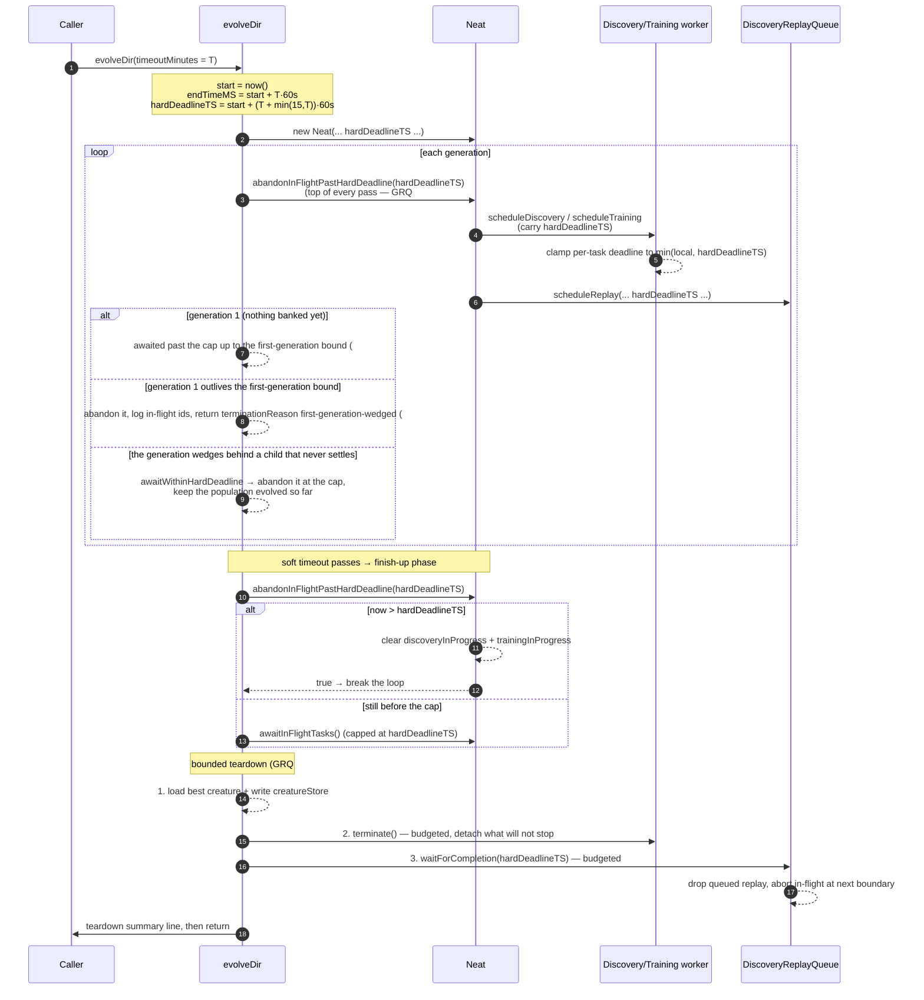
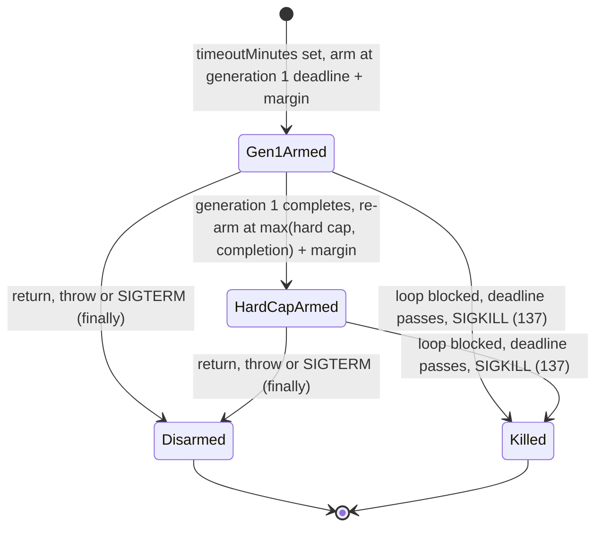

# ⏱️ Timeout Semantics — the T+15 Hard Cap

How long can an evolution run actually take? This document is the single source
of truth for the **`timeoutMinutes`** option and the **absolute hard cap** that
bounds `evolveDir` (and its siblings `evolveDataSet`, `evolveEnv`, `evolveRL`).

> [!IMPORTANT]
> **The guarantee in one line:** a run configured with `timeoutMinutes = T`
> returns within **`T + min(15, T)` minutes** of wall-clock — "T+15" for any
> `T ≥ 15` — abandoning in-flight work while keeping the best creature found so
> far. A run started with `--timeout=45` therefore finishes inside the hour,
> leaving the caller time for its normal save / model check-in.

That guarantee has exactly one carve-out.

> [!NOTE]
> **The one exception: the first generation is not abandoned at the hard cap
> (Issue #3940), but has its own larger bound (Issue #4053).** The cap bounds a
> run that is _making progress_; it is not a licence to return nothing. A run
> whose first generation is merely slower than `T + grace` completes that
> generation and returns it, because coming back with `generation === 0` leaves
> an unscored population with no winner to publish. That allowance is not
> unlimited: generation 1 is bounded by `start + (T + grace + min(60, 4 × T))`
> minutes. A generation 1 that outlives that bound never settled, so it is
> abandoned loudly
> (`[Neat] First generation wedged after Ns … in-flight: <ids>`) and `evolveDir`
> returns with `generation === 0` and
> `terminationReason: "first-generation-wedged"`. Every generation after the
> first is capped exactly as described below. `evolveEnv` and `evolveRL` apply
> the same first-generation bound and hard cap as `evolveDir` (Issue #4056);
> `evolveDataSet` delegates to `evolveDir`.

## 🧩 The deadlines

Evolution tracks wall-clock deadlines anchored at the run's start timestamp:

| Deadline                                                 | Value                                         | Role                                                                                                                                                                                                  |
| -------------------------------------------------------- | --------------------------------------------- | ----------------------------------------------------------------------------------------------------------------------------------------------------------------------------------------------------- |
| **Soft timeout** (`endTimeMS`)                           | `start + max(1, T) × 60 000 ms`               | Stops starting _new_ generations once it passes. The loop then enters the finish-up phase and waits — briefly — for in-flight discovery / training to settle so their partial results are not wasted. |
| **Over-run** (GRQ #4141)                                 | `elapsed > T × factor` (default factor `1`)   | Same generation-stop as the soft timeout, but an explicit self-termination path: the run finishes with the evolved population committed and does **not** wait for an external wall-clock cap.         |
| **Hard cap** (`hardDeadlineTS`)                          | `start + (T + grace) × 60 000 ms`             | The point of no return, **once one generation has been banked**. After that, every phase abandons in-flight work and the run returns. Nothing else is allowed to push past it.                        |
| **First-generation bound** (`firstGenerationDeadlineMS`) | `hardDeadlineTS + min(60, 4 × T) × 60 000 ms` | Bounds generation 1 only (Issue #4053). A generation 1 that merely runs late is kept past the hard cap (#3940); one that outlives this bound never settled and is abandoned loudly.                   |

The grace period is clamped:

```text
grace = min(HARD_DEADLINE_GRACE_MINUTES, max(1, T))   // HARD_DEADLINE_GRACE_MINUTES = 15
```

So the grace never exceeds 15 minutes for long runs, and stays proportionate for
short ones (a 2-minute run gets at most 2 minutes of grace, not 15). When
`timeoutMinutes` is `0`/unset there is **no** soft timeout and **no** hard cap —
the run is bounded only by `iterations`, `targetError`, `SIGTERM`, and the
external watchdog. The canonical computation lives in
[`src/NEAT/HardDeadline.ts`](../src/NEAT/HardDeadline.ts)
(`computeHardDeadlineTS`).

## 🛑 What each phase does at the hard cap

The cap is enforced cooperatively — each phase checks the absolute
`hardDeadlineTS` at its own next safe boundary and stops there. None of them
waits past it, and none of them fires until `Neat.generationsCompleted > 0`
(Issue #3940; the first-generation bound is the exception for generation 1,
Issue #4053) — `shouldAbandonInFlight` in
[`src/NEAT/HardDeadline.ts`](../src/NEAT/HardDeadline.ts) is the shared
predicate, applying the same one-generation floor
`shouldStopStartingGenerations` has always applied to the soft guard.

- **Evolve loop** — `Neat.abandonInFlightPastHardDeadline(hardDeadlineTS)` is
  the first check in the finish-up branch, and the single chokepoint the floor
  lives in. Once the cap has passed it clears `discoveryInProgress` /
  `trainingInProgress` (so the abandoned promises can never be re-awaited) and
  breaks the loop **unconditionally**, even when `finishUp()` would otherwise
  still ask for more wait generations. A stall _inside_ fitness is tracked as
  `inFlightPhase = "fitness"` so the watchdog reports `stalled in fitness`
  _while interrupting_, rather than `abandoning 0 in-flight task(s)` after the
  fact (GRQ #4141).
- **Generation loop** — the same check runs at the **top of every pass** of the
  loop, before any branch decides what to do next, so a generation that neither
  completed nor tripped the over-run predicate cannot start another one past the
  cap (GRQ #4470). The very first generation is exempt from this check, so a run
  that starts already past its cap still commits one evolved population; it is
  bounded by the first-generation bound instead (Issue #4053).
- **The generation itself** — `awaitWithinHardDeadline`
  ([`src/NEAT/HardDeadlineRace.ts`](../src/NEAT/HardDeadlineRace.ts)) bounds the
  `await neat.evolve()` itself. A discovery or training child that never settles
  can hold the resources the next generation needs; past the cap the wedged
  generation is abandoned (its late rejection swallowed), the population evolved
  so far is kept, and control returns to the caller — no hard kill (GRQ #4470).
  The abandoned generation keeps running in the background, so when its fitness
  phase returns `evolve()` checks `isRunAbandonedSince` and returns before
  anything sorts or commits `neat.population`. The result it hands back is still
  real — the champion and averages come from a sorted _copy_ of the population —
  because `evolveDir`, `evolveEnv` and `evolveRL` all race `evolve()` against
  the same deadlines and adopt that champion. The teardown's checkpoint write
  (`writeCreatures`) also iterates a snapshot of the population taken at entry,
  so the checkpoint holds every member exactly once (Issue #4052). **Generation
  1 is awaited past the hard cap, but only up to the first-generation bound**
  (Issues #3940, #4053): bounding it at the hard cap is what produced
  `keeping the 0 generation(s) already evolved`, and the per-task budgets below
  still clamp every discovery / training child to the cap, so a generation 1
  that is merely late ends on its own. One that outlives the first-generation
  bound is abandoned with `terminationReason` `"first-generation-wedged"`; its
  in-flight training tasks are cancelled (their schedule-time captures under
  `NEAT_AI_TRAINING_TASK_CAPTURE_DIR` are kept, GRQ #4794) and named in the log.
- **Over-run** — independently of the hard cap, when elapsed exceeds
  `timeoutMinutes × factor` after at least one generation, the loop stops
  starting new generations and finishes with the population committed. This is
  graceful self-termination, not the hard-deadline abandon.
- **Finish-up wait** — `Neat.awaitInFlightTasks()` caps its own timeout at the
  time remaining before `hardDeadlineTS`, measured on the evolve loop's own
  clock. A never-resolving in-flight promise can therefore never wedge the wait
  past the cap, and once the wait returns instantly the loop-top check above
  ends the run instead of spinning on it.
- **Discovery** — the absolute `discoveryHardDeadlineTS` crosses the worker
  boundary (Issue #2898), so the worker clamps every per-discovery
  record/analysis deadline to the cap regardless of how long the request waited
  in the queue. The relative phase-split allocation (record vs analysis) still
  applies _inside_ that ceiling.
- **Training** — scheduled training tasks carry the same absolute hard deadline
  (Issue #2899) and are clamped to it.
- **Discovery replay** — `DiscoveryReplayQueue.scheduleReplay()` refuses to
  start a replay once the cap has passed, and
  `waitForCompletion(hardDeadlineTS)` drops any queued replay and signals the
  in-flight one to abort cooperatively at its next candidate boundary (Issue
  #2901).
- **Post-loop teardown** — everything that happens _after_ the loop breaks is
  bounded too (GRQ #4472): see
  [the next section](#-the-post-loop-teardown-is-bounded-too-grq-4472).

In every case the **partial results already gathered are kept** and the **best
creature found so far is loaded onto the caller's creature**, `creatureStore` is
written, and the run returns its normal `{ error, score, generation, time }`
summary. The cap costs you only the _unfinished_ work, never the finished work.

## 🧹 The post-loop teardown is bounded too (GRQ #4472)

Breaking out of the generation loop on time is only half of returning control to
the caller. After the loop breaks, `evolveDir` still has to terminate every
worker, drain the background replay queue, restore the champion and write the
checkpoint — and before GRQ #4472 each of those steps could block indefinitely.
A GRQ-22 `location` child was silent for ~2.5 h, which was equally consistent
with a wedge in the teardown as with one in the loop.

[`src/creature/BoundedEvolveTeardown.ts`](../src/creature/BoundedEvolveTeardown.ts)
is the single teardown shared by `evolveDir`, `evolveEnv` and `evolveRL`. It
runs three steps, in this order (with a short naming pass between steps 2 and 3,
described after the list):

1. **Persist first.** The champion restore and the `creatureStore` write run
   _before_ anything that can block, so the evolved improvement is on disk even
   in the worst case. A failing write is logged and re-thrown — never swallowed
   — but only after the workers are down, so a failed checkpoint can neither
   hide nor leave a live pool behind.
2. **Terminate workers, on a budget.** A handler that throws, or one whose
   `terminate()` never settles, is detached and named in the log instead of
   waited on. Before this, one unguarded `terminate()` throw skipped the drain,
   the champion restore **and** the checkpoint write.
3. **Drain the replay queue, on a budget.** The queue's own cap only stops it
   starting _another_ replay, so a replay already in flight when the drain
   begins could outlive the cap entirely. The drain now ends no later than
   `max(hardDeadlineTS, now) + budget`; when it expires the in-flight replay is
   signalled to abort (`abandonInFlightReplay()`) and left running. An uncapped
   run (`timeoutMinutes` unset) keeps the unbounded Issue #1509 wait — with no
   deadline there is nothing to be late for.

Between steps 2 and 3, once the workers are down, a training or discovery task
still in flight (an interrupted SIGTERM stop breaks the loop before any abandon
runs) is logged by task ID as abandoned, and any completed result that was never
merged — including one that settled while the persist was awaiting — is logged
by task ID as discarded (Issue #4099). Neither is part of the evolved state, so
neither gates the persist. A run whose generation throws never reaches this
teardown; its failure cleanup (Issue #4072) makes the same two calls after
terminating the workers, so those tasks are named there too.

A result already merged by `evolve()` has left `trainingComplete`, so the
teardown discard above cannot see it. When the hard deadline abandons that
generation before it commits (Issue #4050), the generation's trained creatures
are dropped with it, so `evolve()` logs
`Training <id> discarded: generation abandoned past the hard deadline` once per
task (Issue #4107). Discovery and replay creatures carry no train ID and are not
named by this line.

Issue #4061 narrows what the restore step may hand back. Each entry point
(`evolveDir`, `evolveEnv`, `evolveRL`) validates the caller's creature on entry
(Issue #4078) and then snapshots it. A caller with fewer than `input + output`
neurons, or one that fails `validate()`, is rejected with a `ValidationError`
before any signal listener, worker or population is registered or built, and is
left untouched. The restore (`restoreEvolveChampion` in
[`src/creature/EvolveTeardown.ts`](../src/creature/EvolveTeardown.ts)) loads the
champion only when it is usable: at least `input + output` neurons, and
`validate()` passes. Otherwise it puts the caller's original genome back from
the snapshot, logging a warning when it rejected a champion (a run that adopted
no champion restores silently). The restore runs in the teardown's persist step
and is also attempted when the generation loop rejects, preserving the original
error. The entry snapshot is released on both success and failure. Because the
caller was validated on entry, the snapshot is always usable: the "neither copy
is usable" throw is only a backstop for a snapshot damaged after entry. It
throws and leaves the caller as it is rather than load a broken creature. A
generation abandoned past the hard deadline that finishes after the run has
moved on no longer disposes the previous population at commit; it logs a warning
instead, because that population can still hold the caller's creature.

Issue #4072 covers the failure path, which the teardown above does not. Each
entry point's outer `finally` removes its SIGTERM listener on every exit, and
`evolveEnv` and `evolveRL` also remove their abort listener, so a run that
throws no longer swallows a supervisor's SIGTERM. When the run fails before the
success path's teardown has completed, that `finally` also terminates the
`WorkerHandler`s (`evolveDir`) or the `EpisodeWorkerPool` (`evolveRL`, when one
was created), names the tasks the run leaves behind
(`abandonInFlightAtTeardown()` for those in flight, then
`discardUnprocessedResults()` for results queued but never merged), disposes the
population except the caller's creature, disposes the champion and releases the
process-global evolve caches. `evolveEnv` creates no workers. Each of those
cleanup steps is isolated: an error is logged and never replaces the error that
caused the failure, which still propagates to the caller. The Issue #4061
restore still runs first, before the population is disposed. The success and
failure paths release the same resources; the failure path differs only in
running that release when the success teardown has not completed.

The budget defaults to `DEFAULT_TEARDOWN_STEP_BUDGET_MS` (5 s) per step. The
teardown always emits **one summary line** naming what it left behind, so the
gap between a child's last log line and its exit is diagnosable rather than
silence:

```text
[evolveDir] teardown complete: 3 worker(s) terminated, 1 detached; replay queue
abandoned still-running — the process may stay alive until the detached work ends
```

> [!WARNING]
> **A bounded teardown makes `evolveDir` _return_ on time; it cannot make the
> Deno process _exit_ on time.** A worker wedged inside a synchronous native /
> WASM call never yields to its event loop, so `Worker.terminate()` returns
> immediately on the main thread but the worker thread is never reaped and the
> runtime will not exit. Measured directly on Deno 2.x: a main module that
> spawns a worker running `while (true) {}`, calls `terminate()` and then falls
> off the end **never exits** (killed at a 20 s timeout); the same program with
> a final `Deno.exit(0)` exits immediately.
>
> So a caller that must guarantee its own exit — GRQ's `location` children, for
> example — has to call `Deno.exit()` after `evolveDir` resolves rather than
> rely on natural exit. The teardown's warning line is the signal that this
> matters for a given run: it fires exactly when something was detached.

## 🤝 Cooperative return vs. forced abandon (Issue #3166)

A task asked to stop should **return on its own** within a small bounded grace
window — a _forced abandon_ is the failure mode, not the design. Two behaviours
keep the "Abandoning stuck training task(s)" force-cleanup path from firing in
normal runs:

- **A bounded grace cycle before force-abandon.** When the soft timeout passes,
  a worker that has hit its own per-task deadline has already returned
  cooperatively — but its result-handling callback (which removes the task from
  `trainingInProgress` / `discoveryInProgress`) runs as a microtask on the next
  finish-up cycle. `Neat.finishUp()` now grants **one** grace cycle after the
  wall-clock deadline passes, during which `awaitInFlightTasks()` drains those
  settled promises, so a cooperatively-returning task removes itself instead of
  being mislabelled "stuck" and force-abandoned the instant the deadline passes.
  Genuinely stuck tasks (whose promise never settles) are still abandoned — by
  the per-task stuck-task watchdog (`abandonStuckTrainingTasks`, Issue #3053)
  and, as a final backstop, on the next cycle after the grace — so the run
  always finalizes within a bounded window.
- **Sub-second training budgets are rejected, not silently run.**
  `scheduleTraining` computes each task's effective budget
  (`min(relative budget, hardDeadlineTS) − now`) up front. When that budget is
  below `MIN_TRAINING_BUDGET_MS` (1 s) the task is **skipped and flagged** with
  a warning rather than dispatched to a worker that could only "time out" in
  milliseconds. This surfaces mis-scaled budgets (the GRQ-16 run saw 16–93 ms
  budgets) and stops burning a worker slot near the hard deadline on a no-op.
  The pure helpers `computeEffectiveTrainingBudgetMs` and
  `isTrainingBudgetTooSmall` live in
  [`src/NEAT/PerTaskTrainingTimeout.ts`](../src/NEAT/PerTaskTrainingTimeout.ts).

## 🧟 Abandoning a task means cancelling it (GRQ #4489)

Abandoning used to mean _forgetting_: the watchdog dropped the UUID from
`trainingInProgress` / `trainingDeadlines` and the worker request stayed in
flight, unsettled, for the rest of the run. Nothing else could settle it — the
worker was the only thing that could answer, and a wedged worker never does. On
the GRQ fleet that produced runs of `scheduled=12 completed=0` where every task
reported `outcome=abandoned … reason=watchdog-abandoned` with no error, no
timing and no partial result, and the same wedged worker was then handed the
next creature.

Every abandon path now settles the work as well as the bookkeeping:

- `WorkerHandler.trainTracked()` returns the dispatched `taskID` alongside the
  response promise, so the task is addressable.
- `Neat.trainingTasks` maps each in-flight creature UUID to that
  `{ worker, taskID }` handle.
- `abandonStuckTrainingTasks`, the finish-up "Training timeout reached" clear
  and `abandonInFlightPastHardDeadline` all call `WorkerHandlerBase.cancelTask`,
  which rejects the task promise with a
  [`WorkerTaskCancelledError`](../src/workers/WorkerTaskCancelledError.ts)
  naming the task, the worker, the elapsed time and the reason. NEAT's normal
  training-failure path reports it per task.
- A worker that missed its own per-task deadline is **quarantined**: it is
  marked unhealthy (skipped by `WorkerPool` selection) and terminated, because
  handing a wedged isolate the next creature just buys another stuck task.
- A worker `error` / `messageerror` event _after_ init no longer vanishes; it
  fails that worker's in-flight tasks with the crash as the cause and
  quarantines it.
- When every selectable worker is busy, `WorkerPool` selection now picks the
  worker with the least in-flight load (queue size plus `getPendingTaskCount()`,
  ties to the first) instead of ranking an always-empty queue.
  `scheduleTraining` and `scheduleDiscovery` therefore spread extra tasks across
  the heavy workers rather than piling them onto the first one (Issue #4095).
- A labelled task (a training or discovery task, labelled with the creature uuid
  passed to `trainTracked` / `discover`) that fails because its worker was
  quarantined now carries its **own** label in its `WorkerTaskCancelledError`
  reason, and says it was queued on the quarantined worker. It no longer repeats
  the culprit task's reason. Other request kinds (evaluate, score, ...) are
  unlabelled and keep the quarantine reason unchanged. The task that actually
  missed its deadline keeps its own reason.

A response that arrives after its task was cancelled is logged and discarded —
never asserted on, since an assertion inside the worker's message listener would
escape as an uncaught error.

## 🔀 How the deadline propagates



The data flow, in one line:

```text
evolveDir → Neat.hardDeadlineTS → scheduleDiscovery / scheduleTraining / replay queue → worker clamps
```

## 🛰️ The external watchdog is unchanged

The T+15 hard cap is an **in-process** guarantee. The external watchdog — for
example GRQ's 3-hour `max-task-hours` — remains the independent backstop and is
**unchanged** by any of this. The cap exists so that, in the normal case, a run
finishes and checks its model in _well before_ the watchdog ever has to fire;
the watchdog only catches pathological situations (a wedged process, a deadlock
outside the cooperative checkpoints) that an in-process deadline cannot reach.

Like every in-process bound, the cap only fires while the run's main event loop
yields. The subsection below explains what that means for a caller and how to
bound each run from outside the process.

### 🧱 The event-loop limit and the caller-side per-loop kill (Issue #4068)

**Why the in-process bounds cannot always fire.** The T+15 cap, generation 1's
bound and the bounded teardown all run on the run's main event loop.
`awaitWithinHardDeadline` in
[`src/NEAT/HardDeadlineRace.ts`](../src/NEAT/HardDeadlineRace.ts) polls its
deadline with `setInterval` on that loop, and a timer callback runs only when
the loop is free. If the main thread is blocked in a synchronous loop, or the V8
heap is thrashing in garbage collection, the poll never runs, and the run
outlives every in-process bound. A loop that never yields is the #4060 failure
mode: loop-2 runs at T = 4 and T = 5 went silent for about two hours against a
24- or 30-minute first-generation bound, until the caller's stale window ended
them. The code that blocked the loop there is not yet identified; the Issue
#4069 reproduction
[excluded GC thrash](troubleshooting/MEMORY.md#-silent-single-worker-generation-gc-thrash-excluded-issue-4069).
The [event-loop watchdog](#-the-event-loop-watchdog-primitive-issue-4066)
(#4066, armed by #4067) keeps its deadline in a Worker, which has its own event
loop and its own timer. At breach it writes one stderr line and SIGKILLs the
whole process.

**Recognising the watchdog kill.** A run the watchdog ends exits with status
**137** (128 + `SIGKILL`) and returns no `terminationReason`. The stderr line
just before the exit says which bound was breached:

| Exit | stderr line contains                                             | What happened                                                                 | Report it as                                    |
| ---- | ---------------------------------------------------------------- | ----------------------------------------------------------------------------- | ----------------------------------------------- |
| 137  | `First generation wedged after <s>s … — first-generation-wedged` | Generation 1 was still running (generation counter 0) past its bound + margin | `first-generation-wedged`                       |
| 137  | `Run wedged after <s>s at generation <n>`                        | `<n>` generations had completed and the run was past its re-armed deadline    | a wedge past the hard cap                       |
| 137  | neither line                                                     | A `SIGKILL` from elsewhere: the caller's own kill, the OOM killer, a host cap | whatever the caller's own records say killed it |

Neither breach line is a generic crash or an out-of-memory kill. Report exit 137
plus the first line as `first-generation-wedged`, and exit 137 plus the second
line as a wedge. When the loop does yield, the in-process bound fires first,
because the watchdog deadline is that bound plus the margin (for the re-armed
watchdog, the bound is the later of the hard cap and the moment generation 1
completes). The run then returns normally with `terminationReason` set, and
there is no exit 137. A `SIGKILL` skips in-process cleanup (checkpoint flush and
SIGTERM teardown), so a run killed this way has persisted only what it had
already written.

**The caller-side per-loop hard kill.** As defence in depth, a caller that
launches one `evolve*` run per loop (for example GRQ's `worker/sampler.sh`)
should enforce its own hard kill on each loop. It also covers two cases the
in-process watchdog does not. One is a Worker that cannot load: the run then
logs `[Neat] event-loop watchdog unavailable: …` and only the in-process bound
applies. The other is a run with no `timeoutMinutes`, for which nothing is
armed. For a loop launched with `timeoutMinutes` = T, kill it at:

```text
start + T + min(15, max(1, T)) + min(60, 4×T) + margin   (minutes)
```

| Term                 | Source                                                                                                                                           |
| -------------------- | ------------------------------------------------------------------------------------------------------------------------------------------------ |
| `T`                  | The soft timeout, `timeoutMinutes`                                                                                                               |
| `min(15, max(1, T))` | The grace clamp in `computeHardDeadlineTS` (`HARD_DEADLINE_GRACE_MINUTES`); `start + T + grace` is the hard cap                                  |
| `min(60, 4×T)`       | Generation 1's extra allowance in `computeFirstGenerationDeadlineTS` (`FIRST_GENERATION_MAX_EXTRA_MINUTES`, `FIRST_GENERATION_TIMEOUT_MULTIPLE`) |
| `margin`             | At least `DEFAULT_WATCHDOG_MARGIN_MS`, 5 minutes, the margin the in-process watchdog adds                                                        |

These constants and helpers all live in
[`src/NEAT/HardDeadline.ts`](../src/NEAT/HardDeadline.ts). Worked example, T = 6
with a 5-minute margin: the hard cap is 6 + 6 = 12 minutes, the first-generation
bound is 12 + min(60, 24) = 36 minutes, and the per-loop kill lands at 36 + 5 =
**41 minutes** after `start`. Once generation 1 completes, the in-process
watchdog re-arms at max(hard cap, the moment generation 1 completes) + margin.
For T = 6 that is 17 minutes only when generation 1 finishes within 12 minutes;
otherwise it is 5 minutes after generation 1 completes (generation 1 finishing
at minute 20 re-arms to minute 25, and its breach line reads
`Run wedged after 1500s`). The 41-minute kill still bounds every loop in which
generation 1 completes by minute 36, its own bound. The in-process watchdog
measures from the start `evolve*` itself records, which comes after the process
launches. A caller that measures `start` from the launch should therefore round
the margin up to cover start-up. That way the in-process watchdog fires first
and its breach line is printed. That holds for a generation 1 that completes
within its bound. A generation 1 that completes later (a blocked loop that
unblocks between minute 36 and minute 41) re-arms the watchdog as late as minute
46, after the caller's 41-minute kill, so the caller's kill fires first and no
breach line is printed.

## 🐕 The event-loop watchdog primitive (Issue #4066)

The in-process bounds above all run on the run's own event loop:
`awaitWithinHardDeadline` polls with `setInterval`, and the others are checks
the loop reaches between steps. A main thread blocked in a synchronous loop, or
a V8 heap thrashing in garbage collection, silences them exactly when they are
needed (#4060). `armEventLoopWatchdog` in
[`src/NEAT/EventLoopWatchdog.ts`](../src/NEAT/EventLoopWatchdog.ts) runs the
deadline in a Worker instead. At breach it writes the breach line to stderr and
sends `SIGKILL` to the process, which exits with status 137. The line ends with
three heartbeat fields that say how long the main thread had been silent (see
[Main-thread heartbeat and reading a breach line](#main-thread-heartbeat-and-reading-a-breach-line-issue-4096)).
`SIGKILL` is used because `SIGTERM` is swallowed by the listeners the training
entry points register, and `Deno.exit` from a Worker ends only that Worker. A
`{generation}` token in the breach line is replaced with the last generation the
run recorded. If the Worker cannot load, the primitive logs
`[Neat] event-loop watchdog unavailable: ...` and only the in-process bound
applies.

### Armed by the training entry points (Issue #4067)

When `timeoutMinutes` is set, `evolveDir`, `evolveEnv` and `evolveRL` arm the
watchdog through `armRunWatchdog` in
[`src/creature/EvolveRunWatchdog.ts`](../src/creature/EvolveRunWatchdog.ts), at
the start of the main try block and before the population is seeded. With no
`timeoutMinutes` nothing is armed.

- **Generation 1.** The deadline is
  `Date.now() + max(0, firstGenerationDeadlineMS - now()) + margin`, where
  `now()` is the run's clock. An injected start in the past therefore cannot
  schedule a kill before the margin. The helper is
  `computeWatchdogDeadlineEpochMS` and the default margin is
  `DEFAULT_WATCHDOG_MARGIN_MS` (5 minutes, which covers the bounded teardown);
  both live in [`src/NEAT/HardDeadline.ts`](../src/NEAT/HardDeadline.ts).
- **After generation 1 completes** the watchdog is re-armed using the same
  formula with `hardDeadlineMS`. Because `max(0, hardDeadlineMS - now())` is
  zero once the hard cap has passed, the deadline is max(hard cap, the moment
  generation 1 completes) + margin: the hard cap + margin when generation 1
  finishes before the cap, otherwise the margin after generation 1 completes.
  The generation counter is updated after every completed generation.
- **Disarm.** A `finally` disarms the watchdog, so a normal return, a thrown
  error and the SIGTERM path all release it.
- **Breach.** At the scheduled deadline the watchdog writes one stderr line,
  then SIGKILLs the process, which exits with status 137. `<s>` is the run's
  elapsed seconds at the breach. The three trailing heartbeat fields
  (`lastHeartbeatAgeMs=<ms> inFlightPhase=<phase> heartbeatIntervalMS=<ms>`) are
  appended to the end of the line; the text before them is unchanged:
  - during generation 1:
    `[Neat] First generation wedged after <s>s (event loop blocked past the first-generation bound; watchdog killing the process) — first-generation-wedged lastHeartbeatAgeMs=<ms> inFlightPhase=<phase> heartbeatIntervalMS=<ms>`
  - later:
    `[Neat] Run wedged after <s>s at generation <n> (event loop blocked past the hard cap; watchdog killing the process) lastHeartbeatAgeMs=<ms> inFlightPhase=<phase> heartbeatIntervalMS=<ms>`,
    where `<n>` is the number of generations completed.



A blocked main thread cannot return
`terminationReason: "first-generation-wedged"`, so on this path the caller sees
exit 137 and the stderr line only. When the loop does yield, the in-process
bound fires first, because the watchdog deadline is that bound plus the margin,
and it returns `terminationReason` exactly as before. SIGKILL skips in-process
cleanup (checkpoint flush and SIGTERM teardown). That is accepted for a
last-resort bound.

### Main-thread heartbeat and reading a breach line (Issue #4096)

A breach line says that a deadline passed. On its own it does not say whether
the main thread was blocked or only over budget. The heartbeat is the
measurement that tells the two apart.

- **Written by the main thread.** The main thread writes the epoch-ms of its
  latest timer tick into a `SharedArrayBuffer` every `heartbeatIntervalMS`, and
  once at arm. The default is `DEFAULT_HEARTBEAT_INTERVAL_MS` (1000 ms), set
  with the `heartbeatIntervalMS` option on `armEventLoopWatchdog`. The timer is
  unreferenced, so it never keeps the process alive, and `disarm()` clears it.
- **Read at breach.** The Worker reads the buffer when the deadline passes.
  `lastHeartbeatAgeMs` is the time since the main thread's latest tick.
- **`inFlightPhase`** is the phase the main thread most recently entered: one of
  `untracked` (outside any tracked phase, for example checkpoint or bookkeeping
  between generations), `fitness`, `sort`, `write-scores`, `breeding`,
  `mutation`, `pre-warm` or `deduplication`. `NeatEvolution` sets it per
  generation through `neat.markPhase`, and `RunWatchdog.setPhase` forwards it. A
  marker is cleared back to `untracked` when its work returns, so spans between
  tracked phases (speciation, pre-selection, population assembly) read
  `untracked`. Dedup and write-scores can overlap other work in time, so the
  field names the most recently entered phase, not necessarily the one that is
  stuck. The list is `EVENT_LOOP_WATCHDOG_PHASES` in
  [`src/NEAT/EventLoopWatchdog.ts`](../src/NEAT/EventLoopWatchdog.ts).
- **`heartbeatIntervalMS`** is the interval in force, so the age can be read
  against it.

Read `lastHeartbeatAgeMs` against `heartbeatIntervalMS`:

| Age against the interval   | What it means                                                                                                                          |
| -------------------------- | -------------------------------------------------------------------------------------------------------------------------------------- |
| About one interval or less | The main event loop was alive and servicing timers. The run was over budget: slow, not wedged.                                         |
| Far above the interval     | The main event loop was not servicing timers for about `lastHeartbeatAgeMs`. It was blocked for roughly that long, in `inFlightPhase`. |

A reading between these two is not classified; treat it as inconclusive. Both
readings are measurements of timer behaviour. The parenthetical in the breach
line, such as `(event loop blocked past the hard cap; …)`, describes the
condition the deadline was set to catch. It is fixed wording, not a measurement,
so decide from the trailing fields.

A worked example, with the values made concrete:

```text
[Neat] Run wedged after 1834s at generation 4 (event loop blocked past the hard cap; watchdog killing the process) lastHeartbeatAgeMs=312044 inFlightPhase=fitness heartbeatIntervalMS=1000
```

Read this as: the main thread had not ticked for about 312 s, and it was last in
`fitness`. The kill happens whatever the age; the field changes the diagnosis,
not the action.

Callers that treat exit 137 plus the breach line as a wedge should read
`lastHeartbeatAgeMs` first. A large age supports the wedge reading and points at
`inFlightPhase`. An age near `heartbeatIntervalMS` means the process was alive
and was killed for overrunning its budget, so it is a slow run, not a wedge.

## ✅ Verifying the guarantee

The end-to-end guard
[`test/creature/EvolveDirHardDeadline.ts`](../test/creature/EvolveDirHardDeadline.ts)
drives `evolveDir` with a tiny `timeoutMinutes` and stubbed never-resolving
discovery / training work, with the cap placed in the past via an injected start
timestamp (so the assertions are behavioural, never elapsed-time measurements —
the policy from Issue #2888). It asserts the run **returns**, the best creature
is loaded onto the caller's creature, `creatureStore` is written and loadable,
and the in-flight maps are empty. Its sibling
[`test/creature/EvolveDirFirstGenerationHardDeadline.ts`](../test/creature/EvolveDirFirstGenerationHardDeadline.ts)
drives the opposite case for Issue #3940 — the cap passing _during_ generation 1
but before the first-generation bound — and asserts the run still returns a
scored generation with a champion in `creatureStore`; the floor itself is
unit-covered in
[`test/NEAT/HardDeadlineFirstGeneration.ts`](../test/NEAT/HardDeadlineFirstGeneration.ts).
`test/creature/EvolveDirFirstGenerationWedged.ts` drives a generation 1 that
never settles with `timeoutMinutes` 5 and asserts `evolveDir` returns with
`first-generation-wedged` once the bound passes; the bound itself is
unit-covered in `test/NEAT/HardDeadline.ts`.
[`test/creature/EvolveEnvHardDeadline_test.ts`](../test/creature/EvolveEnvHardDeadline_test.ts)
and
[`test/creature/EvolveRLHardDeadline_test.ts`](../test/creature/EvolveRLHardDeadline_test.ts)
drive the same cases through `evolveEnv` and `evolveRL` (Issue #4056). The
replay-queue hard-cap bound has dedicated coverage in
[`test/NEAT/DiscoveryReplayQueueDeadline.ts`](../test/NEAT/DiscoveryReplayQueueDeadline.ts).

The bounded teardown has its own two layers:
[`test/creature/BoundedEvolveTeardown.ts`](../test/creature/BoundedEvolveTeardown.ts)
unit-covers each branch with an injected clock, and
[`test/creature/EvolveDirBoundedTeardown.ts`](../test/creature/EvolveDirBoundedTeardown.ts)
drives `evolveDir` end to end with a worker whose `terminate()` never resolves,
one whose `terminate()` throws, and a replay drain that never settles —
asserting in every case that the run returns and the champion still reaches
`creatureStore`.

The off-main-thread primitive is covered by
[`test/NEAT/EventLoopWatchdog_test.ts`](../test/NEAT/EventLoopWatchdog_test.ts)
(Issue #4066). Its subprocess tests run each case in its own `deno run` child. A
child whose main thread spins in a synchronous loop and swallows `SIGTERM` exits
137 with the breach line on stderr. When no generation was set, the breach line
names `unknown`. After `disarm()` the child exits 0 without the line. A Worker
that cannot load (no read permission), or whose constructor throws, logs
`event-loop watchdog unavailable` and leaves only the in-process bound, so the
child exits 0; the no-read-permission case also checks that the breach line is
absent.

The arming by the training entry points (Issue #4067) is covered by
[`test/creature/EvolveFirstGenerationBusyLoop_test.ts`](../test/creature/EvolveFirstGenerationBusyLoop_test.ts),
which runs each entry point in a subprocess with a generation 1 that spins in a
synchronous loop and asserts exit 137 with the first-generation stderr line.
[`test/NEAT/HardDeadlineWatchdog_test.ts`](../test/NEAT/HardDeadlineWatchdog_test.ts)
pins the deadline arithmetic,
[`test/creature/EvolveRunWatchdog_test.ts`](../test/creature/EvolveRunWatchdog_test.ts)
covers arm, re-arm and disarm, and
[`test/creature/EvolveWatchdogWiring_test.ts`](../test/creature/EvolveWatchdogWiring_test.ts)
checks that each entry point arms, re-arms and disarms, including on error.

## 🔗 Related

- [`src/NEAT/HardDeadline.ts`](../src/NEAT/HardDeadline.ts) — the pure
  `computeHardDeadlineTS` helper, `HARD_DEADLINE_GRACE_MINUTES`, the abandon
  predicate `shouldAbandonInFlight`, and the over-run helpers
  (`hasTrainingOverrun`, `shouldStopStartingGenerations`).
- [`src/discovery/DiscoveryTimeout.ts`](../src/discovery/DiscoveryTimeout.ts) —
  `remainingTaskBudgetMinutes` honours `GRQ_TASK_DEADLINE_EPOCH` /
  `GRQ_TASK_MAX_SECONDS` when GRQ's `run_core.sh` exported them, and
  `resolveWallClockBudgetMinutes` applies it as a **clamp only**
  (`min(timeOutMinutes, envBudgetMinutes ?? timeOutMinutes)`, GRQ #4471): the
  env budget may shorten a discovery plan, never widen one past the
  `timeoutMinutes` the caller asked for.
- [CONFIGURATION_GUIDE.md](CONFIGURATION_GUIDE.md) — the full configuration
  surface, including `timeoutMinutes`.
- [TROUBLESHOOTING.md](TROUBLESHOOTING.md) — what to do when a run does not stop
  when you expect it to.
