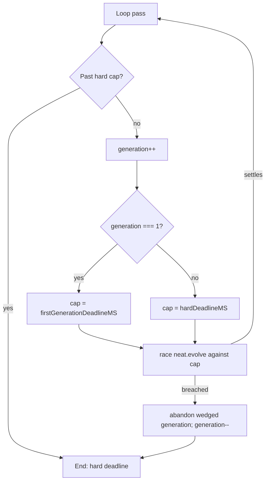

# evolveEnv and evolveRL: bound `neat.evolve()` by the hard deadline

## Summary

Closes #4056.

`evolveEnv` and `evolveRL` awaited `neat.evolve()` with no deadline bound, so a
wedged generation outlived `timeoutMinutes` forever. Both now follow
`evolveDir`: the hard cap is checked at the top of each pass, `neat.evolve()` is
raced against the deadline, generation 1 is bounded by
`firstGenerationDeadlineMS` and later generations by `hardDeadlineMS`.

## Spec

### Intent and Rationale

`docs/TIMEOUTS.md` promises that a run ends within the hard deadline. That held
for `evolveDir` only (Issues #4053 and GRQ-AutoTrader #4470). The other two
evolve loops computed `firstGenerationDeadlineMS` but never used it, so a
generation that never settled hung the caller indefinitely.

### Essential Design Decisions

- Reuse the `evolveDir` primitives (`awaitWithinHardDeadline`,
  `abandonWedgedFirstGeneration`, `abandonWedgedGeneration`,
  `abandonInFlightPastHardDeadline`) rather than a second implementation.
- The cap is `firstGenerationDeadlineMS` for the first generation and
  `hardDeadlineMS` afterwards.
- `evolveEnv` and `evolveRL` increment the counter before `evolve`, so their
  first generation is `generation === 1` (`evolveDir` uses 0). On a breach the
  counter is decremented so the abandoned generation is not counted as kept.
- `evolveRL` also drains `rlFitness.consumeGenerationStatistics()` on a breach
  so the abandoned generation's statistics do not leak into the next call.

### Undiscoverable Facts

- Generation numbering differs between `evolveDir` (0-based) and these two loops
  (1-based); copying the `evolveDir` condition verbatim would bound the wrong
  generation.
- The test seam is an optional `deps?: EvolveDirDeps` parameter on both
  functions (injected clock, `onNeatReady`, enforcement factor, teardown
  budget), mirroring `evolveDir`.

## Evidence

Tests (all 8 red before the fix, green after):

```text
deno test -A test/creature/EvolveEnvHardDeadline.ts test/creature/EvolveRLHardDeadline.ts
ok | 8 passed | 0 failed
```



Related issues: #4056 (this), #4053 (evolveDir first-generation bound),
GRQ-AutoTrader #4470 (hard-deadline race).

Docs sweep: grepped `timeoutMinutes`, `hard deadline`,
`first-generation-wedged`, `evolveEnv`, `evolveRL`. Updated `docs/TIMEOUTS.md`
(evolveEnv and evolveRL now share the evolveDir behaviour). Hits still true:
`docs/TIMEOUTS.md:5,17-31,94,146`, `docs/EVOLUTION_CONTROL.md:27,41,68`,
`docs/TRAINING_GAIN_LOG.md:85`, `src/creature/CreatureTraining.ts` doc comments
near 871-876 and 1305-1310. `docs/REINFORCEMENT_LEARNING.md` makes no deadline
claims.

## Acceptance Criteria

<!-- vibe-spec-review inputs="diff+issue-body" -->

- **met** — Check the hard cap (`abandonInFlightPastHardDeadline`) at the top of
  each loop pass in `evolveEnv` and `evolveRL` — evidence:
  src/creature/CreatureTraining.ts:1011, src/creature/CreatureTraining.ts:1557 —
  reviewer: met
- **met** — Race `neat.evolve()` with `awaitWithinHardDeadline` — evidence:
  src/creature/CreatureTraining.ts:1062, src/creature/CreatureTraining.ts:1616 —
  reviewer: met
- **met** — Bound generation 1 by `firstGenerationDeadlineMS` and use
  `abandonWedgedFirstGeneration` — evidence:
  src/creature/CreatureTraining.ts:1044, src/creature/CreatureTraining.ts:1054,
  src/creature/CreatureTraining.ts:1598, src/creature/CreatureTraining.ts:1608 —
  reviewer: met
- **met** — Bound later generations by `hardDeadlineMS` and use
  `abandonWedgedGeneration` — evidence: src/creature/CreatureTraining.ts:1055,
  src/creature/CreatureTraining.ts:1609 — reviewer: met
- **met** — Injected-clock regression tests where `neat.evolve()` never settles
  — evidence: test/creature/EvolveEnvHardDeadline.ts,
  test/creature/EvolveRLHardDeadline.ts — reviewer: met
- **unrequested** — Optional `deps?: EvolveDirDeps` parameter on `evolveEnv` and
  `evolveRL` — evidence: src/creature/CreatureTraining.ts — reviewer:
  unrequested — reason: the injected clock needs a seam; it mirrors
  `evolveDir`'s existing seam and is optional, so default behaviour is
  unchanged.

## Standards Review

<!-- vibe-standards-review inputs="diff+CODING-STANDARDS.md" -->

Clean: no material departures. The repository has no `CODING-STANDARDS.md`;
`AGENTS.md` was used as the standard (Australian English, logger via
`getLogger()`, no timing APIs in tests, unit tests under `test/`).

## Test Plan

- `test/creature/EvolveEnvHardDeadline.ts` and
  `test/creature/EvolveRLHardDeadline.ts`, four tests each: a first generation
  that never settles ends at its bound; a later generation that never settles
  ends at the hard cap; the top-of-loop hard cap stops before a second
  generation; a first generation slower than the hard cap is not abandoned at
  the hard cap. 8/8 passed. No assertions removed.
- `./quality.sh --lint-only` and `--check-only` pass. The full `./quality.sh`
  fails in this environment with "Native rust_scorer is required (quality.sh
  default) but was not found"; this is an environment limitation, not a pass.

<!-- vibe-quality-gate-skipped reason="native rust_scorer unavailable in this environment; lint and type-check passed, 8/8 targeted tests passed" -->

Branch outcomes:

- src/creature/CreatureTraining.ts:1011 — evolveEnv hard cap reached at top of
  loop → stops; test/creature/EvolveEnvHardDeadline.ts "the top-of-loop hard cap
  stops before a second generation"; flipping went red.
- src/creature/CreatureTraining.ts:1044 — evolveEnv generation 1 uses the
  first-generation bound; "a first generation that never settles ends at its
  bound" and "a first generation slower than the hard cap is not abandoned at
  the hard cap"; flipping went red.
- src/creature/CreatureTraining.ts:1044 — evolveEnv later generation uses the
  hard cap; "a later generation that never settles ends at the hard cap";
  flipping went red.
- src/creature/CreatureTraining.ts:1062 — evolveEnv breach → `generation--` and
  break; the two never-settles tests; flipping went red.
- src/creature/CreatureTraining.ts:1557 — evolveRL hard cap at top of loop →
  stops; test/creature/EvolveRLHardDeadline.ts "the top-of-loop hard cap stops
  before a second generation"; flipping went red.
- src/creature/CreatureTraining.ts:1598 — evolveRL generation 1 first-generation
  bound / later generation hard cap; the corresponding EvolveRL tests; flipping
  went red.
- src/creature/CreatureTraining.ts:1616 — evolveRL breach → `generation--`,
  break; the two never-settles tests; flipping went red.
- src/creature/CreatureTraining.ts:1620 — evolveRL drains
  `rlFitness.consumeGenerationStatistics()` on breach; exempt (untestable): the
  drained value is discarded and not observable through the public API.
