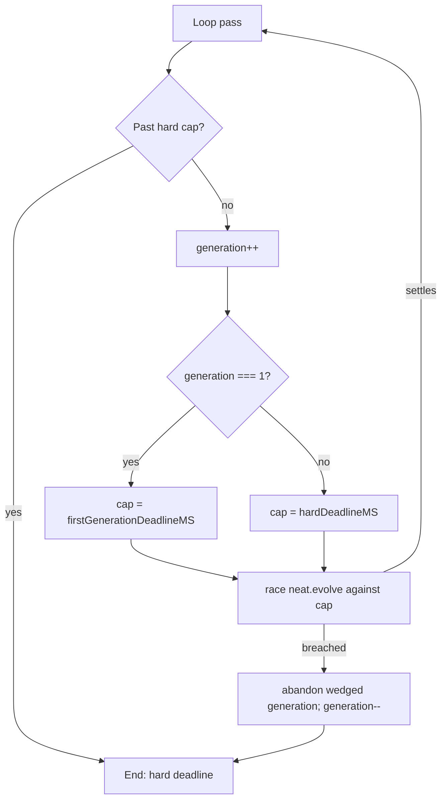

# evolveEnv and evolveRL: bound `neat.evolve()` by the hard deadline

## Summary

Closes #4056.

`evolveEnv` and `evolveRL` awaited `neat.evolve()` with no deadline bound, so a
wedged generation outlived `timeoutMinutes` forever. Both now follow
`evolveDir`: the hard cap is checked at the top of each pass, `neat.evolve()` is
raced against the deadline, generation 1 is bounded by
`firstGenerationDeadlineMS` and later generations by `hardDeadlineMS`.

## Spec

### Intent and Rationale

`docs/TIMEOUTS.md` promises that a run ends within the hard deadline. That held
for `evolveDir` only (Issues #4053 and GRQ-AutoTrader #4470). On `Develop`, only
`evolveDir` computes `firstGenerationDeadlineMS` and races `neat.evolve()`
against the deadlines. `evolveEnv` and `evolveRL` computed only
`hardDeadlineMS`, checked it only in the finish-up branch, and awaited
`neat.evolve()` directly, so a generation that never settled hung the caller
indefinitely. This branch adds the `firstGenerationDeadlineMS` computation, the
top-of-loop check and the race to both functions.

### Essential Design Decisions

- Reuse the `evolveDir` primitives (`awaitWithinHardDeadline`,
  `abandonWedgedFirstGeneration`, `abandonWedgedGeneration`,
  `abandonInFlightPastHardDeadline`) rather than a second implementation.
- The cap is `firstGenerationDeadlineMS` for the first generation and
  `hardDeadlineMS` afterwards.
- `evolveEnv` and `evolveRL` increment the counter before `evolve`, so their
  first generation is `generation === 1` (`evolveDir` uses 0). On a breach the
  counter is decremented so the abandoned generation is not counted as kept.
- `evolveRL` consumes each kept generation's `rlFitness` statistics into a
  `lastGenerationStats` snapshot once the generation settles, and both the
  scheduled and the synthetic final milestone read that snapshot. The abandoned
  generation's `beginGenerationStatistics()` reset therefore cannot erase the
  last kept generation's statistics (PR #4059 review: the terminal milestone
  reported `meanEpisodeSteps` 0).

### Undiscoverable Facts

- Generation numbering differs between `evolveDir` (0-based) and these two loops
  (1-based); copying the `evolveDir` condition verbatim would bound the wrong
  generation.
- The test seam is an optional `deps?: EvolveDirDeps` parameter on both
  functions (injected clock, `onNeatReady`, enforcement factor, teardown
  budget), mirroring `evolveDir`.
- The test files are named `*_test.ts` (Deno's default test-name pattern, as in
  `test/creature/EvolveRLStatistics_test.ts`) and import `evolveEnv` /
  `evolveRL` by relative path (`../../src/creature/CreatureTraining.ts`). Under
  the old names, importing through the `@creature/` alias, the mutation check
  reported "no test imports this module" for both `CreatureTraining.ts` and the
  test files.

## Evidence

Tests (the original 8 were red before the fix; all 13 green after):

```text
deno test -A test/creature/EvolveEnvHardDeadline_test.ts test/creature/EvolveRLHardDeadline_test.ts
ok | 13 passed | 0 failed
```

Mutation check, re-run by hand on every `CreatureTraining.ts` line the gate
listed (`deno test --no-check` on the two files, one mutant at a time); each
went red:

| Line | Mutant                                             | Result                |
| ---- | -------------------------------------------------- | --------------------- |
| 1025 | delete `requestOverrunStop(neat, overrunFactor)`   | 1 failed (over-run)   |
| 1062 | negate `outcome === HARD_DEADLINE_BREACHED`        | 6 failed              |
| 1129 | negate finish-up `abandonInFlightPastHardDeadline` | 1 failed (completed)  |
| 1583 | delete `requestOverrunStop(neat, overrunFactor)`   | 1 failed (over-run)   |
| 1628 | negate `outcome === HARD_DEADLINE_BREACHED`        | 7 failed              |
| 1678 | delete `lastGenerationStats = generationStats`     | 1 failed (statistics) |
| 1744 | negate finish-up `abandonInFlightPastHardDeadline` | 1 failed (completed)  |

The listed `test/creature/EvolveEnvHardDeadline.ts` mutants mutate the test file
itself; the gate ran no test against them ("no test imports this module"). The
file is now `EvolveEnvHardDeadline_test.ts` (likewise
`EvolveRLHardDeadline_test.ts`), named as a test.



Related issues: #4056 (this), #4053 (evolveDir first-generation bound),
GRQ-AutoTrader #4470 (hard-deadline race).

**Docs sweep** — grep: `timeoutMinutes`, `hard deadline`,
`first-generation-wedged`, `firstGenerationDeadlineMS`, `evolveEnv`, `evolveRL`,
"await `evolve()` directly"; section:
`docs/TIMEOUTS.md#-what-each-phase-does-at-the-hard-cap`; updated:
`docs/TIMEOUTS.md`

Read through `docs/TIMEOUTS.md` (the opening note,
`#-what-each-phase-does-at-the-hard-cap` and `#-verifying-the-guarantee`). The
sentence saying `evolveEnv` and `evolveRL` "await `evolve()` directly" was made
false and now says all three loops race `evolve()`. The opening note now says
`evolveEnv` and `evolveRL` apply the same first-generation bound and hard cap.
`#-verifying-the-guarantee` now names the two new test files. Hits still true:
`docs/api/EVOLUTION.md#-creatureevolverl` ("stop conditions match
`evolveDir()`", true now that the deadlines match),
`docs/EVOLUTION_CONTROL.md:27,41,68`, `docs/TRAINING_GAIN_LOG.md:85`, and the
`src/creature/CreatureTraining.ts` doc comments on `evolveEnv` / `evolveRL`.
`docs/REINFORCEMENT_LEARNING.md` and `docs/event-driven-evolution.md` make no
deadline claims.

## Acceptance Criteria

<!-- vibe-spec-review inputs="diff+issue-body" -->

- **met** — Check the hard cap (`abandonInFlightPastHardDeadline`) at the top of
  each loop pass in `evolveEnv` and `evolveRL` — evidence:
  src/creature/CreatureTraining.ts:1011, src/creature/CreatureTraining.ts:1569 —
  reviewer: met
- **met** — Race `neat.evolve()` with `awaitWithinHardDeadline` — evidence:
  src/creature/CreatureTraining.ts:1062, src/creature/CreatureTraining.ts:1628 —
  reviewer: met
- **met** — Bound generation 1 by `firstGenerationDeadlineMS` and use
  `abandonWedgedFirstGeneration` — evidence:
  src/creature/CreatureTraining.ts:1044, src/creature/CreatureTraining.ts:1054,
  src/creature/CreatureTraining.ts:1610, src/creature/CreatureTraining.ts:1620 —
  reviewer: met
- **met** — Bound later generations by `hardDeadlineMS` and use
  `abandonWedgedGeneration` — evidence: src/creature/CreatureTraining.ts:1055,
  src/creature/CreatureTraining.ts:1621 — reviewer: met
- **met** — Injected-clock regression tests where `neat.evolve()` never settles
  — evidence: test/creature/EvolveEnvHardDeadline_test.ts,
  test/creature/EvolveRLHardDeadline_test.ts — reviewer: met
- **unrequested** — Optional `deps?: EvolveDirDeps` parameter on `evolveEnv` and
  `evolveRL` — evidence: src/creature/CreatureTraining.ts — reviewer:
  unrequested — reason: the injected clock needs a seam; it mirrors
  `evolveDir`'s existing seam and is optional, so default behaviour is
  unchanged.

## Standards Review

<!-- vibe-standards-review inputs="diff+CODING-STANDARDS.md" -->

Clean: no material departures. The repository has no `CODING-STANDARDS.md`;
`AGENTS.md` was used as the standard (Australian English, logger via
`getLogger()`, no timing APIs in tests, unit tests under `test/`).

## Test Plan

- `test/creature/EvolveEnvHardDeadline_test.ts` and
  `test/creature/EvolveRLHardDeadline_test.ts` (renamed from `*.ts`), six tests
  each: "a first generation that never settles ends at its bound"; "a later
  generation that never settles ends at the hard cap"; "the top-of-loop hard cap
  stops before a second generation"; "a first generation slower than the hard
  cap is not abandoned at the hard cap"; "an over-run before the hard cap stops
  new generations as an over-run"; "a completed run before the hard cap still
  runs a requested additional generation". `EvolveRLHardDeadline_test.ts` adds a
  seventh: "an abandoned generation's statistics do not reach the final
  milestone". 13/13 passed. No assertions removed.
- `./quality.sh --lint-only` and `--check-only` pass. The full `./quality.sh`
  fails in this environment with "Native rust_scorer is required (quality.sh
  default) but was not found"; this is an environment limitation, not a pass.

<!-- vibe-quality-gate-skipped reason="native rust_scorer unavailable in this environment; lint and type-check passed, 13/13 targeted tests passed" -->

Branch outcomes:

- src/creature/CreatureTraining.ts:1011 — evolveEnv hard cap reached at top of
  loop → stops; test/creature/EvolveEnvHardDeadline_test.ts "the top-of-loop
  hard cap stops before a second generation"; flipping went red.
- src/creature/CreatureTraining.ts:1044 — evolveEnv generation 1 uses the
  first-generation bound; "a first generation that never settles ends at its
  bound" and "a first generation slower than the hard cap is not abandoned at
  the hard cap"; flipping went red.
- src/creature/CreatureTraining.ts:1044 — evolveEnv later generation uses the
  hard cap; "a later generation that never settles ends at the hard cap";
  flipping went red.
- src/creature/CreatureTraining.ts:1062 — evolveEnv breach → `generation--` and
  break; the two never-settles tests; flipping went red.
- src/creature/CreatureTraining.ts:1569 — evolveRL hard cap at top of loop →
  stops; test/creature/EvolveRLHardDeadline_test.ts "the top-of-loop hard cap
  stops before a second generation"; flipping went red.
- src/creature/CreatureTraining.ts:1610 — evolveRL generation 1 first-generation
  bound / later generation hard cap; the corresponding EvolveRL tests; flipping
  went red.
- src/creature/CreatureTraining.ts:1628 — evolveRL breach → `generation--`,
  break; the two never-settles tests; flipping went red.
- src/creature/CreatureTraining.ts:1678 — evolveRL snapshots the kept
  generation's statistics into `lastGenerationStats`;
  test/creature/EvolveRLHardDeadline_test.ts "an abandoned generation's
  statistics do not reach the final milestone" (with `statistics: true`, the
  synthetic milestone for the last kept generation reports its own
  `meanEpisodeSteps` of 1, neither the abandoned generation's episodes nor 0);
  deleting the assignment went red.
- src/creature/CreatureTraining.ts:1025, 1583 — over-run before the hard cap →
  `requestOverrunStop` sets `terminationReason: "overrun"`; "an over-run before
  the hard cap stops new generations as an over-run" in each file; deleting the
  call went red.
- src/creature/CreatureTraining.ts:1129, 1744 — finish-up branch before the hard
  cap → falls through to `finishUp()`, which honours a pending additional
  generation; "a completed run before the hard cap still runs a requested
  additional generation" in each file; negating it went red.
