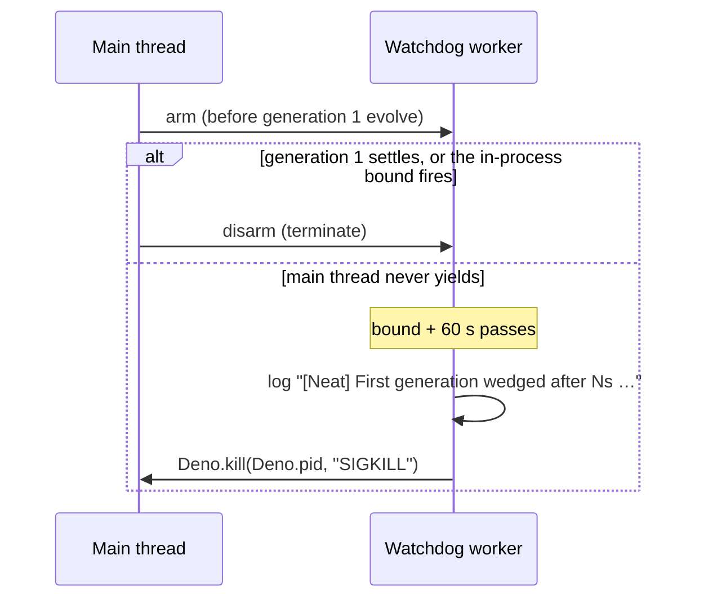

## Summary

The #4053 first-generation bound is enforced by `awaitWithinHardDeadline`, a
`setInterval` poll on the **same event loop** as the work it bounds, so a main
thread that stops yielding starves it. Generation 1 is now also bounded
off-thread. `evolveDir`, `evolveEnv` and `evolveRL` arm a watchdog worker
(`src/NEAT/FirstGenerationWatchdog.ts` and
`src/NEAT/FirstGenerationWatchdogWorker.ts`) just before generation 1's
`neat.evolve()` is called. They disarm it (terminate the worker) when that await
settles. If the watchdog is still armed 60 s after the bound, it logs
`[Neat] First generation wedged after Ns (first-generation bound passed while
the main thread was not yielding …)`
from the worker thread and ends the process with `SIGKILL`. Closes #4060. Two
criteria remain `missing` (see Acceptance Criteria): the issue's root-cause
capture and its closing field evidence can only come from a GRQ host.

## Spec

### Intent and Rationale

- Nothing on a blocked JS event loop can bound that loop, so the bound has to
  live on another thread. A Deno Worker has its own event loop and heap, so it
  keeps running while the main isolate busy-loops or thrashes in GC.
- This repo can deliver an in-process backstop. The issue offered caller-side
  guidance as an alternative, and `docs/TIMEOUTS.md` now also documents it as
  defence in depth.

### Essential Design Decisions

- The watchdog kills with `SIGKILL`. `evolveDir` registers a `SIGTERM` listener,
  which needs the blocked loop to run, so `SIGTERM` is swallowed. A worker's
  `Deno.exit()` only closes the worker, which I observed on this host.
- `withFirstGenerationWatchdog` arms **before** `run()` calls `neat.evolve()`,
  so it also covers a block in `evolve()`'s synchronous prefix. The child test
  depends on this ordering.
- The watchdog fires 60 s after the bound
  (`FIRST_GENERATION_WATCHDOG_SLACK_MS`), so a responsive loop's in-process path
  (1 s poll) wins first. That path disarms the watchdog and still returns
  `first-generation-wedged` with teardown. The kill path writes no new
  checkpoint, which the docs and CHANGELOG say.
- Only generation 1 is armed, once per run. Nothing is spawned when
  `timeoutMinutes` is 0.

### Undiscoverable Facts

- With `threads: 1` (all three failing GRQ runs: `heavyWorkers 1, threads 1`),
  `evolveDir` sets `preferDirect` and the only `WorkerHandler` is a
  `MockWorker`. Fitness and the scheduled training then run in-process on the
  main thread (`src/creature/CreatureTraining.ts`
  `preferDirect = threads === 1`; `src/multithreading/workers/MockWorker.ts`
  `this.processor.process(data)`). So the issue's "the training task runs on a
  worker" does not hold for these runs. This is consistent with the comment that
  the bound fired on the 12-worker GRQ-3 run and failed on every 1-worker run.
- On Deno 2.9.6 here, `Deno.kill(Deno.pid, "SIGKILL")` from a worker killed a
  busy-looping process even when it ran with only `--allow-read`. The
  kill-refused branch exists for hosts that refuse it, and it logs the cause.

## Evidence

Backend-only change; no UI files.

- **Tool behaviour observed (scratch script, deleted):**
  - In a worker, `Deno.exit(124)` left the busy main thread running and the
    process exited 0.
  - `Deno.kill(Deno.pid, "SIGKILL")` from a worker, with a `SIGTERM` listener
    registered and the main thread in `for (;;) {}`, ended the process with
    status 137 (`Killed`). It did the same under `--allow-read` only.
- **Issue numbers cited:**
  - #4060: evolveDir first-generation bound (#4054) did not fire on 7.0.55 …
  - #4053: the first-generation bound this backs up, cited in existing code
  - #4063: Flaky test: MakeUuidDirectConstruction …, filed this run

**Docs sweep** — grep: `awaitWithinHardDeadline`, `first-generation-wedged`,
"First generation wedged", "first-generation bound", "in-process"; section:
`docs/TIMEOUTS.md#-the-off-thread-first-generation-watchdog-issue-4060` (new)
and `docs/TIMEOUTS.md#️-the-external-watchdog-is-unchanged`; siblings:
`teardownBudgetMS`, `startTimeMS` (the existing `EvolveDirDeps` members; no doc
lists the deps set); updated: `docs/TIMEOUTS.md`, `CHANGELOG.md`,
`src/NEAT/HardDeadlineRace.ts` (module doc).

Hits left in place:

- `docs/TIMEOUTS.md` propagation `sequenceDiagram` ("abandon it … return
  terminationReason first-generation-wedged") — still true because it shows the
  responsive-loop path, which is unchanged.
- `src/creature/CreatureTraining.ts:672` ("breaching it ends the run with
  terminationReason first-generation-wedged") — still true for the in-process
  path, and the comment added directly below it names the off-thread backstop.

## Reproduction

- **symptom** — loop-2 generation 1 sat silent for ~2 h with no
  `First generation wedged` line, and was killed only by GRQ's stale window.
  Example:
  `20261013-132901 run_core: node log silent: no output for 7208s
  (stale window 7200s)`.
- **status** — `partial` — reason: the regression test reproduces a blocked main
  thread defeating the bound. Against base production code
  (`git show f089c75f:src/creature/CreatureTraining.ts`) all three child runs
  hung until the 60 s guard:
  `AssertionError: child never terminated — the
  first-generation bound did not fire on a blocked event loop`,
  0 passed / 3 failed. With the fix they pass. What blocked the field runs (GC
  thrash vs a long synchronous in-process training step) was not reproduced; the
  host captures are on GRQ machines this run cannot reach.
- **regression test** —
  `test/creature/FirstGenerationBlockedEventLoop.ts::evolveDir: a blocked main thread still ends at the first-generation bound`
  (plus the `evolveEnv` and `evolveRL` cases)

## Acceptance Criteria

<!-- vibe-spec-review inputs="diff+issue-body" -->

- **missing** — Root cause quoted from a reproduction, or from a host-side
  capture (`~/logs/training-hangs/in-flight/training-task-b08ca7f0.json` on
  rocket@GRQ-19), confirming or excluding the GC-thrash theory. — reviewer:
  missing — reason: the capture lives on GRQ-19, which this run cannot reach.
  The diff confirms the mechanism (a blocked loop starves the bound, and
  `threads: 1` runs training on the main thread) but not what blocked it.
- **met** — A bound that does not depend on the bounded event loop yielding. For
  example, a worker-thread or out-of-process watchdog that terminates the
  isolate, or documented guidance that the caller (GRQ `sampler.sh`) must
  enforce `timeout + first-generation bound` as a hard per-loop kill. —
  evidence: `src/NEAT/FirstGenerationWatchdog.ts`,
  `src/NEAT/FirstGenerationWatchdogWorker.ts`, caller guidance in
  `docs/TIMEOUTS.md` — reviewer: met
- **partial** — Regression test: a generation-1 `evolve()` that blocks the main
  thread synchronously (a busy loop past the bound) must still end at the
  first-generation bound with `first-generation-wedged`. — evidence:
  `test/creature/FirstGenerationBlockedEventLoop.ts` — reviewer: partial —
  reason: the run ends via SIGKILL plus a log line carrying
  `first-generation-wedged`, not a returned `terminationReason`, because nothing
  in-process can return from a loop that never yields. The test uses slack 0,
  not the production 60 s.
- **missing** — Closing evidence: a quoted
  `[Neat] First generation wedged after
  …` line, or a loop-≥2
  `Generation 1 … time …` line after an OOM-retry relaunch, from a GRQ host on
  the fixed release. — reviewer: missing — reason: this needs this PR released
  and run on a GRQ host.
- **unrequested** — `firstGenerationWatchdogSlackMS` on `EvolveDirDeps` —
  reviewer: unrequested — reason: a test seam like `teardownBudgetMS`. Without
  it the end-to-end test would wait the real 60 s slack.
- **unrequested** — the watchdog also wraps `evolveEnv` and `evolveRL` —
  reviewer: unrequested — reason: they share the same `setInterval`
  first-generation bound (#4056), so the same blocked-loop defect applied to
  them.
- **unrequested** — the `docs/TIMEOUTS.md` deadlines table is re-flowed —
  reviewer: unrequested — reason: `deno fmt` column widths after one appended
  sentence in a row.

## Standards Review

<!-- vibe-standards-review inputs="diff+CODING-STANDARDS.md" -->

The repo has no `CODING-STANDARDS.md`. The reviewer was given `AGENTS.md` and
`docs/ENGINEERING_PRINCIPLES.md`.

- **clean** — no violations. The diff removes no test assertions and changes no
  existing expected value. Every named test exists. Review-enforced rules
  checked:
  - logging through `getLogger()` (no `console.*` in `src/`)
  - Temporal vs `Date.now()` (elapsed and deadline use only)
  - no fallback / dual path (principle 7)
  - no `Deno.env.set` in tests (the risky case runs in a child process)
  - Australian English
  - behaviour-not-implementation tests
  - an application-agnostic library
  - Optional notes, not chased: the child code string uses `Date.now()` to
    anchor a past start, as `EvolveDirHardDeadline.ts` does. The real-worker
    unit cases turn off sanitizers. The wrapper repeats at three call sites, one
    per entry point.

## Test Plan

- Added `test/NEAT/FirstGenerationWatchdog.ts` (7 tests): the due predicate, the
  fire path (log + one kill), a refused kill reported and not thrown, a failing
  log that still kills, no spawn when the deadline is 0, and the real-worker
  wrapper returning a value and propagating a rejection.
- Added `test/creature/FirstGenerationBlockedEventLoop.ts` (3 tests): one child
  process per entry point. `evolve()` is stubbed to `for (;;) {}`, so the
  in-process poll can never run. Each test asserts:
  - SIGKILL, not a clean exit
  - the `[Neat] First generation wedged after` line, plus
    `main thread was not yielding` and `first-generation-wedged`
  - `EVOLVE_RETURNED` never printed
  - no 60 s guard kill
- Red runs:
  - With base `CreatureTraining.ts`, all 3 child tests failed with
    `child never terminated …` (run by me).
  - Disabling one call site at a time (deadline argument `0`) turned only that
    entry point's test red, for each of `evolveDir`, `evolveEnv` and `evolveRL`.
  - Removing `actions.kill()` turned "logs the wedge and kills once" red.
  - Making the kill catch rethrow turned "a failing kill is reported, not
    thrown" red.
  - Moving the log back into the kill's try turned "a failing log still kills"
    red.
- Targeted run on the final head:
  `deno test -A test/NEAT/FirstGenerationWatchdog.ts test/creature/FirstGenerationBlockedEventLoop.ts test/creature/EvolveDirFirstGenerationWedged.ts test/creature/EvolveDirFirstGenerationHardDeadline.ts test/creature/EvolveDirHardDeadline.ts test/creature/EvolveEnvHardDeadline_test.ts test/creature/EvolveRLHardDeadline_test.ts test/NEAT/HardDeadlineRace.ts`
  — 32 passed, 0 failed.
- `./quality.sh --rust-scorer-bin=<built NEAT-AI-scorer rust_scorer>`: fmt, lint
  and check were clean. Tests: 9888 passed, 1 failed. The failure was
  `test/architecture/MakeUuidDirectConstruction.ts` "different squash produces
  different UUIDs", which this diff does not touch. It passed 6/6 when run
  alone: two random creatures can differ in synapse count. Filed as #4063.
- No existing test was edited. No existing test needed fixture changes: the full
  gate ran every `startTimeMS` test with the watchdog live, and none was killed.
- Callers and siblings checked: every `awaitWithinHardDeadline(neat.evolve(…))`
  site in `src/creature/CreatureTraining.ts` (`evolveDir`, `evolveEnv`,
  `evolveRL`) is wrapped. `evolveDataSet` delegates to `evolveDir`.

**Branch outcomes:**

- `src/NEAT/FirstGenerationWatchdog.ts` `if (!deadlineMS) return undefined` — no
  bound, nothing spawned:
  `test/NEAT/FirstGenerationWatchdog.ts::armFirstGenerationWatchdog: no bound means nothing is spawned`.
  Bound set, worker armed: the `withFirstGenerationWatchdog` real-worker cases
  and `FirstGenerationBlockedEventLoop.ts`. Forcing `undefined` turned the child
  tests red (the guard fired).
- `isFirstGenerationWatchdogDue` (strictly past deadline + slack) —
  `test/NEAT/FirstGenerationWatchdog.ts::isFirstGenerationWatchdogDue: only strictly past deadline + slack`
  covers both outcomes at the boundary.
- `fireFirstGenerationWatchdog`:
  - kill succeeds: "logs the wedge and kills once"
  - kill throws: "a failing kill is reported, not thrown"
  - log throws: "a failing log still kills"
  - Each went red when its branch was broken, as listed above.
- `src/NEAT/FirstGenerationWatchdogWorker.ts`
  `if (isFirstGenerationWatchdogDue(…))`:
  - due: the child tests (red when the watchdog never fires)
  - not due: the in-process tests with a future bound (`EvolveDir*`,
    `EvolveEnv*`, `EvolveRL*`) still return normally rather than being killed
- `src/creature/CreatureTraining.ts`: the generation-1 predicate at each of the
  3 call sites (`generation === 0` / `generation === 1`) arms only for
  generation 1. Each site was red-checked alone, as listed above.
