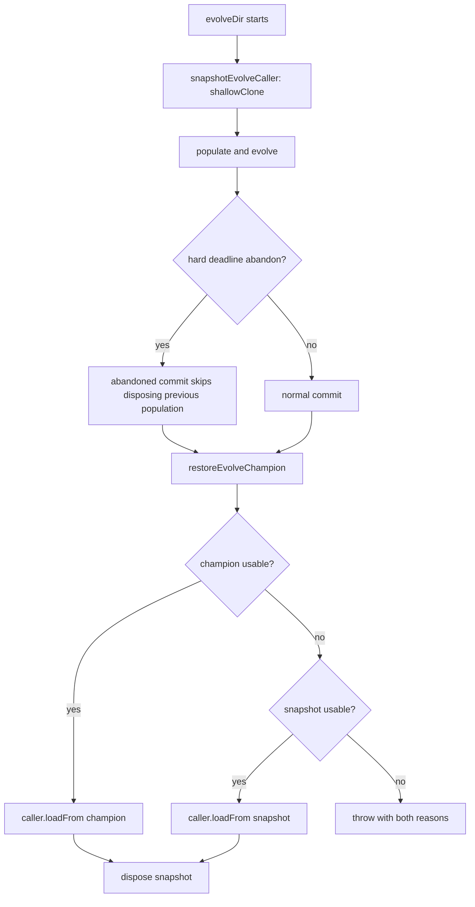

# Keep the caller's creature valid on every `evolveDir()` exit, deadline abandon included (#4061)

## Summary

`evolveDir()` could return the caller's creature with `neurons.length < input`
after a generation-2 hard-deadline abandon, so `CreatureUtil.makeUUID` threw
`RangeError: Invalid array length`. The restore step now snapshots the caller
before populating and only hands back a champion that is usable; otherwise it
restores the caller's original genome. `NeatEvolution` also stops disposing the
previous population once a run has been abandoned mid-commit.

Closes #4061.

## Spec

### Intent and Rationale

After the hard deadline abandons a generation, the abandoned work keeps running
and may later commit. The caller's creature sits in the generation-1 population,
so that late commit disposes it (`Creature.dispose()` sets
`neurons.length = 0`). Two changes close the hole:

- `src/NEAT/NeatEvolution.ts` re-checks `isRunAbandonedSince(scheduledEpoch)`
  before disposing the previous population and skips disposal when the run was
  abandoned.
- `src/creature/EvolveTeardown.ts` adds `snapshotEvolveCaller` and
  `restoreEvolveChampion`. The champion is restored only when
  `neurons.length >= input + output` and `validate()` passes. Otherwise the
  snapshot is restored. If both are unusable it throws with context rather than
  returning damage.

`evolveEnv()` and `evolveRL()` share the same restore step, so they use the same
helpers.

### Essential Design Decisions

- **Snapshot with `shallowClone()` before populating.** The snapshot is
  independent of the caller's later disposal and is disposed itself once the
  restore finishes.
- **Fail loud, not silent.** When neither candidate is usable, the restore
  throws and names both reasons, so a damaged creature is never returned as
  success.
- **Skip disposal, don't wait.** An abandoned commit leaves previous-population
  members undisposed (logged at warn) and leaves them to the garbage collector.
  A leak of a few creatures is cheaper than a corrupt caller.

### Undiscoverable Facts

- An abandon during generation 2 reports `generation === 1`.
- The root cause is inferred from the code path and was not reproduced against
  the base.
- `DeDuplicator.perform` throws the same `RangeError` over a population disposed
  during teardown. That is out of scope here.

## Evidence

```text
test/creature/RestoreEvolveChampion.ts                     7 passed
test/creature/EvolveRestoresCallerSnapshot.ts              3 passed
test/creature/EvolveDirGenerationTwoAbandonCaller.ts       1 passed
test/NEAT/AbandonedCommitKeepsPreviousPopulation.ts        1 passed
deno fmt / deno lint / deno check on changed files         clean
```

Mutation red-checks (each mutation was applied, the named test went red, then it
was restored):

| Line                                             | Mutant                                           | Result                                                          |
| ------------------------------------------------ | ------------------------------------------------ | --------------------------------------------------------------- |
| `src/creature/EvolveTeardown.ts:54`              | drop the neuron-count check                      | red (RestoreEvolveChampion.ts "too few neurons")                |
| `src/creature/EvolveTeardown.ts:57`              | drop the `validate()` check                      | red (RestoreEvolveChampion.ts "fails validate")                 |
| `src/creature/EvolveTeardown.ts:101`             | skip the snapshot fallback when no champion      | red (RestoreEvolveChampion.ts "no champion")                    |
| `src/creature/EvolveTeardown.ts:102`             | return the unusable snapshot instead of throwing | red (RestoreEvolveChampion.ts "throws when neither usable")     |
| `src/NEAT/NeatEvolution.ts:1257`                 | force the guard to `if (false)`                  | red (AbandonedCommitKeepsPreviousPopulation.ts)                 |
| `src/creature/CreatureTraining.ts:796,1161,1814` | revert each caller to the old restore            | red (EvolveRestoresCallerSnapshot.ts, one test per entry point) |



Related issues: #4061, #4050 (earlier occurrence of the same failure), GRQ #4472
(post-loop teardown budget).

**Docs sweep** — grep: `restoreEvolveChampion`, `loadFrom\(champion`,
`hard deadline`, `abandon\w*`, `dispos\w*`; section: `docs/TIMEOUTS.md` "The
post-loop teardown is bounded too"; siblings: `evolveEnv`, `evolveRL`; updated:
`docs/TIMEOUTS.md`, `CHANGELOG.md`.

The remaining hits in `docs/TIMEOUTS.md` that describe the teardown budget and
the abandon epoch are still true: the change narrows what the restore step may
hand back and does not change either mechanism.

## Reproduction

Not reproduced against the base. The regression test
`test/creature/EvolveDirGenerationTwoAbandonCaller.ts` follows the issue's
recipe (a hard-deadline breach in generation 2, the abandoned generation
finishing after `evolveDir()` returns, then `makeUUID(caller)` and
`caller.neurons.length > caller.input`). It passes on both the base and the
head, so it pins the behaviour but does not demonstrate the failure. The fix is
covered by tests that do go red without it:

- `test/NEAT/AbandonedCommitKeepsPreviousPopulation.ts` goes red when the
  abandon guard is removed.
- `test/creature/RestoreEvolveChampion.ts` and
  `test/creature/EvolveRestoresCallerSnapshot.ts` go red when the champion check
  or snapshot fallback is removed. The latter disposes the caller and leaves no
  champion, then asserts the original genome is restored.

## Acceptance Criteria

<!-- vibe-spec-review inputs="diff+issue-body" -->

- **partial** — "`evolveDir()` guarantees on every exit path, deadline-abandon
  included, that the caller's creature is valid
  (`neurons.length >= input + output`, `validate()` passes). If it cannot
  restore a champion, it leaves the caller's original genome untouched." —
  evidence: `src/creature/EvolveTeardown.ts:83`,
  `src/creature/CreatureTraining.ts:796` — reviewer: partial — reason: when
  neither the champion nor the snapshot is usable the restore throws instead of
  returning a valid creature; a teardown-budget breach may skip persistence; the
  root cause was inferred and not reproduced.
- **partial** — "Regression test (in the style of
  `test/NEAT/HardDeadlineDisposalRegression.ts`): force a hard-deadline breach
  in generation 2, let the abandoned generation finish after `evolveDir()`
  returns, then assert `CreatureUtil.makeUUID(caller)` succeeds and
  `caller.neurons.length > caller.input`." — evidence:
  `test/creature/EvolveDirGenerationTwoAbandonCaller.ts:33` — reviewer: partial
  — reason: the test is green on the base, and it holds
  `DeDuplicator.prototype.perform` to stage the abandon. Failing-without-the-fix
  coverage sits in the other tests listed above.
- **missing** — "Closing evidence: a quoted GRQ sampler log line from a run that
  logs `Hard deadline … exceeded during generation N` and still completes the
  loop, on the fixed release." — reviewer: missing — reason: needs a released
  build and a production run; it cannot be produced from this PR.
- **unrequested** — the restore step is also wired into `evolveEnv()` and
  `evolveRL()` (`src/creature/CreatureTraining.ts:1161`, `:1814`) — reviewer:
  unrequested — reason: the issue names `evolveDir()` only; the three loops
  share the same restore step and the same defect, so leaving two of them would
  keep the hole open.

## Standards Review

<!-- vibe-standards-review inputs="diff+CODING-STANDARDS.md" -->

One departure found, fixed in this diff: an earlier draft of a test helper used
`setTimeout`, which breaks the rule against timing in tests (`AGENTS.md` → Unit
Tests vs Benchmarks). It was removed; the tests now use `disposeThenWedge` and
an injected clock. Otherwise clean: the repository has no `CODING-STANDARDS.md`,
so `docs/ENGINEERING_PRINCIPLES.md` and `AGENTS.md` were used as the standard
(Australian English, logging through `getLogger()`, errors that name their
cause, tests that assert behaviour).

## Test Plan

- `deno task test` was not run in full; the touched tests ran individually:
  `test/creature/RestoreEvolveChampion.ts`,
  `test/creature/EvolveRestoresCallerSnapshot.ts`,
  `test/creature/EvolveDirGenerationTwoAbandonCaller.ts`,
  `test/NEAT/AbandonedCommitKeepsPreviousPopulation.ts`.
- `deno fmt`, `deno lint` and `deno check` pass on the changed files.
- `./quality.sh` aborts in this environment with "Native rust_scorer is required
  (quality.sh default) but was not found", so the full gate could not be run.

<!-- vibe-quality-gate-skipped reason="quality.sh aborts: Native rust_scorer required but not found; lint, type-check and targeted tests passed" -->

Branch outcomes:

- `src/creature/EvolveTeardown.ts:54` — champion has too few neurons;
  `test/creature/RestoreEvolveChampion.ts` "a champion with too few neurons
  falls back"; flipping went red.
- `src/creature/EvolveTeardown.ts:57` — champion fails `validate()`;
  `test/creature/RestoreEvolveChampion.ts` "a champion that fails validate()
  falls back"; flipping went red.
- `src/creature/EvolveTeardown.ts:91` — champion usable, restored;
  `test/creature/RestoreEvolveChampion.ts` "a usable champion is restored";
  flipping went red.
- `src/creature/EvolveTeardown.ts:101` — no champion, falls back to the
  snapshot; `test/creature/RestoreEvolveChampion.ts` "no champion falls back to
  the snapshot"; flipping went red.
- `src/creature/EvolveTeardown.ts:102` — snapshot also unusable, throws;
  `test/creature/RestoreEvolveChampion.ts` "throws when neither is usable";
  flipping went red.
- `src/NEAT/NeatEvolution.ts:1257` — run abandoned mid-commit, previous
  population left undisposed;
  `test/NEAT/AbandonedCommitKeepsPreviousPopulation.ts` "a generation abandoned
  mid-commit leaves the previous population undisposed"; flipping went red.
- `src/creature/CreatureTraining.ts:796`, `:1161`, `:1814` — each loop restores
  through `restoreEvolveChampion`;
  `test/creature/EvolveRestoresCallerSnapshot.ts` (one test per loop); flipping
  went red.
