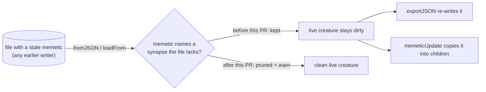

# Prune a dangling memetic when a creature is loaded

## Summary

Part of #4062.

A creature loaded from a file whose `memetic` names a synapse the file does not
carry kept that memetic unchanged. It was re-exported on every checkpoint and
copied into children by `memeticUpdate`, so one stale record could outlive the
code that created it. `loadFrom` (so `Creature.fromJSON`) now prunes such rows
and bias keys, ancestry included, on a private copy, and logs one warning naming
Issue #4062. The writer-side prune (`pruneDanglingMemeticFromExport`, merged
earlier for this issue) is unchanged.

The mutation or teardown path that first created the stale reference on GRQ-21
is **not identified**; see the Acceptance Criteria.

Version bump: `deno.json` is not edited here; the merged commit records the
final version.

## Spec

### Intent and Rationale

- The log in the issue shows a stale `memetic` on a numbered checkpoint after
  the #3849 and writer-side fixes were deployed. Hunting for a new producer
  found none (see Evidence), but it showed the record never heals: load adopts
  it, export re-emits it, `memeticUpdate` spreads it. Pruning at the one ingest
  point stops that, whatever wrote the file.
- The alternative of pruning only at write time leaves the live population dirty
  (training, fine-tune and breeding still read the stale rows) and is already
  done by `writeCreatures`.

### Essential Design Decisions

- Prune on ingest, in `loadFrom`, by reusing `pruneOrphanMemeticReferences` (the
  live-creature pruner `fix()` and `Offspring` already use) rather than a second
  copy of the rule. It now returns the removed count, which `loadFrom` logs.
- The caller's memetic is never mutated: `convertMemeticToIntIds` reports
  whether it returned its own deep clone (`owned`); `loadFrom` clones only when
  it did not.
- The prune is on by default and not behind an option, because the issue's
  requirement is that no stale memetic persists.
- A snapshot whose `weights` is still the wire array shape has its `weights`
  skipped (deleting array slots by id would corrupt it); its `biases` are still
  checked.

### Undiscoverable Facts

- Because load now repairs a stale memetic before downstream code sees it, a
  downstream `rule=ValidationError/MEMETIC` repair line can no longer appear for
  a load that goes through `Creature.fromJSON`. Further log evidence has to
  search for `[loadFrom] Pruned` with `Issue #4062` and the writer's
  `[CheckpointWriter] Pruned` line instead.
- Cost, measured with `bench/LoadFromMemeticPrune.ts` (2000 synapses, 200-row
  memetic and 3-deep ancestry, 800 rows): base `fromJSON` 777 µs, with this PR
  1.1 ms; the no-memetic control is unchanged at 433 µs. The pass builds one key
  per synapse, so it scales with synapse count and only runs when a memetic is
  present.

## Evidence

Backend change; no UI. Observed on the base branch, then on the head:

- Base: loading `{ memetic.weights: [{ h1 -> output-0 }] }` with no
  `h1 ->
  output-0` synapse and exporting it returns the dangling row, and a
  child from `memeticUpdate(parent, child)` carries it. Running the new test
  file against the base `CreatureSerialization.ts` and `MemeticCleanup.ts` gives
  `FAILED | 3 passed | 7 failed`, including
  `a loaded dirty creature passes core
  creatureValidate (#4062)`, which fails
  with core's `Memetic from id 1 to id -1 has no matching synapses`.
- Looked for a producer that creates the stale record and found none: operator
  fuzzing of every mutation operator on a creature with a root and ancestry
  memetic (150 seeds × 11 operators), `fineTuneImprovement` fuzzing (2400 runs,
  7200 candidates), and ten real `evolveDataSet` runs of 300 generations with
  `checkpointEveryGeneration`, watching for the writer's prune warning. Only
  `SubConnection` leaves an `ancestry` row dangling (core's prune does not reach
  ancestry), and `Mutator` then discards and rebuilds the memetic.
  `Mutator.mutate` is fully synchronous, so a checkpoint export cannot see a
  creature mid-mutation. These fuzz scripts were scratch files and are not
  committed.
- Abandoned-generation interleaving, run for real this time: a test applies one
  real `SubConnection` mutation (removing `hidden-1 -> output-0` from a creature
  with a root and ancestry memetic) to a population member between checkpoint
  batches, then writes. The operator left that creature's memetic consistent
  (the exported root and ancestry rows named only surviving synapses), so this
  fixture does not reproduce a stale record either. It is kept as a regression
  test for the path the issue names as its strongest lead.
- Quality gate: the full `./quality.sh` was not run, see the note under Test
  Plan; `./quality.sh --check-only` (whole-repo type check) exited 0.

Issue numbers cited as provenance, each read with `gh`: #4062 (this issue, "a
dangling memetic reference"), #3844 and #4052 (named in the issue body).

## Closing evidence

Evidence recorded by the earlier PR #4100 run (not re-fetched in this run). It
predates this change. Source: the downstream production log repository's
`Develop` branch, cloned with
`git clone --single-branch --branch Develop --shallow-since=2026-10-10`. The
writer-side fix first appears in a deployed build as
`[neat-ai] running version
7.0.57` (commit `c79ed9e`, 2026-10-15); the report
was on 7.0.55.

- Search 1: `git log -S"rule=ValidationError/MEMETIC" --name-only` found two
  commits, both `GRQ-21-rocket.log` — `8f7f82c` (2026-10-13, the line the issue
  quotes) and `6f8c1a3` (the rotation that removed it).
- Search 2:
  `git log -G"creature-repair\] INVALID|repairing an INVALID creature"
  --since=2026-10-14T22:35:00Z`
  found no commits.
- Search 3: `grep -c "ValidationError/MEMETIC" *.log` was 0 in all 25 files at
  the Develop head.
- Window on the fixed release: about 13 days (2026-10-15 to 2026-10-28), 1072
  log commits, no `INVALID CREATURE` repair line of any rule.

Limits: periodic snapshots that rotate, so a line written and rotated out
between snapshots would not be seen.

## Reproduction

- **symptom** — a population file loads with
  `Memetic from id X to id Y has no
  matching synapses`, so GRQ repairs it and
  calls it an upstream defect.
- **status** — `partial` — reason: the persistence of a stale memetic through
  load, export and `memeticUpdate` is reproduced against the base code; the
  original producer on GRQ-21 is not, and `.creatures/10.json` was not available
  to load.
- **regression test** —
  `test/creature/LoadPrunesDanglingMemetic.ts::a loaded dirty creature passes core creatureValidate (#4062)`

## Acceptance Criteria

<!-- vibe-spec-review inputs="diff+issue-body" -->

- **missing** — Identify the producing path. Load `.creatures/10.json` from
  rocket@GRQ-21 if it still exists, or reproduce with a checkpoint write during
  a deadline-abandoned generation — evidence: none for the origin; see Evidence
  for what was ruled out — reviewer: missing — reason: the first writer of the
  stale record is not identified; this PR removes how it persists, not where it
  began
- **met** — `writeCreatures` (or the producing mutation) never persists a
  creature whose `memetic` references a missing synapse: either
  validate-before-write, or prune at the mutation site — evidence:
  `src/creature/CheckpointWriter.ts::writeCreatures` and
  `test/creature/CheckpointWriteDanglingMemetic_test.ts`, merged earlier for
  this issue; this PR adds the load-side prune
  `src/creature/CreatureSerialization.ts::loadFrom` — reviewer: met
- **partial** — Regression test: run the identified path (e.g. abandon
  generation N while its mutations are in flight, then write the checkpoint) and
  assert every written creature passes `ValidationError/MEMETIC` validation —
  evidence: `test/creature/LoadPrunesDanglingMemetic.ts` (load, export, child
  and core validation) and
  `test/creature/CheckpointWriteDanglingMemetic_test.ts::a checkpoint written while an abandoned generation prunes a synapse holds only valid creatures (#4062)`
  (a real `SubConnection` mutation lands between checkpoint batches; every
  written file is free of dangling references and passes `creatureValidate`) —
  reviewer: partial — reason: the spec reviewer rated it partial: the test
  simulates the race with a real operator inside the write seam but does not
  drive `evolve` or a deadline, does not show the race producing a stale
  memetic, and no path was identified to run
- **partial** — Closing evidence: a week of logs from the downstream production
  sampler hosts with no `rule=ValidationError/MEMETIC` repair lines on the fixed
  release, quoted with the search used — evidence: Closing evidence above —
  reviewer: missing — reason: the reviewer saw only the diff and cannot see
  logs; the searches and window quoted are retained from the earlier PR #4100
  run, not re-fetched in this run, and cover the writer-side fix only. This
  change is not yet in a deployed release, and after it the repair line cannot
  appear on loads through `Creature.fromJSON`, so that search cannot show
  anything about this head. The criterion stays open until a log search against
  the release carrying this change (using the
  `[loadFrom] Pruned ... Issue #4062` and `[CheckpointWriter] Pruned` terms)
  exists
- **unrequested** — Load-side pruning in `loadFrom`, with the clone, the count
  return and the warning — reviewer: unrequested — reason: the issue asks for a
  writer fix; this is the change that stops a stale record persisting, found
  while looking for the producer, and it is what makes the record stop spreading
- **unrequested** — `bench/LoadFromMemeticPrune.ts` — reviewer: unrequested —
  reason: AGENTS.md asks for a benchmark when load and export hot paths change

## Standards Review

<!-- vibe-standards-review inputs="diff+AGENTS.md+docs/ENGINEERING_PRINCIPLES.md+CONTRIBUTING.md" -->

- **violation** — every load cloned the memetic a second time on the import hot
  path with no benchmark — evidence: `src/creature/CreatureSerialization.ts:958`
  — reason: fixed in this diff (clone only when the memetic is still shared with
  the caller, plus `bench/LoadFromMemeticPrune.ts`)
- **violation** — the warning printed `<unidentified>` because `loadFrom`
  discards the incoming uuid — evidence:
  `src/creature/CreatureSerialization.ts:963` — reason: fixed in this diff
  (labels the creature by structural hash)
- **violation** — the doc comment on `pruneOrphanMemeticReferences` said a
  wire-shaped snapshot is skipped untouched when only its `weights` are —
  evidence: `src/compact/MemeticCleanup.ts:146` — reason: fixed in this diff
- **clean** — no existing test expectation changed; callers of
  `pruneOrphanMemeticReferences` ignore the new numeric return; no timing APIs
  in tests; logging through `getLogger()`; Australian English; no `Deno.env` in
  tests; named tests exist. Review-enforced rules checked: the AGENTS.md
  serialisation hot-path rule and the "what, not how" test rule

## Test Plan

Added:

- `test/creature/LoadPrunesDanglingMemetic.ts` (10 tests): root row, ancestry
  row and legacy uuid-keyed map pruned on load; caller's memetic not mutated;
  child via `memeticUpdate` clean; `creatureValidate` passes; clean memetic
  unchanged; exactly one warning with the count for a dirty load and none for a
  clean one; runtime-shaped memetic pruned on a copy.
- `test/compact/PruneOrphanMemeticReferences.ts`: two tests added, the exact
  removed count (4) and a clean target (0), and array-shaped `weights` left
  untouched while a dangling bias is still counted.
- `test/compact/PruneOrphanMemeticReferences.ts`: two more tests, a creature
  with no memetic (0, memetic stays unset) and snapshots with no `weights` at
  all (their biases are pruned, root and ancestry, and no `weights` is added).
- `test/creature/CheckpointWriteDanglingMemetic_test.ts`: one test, a real
  `SubConnection` mutation between checkpoint batches; every written file has no
  dangling reference and reloads through `creatureValidate`, and exactly the
  racing member was shortened. It still passes with the writer's prune disabled,
  because the real operator leaves the memetic consistent: it guards the
  boundary end to end but does not red-check the prune.
- `bench/LoadFromMemeticPrune.ts`.

No existing assertion was removed or edited.

Checks run on the final head:

- `deno test -A test/creature/LoadPrunesDanglingMemetic.ts
  test/compact/PruneOrphanMemeticReferences.ts`:
  14 passed, 0 failed.
- 73 memetic and serialisation test files plus the serialisation tests in
  `test/creature`: 441 passed, 0 failed. `test/blackbox`, `test/compact`,
  `test/breed`, `test/mutate` and `test/architecture` (every `.ts` in them):
  1439 passed, 0 failed.
- `deno fmt --check` (2920 files), `deno lint` (2308 files) and
  `deno check
  mod.ts`: clean.

Red checks:

- Base `CreatureSerialization.ts` and `MemeticCleanup.ts` against the new load
  tests: 7 of 10 fail (root, ancestry, legacy map, child, core validation,
  warning, runtime-shaped); the not-mutated, clean-round-trip and no-warning
  tests pass on base because they guard behaviour the change must keep.
- Skip the ownership clone → the runtime-shaped test fails (the caller's object
  is mutated); drop the warning → the warning test fails (`0` vs `1`).
- `pruneOrphanMemeticReferences` returning `0` → both new compact tests fail;
  removing each `removed` increment fails the count test (`3`, `3`, `2` vs `4`);
  removing the `Array.isArray(weights)` guard fails the array test (`4` vs `1`).

Mutation survivors (Issue #4146 retry): the `MemeticCleanup.ts` survivors at
lines 156, 190 and 222 are killed by the new compact tests (no memetic; a
snapshot with no `weights`, which throws on `Object.keys(undefined)` without the
`!weights` guard; the count assertions). The `CreatureSerialization.ts` mutants
at 485, 497, 503 and the prune guard at 957 each fail 7 of the 10 load tests
when applied by hand. The reported "no test imports this module" is a
direct-import heuristic: `test/creature/LoadPrunesDanglingMemetic.ts` reaches
`loadFrom` through `Creature.fromJSON`. The redundant `memeticOwned = false`
assignments in `loadFrom` were removed because they were dead.

- `src/creature/CreatureSerialization.ts:932` exempt (untestable): the initial
  `memeticOwned = false` only matters on the `else` branch (`json.memetic`
  present with an empty `uuidToIndex`), which `assertValidCreatureShape` makes
  unreachable — a creature with `input: 0` throws before `loadFrom` gets there.
- `bench/LoadFromMemeticPrune.ts:43-102` exempt (untestable): a benchmark file
  run by `deno bench`, which no test imports by design (AGENTS.md keeps timing
  out of `test/`).

Callers of `pruneOrphanMemeticReferences` checked (all ignore the result):
`Upgrade.ts`, `Offspring.ts`, `FineTune.ts`, `RestoreSource.ts`,
`TargetedRepair.ts`, `CreatureMutation.ts`, `CreatureSerialization.ts`. Doc
surfaces read: `loadFrom` JSDoc, `Creature.fromJSON` doc comment,
`docs/PERFORMANCE_TUNING.md` checkpoint paragraph, `CHANGELOG.md`.

<!-- vibe-quality-gate-skipped reason="the full `./quality.sh` takes longer than the 10-minute cap on a foreground command here and may not be started in the background; its format, lint, bash and whole-repo type-check steps were run (`./quality.sh --check-only` exited 0) with the targeted test suites above" -->

Skipped or unverified: the producing path on GRQ-21, `.creatures/10.json` (not
available), a reproduction of a stale memetic from a real abandoned generation
(the interleaving test does not produce one), a fresh log search after this
change, and the full quality gate (CI runs it).
