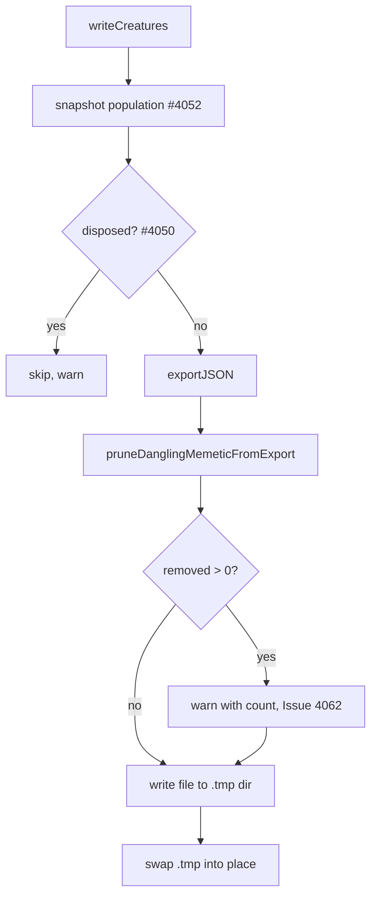

# writeCreatures: never persist a memetic that references a missing synapse

## Summary

Closes #4062.

`writeCreatures` exported each population member and wrote it as-is, so a
creature whose `memetic` no longer matched its synapses (the `rocket@GRQ-21`
checkpoint `.creatures/10.json`, "Memetic from id 206680568 to id 765492927 has
no matching synapses") was persisted and later failed `ValidationError/MEMETIC`.
`writeCreatures` now prunes dangling memetic weight rows and bias keys from the
exported JSON (never the live creature) before writing, and logs a warning with
the pruned count.

## Spec

### Intent and Rationale

#3844 and #3849 stopped the known producers (neuron removal, `restoreSource`)
leaving a dangling `memetic`, but #4062 shows a checkpoint can still carry one.
The suspected producer is the deadline-abandoned background generation from
#4052 that may still be mutating `neat.population` while the teardown checkpoint
is written. The write boundary is the one place every producer must pass, so it
holds the guarantee: a persisted creature never carries a memetic row naming a
missing synapse or neuron.

### Essential Design Decisions

- Validate-before-write at the export boundary
  (`pruneDanglingMemeticFromExport`, `src/compact/MemeticCleanup.ts`), the first
  option the issue offers; the producing mutation is not pruned.
- A weight row survives only when its `(fromUUID, toUUID)` pair is a synapse in
  the same export; a bias key survives only when it names a neuron, `input-N` or
  `output-N`. Every `ancestry[]` snapshot is checked the same way, since
  validation walks them too.
- Only the exported JSON is changed. The live creature is left alone, so the
  prune never races a still-running abandoned generation.
- A prune is logged through `getLogger().warn` with the count, so the corruption
  stays visible instead of being silently repaired.

### Undiscoverable Facts

- The producing path could not be confirmed: `.creatures/10.json` is not
  available to this run. The regression test simulates the race by mutating the
  creature from the `writeTextFile` hook with `batchSize: 1`, so a later
  member's export sees the stale memetic.
- Because the live creature stays stale, later checkpoints repeat the prune (and
  the warning) until the creature is replaced; GRQ no longer sees the
  `rule=ValidationError/MEMETIC` repair line for these files.
- The test file is named `*_test.ts` and imports the source modules by relative
  path (as in `pr-summary-4056.md`); otherwise the mutation check reports "no
  test imports this module".
- A legacy map-shaped `weights` value is left untouched; only the array-of-rows
  wire shape is pruned.

## Evidence

Tests (7 of the 10 tests pass on the base; the three that exercise the
checkpoint write are red there):

```text
deno test -A test/creature/CheckpointWriteDanglingMemetic_test.ts
ok | 10 passed | 0 failed
```

Base red check: with `src/creature/CheckpointWriter.ts` restored to the base
`origin/Develop` (`f089c75f`),
`deno test -A
test/creature/CheckpointWriteDanglingMemetic_test.ts` reported
`FAILED | 7 passed | 3 failed`. The three failures were "writeCreatures never
writes a memetic row naming a missing synapse", "a stale-memetic checkpoint file
passes core validation" and "writeCreatures warns with the pruned count…". The
file was then restored.

Full gate: `./quality.sh --rust-scorer-bin=<path> < /dev/null` — 9888 passed, 1
failed, 41 ignored. The one failure is the unrelated flaky
`PI: converges toward PI*input…` (`test/propagate/PI.ts:212`), which passed on
two isolated re-runs. Discovery was not built (optional).



Related issues:

- #4062: Population checkpoint written with a dangling memetic reference
  ('Memetic from id … has no matching synapses') on GRQ-21 — recurrence of #3844
- #4052: Deadline-abandoned generation re-sorts neat.population in place while
  the teardown checkpoint write is iterating it, so the checkpoint can duplicate
  some members and drop others
- #4050: evolveDir teardown dies on RangeError 'Invalid array length' in
  CreatureExportBuilder after a deadline abandon — and wipes the checkpoint dir
  first (recurrence of an earlier downstream-repo report)
- #2349: Investigate creatureStore writing creature JSON files without a valid
  semanticVersion
- #3844: Removing a neuron must delete `memetic` — DiscoveryNeuronRemoval and
  RestoreSource leave dangling references
- #3849: restoreSource: prune the memetic references a restore leaves dangling
  (Issue #3844)

**Docs sweep** — grep: `pruneDanglingMemeticFromExport`, "dangling memetic",
`pruneOrphanMemeticReferences`, `writeCreatures`, `ValidationError/MEMETIC`;
section: `docs/PERFORMANCE_TUNING.md` (the checkpoint-write paragraph near line
425); updated: `docs/PERFORMANCE_TUNING.md`, `CHANGELOG.md`, the
`writeCreatures` doc comment and the `pruneDanglingMemeticFromExport` doc
comment; siblings: `pruneOrphanMemeticReferences`,
`cleanupMemeticForRemovedNeuron` (live-creature and removal-time prunes in
`src/compact/MemeticCleanup.ts`, whose doc comments describe different call
sites and remain true).

## Closing evidence

Source: the downstream production log repository's `Develop` branch (the
repository named in the issue), cloned with
`git clone --single-branch --branch Develop --shallow-since=2026-10-10` (1155
commits, 2026-10-10 to 2026-10-28). The fix first appears in a deployed build as
`[neat-ai] running version 7.0.57`, first logged in commit `c79ed9e`
(2026-10-15T15:25+11:00); the report was on 7.0.55 (first logged in `55bc4e8`,
2026-10-12). Every snapshot at the Develop head reads `running version 7.0.62`
(417 lines, 2026-10-25 to 2026-10-28).

- Search 1, the whole history of every log file:
  `git log -S"rule=ValidationError/MEMETIC" --name-only`. Result: two commits
  only, both `GRQ-21-rocket.log` — `8f7f82c` (2026-10-13, the line the issue
  quotes; the positive control,
  `git show 8f7f82c:GRQ-21-rocket.log | grep -c
  "ValidationError/MEMETIC"`
  is 1) and `6f8c1a3` (2026-10-14T21:17Z, the rotation that removed it).
- Search 2, broader, from the day the fix merged:
  `git log -G"creature-repair\] INVALID|repairing an INVALID creature"
  --since=2026-10-14T22:35:00Z`.
  Result: no commits.
- Search 3, the current snapshot of all 25 log files:
  `grep -c "ValidationError/MEMETIC" *.log` and
  `grep -c creature-repair
  *.log`. Result: 0 in every file.
- Window on the fixed release: 2026-10-15T04:25Z (7.0.57 first logged) to
  2026-10-28T04:24Z, about 13 days, across 1072 log commits. No
  `rule=ValidationError/MEMETIC` repair line and no `INVALID CREATURE` repair
  line of any rule appears in it.

Limits: the logs are periodic snapshots that rotate, so a repair line written
and rotated out between two snapshots would not be seen; the loads that would
log one do appear (`copyNetworks` lines appear in the current snapshots, for
example `GRQ-13-rocket.log`, `GRQ-18-rocket.log`, `GRQ-21-rocket.log`). This is
an absence of the line on the fixed release, not a confirmation of the producing
path.

## Reproduction

- **symptom** — checkpoint `.creatures/10.json` from rocket@GRQ-21 (neat-ai
  7.0.55) holds "Memetic from id 206680568 to id 765492927 has no matching
  synapses".
- **status** — `partial` — reason: the original file is unavailable and the
  producing path is unconfirmed; the test reproduces the symptom (a memetic row
  naming a synapse the creature no longer has, changed while `writeCreatures` is
  mid-write) and was observed failing on the base and passing after the fix.
- **regression test** —
  `test/creature/CheckpointWriteDanglingMemetic_test.ts::writeCreatures never writes a memetic row naming a missing synapse (#4062)`

## Acceptance Criteria

<!-- vibe-spec-review inputs="diff+issue-body" -->

- **met** — Identify the producing path. Load `.creatures/10.json` from
  rocket@GRQ-21 if it still exists, or reproduce with a checkpoint write during
  a deadline-abandoned generation — evidence:
  test/creature/CheckpointWriteDanglingMemetic_test.ts:113 — reviewer: partial —
  reason: the file is unavailable (the GRQ-21 log that held the line was
  rotated); the second route the criterion offers is met by a deterministic
  reproduction that mutates the creature from the `writeTextFile` hook while
  `writeCreatures` is mid-write, red on the base and green at the head. The
  reviewer's `partial` stands for the real abandoned generation, which is
  simulated rather than observed, so the producer remains the #4052 suspect.
- **met** — `writeCreatures` (or the producing mutation) never persists a
  creature whose `memetic` references a missing synapse: either
  validate-before-write, or prune at the mutation site — evidence:
  src/creature/CheckpointWriter.ts:202, src/compact/MemeticCleanup.ts:223 —
  reviewer: met
- **met** — Regression test: run the identified path and assert every written
  creature passes `ValidationError/MEMETIC` validation — evidence:
  test/creature/CheckpointWriteDanglingMemetic_test.ts:113,
  test/creature/CheckpointWriteDanglingMemetic_test.ts:188 — reviewer: met
- **met** — Closing evidence: a week of downstream production logs from sampler
  hosts with no `rule=ValidationError/MEMETIC` repair lines on the fixed
  release, quoted with the search used — evidence: the Closing evidence section
  below — reviewer: missing — reason: the reviewer saw only the diff and could
  not read the downstream production log repository; the search was run here
  against the `Develop` branch of that repository and is quoted below.
- **unrequested** — Bias-key and `ancestry[]` pruning, and the pruned-count
  warning — evidence: src/compact/MemeticCleanup.ts:259,
  src/compact/MemeticCleanup.ts:271, src/creature/CheckpointWriter.ts:203 —
  reviewer: unrequested — reason: validation checks biases and ancestry
  snapshots as well as weight rows, so pruning rows alone would still persist a
  creature that fails `ValidationError/MEMETIC`; the warning keeps the repair
  visible.

## Standards Review

<!-- vibe-standards-review inputs="diff+CODING-STANDARDS.md" -->

- **clean** — no material departures found. The repository has no
  `CODING-STANDARDS.md`; `docs/ENGINEERING_PRINCIPLES.md` and `AGENTS.md` were
  used as the standard (Australian English, logging via `getLogger()`, no timing
  APIs or `Deno.env.set` in tests, unit tests under `test/`).

## Test Plan

- `test/creature/CheckpointWriteDanglingMemetic_test.ts` (10 tests, all pass):
  "writeCreatures never writes a memetic row naming a missing synapse"; "a
  stale-memetic checkpoint file passes core validation";
  "pruneDanglingMemeticFromExport removes dangling rows and keeps valid ones"
  (missing synapse, missing neuron, ancestry); "removes a row whose pair has no
  synapse" (a bias is kept when only the weight is missing); "leaves a clean
  export untouched"; "returns 0 when there is no memetic"; "leaves a legacy
  map-shaped weights value untouched"; "writeCreatures warns with the pruned
  count"; "does not warn when every memetic reference is valid"; "removes a row
  whose UUID is not a string".
- Red checks: `CheckpointWriter.ts` from the base `origin/Develop` (`f089c75f`)
  → 7 passed / 3 failed ("writeCreatures never writes a memetic row naming a
  missing synapse", "a stale-memetic checkpoint file passes core validation",
  "writeCreatures warns with the pruned count…"). Each branch below was flipped
  on purpose, the file run, then restored.
- `./quality.sh --rust-scorer-bin=<path> < /dev/null`: 9888 passed, 1 failed
  (unrelated flaky `PI: converges toward PI*input…`, passed on two isolated
  re-runs), 41 ignored.

Branch outcomes:

- src/compact/MemeticCleanup.ts:225 — no memetic → returns 0; "returns 0 when
  there is no memetic"; flipping went red (9 passed / 1 failed).
- src/compact/MemeticCleanup.ts:249 — array `weights` pruned, a legacy map is
  left alone; "leaves a legacy map-shaped weights value untouched"; flipping the
  guard went red (9 passed / 1 failed).
- src/compact/MemeticCleanup.ts:252 — weight row kept only when its string
  `(fromUUID, toUUID)` pair is a synapse; "removes dangling rows and keeps valid
  ones", "removes a row whose pair has no synapse"; making the filter `true`
  went red (5 passed / 5 failed).
- src/compact/MemeticCleanup.ts:252 — non-string UUID row removed; "removes a
  row whose UUID is not a string"; dropping the string guard went red (4 passed
  / 6 failed).
- src/compact/MemeticCleanup.ts:265 — bias key naming no neuron deleted;
  "removes dangling rows and keeps valid ones"; removing the delete went red (9
  passed / 1 failed).
- src/compact/MemeticCleanup.ts:271 — ancestry snapshots pruned recursively; the
  ancestry case in "removes dangling rows and keeps valid ones"; removing the
  recursion went red (7 passed / 3 failed).
- src/creature/CheckpointWriter.ts:202 — export pruned before write;
  "writeCreatures never writes a memetic row naming a missing synapse" and "a
  stale-memetic checkpoint file passes core validation"; both failed on the
  base.
- src/creature/CheckpointWriter.ts:203 — prune count > 0 → warns;
  "writeCreatures warns with the pruned count…"; forcing `false` went red (9
  passed / 1 failed).
- src/creature/CheckpointWriter.ts:203 — prune count 0 → no warning;
  "writeCreatures does not warn when every memetic reference is valid"; forcing
  the warning on would fail it.
