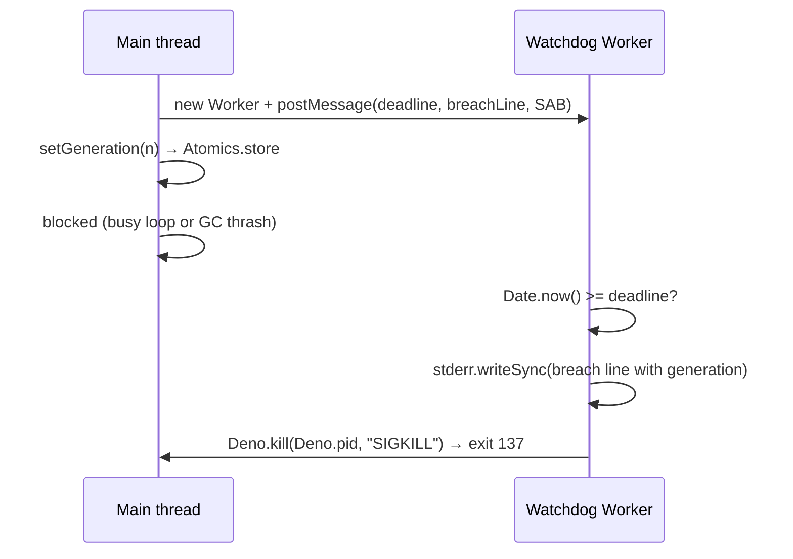

## Summary

Adds `armEventLoopWatchdog` (`src/NEAT/EventLoopWatchdog.ts`), a last-resort
deadline that does not depend on the run's main event loop yielding. A Deno
Worker (`src/NEAT/EventLoopWatchdogWorker.ts`) holds its own timer against
`Date.now()`. At the deadline it writes the breach line to stderr with
`Deno.stderr.writeSync` and sends `SIGKILL` to the whole process (exit 137). If
the Worker cannot load, one
`[Neat] event-loop watchdog unavailable: <cause> —
only the in-process bound applies`
line is logged and the handle is a no-op. No entry point arms it yet; #4067
will. Closes #4066.

## Spec

### Intent and Rationale

- `awaitWithinHardDeadline` polls with `setInterval` on the event loop it
  bounds, so a blocked main thread or V8 GC thrash silences every in-process
  bound (#4060). A Worker has its own event loop and timer.
- `SIGKILL` is the only signal that ends a blocked main thread from a Worker:
  `SIGTERM` is swallowed by the listeners `evolveDir`/`evolveEnv`/`evolveRL`
  register, and `Deno.exit` in a Worker ends only that Worker.

### Essential Design Decisions

- `setGeneration(n)` writes to a `SharedArrayBuffer` the Worker reads at breach
  time, rather than posting a message (the issue said "posts"). The Worker then
  sees the latest generation even when the main thread blocks straight after the
  write, and the test with an already-past deadline is deterministic: a posted
  message can lose the race with the breach.
- The breach line's `{generation}` token
  (`EVENT_LOOP_WATCHDOG_GENERATION_TOKEN`) is replaced at breach with the last
  generation, or `unknown`. Callers (#4067) word the line, including the
  generation-0 wording.
- The Worker re-checks the wall clock at least once a second, so a far deadline
  never overflows `setTimeout`'s 2^31-1 ms limit. The kill runs in a `finally`
  after the stderr write, so a failed write cannot leave the process alive.
- Options are validated with `ConfigurationError` before anything is spawned
  (repo rule: fail fast on configuration errors). `disarm()` is
  `Worker.terminate()`, which is idempotent.
- The `error` listener only prevents the default and logs; it does not call
  `terminate()`. By the time the event arrives the Worker has already stopped
  (it never loaded, or it raised an uncaught error), so a `terminate()` there
  changed nothing. The mutation check showed this, and the line was removed.

### Undiscoverable Facts

- Observed on Deno 2.9.6 (scratch probes): a Worker's
  `Deno.kill(Deno.pid, "SIGKILL")` ends a `for (;;) {}` main thread that has a
  `SIGTERM` listener, exit 137, and needs **no** `--allow-run`. A Worker whose
  module cannot be read does not throw from `new Worker`; it fires an
  asynchronous `error` event with
  `Requires read access to "<path>", run again
  with the --allow-read flag`.
- Remote/JSR consumption: `deno.json` `publish.include` has `src/**`, so the
  Worker module ships with the package and resolves next to
  `EventLoopWatchdog.ts`. Loading it remotely was not exercised. If it fails, it
  reports through the same `error` event, which the unavailable test covers for
  the permission case.
- Both catch branches can be staged in a child process (Deno 2.9.6 probes).
  Replacing `globalThis.Worker` with a class whose constructor throws makes
  `new Worker` throw synchronously. A wrapper Worker module whose first import
  redefines `Deno.kill` makes the Worker's kill throw. Without `terminate()`, a
  Worker that raised an uncaught error, with the event's default prevented, does
  not hold the process open: the child still exits 0.

## Evidence

Backend-only change; no UI files. The subprocess tests in
`test/NEAT/EventLoopWatchdog_test.ts` run a real `deno run` child and assert its
exit status and stderr.

**Docs sweep** — grep: `awaitWithinHardDeadline`, `HardDeadlineRace`,
"first-generation bound", "external watchdog"; section:
`docs/TIMEOUTS.md#-the-external-watchdog-is-unchanged`; siblings: none — no
existing set gained a member (a new module and new exports only); updated:
`docs/TIMEOUTS.md` (new section "The event-loop watchdog primitive (Issue
#4066)", saying no entry point arms it yet); `docs/TIMEOUTS.md:330` — still true
because nothing arms the new primitive yet, so a wedged process still needs the
external watchdog until #4067 lands.

Issue numbers cited: #4060: evolveDir first-generation bound (#4054) did not
fire on 7.0.55 … the setInterval watchdog cannot bound a blocked event loop;
#4066: this issue; #4067: Arm the watchdog in evolveDir, evolveEnv and evolveRL,
with a busy-loop generation-1 regression test (open); #2888: the no-real-waits
test policy the issue cites.

## Reproduction

- **symptom** — a run whose main thread is blocked synchronously never reaches
  its bound: the `setInterval` poll in `awaitWithinHardDeadline` never fires,
  and the run stays silent until GRQ's 2 h stale window kills it (#4060).
- **status** — `partial` — reason: this issue adds the primitive only; the
  busy-loop fixture proves a blocked main thread that swallows SIGTERM is
  SIGKILLed at the deadline, but the training entry points are not armed until
  #4067, so the field symptom itself is not reproduced or fixed here.
- **regression test** —
  `test/NEAT/EventLoopWatchdog_test.ts::EventLoopWatchdogKillsBlockedMainThread: SIGKILLs a busy-looping main thread that swallows SIGTERM`

## Acceptance Criteria

<!-- vibe-spec-review inputs="diff+issue-body" -->

- **met** — `armEventLoopWatchdog` exists, with the API above and a header
  comment explaining why it must live off the main thread and why it uses
  SIGKILL rather than SIGTERM or `Deno.exit`. — evidence:
  `src/NEAT/EventLoopWatchdog.ts` (module header) — reviewer: met
- **met** — Subprocess test under `test/NEAT/`, using the
  `new Deno.Command(Deno.execPath(), …)` pattern as in
  `test/ci/CoverageMergeStepLeastPrivilege.ts:164`. The fixture registers a
  SIGTERM listener, arms the watchdog with a deadline already in the past, then
  runs `for (;;) {}`. The test asserts that the child ends by SIGKILL (signal
  `SIGKILL` / code 137) and that stderr contains the breach line. — evidence:
  `test/NEAT/EventLoopWatchdog_test.ts::EventLoopWatchdogKillsBlockedMainThread: SIGKILLs a busy-looping main thread that swallows SIGTERM`
  — reviewer: met
- **met** — Subprocess test: arm, then `disarm()`, then return normally. The
  child exits 0 promptly; the Worker does not hold the process open. — evidence:
  `test/NEAT/EventLoopWatchdog_test.ts::EventLoopWatchdogDisarm: disarm() lets the process exit 0 without the breach`
  — reviewer: met
- **met** — Neither test uses a real wait or elapsed-time assertion; deadlines
  are already in the past (policy #2888). — evidence:
  `test/NEAT/EventLoopWatchdog_test.ts` (no assertion waits on or measures time)
  — reviewer: partial — reason: the reviewer noted the disarm fixture's deadline
  is one hour ahead and the 60 s hang guard is a real timer. Neither is a wait:
  the disarm child exits at once and the far deadline is what makes a broken
  `disarm()` fail (a past deadline would race the kill against termination), and
  the guard only fires when a regression would otherwise hang the suite.
- **met** — `./quality.sh` passes. — evidence: full gate run on the final code
  with `--rust-scorer-bin` pointing at a locally built NEAT-AI-scorer: exit 0,
  `ok | 9918 passed (5 steps) | 0 failed | 41 ignored (5m33s)` — reviewer:
  missing — reason: the reviewer saw only the diff and could not run the gate;
  it was run here and passed.
- **met** — setGeneration(n) posts the current generation to the Worker, so the
  breach line can name it — evidence:
  `test/NEAT/EventLoopWatchdog_test.ts::EventLoopWatchdogKillsBlockedMainThread: SIGKILLs a busy-looping main thread that swallows SIGTERM`
  (asserts `generation 7`) — reviewer: partial — reason: the reviewer flagged
  that the value travels through a `SharedArrayBuffer`, not a posted message,
  and said the outcome is the same; this was chosen on purpose so the breach
  sees the latest value with no message-ordering race (see Essential Design
  Decisions).
- **unrequested** — `ConfigurationError` validation of `deadlineEpochMS`,
  `breachLine` and `setGeneration`'s argument — reviewer: unrequested — reason:
  AGENTS.md "fail fast on configuration errors"; a NaN deadline would otherwise
  arm a watchdog that never fires, and the shared slot is an `Int32Array`.
- **unrequested** — the exported `EVENT_LOOP_WATCHDOG_GENERATION_TOKEN` and the
  `{generation}` / `unknown` substitution — reviewer: unrequested — reason: this
  is how the breach line names the generation the issue asks for while leaving
  the wording to callers.
- **unrequested** — the Worker's 1 s wall-clock re-check, the guarded kill
  (`finally`) and the "could not kill" stderr line — reviewer: unrequested —
  reason: they stop a far deadline overflowing `setTimeout` and make a failed
  write or kill loud rather than silent.
- **unrequested** — the `docs/TIMEOUTS.md` section — reviewer: unrequested —
  reason: a new behaviour owes a docs change; it says no entry point arms the
  primitive yet.
- **unrequested** — extra tests (unknown generation, validation, `setGeneration`
  range) — reviewer: unrequested — reason: each covers a branch this diff adds.

## Standards Review

<!-- vibe-standards-review inputs="diff+CODING-STANDARDS.md" -->

- **clean** — typed errors from `src/errors/` (`ConfigurationError`), logging
  through `getLogger()` with no `console.*` or `@std/log` in `src/`, `Deno.test`
  with `@std/assert`, no `Deno.env` mutation, no source-text grepping,
  `Date.now()` used for a deadline as the Temporal rule allows, no removed or
  changed assertions in existing tests, Australian English, named files exist.
  `CODING-STANDARDS.md` is absent, so the reviewer used `AGENTS.md` and
  `docs/ENGINEERING_PRINCIPLES.md` and found no "by review only" rule this diff
  touches. It raised one possible violation: that `Deno.kill` might need
  `--allow-run`, so the kill could fail under the `--allow-read`-only fixture.
  That is disproved by the test run: the kill test passes with only
  `--allow-read` (exit 137, signal `SIGKILL`), matching the scratch probe.
  Optional notes it made, not violations: the Worker writes to `Deno.stderr`
  directly because it cannot reach the injected `Logger`, and the unavailable
  test pins Deno's "Requires read access" wording as the cause text.

## Test Plan

- Added `test/NEAT/EventLoopWatchdog_test.ts` (10 tests): six subprocess tests
  (kill of a SIGTERM-swallowing busy loop naming `generation 7`; `unknown`
  generation; disarm exits 0; unavailable Worker logs the cause and exits 0; a
  throwing `Worker` constructor, for both an `Error` and a non-`Error` throw,
  logs the cause and returns a no-op handle; a failed `Deno.kill` is written to
  stderr after the breach line and rethrown) and four in-process validation
  tests. The file is named `*_test.ts` so that the mutation check counts it as a
  test that imports both modules. `deno.json` already runs `test/**/*.ts`.
- `deno test … test/NEAT/EventLoopWatchdog_test.ts`: 10 passed, 0 failed.
- `./quality.sh --rust-scorer-bin=<built rust_scorer>`: exit 0, 9918 passed, 0
  failed. That run was on the head before the mutation-check fixes (the rename,
  the two new tests and the removed `terminate()`). The worker re-runs the gate
  on this head. Plain `./quality.sh` stops early on this host because
  `rust_scorer` is not installed; this is an environment gap, not a code change.
- Mutation check, replayed by hand: each of the 23 source mutants the gate
  listed was applied to a scratch copy of the tree and
  `deno test --no-check -A test/NEAT/EventLoopWatchdog_test.ts` was run. 22 went
  red. The one survivor, `worker.terminate()` in the `error` listener
  (`src/NEAT/EventLoopWatchdog.ts:150` before the fix), was dead code and has
  been removed. The 16 listed mutants of the test file's own lines are no longer
  generated, because the gate skips `*_test.ts` files.
- Red checks (each restored afterwards): Worker `SIGKILL`→`SIGTERM` → kill test
  red ("the hang guard ended the process, not the watchdog"); `disarm()` without
  `terminate()` → disarm test red; unavailable log removed → unavailable test
  red; `replaceAll` removed → kill test red; `"unknown"`→`"-1"` → unknown test
  red; each validation check or operand removed → its test red.
- No existing test is edited; no assertion is removed.

<!-- vibe-branch-outcomes -->
