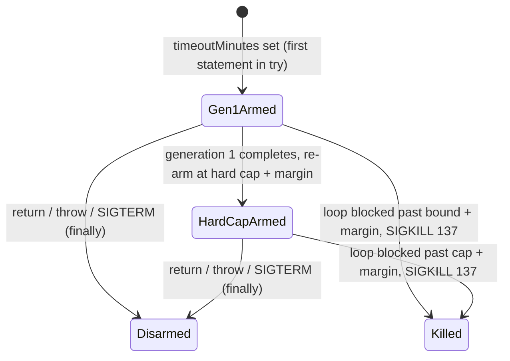

## Summary

`evolveDir`, `evolveEnv` and `evolveRL` now arm the off-main-thread event-loop
watchdog from #4066 whenever `timeoutMinutes` is set, and disarm it in a
`finally`. A generation 1 that blocks the main thread synchronously, which the
in-process `setInterval` bound cannot see (#4060), now ends at the
first-generation bound plus a margin. The process is SIGKILLed (exit 137) after
writing
`[Neat] First generation wedged after <s>s (…) — first-generation-wedged` to
stderr. Once generation 1 completes, the watchdog is re-armed against the hard
cap plus the margin, with a `Run wedged after <s>s at generation <n>` breach
line. When the loop does yield, the existing in-process path still returns
`terminationReason` unchanged. Closes #4067.

## Spec

### Intent and Rationale

- The GRQ-19/21/22 wedges never yielded the event loop, so no bound on that loop
  could fire. The watchdog Worker owns its own timer and kills the whole
  process.
- Arm/re-arm/disarm logic lives once in `armRunWatchdog`
  (`src/creature/EvolveRunWatchdog.ts`) rather than three copies in
  `CreatureTraining.ts`.

### Essential Design Decisions

- Deadline = `Date.now() + max(0, bound - now()) + margin`
  (`computeWatchdogDeadlineEpochMS`, `src/NEAT/HardDeadline.ts`). It is real
  clock plus the remaining injected budget, so injected-clock suites whose start
  is in the past never kill the test runner. The default margin
  `DEFAULT_WATCHDOG_MARGIN_MS` is 5 minutes.
- The watchdog is armed as the first statement inside each entry point's main
  `try`, not at the deadline computation (about `:513`/`:941`/`:1380` in the
  issue). Worker spawn before that `try` can throw, and a watchdog armed there
  would leak and SIGKILL the process later. Arming still precedes
  `populatePopulation` and generation 1.
- `<n>` in the run-wedged line is the number of generations completed
  (`setGeneration(generationsCompleted)`), matching the issue's "generation 0"
  for the first-generation line. `<s>` is computed at arm time as the run's
  elapsed time at the scheduled breach.

### Undiscoverable Facts

- The worker host sets `CARGO_TARGET_DIR`, so `./quality.sh` builds
  `rust_scorer` there but cannot find it. The gate was run with
  `--rust-scorer-bin="$CARGO_TARGET_DIR/release/rust_scorer"`. That is a
  worker-environment fault, so no repository change is made for it.
- The milestone-parent comments (fourth occurrence on GRQ-22, T = 5) confirm the
  same shape as the issue and do not change the design.

## Evidence

Backend-only change; there is no UI. Evidence is the tests below, plus the full
gate passing on the head.

**Docs sweep** — grep: "Nothing arms", "Not armed by any entry point",
`EventLoopWatchdog`, `first-generation-wedged`, "#4067"; section:
`docs/TIMEOUTS.md#-the-event-loop-watchdog-primitive-issue-4066`; siblings:
`teardownBudgetMS`, `onNeatReady` (the `EvolveDirDeps` fields; its doc comment
lists only `startTimeMS` and `onNeatReady` as examples, not every field);
updated: `docs/TIMEOUTS.md`, `CHANGELOG.md`, `src/NEAT/EventLoopWatchdog.ts`
module doc, the evolveEnv/evolveRL doc comments;
`src/architecture/ErrorGuidedStructuralEvolution/DataRecorderAnalysis.ts:64` —
still true because "GRQ #4067" is a different repository's issue.

Issue numbers cited in the diff: #4060: evolveDir first-generation bound (#4054)
did not fire on 7.0.55 … the setInterval watchdog cannot bound a blocked event
loop; #4066: Add an off-main-thread watchdog that SIGKILLs the process when a
run passes its last-resort deadline; #2888: Wall-clock timing assertions in
discovery/NEAT unit tests.

## Reproduction

- **symptom** — a generation 1 that blocks the main thread synchronously never
  ends at its first-generation bound. No `First generation wedged` line appears,
  and the run is silent until the external 2 h stale window kills it.
- **status** — `verified` — with the `armRunWatchdog` call removed from
  `evolveDir`, the `dir` busy-loop case failed ("the hang guard ended the
  process, not the watchdog", 1m0s). With the arm in place it passes, with exit
  137 and both stderr markers.
- **regression test** —
  `test/creature/EvolveFirstGenerationBusyLoop_test.ts::EvolveFirstGenerationBusyLoop (dir): a synchronous first generation is SIGKILLed at its bound`
  (plus the `env` and `rl` cases)

## Acceptance Criteria

<!-- vibe-spec-review inputs="diff+issue-body" -->

- **met** — All three entry points arm the watchdog when `timeoutMinutes` is
  set, and disarm it on every exit path (normal, error, SIGTERM teardown) —
  evidence:
  `test/creature/EvolveWatchdogWiring_test.ts::evolveEnv: arms the first-generation watchdog, re-arms the hard cap after generation 1, and disarms on return`,
  `test/creature/EvolveWatchdogWiring_test.ts::evolveRL: a throw from the evolve loop still disarms the armed watchdog`,
  `test/creature/EvolveFirstGenerationBusyLoop_test.ts::EvolveFirstGenerationBusyLoop (dir-return)`
  — reviewer: met — reason: the reviewer could not confirm the SIGTERM path. It
  is covered because SIGTERM only sets `interrupted`, the loop breaks, and the
  teardown runs inside the same `try` whose `finally` disarms.
- **met** — New subprocess regression test under `test/creature/` … asserts that
  the child ends by SIGKILL / 137 and that stderr contains both
  `First generation wedged after` and `first-generation-wedged` — evidence:
  `test/creature/EvolveFirstGenerationBusyLoop_test.ts`,
  `test/creature/fixtures/BusyLoopFirstGenerationFixture.ts` — reviewer: met
- **met** — A unit test pins the deadline arithmetic, including when
  `firstGenerationDeadlineMS - now()` is negative (clamped to 0) — evidence:
  `test/NEAT/HardDeadlineWatchdog.ts::computeWatchdogDeadlineEpochMS: a bound already behind the injected clock contributes nothing`
  — reviewer: met
- **met** — These suites pass unchanged, so injected clocks do not trigger a
  real kill: `EvolveDirFirstGenerationWedged.ts`,
  `EvolveDirFirstGenerationHardDeadline.ts`, `EvolveDirHardDeadline.ts`,
  `EvolveDirBoundedTeardown.ts`, `EvolveEnvHardDeadline_test.ts` and
  `EvolveRLHardDeadline_test.ts` — evidence: none of the six files is in the
  diff, and all passed in the full `./quality.sh` run on the head with the real
  Worker armed — reviewer: partial — reason: the reviewer did not run them; they
  were run here and pass.
- **met** — `CHANGELOG.md` entry added — evidence: `CHANGELOG.md` `[Unreleased]`
  → `### Fixed`, **Issue #4067** — reviewer: met
- **met** — `./quality.sh` passes — evidence: full gate on the head commit
  `ok | 9944 passed (5 steps) | 0 failed | 41 ignored` — reviewer: missing —
  reason: the reviewer cannot run the gate; it was run here and passed.
- **unrequested** — `docs/TIMEOUTS.md` section describing the arming — reviewer:
  unrequested — reason: the docs-change rule; the section said the watchdog was
  not armed yet, which this PR makes false.
- **unrequested** — the `dir-return`/`env-return`/`rl-return` subprocess cases —
  reviewer: unrequested — reason: added after the Standards review, to
  demonstrate disarm by outcome (a run that returns lets the process exit)
  rather than only by stub call counts.

## Standards Review

<!-- vibe-standards-review inputs="diff+CODING-STANDARDS.md" -->

This repository has no `CODING-STANDARDS.md`. The reviewer used `AGENTS.md` and
`docs/ENGINEERING_PRINCIPLES.md`.

- **violation** — AGENTS.md forbids `Date.now()` in test files — evidence:
  `test/creature/fixtures/BusyLoopFirstGenerationFixture.ts:99` — reason: fixed
  in this diff (a fixed 2001 epoch constant `PAST_START_MS`).
- **violation** — "how" tests asserting stub call counts (`disarms`,
  `generations`) — evidence: `test/creature/EvolveWatchdogWiring_test.ts:215` —
  reason: fixed in this diff. Disarm is now also demonstrated by outcome in
  `test/creature/EvolveFirstGenerationBusyLoop_test.ts` (`*-return` cases): an
  undisarmed Worker keeps the process alive, and that test went red with the
  `finally` disarm removed. The stub assertions stay because the issue mandates
  the `armWatchdog` seam for in-process tests.
- **clean** — named tests exist; no `Deno.env.set`; no `console.*` or `@std/log`
  in `src/`; Australian English; `Date.now` in `src/` is an injected default and
  a relative deadline (allowed by the Temporal rule); no fallback path
  (principle 7); UUID/semantic-version invariants untouched; no removed or
  edited assertions in existing tests (all test files are new). The
  review-enforced rules checked were the timing-API-in-tests and test-shape
  rules.

## Test Plan

- Added `test/NEAT/HardDeadlineWatchdog.ts`: deadline arithmetic (positive
  remaining budget, negative clamped to 0, exactly at the bound) and the
  5-minute default.
- Added `test/creature/EvolveRunWatchdog_test.ts`: `armRunWatchdog` arm, re-arm,
  generation and disarm behaviour, with stubbed clocks.
- Added `test/creature/EvolveWatchdogWiring_test.ts`: each entry point arms,
  re-arms after generation 1 and disarms on return and on a throw; with no
  `timeoutMinutes`, nothing is armed.
- Added `test/creature/EvolveFirstGenerationBusyLoop_test.ts` with
  `test/creature/fixtures/BusyLoopFirstGenerationFixture.ts`. A real subprocess
  per entry point busy-loops in generation 1, and the test asserts SIGKILL/137,
  both stderr markers, and that the hang guard did not fire. The `*-return`
  cases assert that a normal run exits 0.
- Red checks, each restored afterwards:
  - arm removed from `evolveDir` → `dir` busy-loop case red (hang guard);
  - deadline computed from the injected clock → three arithmetic tests red;
  - `generationCompleted` removed from `evolveEnv` → wiring test red;
  - disarm removed from the `evolveRL` `finally` → both evolveRL wiring tests
    red;
  - disarm removed from the `evolveDir` `finally` → `dir-return` red (hang
    guard).
- Existing suites pass unchanged in the full gate:
  `EvolveDirFirstGenerationWedged.ts`,
  `EvolveDirFirstGenerationHardDeadline.ts`, `EvolveDirHardDeadline.ts`,
  `EvolveDirBoundedTeardown.ts`, `EvolveEnvHardDeadline_test.ts`,
  `EvolveRLHardDeadline_test.ts`.
- `./quality.sh --rust-scorer-bin=…` on the head: exit 0,
  `ok | 9944 passed (5 steps) | 0 failed | 41 ignored`.

<!-- vibe-branch-outcomes -->
