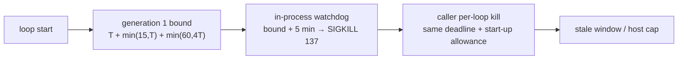

## Summary

Docs-only. `docs/TIMEOUTS.md` gains a subsection,
`### 🧱 The event-loop limit and the caller-side per-loop kill (Issue #4068)`,
under `## 🛰️ The external watchdog is unchanged`. It covers three things. First,
why `awaitWithinHardDeadline` (a `setInterval` on the main loop) and the other
in-process bounds cannot fire while the main thread is blocked, and what the
off-main-thread watchdog from #4066/#4067 does instead. Second, how a caller
recognises the watchdog's kill: SIGKILL, exit 137, and the
`first-generation-wedged` or `Run wedged … at generation <n>` breach line.
Third, the caller-side per-loop hard-kill formula
`start + T + min(15, max(1, T)) + min(60, 4×T) + margin`, with the T = 6 /
5-minute-margin worked example of **41 minutes**.
`## ✅ Verifying the guarantee` now names the #4066 subprocess tests in
`test/NEAT/EventLoopWatchdog_test.ts` next to the #4067 tests. Closes #4068.

One criterion is partial: the GRQ follow-up exists only as a draft. No open GRQ
issue matched, and this run's `gh` guard refused `gh issue create` against the
downstream production repo (`[SECURITY] [WRITE_REPO_BLOCKED]`). The drafted
issue is posted on #4060
(<https://github.com/stSoftwareAU/NEAT-AI/issues/4060#issuecomment-6226875027>)
for a human (needs-human) to file in GRQ exactly once and link.

## Spec

### Intent and Rationale

- `TIMEOUTS.md` called the hard cap "an in-process guarantee" without saying
  that every in-process bound needs the main loop to yield, which is the #4060
  failure mode. Callers also had no formula for a kill of their own.
- The subsection sits under the external-watchdog heading, as the issue asks. It
  links down to the existing `## 🐕` watchdog sections from #4066/#4067 rather
  than restating them.

### Essential Design Decisions

- The caller kill is the generation-1 bound plus the margin. After generation 1
  the in-process watchdog re-arms at the hard cap plus the margin, which is
  earlier, so one caller deadline bounds the whole loop.
- The issue says to report "137 plus that line as `first-generation-wedged`".
  The doc applies that to the generation-1 line. The
  `Run wedged … at generation <n>` line is reported as a wedge past the hard
  cap, because it is not a first-generation event. Neither is to be reported as
  a generic crash.
- The doc does not blame GC thrash for #4060. The #4069 reproduction excluded it
  (`docs/troubleshooting/MEMORY.md`), so the doc links there.

### Undiscoverable Facts

- #4066/#4067 landed on `Develop` through the `4060-src-event-loop-watchdog`
  milestone (PR #4084), but this milestone branch had not synced. This branch
  therefore merges `origin/Develop` (commit `cf87a85d`), and until the milestone
  syncs, the PR diff against the milestone base also shows that already-reviewed
  code. This PR's own change is commits `dbd6f872` and `01a44bd0`, which touch
  only `docs/TIMEOUTS.md`.
- GRQ's sampler lives at `worker/sampler.sh`. I checked that with a `gh api`
  contents lookup on the downstream production repo.
- GRQ search (open issues): no hits for "sampler.sh hard kill", "per-loop kill",
  "per-loop timeout", "first-generation-wedged", "watchdog 137" or "hard kill
  loop" that concern a per-loop kill. #5252 and #5255 are unrelated, and #5220
  and #5221 are closed.

## Evidence

Docs-only change; there is no UI and no code. The claims were checked against
`src/NEAT/HardDeadline.ts` (constants, `computeHardDeadlineTS`,
`computeFirstGenerationDeadlineTS`, `DEFAULT_WATCHDOG_MARGIN_MS`),
`src/creature/EvolveRunWatchdog.ts` (breach lines, re-arm at the hard cap),
`src/NEAT/EventLoopWatchdog.ts` (the `unavailable` log, the no-op handle only on
a constructor throw) and `test/NEAT/EventLoopWatchdog_test.ts`.

**Docs sweep** — grep: "in-process\*\* guarantee", `awaitWithinHardDeadline`,
`first-generation-wedged`, `sampler.sh`, "no-op handle"; section:
`docs/TIMEOUTS.md#-the-external-watchdog-is-unchanged`; siblings: none — no
existing set gained a member; updated: `docs/TIMEOUTS.md`;
`docs/TIMEOUTS.md:325` — still true because the cap is in-process, and the new
paragraph after it states the event-loop limit; `docs/TIMEOUTS.md:28`,
`docs/TIMEOUTS.md:103`, `docs/TIMEOUTS.md:294`, `docs/TIMEOUTS.md:465` and
`docs/TIMEOUTS.md:490` — still true because they describe the in-process
`terminationReason` path, which is unchanged; `docs/TIMEOUTS.md:447` — still
true because it quotes the breach line verbatim; `docs/OPTION_AUDIT_SLICE_D.md`,
`docs/OPTION_AUDIT_SLICE_E.md` and `docs/PROFILING_REPORT_3397.md`
(`worker/sampler.sh` hits) — still true because they describe unrelated GRQ
option flags.

## Acceptance Criteria

<!-- vibe-spec-review inputs="diff+issue-body" -->

- **met** — `docs/TIMEOUTS.md` explains the event-loop limit, the watchdog,
  SIGKILL/137, the breach line, and the per-loop kill formula with the T = 6
  worked example. — evidence: `docs/TIMEOUTS.md`
  `### 🧱 The event-loop limit and the caller-side per-loop kill (Issue #4068)`
  — reviewer: met
- **met** — `## ✅ Verifying the guarantee` names the new tests. — evidence:
  `docs/TIMEOUTS.md` names `test/NEAT/EventLoopWatchdog_test.ts` (#4066) and
  `test/creature/EvolveFirstGenerationBusyLoop_test.ts` (#4067) — reviewer: met
- **partial** — Exactly one GRQ issue (existing or new) is referenced from #4060
  for the caller-side per-loop kill. — evidence: draft posted on #4060, comment
  6226875027 — reviewer: partial — reason: no open GRQ issue matched, and the
  run's guard refused creating one in GRQ (WRITE_REPO_BLOCKED). A human must
  file the drafted issue in the downstream production repo once and link it from
  #4060.
- **met** — Markdown passes the repo's lint/format gate (`./quality.sh`). —
  evidence: full `./quality.sh` (exit 0, 9944 passed) and
  `npx --no-install markdownlint-cli2 docs/TIMEOUTS.md` (0 issues) — reviewer:
  missing — reason: the reviewer saw only the diff and could not run the gate.
  The full `./quality.sh` and markdownlint were run on the head and passed.

## Standards Review

<!-- vibe-standards-review inputs="diff+CODING-STANDARDS.md" -->

- **violation** — Claims must match the code (DOC_STYLE rule 4): the doc said a
  Worker that cannot load returns a no-op handle — evidence:
  `docs/TIMEOUTS.md:514` — reason: fixed in this diff (the async load failure
  returns the live handle; the doc now says only the in-process bound applies)
- **violation** — Claims must match the code (DOC_STYLE rule 4): the re-arm
  sentence said the caller deadline is the earlier one — evidence:
  `docs/TIMEOUTS.md:397` — reason: fixed in this diff (reworded: no later
  in-process bound is later than generation 1's, so the 41-minute deadline
  bounds the loop)
- **violation** — Claims must line up with the cited reference (DOC_STYLE rule
  4): the doc attributed #4060 to GC thrash, which #4069 excluded — evidence:
  `docs/TIMEOUTS.md:345` — reason: fixed in this diff (links the #4069
  exclusion; cause stated as unidentified)
- **clean** — constant and helper names, formula and worked-example arithmetic
  (12/36/41/17), breach-line text, named tests exist, relative links, Australian
  English, no test assertions removed, no workflow change. Review-enforced
  rules: none found worded as review-only in AGENTS.md, CONTRIBUTING.md,
  ENGINEERING_PRINCIPLES.md or DOC_STYLE.md.

## Test Plan

- No tests added or modified; this PR's own commits touch only
  `docs/TIMEOUTS.md` and this summary.
- `./quality.sh --rust-scorer-bin=<built rust_scorer> < /dev/null` on the head:
  exit 0, `9944 passed | 0 failed | 41 ignored`. The explicit flag is needed
  because the gate does not look under `CARGO_TARGET_DIR`, where this container
  builds the binary (a worker-environment fault, not a repo change).
- The first gate run failed `test/docs/ArchiveDocsNoPrivateRepoSlugs.ts` on this
  summary's private-repo slugs; they are reworded to concept level and that test
  now passes.
- `npx --no-install markdownlint-cli2 docs/TIMEOUTS.md < /dev/null`: 0 issues.

<!-- vibe-branch-outcomes -->

🤖 Generated with [Claude Code](https://claude.com/claude-code)
