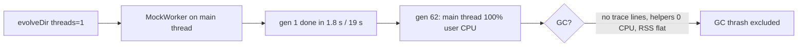

## Summary

Reproduced the #4060 loop-2 settings locally on the v7.0.55 tree. The run used
`--max-old-space-size=2163,--trace-gc`, `timeoutMinutes: 6`, population 5,
`threads: 1` and `heavyTaskWorkerCount: 1`, on a synthetic 8,404-neuron /
58,452-synapse creature. The finding is recorded in a new section of
`docs/troubleshooting/MEMORY.md`.

**Verdict: GC thrash is excluded for this reproduction.**

- Generation 1 finished in 1.8 s without a trainer and in 19 s with the FFI
  trainer.
- The post-GC heap peaked at 331.4 MB of 2163 MB.
- Mutator utilisation never fell below 0.986.

One run did go silent at generation 62 and ran past its timeout. During that
silence the main thread burned 100 % user CPU, with 0 s system CPU, 0 s on the
V8 GC helper threads, a flat RSS and no GC trace output. That is a busy loop
that allocates nothing, not GC. The spinning call site was **not** identified,
so the section still names the two host files that would identify the field's
call site. The reproduction harness is committed as
`scripts/repro_4069_gc_thrash.ts`.

Closes #4069.

## Spec

### Intent and Rationale

- The issue asked to confirm or exclude GC thrash as the cause of the silence. A
  run at the field size answers that directly: GC trace lines, mutator
  utilisation and per-thread CPU during the silence.
- The script is committed rather than described, so the verdict can be
  re-checked from the repository.

### Essential Design Decisions

- The verdict is limited to this reproduction. The field silence was at
  generation 1. The reproduced one was at generation 62 on a synthetic creature,
  so the doc names that difference and does not claim the field's cause.
- Diagnostic and docs only. No runtime code changes, as the issue's Failure
  Detection section requires.

### Undiscoverable Facts

- The per-thread CPU figures came from sampling `/proc/<pid>/task/*/stat` over
  15 s on the live, silent process. Main thread: +15.02 s user, +0 s system. All
  four `V8 DefaultWorker` threads: +0. `VmRSS` stayed at 1,752,672 kB on both
  samples.
- With `threads: 1`, the 5 s heartbeat timer never fired during evolution. On
  the head tree (7.0.59) a small run still shows a lag of 17,841 ms.

## Evidence

Backend/docs only; there are no UI files. Quoted from the local runs:

```text
[    3.5s] Generation 1 score 0.6296566717575544 (avg: 0.6295) error 0.3689388082424456 time 1s 787ms
[83513:0xffffaac40000]   129776 ms: Incremental Mark-Compact 1286.7 (1480.9) -> 331.4 (941.0) MB, pooled: 235.5 MB, 26.12 / 0.00 ms …
[  130.5s] [NEAT-AI] EvolutionControl: generation 62 exact (none/strategy-off), 4 exact / 0 approximate, canary divergence n/a
(no further output; process alive at 528 s, past timeoutMinutes 6)
FFI run: [  363.2s] [heartbeat] heap=1003MB lag=358192ms maxLag=358192ms
```



**Docs sweep** — grep: `MemoryMonitor`, "GC thrash", "max-old-space-size=2163";
section:
`docs/troubleshooting/MEMORY.md#-silent-single-worker-generation-gc-thrash-excluded-issue-4069`;
siblings: "Discovery memory tuning", "Exit code 143" (the existing table of
contents entries; the new section was added to that list); updated:
`docs/troubleshooting/MEMORY.md`.

## Reproduction

- **symptom** — loop 2 at 2163 MB, `popSize=5`, `threads 1`, `heavyWorkers 1`
  printed `Training <id> scheduled` and then nothing for about 2 h.
- **status** — `partial` — reason: a silence with the same shape was reproduced,
  a busy main thread past the timeout with no log output. It happened at
  generation 62 on a synthetic creature, not at generation 1 on the field
  creature. The field creature, its dataset and the in-flight task records are
  not reachable from this repository.
- **regression test** — none. This is a diagnostic-only change and no runtime
  behaviour changes. The harness is `scripts/repro_4069_gc_thrash.ts`.

## Acceptance Criteria

<!-- vibe-spec-review inputs="diff+issue-body" -->

- **met** — The reproduction command line and synthetic-creature parameters are
  recorded. — evidence: `docs/troubleshooting/MEMORY.md` (Reproduction
  subsection) and `scripts/repro_4069_gc_thrash.ts` — reviewer: met
- **partial** — The verdict (confirmed / excluded / inconclusive) is stated,
  with quoted evidence rather than inference. — evidence:
  `docs/troubleshooting/MEMORY.md` (Evidence and Verdict subsections) —
  reviewer: partial — reason: the reviewer noted that the field's generation-1
  silence was not itself reproduced, so "excluded" holds only for this
  reproduction. The doc scopes it that way. Still outstanding: a host capture
  that names the field's spinning call site.
- **met** — The troubleshooting note is added under `docs/troubleshooting/`, or
  the hand-off comment names exactly which host files a human must fetch. —
  evidence: `docs/troubleshooting/MEMORY.md`, which also names
  `training-task-b08ca7f0.json` and `training-task-b3acbd96.json` — reviewer:
  met
- **partial** — Any committed markdown passes `./quality.sh`. — evidence:
  `./quality.sh --lint-only` passed, markdownlint-cli2 reported 0 issues, and
  `deno test test/docs/*.ts` passed (316 passed, 0 failed) — reviewer: missing —
  reason: the reviewer said a gate "cannot be judged from a diff". The full
  `./quality.sh` exits before linting because this host has no native
  `rust_scorer` ("Native rust_scorer is required … but was not found"). That is
  an environment fault, so CI must run the full gate.
- **unrequested** — the finding that `setInterval` timers do not fire on the
  `threads: 1` MockWorker path — reviewer: unrequested — reason: observed in the
  same runs. It explains why the missing `[MemoryMonitor]` and `setInterval`
  output, which the issue asked about, is not evidence of GC.
- **unrequested** — the generation-62 busy-loop finding — reviewer: unrequested
  — reason: it is the silence the reproduction actually produced, and it is the
  evidence for the verdict.
- **unrequested** — the note that `[MemoryMonitor]` stays quiet below its
  thresholds — reviewer: unrequested — reason: it answers the issue's question
  about why those lines were missing.

## Standards Review

<!-- vibe-standards-review inputs="diff+CODING-STANDARDS.md" -->

- **violation** — the doc named a reproduction script, `repro_4069.ts`, that did
  not exist in the repository (named-but-absent reference) — evidence:
  `docs/troubleshooting/MEMORY.md:448` — reason: fixed in this diff; the script
  is committed as `scripts/repro_4069_gc_thrash.ts` and the doc names it
- **clean** — Australian English, the TOC anchor matches the heading slug, no
  bare "NEAT", and the cited symbols exist (`checkMemoryAndEvict` and
  `logMemoryUsage` in `src/NEAT/MemoryMonitor.ts`, `nonblocking: false` in
  `src/architecture/training/NativeBackpropLibrary.ts`). The review-enforced
  rules checked were ENGINEERING_PRINCIPLES 1–11 and the AGENTS.md testing and
  logging rules; the diff touches no runtime code or tests. No assertions were
  removed. Optional style notes (GC/FFI/CPU acronyms) were not chased.

## Test Plan

- No tests added or modified. This is a docs and diagnostic-script change with
  no runtime behaviour change.
- `deno fmt`, `deno lint` and
  `deno check --config deno.json
  scripts/repro_4069_gc_thrash.ts`: passed.
- `./quality.sh --lint-only`: passed (exit 0).
- `deno test -A --config deno.json --preload test/_preload.ts test/docs/*.ts`:
  passed (316 passed, 0 failed).
- `R_HIDDEN=200 R_RECORDS=500 deno run -A --config deno.json
  scripts/repro_4069_gc_thrash.ts`
  on the head tree: ran to generation 1000 and exited 0.
- Full `./quality.sh`: exited 1 before linting, with "Native rust_scorer is
  required (quality.sh default) but was not found". This is an environment fault
  on this host, not a check this change fails.

<!-- vibe-quality-gate-skipped reason="full ./quality.sh refuses to start without the native rust_scorer binary on this host; lint-only stage and docs tests passed; CI runs the full gate" -->

<!-- vibe-branch-outcomes -->

🤖 Generated with [Claude Code](https://claude.com/claude-code)
