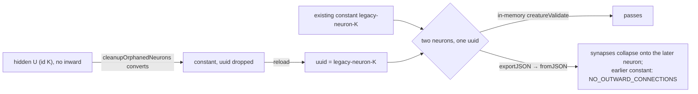

## Summary

`cleanupOrphanedNeurons` converts a hidden neuron that has outward but no inward
synapses into a constant. The conversion built a new export object that kept the
neuron's `id`, bias and tags but dropped its `uuid`. When that export was
loaded, `Neuron.fromJSON` gave the uuid-less constant the label
`legacy-neuron-<id>`. That label can match a uuid another neuron in the same
creature already carries, for example a constant left by an earlier conversion
of the same source neuron. The creature then holds two neurons with one uuid. It
still passes `creatureValidate` in memory, because there is no duplicate-uuid
rule and synapses are resolved by index there. The next export→import, however,
resolves every synapse for that uuid onto the later neuron. The earlier constant
is left with no outward synapse, and the load fails with the CI error. The fix
keeps the neuron's `uuid` on the converted constant, as the neuron UUID
stability invariant in `AGENTS.md` requires. Closes #4071.

## Spec

### Intent and Rationale

- `fix()` repairs every fine-tune candidate in memory before `NeatScheduling`
  serialises it as `r.train.backtracked`, yet the CI load of that JSON still
  failed. So the damage had to come from the round trip itself, not from a
  missing repair step. Adding one more validate-and-repair call at the producer,
  the pattern #3386 used, would not have caught it: in-memory validation passes
  on the damaged creature.
- The `legacy-neuron-` label in both #3383 and this issue can only come from a
  constant serialised without a uuid. The only producer of such a constant is
  the hidden→constant conversion in `src/compact/OrphanedNeuronCleanup.ts`. The
  other conversions (`SubNeuron`, `SubSelfCon`, `SubBackCon`,
  `Offspring.fixType`, `TargetedRepair`, `Simplify`) rewrite `neuron.type` in
  place and keep the uuid.

### Essential Design Decisions

- The uuid is copied unconditionally (`uuid: neuron.uuid`). For legacy uuid-less
  input it is `undefined`, which `Neuron.fromJSON` treats exactly like a missing
  uuid, so that path is unchanged.
- No load-side or validation change. Rejecting duplicate uuids belongs to
  NEAT-AI-core's `creature_validate` rules and is outside this issue.

### Undiscoverable Facts

- In this checkout `ProcessCompletedResults.ts:79`, the frame in the CI trace,
  is `Creature.fromJSON(r.train.backtracked, …)`. I confirmed the file at the
  failing run's head SHA `b788cf08` via `gh api …/contents?ref=` and it is the
  same line. So the failing creature was the fine-tune variant built in the main
  thread, not the worker's trained or compacted result.
- The XNOR test did not fail end to end in 210 seed runs, nor in 231 runs of the
  test's seed loop under CPU contention with a capture probe on the fine-tune
  export. One contention run hit an unrelated flaky
  `Memetic … has no matching synapses` failure.

## Evidence

Bug fix, backend only. A deterministic reproduction of the exact error
signature, run against the base-branch code before the fix:

```text
input:…  constant:legacy-neuron-1777777:415099909 hidden:U:1777777 hidden:H2 output:output-0
{ removed: 0, converted: 1 }
… constant:legacy-neuron-1777777:415099909 constant:legacy-neuron-1777777:1777777 …
in-memory valid
round trip FAIL: constants neuron legacy-neuron-1777777 has no outward connections
```



**Docs sweep** — grep: `cleanupOrphanedNeurons`, `legacy-neuron`, "convert\w* to
.*constant", "drops the source UUID"; section: none — no manual documents the
orphan-cleanup conversion (the only doc hits are code comments and
`CHANGELOG.md`); siblings: none — no existing set gained a member; updated:
`src/compact/OrphanedNeuronCleanup.ts` (doc comment of
`cleanupOrphanedNeurons`), `test/compact/CleanupOrphanedNeurons.ts` (two
comments that said the conversion drops the source UUID), `CHANGELOG.md`;
`src/neuron/NeuronSerialization.ts:180` — still true because uuid-less legacy
snapshots still get the `legacy-neuron-<id>` label;
`test/architecture/training/CompactResultValidation.ts:11` — still true because
it quotes the historical #3383 error.

## Reproduction

- **symptom** —
  `Uncaught ValidationError: constants neuron legacy-neuron-148065463 has no outward connections`
  at `processCompletedResults (ProcessCompletedResults.ts:79)` while loading a
  fine-tune variant in `XNOR - evolve`
- **status** — `partial` — reason: the regression test was observed failing
  against the unfixed code
  (`constants neuron legacy-neuron-1777777 has no outward connections`) and
  passing after the fix, but it drives the conversion directly. The end-to-end
  flaky `XNOR - evolve` failure did not reproduce in 441 evolution runs, so it
  is not proven that this collision is the exact one CI hit.
- **regression test** —
  `test/compact/ConvertedConstantKeepsUuid.ts::Issue #4071 - a converted constant survives an export round trip beside a legacy-labelled constant`

## Test Plan

- Added `test/compact/ConvertedConstantKeepsUuid.ts`:
  - `Issue #4071 - a converted constant survives an export round trip beside a legacy-labelled constant`:
    a constant `legacy-neuron-1777777` sits beside a hidden `U` (id 1777777)
    that has no inward synapse. After `cleanupOrphanedNeuronsInCreature`, a
    debug-validated `Creature.fromJSON(creature.exportJSON(), true)` must load.
    Both constants keep distinct uuids and outward synapses.
  - `Issue #4071 - cleanupOrphanedNeurons keeps the source uuid on a hidden converted to a constant`:
    the converted constant's uuid equals the hidden neuron's uuid.
  - Red check: with `uuid: neuron.uuid,` removed, both tests fail, with
    `ValidationError: constants neuron legacy-neuron-1777777 has no outward connections`
    and `AssertionError: undefined` vs `"hidden-no-inward"` respectively. Both
    pass with the line restored.
- Edited `test/compact/CleanupOrphanedNeurons.ts`: comments only. Two comments
  said "(conversion drops the source UUID)" and are reworded. No assertion was
  removed or changed.
- Targeted run:
  `deno test … test/compact/ConvertedConstantKeepsUuid.ts test/compact/CleanupOrphanedNeurons.ts test/compact/OrphanedNeuronCornerCases.ts test/compact/CompactTagPreservation.ts test/architecture/training/CompactResultValidation.ts test/creature/NeuronUuidStability.ts`:
  41 passed, 0 failed.
- `./quality.sh --rust-scorer-bin=/var/tmp/vibe-cargo-target/NEAT-AI-5d15f9f9/release/rust_scorer < /dev/null`
  on the final code: `ok | 9928 passed (5 steps) | 0 failed | 4 ignored`, exit
  0. The `rust_scorer` binary came from the host's existing cargo target
  directory, outside the checkout.

<!-- vibe-branch-outcomes -->

🤖 Generated with [Claude Code](https://claude.com/claude-code)
