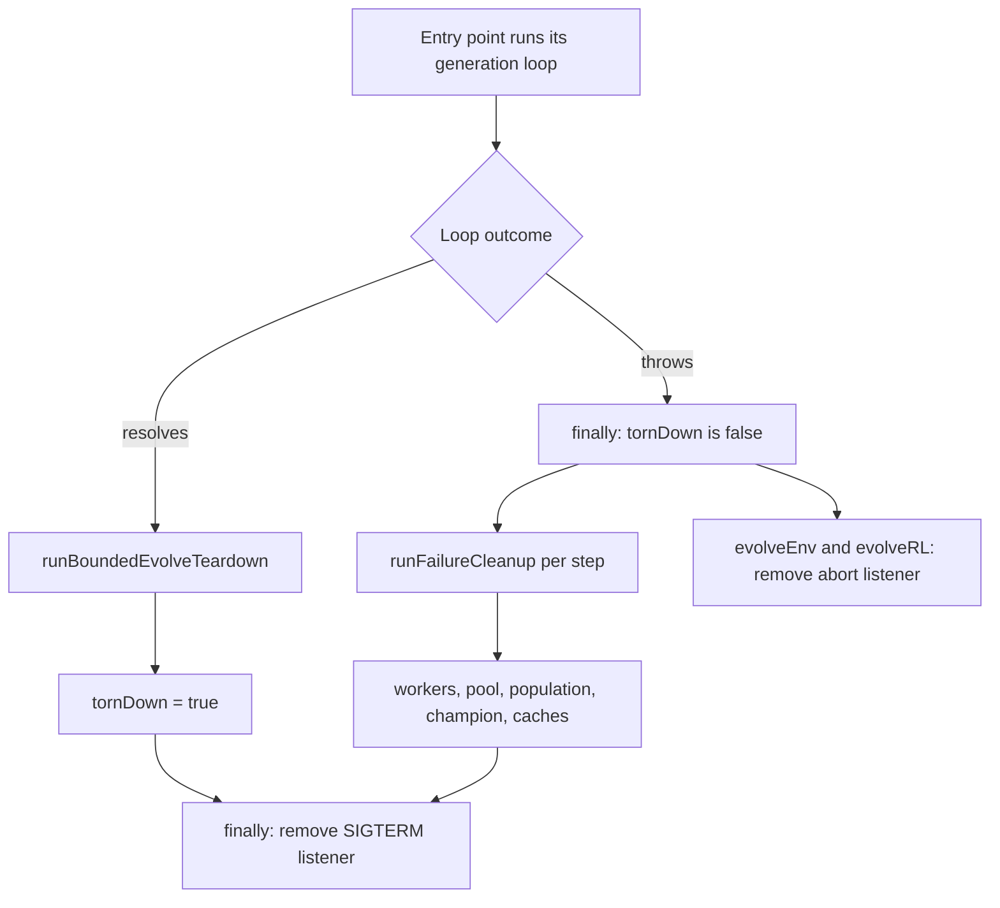

## Summary

`evolveDir()`, `evolveEnv()` and `evolveRL()` now tear down their run when the
generation loop throws. Before this change a rejected run left its SIGTERM
listener registered, so a supervisor's SIGTERM was swallowed (see #4066).
`evolveEnv()` and `evolveRL()` also kept their abort listener. A failed run did
not release its worker threads, episode pool, population, champion or the
process-global evolve caches. Closes #4072.

Each entry point wraps its body in `try`/`finally`. Its success path already
runs `runBoundedEvolveTeardown` (`src/creature/CreatureTraining.ts:854`,
`:1287`, `:2009`), so each entry point sets `let tornDown = false` and sets it
to `true` after that teardown. The `finally` runs the failure teardown only
while `tornDown` is still `false`. The SIGTERM listener is removed on every
exit. Each failure-teardown step runs through `runFailureCleanup`
(`src/creature/CreatureTraining.ts:503-508`), so a cleanup error is logged and
never replaces the original rejection.

## Spec

### Requirements

Each requirement is pinned by a named test in
`test/creature/EvolveCleanupOnThrow_test.ts`.

- **met** — A rejected `evolveDir()` terminates every worker, removes its
  SIGTERM listener, and a second run starts clean. Test 1.
- **met** — A cleanup error is logged and never replaces the original rejection.
  Test 2.
- **met** — A rejected `evolveEnv()` removes its SIGTERM and abort listeners,
  and a second run starts clean. Test 3.
- **met** — A rejected `evolveRL()` removes its SIGTERM and abort listeners, and
  a second run starts clean. Test 4.
- **met** — A rejected `evolveRL()` terminates its episode worker pool. Test 5.
- **met** — A rejection after a champion exists disposes the champion, for all
  three entry points. Tests 6 to 8.
- **met** — A successful run logs no cleanup failure, leaves the caller usable,
  and terminates the `evolveRL()` episode pool exactly once. Tests 9 to 11.
- **n/a for `evolveEnv()`** — `evolveEnv()` creates no worker threads or episode
  pool, so the worker and pool requirements do not apply to it.

### Second terminate after a partial success-path teardown

If a step after `runBoundedEvolveTeardown` throws, `tornDown` stays `false`, so
the failure teardown runs on a run that was partly torn down already. For
`evolveDir()` nothing terminates twice, because `workers.length = 0` at
`src/creature/CreatureTraining.ts:879` empties the array. For `evolveRL()` the
episode pool may be terminated a second time. Test 11 pins one call on the
success path only. `EpisodeWorkerPool.terminate` was not checked for idempotence
in this change.

## Evidence

Backend-only change; there is no UI surface.

Eleven tests in `test/creature/EvolveCleanupOnThrow_test.ts`:

1. `evolveDir: a rejected generation terminates every worker, removes its SIGTERM listener, and a second run starts clean (Issue #4072)`
2. `evolveDir: a cleanup error is logged and never replaces the original rejection (Issue #4072)`
3. `evolveEnv: a rejected generation removes its SIGTERM and abort listeners, and a second run starts clean (Issue #4072)`
4. `evolveRL: a rejected generation removes its SIGTERM and abort listeners, and a second run starts clean (Issue #4072)`
5. `evolveRL: a rejected generation terminates its episode worker pool (Issue #4072)`
6. `evolveDir: a rejection after a champion exists disposes the champion (Issue #4072)`
7. `evolveEnv: a rejection after a champion exists disposes the champion (Issue #4072)`
8. `evolveRL: a rejection after a champion exists disposes the champion (Issue #4072)`
9. `evolveDir: a successful run logs no cleanup failure and leaves the caller usable (Issue #4072)`
10. `evolveEnv: a successful run logs no cleanup failure and leaves the caller usable (Issue #4072)`
11. `evolveRL: a successful run logs no cleanup failure, terminates its episode worker pool exactly once, and leaves the caller usable (Issue #4072)`

Targeted runs (`deno test -A` with `< /dev/null`):

- `EvolveCleanupOnThrow_test.ts`: `ok | 11 passed | 0 failed (482ms)`.
- Six creature files together (`EvolveCleanupOnThrow_test.ts`,
  `EvolveRejectsUnusableCaller_test.ts`, `EvolveWatchdogWiring_test.ts`,
  `EvolveRunWatchdog_test.ts`, `NeuronUuidStability.ts`,
  `SemanticVersionStability.ts`): `ok | 59 passed | 0 failed (1s)`.

**Docs sweep** — grep: `SIGTERM listener`, `abort listener`,
`runBoundedEvolveTeardown`, `Issue #4072`; section: the Issue #4072 paragraph in
`docs/TIMEOUTS.md` (L186-200), next to the teardown section; siblings: Issue
#4067 (`docs/TIMEOUTS.md:368`), Issue #4078 (`docs/TIMEOUTS.md:168`), Issue
#4071 (no doc section; the fix is in code and `CHANGELOG.md` only); updated:
`docs/TIMEOUTS.md` (+15 lines), `CHANGELOG.md:48` (the Issue #4072 entry);
`docs/TIMEOUTS.md:145` (link to `BoundedEvolveTeardown.ts`) — still true, not
touched; `docs/TIMEOUTS.md:187` says the outer `finally` removes the SIGTERM
listener on every exit — still true, matching
`src/creature/CreatureTraining.ts:960`, `:1387` and `:2133`.

## Standards Review

<!-- vibe-standards-review inputs="diff+AGENTS.md" -->

Manual check against `AGENTS.md` and `docs/ENGINEERING_PRINCIPLES.md`:

- **clean** — `grep` for `console.`, `@std/log` and `Deno.env` in the added
  lines of `src/creature/CreatureTraining.ts` and in
  `test/creature/EvolveCleanupOnThrow_test.ts` returned no matches. The test
  file has no timing API. `Date.now()` appears in the added lines of
  `CreatureTraining.ts` only because the re-indent rewrote 14 existing
  elapsed-time calls (origin already had 14); they measure elapsed time, which
  `AGENTS.md` keeps on `Date.now()`.
- **clean** — Failure logging goes through `getLogger()`. No TS fallback was
  added. No UUID, semantic-version or synapse-identity code was touched.
- **clean** — No existing assertion was removed. The new tests import the
  modules under test by relative path.

## Test Plan

Mutation checks ran on a copy in `/tmp`, so the worktree was not edited. Each
mutant was restored and `cmp` confirmed the copy was identical to the source.

| Mutant                                          | Result                                | Failing test(s) |
| ----------------------------------------------- | ------------------------------------- | --------------- |
| M0 unmutated                                    | `ok \| 11 passed \| 0 failed`         | none            |
| M1 `CreatureTraining.ts:944` guard `if (false)` | `FAILED \| 8 passed \| 3 failed`      | tests 1, 2, 6   |
| M2 `:1375` guard `if (false)`                   | `FAILED \| 9 passed \| 2 failed`      | tests 3, 7      |
| M3 `:2120` guard `if (false)`                   | `FAILED \| 8 passed \| 3 failed`      | tests 4, 5, 8   |
| M4 `:944` guard `if (true)`                     | `ok \| 11 passed` (green, equivalent) | none            |
| M5 `:1375` guard `if (true)`                    | `ok \| 11 passed` (green, equivalent) | none            |
| M6 `:2120` guard `if (true)`                    | `FAILED \| 10 passed \| 1 failed`     | test 11         |
| M7 `:1388` evolveEnv abort removal deleted      | `FAILED \| 10 passed \| 1 failed`     | test 3          |
| M8 `:2134` evolveRL abort removal deleted       | `FAILED \| 10 passed \| 1 failed`     | test 4          |
| M9 `:506` `runFailureCleanup` catch rethrows    | `FAILED \| 10 passed \| 1 failed`     | test 2          |
| M10 `:2124` evolveRL pool terminate deleted     | `FAILED \| 10 passed \| 1 failed`     | test 5          |
| M11 `:958` evolveDir cache release deleted      | `FAILED \| 10 passed \| 1 failed`     | test 1          |

M4 and M5 stay green because forcing the guard to `true` only repeats the
teardown after a successful run. That is why the success-path outcomes at `:944`
and `:1375` are recorded as `exempt` in the facts file.

- The `flipWentRed` values in
  `docs/archive/pr-summaries/pr-summary-4072.facts.json` come from these runs.
- The tests in the Evidence list must exist under those names.

### Quality gate

- `./quality.sh --lint-only` passed: 2889 files formatted, 2226 files linted,
  six bash scripts checked.
- `./quality.sh --check-only` passed: `deno check` completed with exit 0.
- The full `./quality.sh` test run was **not** run in this worker: its test lane
  hard-requires the native `rust_scorer` binary (Issue #3871), which is not
  present in this environment. The tests that cover this change were run
  directly with `deno test -A` (see Evidence) and pass. CI and the worker's
  pre-PR gate re-run the full suite with the scorer.

<!-- vibe-branch-outcomes -->

## Notes

- **Helper reuse (#4078).** The entry points reuse `snapshotEvolveCaller`,
  `assertEvolveCallerUsable`, `restoreEvolveChampion`, `disposeEvolvePopulation`
  and `releaseEvolveCaches` from `src/creature/EvolveTeardown.ts`.
- **Watchdog (#4067) unchanged.** `armRunWatchdog` is still the first statement
  of the inner `try`, and `watchdog?.disarm()` still runs in the inner
  `finally`.
- **Diff size.** `src/creature/CreatureTraining.ts` shows 2482 changed lines in
  `git diff`, because wrapping each body in `try`/`finally` re-indents it. Under
  `git diff -w` it is 130 lines (112 insertions, 18 deletions). The whole branch
  is 1273 insertions and 18 deletions under `-w`.
- **CHANGELOG (#4067).** Commit `3b61a461` restores the Issue #4067 entry that
  the #4072 entry had dropped.
- **Dependencies.** No `deno.lock`, `deno.json` or dependency change. The diff
  touches four files: `CHANGELOG.md`, `docs/TIMEOUTS.md`,
  `src/creature/CreatureTraining.ts` and
  `test/creature/EvolveCleanupOnThrow_test.ts`.
- **Persisted data.** No export or import code changed, so no persisted data
  shape changed.

## Pre-PR security self-check

- No secrets, tokens or credentials are in the diff.
- No new external inputs, network calls, file reads or dependencies were added.
- The change only removes listeners and releases resources on failure. Cleanup
  errors are logged through `getLogger()`.

🤖 Generated with [Claude Code](https://claude.com/claude-code)
