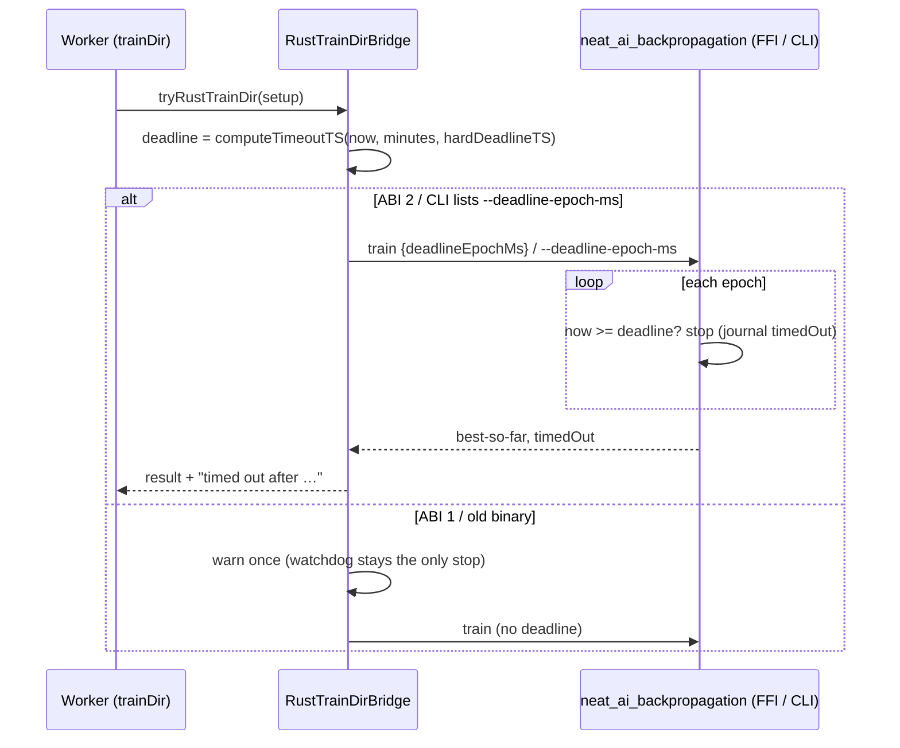

## Summary

The Rust `trainDir` path now hands the native trainer the task's per-task
deadline. That deadline is the same `timeoutTS` the TypeScript loop uses
(`computeTimeoutTS(now, trainingTimeOutMinutes, hardDeadlineTS)`). A long native
train therefore stops between epochs and returns its best-so-far creature.
Before this change it ran every epoch, blocked the worker past the grace cycle,
and was cancelled and quarantined as a "hang".

- **FFI:** the bridge sends `deadlineEpochMs` (ABI 2). It reads `timedOut` from
  the response instead of hard-coding `false`.
- **CLI fallback:** the bridge passes `--deadline-epoch-ms`, and the journal's
  `{"kind":"timedOut",…}` line sets `timedOut`.
- **Log line:** a native stop logs `Training <ID> timed out after …`, the same
  line the TypeScript loop writes.

The native side of the fix is on stSoftwareAU/NEAT-AI-Backpropagation branch
`issue-neat-ai-4073-train-deadline` (commit `7ec31cc`, crate 0.1.48). That
branch adds the request field, the CLI flag, the per-epoch check, the journal
line, the `timedOut` response field and ABI 2. The worker opens its PR from the
marker in this run's final message.

Part of #4073. This PR does not close the issue: the issue's closing evidence is
a GRQ-logs line from a release that carries the fix. That line needs the native
PR merged and released, and GRQ hosts updated.

## Spec

### Intent and Rationale

- The FFI call is synchronous inside the worker, so nothing on the TypeScript
  side can interrupt it. The only clean stop is inside the native loop, so the
  deadline goes to the trainer.
- The deadline comes from the existing owner, `computeTimeoutTS`, rather than a
  copy. Both backends therefore stop on the same instant.

### Essential Design Decisions

- **ABI 1 stays loadable.** An ABI-1 library or a binary whose `train --help`
  lacks `--deadline-epoch-ms` still trains. It just can't enforce the deadline,
  and the bridge warns once per process. The request is `deny_unknown_fields`,
  so the field is omitted entirely, not sent as `null`, for ABI 1. Refusing ABI
  1 would have turned every GRQ host into a hard training failure until the new
  crate is installed.
- **The check runs before each epoch, including the first.** An epoch already
  running finishes first. The check is not between record batches (the issue's
  "if affordable").
- **CLI capability is probed with `train --help`.** It is not detected by
  retrying after a clap error, so a failed probe means "unsupported", never a
  failed train.

### Undiscoverable Facts

- Before this change, NEAT-AI-Backpropagation accepted no deadline at all: a
  grep of its tree found no deadline or timeout field. NEAT-AI could not have
  been simply forgetting to send one.
- The CLI stub tests need no native build, so they run anywhere. The FFI
  deadline test returns early unless an ABI-2 library resolves. It was run here
  against the library built from the native branch.

## Evidence

Backend only, no UI. End-to-end run against the real binary and library built
from the native branch. The scratch script in `/tmp` trains `Creature(10,1)` on
1,000,000 records with `iterations: 50` and `trainingTimeOutMinutes: 0.05` (3
s); about 0.7 s per epoch:

| Code             | Backend | Deadline | Result                                                                            |
| ---------------- | ------- | -------- | --------------------------------------------------------------------------------- |
| base (`d7c8f72`) | CLI     | 3 s      | `{"iteration":50,"elapsedMs":41708}`, no timed-out line                           |
| this branch      | FFI     | 3 s      | `Training a812440f timed out after 3s 451ms` / `{"iteration":5,"elapsedMs":3454}` |
| this branch      | CLI     | 3 s      | `Training d415897d timed out after 3s 391ms` / `{"iteration":5,"elapsedMs":3394}` |
| this branch      | FFI     | none     | `{"iteration":50,"elapsedMs":35192}`                                              |

Real tool observed: `neat_ai_backpropagation train --help` from the native
branch prints `--deadline-epoch-ms <DEADLINE_EPOCH_MS>` on stdout, and the CLI
probe depends on that. The native tests assert the journal line
`{"kind":"timedOut","completedEpochs":0,"deadlineEpochMs":1}`.
`scripts/check_native_backprop_train.ts` against that library prints
`(v0.1.48, ABI 2)`.

**Docs sweep** — grep: "enforces each task", "worker enforce\w*",
`NEAT_BACKPROP_ABI_VERSION`, "header revision", `timedOut: false`,
`neat_backprop_train`, `neat_ai_backpropagation`; section:
`src/NEAT/PerTaskTrainingTimeout.ts#TRAINING_TASK_WATCHDOG_GRACE_MS` (the issue
names this doc comment; no manual page documents the Rust trainDir deadline);
siblings: `maxRecords`, `traceStore` (existing request fields, which only the
request interface lists); updated: `src/NEAT/PerTaskTrainingTimeout.ts`,
`src/NEAT/Neat.ts`, `src/architecture/training/NativeBackpropLibrary.ts`,
`src/architecture/training/RustTrainDirBridge.ts`,
`scripts/check_native_backprop_train.ts`, `CHANGELOG.md`;
`src/architecture/training/TrainingOutcome.ts:84` — still true because it is the
TypeScript loop's initial state; `README.md:331` — still true because it only
names the sibling crate.

## Reproduction

- **symptom** — a native (FFI/CLI) `trainDir` ignored its per-task `timeoutTS`
  and ran every epoch: a 3 s budget ran 50 epochs in 41.7 s on base. On GRQ this
  blocked the worker past the grace cycle, and the watchdog then cancelled the
  task and quarantined the worker.
- **status** — `verified` — the CLI regression test failed on the bridge with
  only the deadline forwarding removed
  (`Rust trainDir CLI: per-task deadline is forwarded and stops training early ... FAILED`),
  as did the FFI test against the real ABI-2 library. Both pass after the fix.
  The end-to-end base-vs-fix runs above reproduce the reporter's symptom with
  the real native binary. On the unmodified base, the new test file fails at
  import, because the base module lacks `nativeBackpropSupportsDeadline`.
- **regression test** —
  `test/architecture/training/RustTrainDirBridge.ts::Rust trainDir CLI: per-task deadline is forwarded and stops training early`,
  plus
  `test/architecture/training/RustTrainDirBridge.ts::Rust trainDir FFI: per-task deadline stops the native trainer early`

## Acceptance Criteria

<!-- vibe-spec-review inputs="diff+issue-body" -->

- **met** — Pass the task's absolute deadline (or remaining ms) into the native
  train: a new `deadlineEpochMs` / `timeoutMs` field on
  `NativeBackpropTrainRequest` (ABI bump), honoured between epochs at least, and
  between record batches if affordable. Report `timedOut: true` from the
  response instead of hard-coding `false` at `RustTrainDirBridge.ts:534`. —
  evidence: `src/architecture/training/NativeBackpropLibrary.ts`,
  `src/architecture/training/RustTrainDirBridge.ts`,
  `test/architecture/training/RustTrainDirBridge.ts::Rust trainDir FFI: per-task deadline stops the native trainer early`;
  native enforcement on NEAT-AI-Backpropagation `7ec31cc` — reviewer: met
- **met** — Give the CLI fallback (`spawnTrain`) the same deadline, as an
  argument or as a kill after the deadline. — evidence:
  `test/architecture/training/RustTrainDirBridge.ts::Rust trainDir CLI: per-task deadline is forwarded and stops training early`
  — reviewer: met
- **met** — Make `PerTaskTrainingTimeout.ts`'s comment true, or reword it. —
  evidence: `src/NEAT/PerTaskTrainingTimeout.ts`, `src/NEAT/Neat.ts`
  (`abandonStuckTrainingTasks` doc) — reviewer: met
- **partial** — Regression test: native `trainDir` with a 1-epoch-cost of ~2 s,
  `epochs` = 50 and a `timeoutTS` 3 s out must return within ~5 s with
  `timedOut: true` and a best-so-far creature. Today it runs all 50 epochs, so
  the test fails. — evidence:
  `test/architecture/training/RustTrainDirBridge.ts::Rust trainDir FFI: per-task deadline stops the native trainer early`,
  CLI tests in the same file, and the timed end-to-end runs under Evidence —
  reviewer: partial — reason: AGENTS.md forbids timing APIs in unit tests, so
  the tests use a deadline already passed (deterministic) rather than 2 s
  epochs. The mid-run stop (5 of 50 epochs at 3.4 s) is shown by the recorded
  end-to-end runs, not a unit test. The FFI test skips without an ABI-2 library.
- **missing** — Closing evidence: a quoted GRQ-logs line on the release carrying
  the fix, showing a native training task reporting `timed out after …` near its
  deadline, and no `cancelled after …ms without a response` for that run.
  Inspection is not enough. — reviewer: missing — reason: this needs the
  NEAT-AI-Backpropagation PR merged and released, this PR released, and a GRQ
  run on updated hosts. It cannot exist before merge.
- **unrequested** — ABI-1 compatibility: `NEAT_BACKPROP_MIN_ABI_VERSION`,
  `getNativeBackpropAbiVersion`, `nativeBackpropSupportsDeadline`, the
  `train --help` probe and the once-per-process warning — reviewer: unrequested
  — reason: without it the ABI bump would turn every host still on the old crate
  into a hard training failure. The warning keeps the gap visible rather than
  silent.
- **unrequested** — `CHANGELOG.md` entry and the ABI text in
  `scripts/check_native_backprop_train.ts` — reviewer: unrequested — reason: the
  changelog records the needed native upgrade, and the check script would
  otherwise print a wrong ABI after the bump.

## Standards Review

<!-- vibe-standards-review inputs="diff+CODING-STANDARDS.md" -->

- **violation** — the CLI test stub was more permissive than the real binary: no
  `set -e`, unchecked positional args and creature copy, and no named contract
  source — evidence: `test/architecture/training/RustTrainDirBridge.ts:563`
  (`cliStubScript`) — reason: fixed in this diff. The stub now runs under
  `set -euo pipefail`, exits 2 on missing args or `--output-dir` and 1 on an
  unreadable creature or non-directory data path, and names
  `backpropagation/src/main.rs` on NEAT-AI-Backpropagation `7ec31cc` as its
  contract.
- **clean** — Australian English; logging through `getLogger()` only; no
  `@std/log`; `Date.now()` used only for deadline and elapsed time (Temporal
  rule); no timing APIs, `Deno.env.set` or `Deno.env.delete` in tests
  (child-process pattern with `clearEnv`); UUID and semantic-version invariants
  untouched; no removed or changed test assertions. The repository has no
  `CODING-STANDARDS.md`, so the reviewer used `AGENTS.md` and
  `docs/ENGINEERING_PRINCIPLES.md`; it found no rule there marked
  review-enforced.

## Test Plan

- Added in `test/architecture/training/RustTrainDirBridge.ts`:
  - `Rust trainDir FFI: per-task deadline stops the native trainer early`: real
    ABI-2 library; asserts `iteration < 50` and the `timed out after` log.
  - `Rust trainDir CLI: per-task deadline is forwarded and stops training early`:
    child process with a stub CLI; asserts iteration 1, the timed-out log and no
    warning.
  - `Rust trainDir CLI: no deadline runs every iteration`: iteration 50, no
    timed-out log.
  - `Rust trainDir CLI: binary without --deadline-epoch-ms trains and warns`:
    iteration 50 and the once-only warning.
- No existing test assertion was removed or changed.
- Red checks (each break alone, then restored):
  - Drop FFI and CLI deadline forwarding: the FFI and CLI deadline tests went
    red.
  - Ignore the journal `timedOut` line: the CLI deadline test went red.
  - Disable the CLI unsupported warning: the old-binary test went red.
  - Never log the timeout: both deadline tests went red.
  - Hard-code FFI `timedOut: false`: the FFI test went red.
  - Force CLI `deadlineTS > 0` true: the no-deadline test went red.
  - Force the FFI `deadlineTS > 0` check true:
    `Rust trainDir FFI: MSE forward-only trains when library is present` went
    red.
- `NEAT_AI_BACKPROP_LIB_PATH=<native branch .so> deno test -A test/architecture/training/RustTrainDirBridge.ts`:
  20 passed, 0 failed. Without the library (CI shape): 20 passed, with the FFI
  tests returning early.
- `./quality.sh --rust-scorer-bin=<rust_scorer built from NEAT-AI-scorer>`
  passed with exit 0:
  `ok | 9893 passed (5 steps) | 0 failed | 41 ignored (13m8s)`. The gate started
  before two follow-up edits: the stricter stub and the probe-cache removal in
  `RustTrainDirBridge.ts`. Their file's tests and fmt/lint/check were re-run on
  the final head.
- New members, each with a production reader:
  - `nativeBackpropSupportsDeadline` and `getNativeBackpropAbiVersion` are read
    by `RustTrainDirBridge.ts`. `getNativeBackpropAbiVersion` is also read by
    `scripts/check_native_backprop_train.ts`.
  - `NEAT_BACKPROP_MIN_ABI_VERSION` is read by the loader and the check script.
  - `deadlineEpochMs` is set by the bridge.
  - `timedOut` is read by the bridge.
- Callers of `tryRustTrainDir`: only `src/architecture/Training.ts:121`,
  unchanged. The deadline is computed inside, from `setup`, so every path gets
  it.

<!-- vibe-branch-outcomes -->
