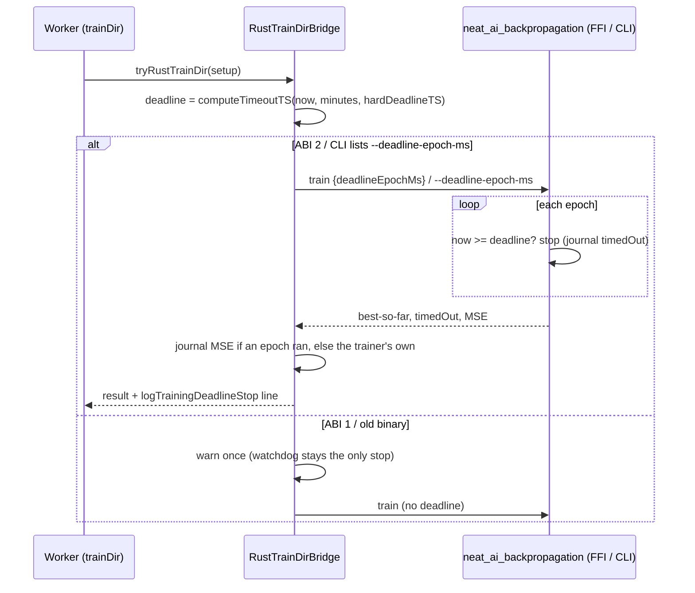

## Summary

The Rust `trainDir` path now hands the native trainer the task's per-task
deadline. That deadline is the same `timeoutTS` the TypeScript loop uses
(`computeTimeoutTS(now, trainingTimeOutMinutes, hardDeadlineTS)`). A long native
train therefore stops between epochs and returns its best-so-far creature.
Before this change it ran every epoch, blocked the worker past the grace cycle,
and was cancelled and quarantined as a "hang".

- **FFI:** the bridge sends `deadlineEpochMs` (ABI 2). It reads `timedOut` from
  the response instead of hard-coding `false`.
- **CLI fallback:** the bridge passes `--deadline-epoch-ms`, and the journal's
  `{"kind":"timedOut",…}` line sets `timedOut`.
- **A stop before epoch 1 keeps a finite error.** A deadline that has already
  passed stops the native loop before epoch 1. The journal then has no epoch
  line, so it has no MSE. The bridge used to report `error = NaN`, which the
  scheduler counts as a failed training task. Now FFI keeps the response's
  `bestMse` (the native baseline), and the CLI takes `best_mse` from its own
  `train: baseline_mse=… best_mse=…` stderr line.
- **One stop line for both backends.** The TypeScript loop's deadline-stop log
  moved into `logTrainingDeadlineStop` (`TrainingOutcome.ts`), and the bridge
  calls it too. A native stop logs `Training <ID> timed out after …`, or, for a
  budget under `MIN_TRAINING_BUDGET_MS`, the Issue #3166 misconfiguration
  warning, exactly as the TypeScript loop does.

The native side of the fix is on stSoftwareAU/NEAT-AI-Backpropagation branch
`issue-neat-ai-4073-train-deadline` (commit `7ec31cc`, crate 0.1.48). That
branch adds the request field, the CLI flag, the per-epoch check, the journal
line, the `timedOut` response field and ABI 2. The worker opens its PR from the
marker in this run's final message.

Part of #4073. This PR does not close the issue: the issue's closing evidence is
a GRQ-logs line from a release that carries the fix. That line needs the native
PR merged and released, and GRQ hosts updated.

## Spec

### Intent and Rationale

- The FFI call is synchronous inside the worker, so nothing on the TypeScript
  side can interrupt it. The only clean stop is inside the native loop, so the
  deadline goes to the trainer.
- The deadline comes from the existing owner, `computeTimeoutTS`, rather than a
  copy. Both backends therefore stop on the same instant, and they now report
  the stop through the same function.

### Essential Design Decisions

- **ABI 1 stays loadable, for now.** An ABI-1 library, or a binary whose
  `train --help` lacks `--deadline-epoch-ms`, still trains. It just can't
  enforce the deadline, and the bridge warns once per process. The request is
  `deny_unknown_fields`, so for ABI 1 the field is omitted entirely, not sent as
  `null`. Refusing ABI 1 would turn every GRQ host into a hard training failure
  the moment this merges, because the native PR is not yet merged or released.
  Follow-up: once a NEAT-AI-Backpropagation release with ABI 2 is installed on
  the fleet, drop ABI 1, the `train --help` probe and the warning, and fail loud
  instead (principles 7/8; see Standards Review).
- **The check runs before each epoch, including the first.** An epoch already
  running finishes first. The check is not between record batches (the issue's
  "if affordable").
- **A stop before epoch 1 keeps the trainer's own MSE.** The bridge prefers the
  journal's MSE (it reflects early stops), but only when the journal has an
  epoch to derive it from. Otherwise FFI keeps the response's `bestMse`, and the
  CLI reads `best_mse` from stderr. Only `bestMse` reaches
  `TrainingResult.error`. The summary's `baselineMse` is not read downstream, so
  that line is unchanged.
- **CLI capability is probed with `train --help`.** It is not detected by
  retrying after a clap error. A probe that exits non-zero counts as
  unsupported. A binary that cannot be spawned throws from the probe, exactly as
  the train itself would.
- **Test seam:** `__installNativeBackpropLibraryForTests` lets the tests install
  a double of the C ABI. It goes through the same ABI range check as a real
  `dlopen`, so the FFI paths are tested without a native build.

### Undiscoverable Facts

- Before this change, NEAT-AI-Backpropagation accepted no deadline at all: a
  grep of its tree found no deadline or timeout field. NEAT-AI could not have
  been simply forgetting to send one.
- The native trainer measures the baseline MSE before epoch 1
  (`backpropagation/src/train.rs`). With a deadline already passed it journals
  only `{"kind":"timedOut","completedEpochs":0,…}`, so the response's
  `baselineMse`/`bestMse` are finite while the journal has no MSE at all. The
  CLI prints `train: baseline_mse=… best_mse=… accepted_epochs=…` on stderr,
  both on the native branch and on its `main`.
- The worker's mutation check treats only `*_test.ts` files as tests, and only
  ones that import the mutated module by a relative path. The old
  `test/architecture/training/RustTrainDirBridge.ts` matches neither, so the new
  tests live in `test/architecture/training/TrainingDeadline_test.ts`, which
  imports `src/…` relatively. The old file is unchanged from `Develop`.

## Evidence

Backend only, no UI. End-to-end run against the real binary and library built
from the native branch. The scratch script in `/tmp` trains `Creature(10,1)` on
1,000,000 records with `iterations: 50` and `trainingTimeOutMinutes: 0.05` (3
s); about 0.7 s per epoch:

| Code             | Backend | Deadline | Result                                                                            |
| ---------------- | ------- | -------- | --------------------------------------------------------------------------------- |
| base (`d7c8f72`) | CLI     | 3 s      | `{"iteration":50,"elapsedMs":41708}`, no timed-out line                           |
| this branch      | FFI     | 3 s      | `Training a812440f timed out after 3s 451ms` / `{"iteration":5,"elapsedMs":3454}` |
| this branch      | CLI     | 3 s      | `Training d415897d timed out after 3s 391ms` / `{"iteration":5,"elapsedMs":3394}` |
| this branch      | FFI     | none     | `{"iteration":50,"elapsedMs":35192}`                                              |

These runs were recorded at `c8f1fb2`, before this revision (the zero-epoch fix
and the shared stop line). Neither change affects them: each run completed
epochs, so the journal had an MSE, and a 3 s budget is above
`MIN_TRAINING_BUDGET_MS`, so the shared line is still `timed out after`. The
native library and binary are not on this machine now, so the runs were not
repeated.

Real tool observed: `neat_ai_backpropagation train --help` from the native
branch prints `--deadline-epoch-ms <DEADLINE_EPOCH_MS>` on stdout, and the CLI
probe depends on that. The native tests assert the journal line
`{"kind":"timedOut","completedEpochs":0,"deadlineEpochMs":1}`.
`scripts/check_native_backprop_train.ts` against that library prints
`(v0.1.48, ABI 2)`.

**Docs sweep** — grep: "enforces each task", "worker enforce\w*",
`NEAT_BACKPROP_ABI_VERSION`, "header revision", `timedOut: false`,
`neat_backprop_train`, `neat_ai_backpropagation`, "implausibly small budget",
"timed out after"; section:
`src/NEAT/PerTaskTrainingTimeout.ts#TRAINING_TASK_WATCHDOG_GRACE_MS` (the issue
names this doc comment; no manual page documents the Rust trainDir deadline);
siblings: `maxRecords`, `traceStore` (existing request fields, which only the
request interface lists); updated: `src/NEAT/PerTaskTrainingTimeout.ts`,
`src/NEAT/Neat.ts`, `src/architecture/training/NativeBackpropLibrary.ts`,
`src/architecture/training/RustTrainDirBridge.ts`,
`src/architecture/training/TrainingOutcome.ts` (the Issue #3166 comment moved
here with the log line), `scripts/check_native_backprop_train.ts`,
`CHANGELOG.md`; `src/architecture/training/TrainingOutcome.ts:84`
(`timedOut: false`) — still true because it is the TypeScript loop's initial
state; `README.md:331` — still true because it only names the sibling crate.

## Reproduction

- **symptom** — a native (FFI/CLI) `trainDir` ignored its per-task `timeoutTS`
  and ran every epoch: a 3 s budget ran 50 epochs in 41.7 s on base. On GRQ this
  blocked the worker past the grace cycle, and the watchdog then cancelled the
  task and quarantined the worker.
- **status** — `verified` — the CLI regression test failed on the bridge with
  only the deadline forwarding removed
  (`Rust trainDir CLI: per-task deadline is forwarded and stops training early ... FAILED`),
  as did the FFI test against the real ABI-2 library. Both pass after the fix.
  The end-to-end base-vs-fix runs above reproduce the reporter's symptom with
  the real native binary. The pre-PR verifier's zero-epoch defect reproduces
  too: with the fallback removed from either path, the stop-before-epoch-1 test
  for that path goes red with a non-finite error (`NaN`, not 0.3, on FFI;
  `null`, JSON's `NaN`, not 0.5, on the CLI).
- **regression test** —
  `test/architecture/training/TrainingDeadline_test.ts::Rust trainDir CLI: per-task deadline is forwarded and stops training early`,
  plus
  `test/architecture/training/TrainingDeadline_test.ts::Rust trainDir FFI double: a stop before epoch 1 keeps the response's finite error`
  and
  `test/architecture/training/TrainingDeadline_test.ts::Rust trainDir FFI: per-task deadline stops the native trainer early`
  (real ABI-2 library only)

## Acceptance Criteria

<!-- vibe-spec-review inputs="diff+issue-body" -->

- **met** — Add a deadline field (`deadlineEpochMs`) to
  `NativeBackpropTrainRequest`, with an ABI bump — evidence:
  `src/architecture/training/NativeBackpropLibrary.ts`,
  `test/architecture/training/TrainingDeadline_test.ts::Rust trainDir FFI double: a future deadline is forwarded exactly and every epoch runs`
  — reviewer: met
- **partial** — The trainer honours the deadline between epochs at least, and
  between record batches if affordable — evidence:
  `src/architecture/training/RustTrainDirBridge.ts` (`tryFfiTrainDir` sets
  `request.deadlineEpochMs`); native check on NEAT-AI-Backpropagation `7ec31cc`
  — reviewer: partial — reason: the per-epoch check is on the unmerged native
  branch and is only modelled by the test double here; the optional record-batch
  check is not done.
- **met** — Report `timedOut` from the response instead of hard-coding `false` —
  evidence: `src/architecture/training/RustTrainDirBridge.ts`
  (`timedOut: response.timedOut === true`; the journal `timedOut` line on the
  CLI path) — reviewer: met
- **met** — Give the CLI fallback (`spawnTrain`) the same deadline, as an
  argument or a kill — evidence:
  `test/architecture/training/TrainingDeadline_test.ts::Rust trainDir CLI: per-task deadline is forwarded and stops training early`,
  `test/architecture/training/TrainingDeadline_test.ts::Rust trainDir CLI: a future deadline is forwarded exactly`
  — reviewer: met
- **met** — Make the `PerTaskTrainingTimeout.ts` comment true, or reword it —
  evidence: `src/NEAT/PerTaskTrainingTimeout.ts`, `src/NEAT/Neat.ts`
  (`abandonStuckTrainingTasks` doc) — reviewer: met
- **partial** — Regression test: native `trainDir` with a ~2 s epoch cost,
  `epochs` = 50 and a `timeoutTS` 3 s out returns within ~5 s with
  `timedOut: true` and a best-so-far creature — evidence:
  `test/architecture/training/TrainingDeadline_test.ts` (FFI double and CLI stub
  cases) and the timed end-to-end runs under Evidence — reviewer: partial —
  reason: every stop case uses a deadline already passed, so no unit test stops
  mid-run with accepted epochs. The ~5 s bound is not asserted (AGENTS.md bans
  timing APIs in tests). `timedOut` is seen only through the log line, and the
  real-library case returns early when no ABI-2 library resolves.
- **missing** — Closing evidence: a quoted GRQ-logs line from the release with
  the fix, showing `timed out after …` and no
  `cancelled after …ms without a response` — reviewer: missing — reason: it
  cannot exist before merge and release; this PR is "Part of #4073", so the
  issue stays open until a GRQ run on the released version supplies it.
- **unrequested** — ABI-1 backward compatibility
  (`NEAT_BACKPROP_MIN_ABI_VERSION`, accepting ABI 1..2,
  `nativeBackpropSupportsDeadline`, omitting `deadlineEpochMs` for ABI 1) —
  reviewer: unrequested — reason: keeps older native libraries working, since
  ABI 1 rejects unknown fields (`deny_unknown_fields`).
- **unrequested** — The `train --help` probe on every CLI train
  (`cliSupportsDeadline`) and the once-per-process deadline-unsupported warnings
  — reviewer: unrequested — reason: lets an old CLI binary still train instead
  of failing on an unknown flag, at one extra spawn per train
  (`SIMPLE-ON-PURPOSE`).
- **unrequested** — A stop before epoch 1 reports a finite MSE: FFI keeps the
  response's `bestMse`, and the CLI parses `best_mse` from stderr
  (`parseCliBestMse`) — reviewer: unrequested — reason: an empty journal would
  otherwise give a non-finite error, which counts as a failed training task.
- **unrequested** — The deadline-stop log moved out of `TrainingEpoch.ts` into a
  shared `logTrainingDeadlineStop` in `TrainingOutcome.ts` — reviewer:
  unrequested — reason: a refactor so the native path prints the same
  `timed out after …` line the closing evidence looks for.
- **unrequested** — Test seam: `NativeBackpropHandle`,
  `__installNativeBackpropLibraryForTests`, `adoptNativeBackpropLibrary`, and
  `loggedAvailability` replaced by `loadedAbiVersion` — reviewer: unrequested —
  reason: lets the tests inject a double of the C ABI through the same ABI check
  as a real `dlopen`.
- **unrequested** — New export `getNativeBackpropAbiVersion` and the ABI text in
  `scripts/check_native_backprop_train.ts` — reviewer: unrequested — reason:
  used by the bridge's warning text and the diagnostic script, which follows the
  1..2 range.
- **unrequested** — `CHANGELOG.md` entry under Fixed — reviewer: unrequested —
  reason: standard release-notes upkeep for the fix.
- **unrequested** — `test/architecture/training/RustTrainDirBridge.ts` restored
  to `Develop` — reviewer: unrequested — reason: the tests the branch had added
  there moved to `TrainingDeadline_test.ts`, the file the mutation check
  recognises.

## Standards Review

<!-- vibe-standards-review inputs="diff+CODING-STANDARDS.md" -->

- **violation** — Principles 7/8 (no long-lived dual path) — evidence:
  `src/architecture/training/NativeBackpropLibrary.ts:38`
  (`NEAT_BACKPROP_MIN_ABI_VERSION = 1`),
  `src/architecture/training/RustTrainDirBridge.ts:595` and `:703` — reason:
  still open, deliberately. The reviewer judged it justified for now: upstream
  `Develop` still ships ABI 1, so requiring ABI 2 would break every current
  host. The removal trigger it asked for is now written on the constant: raise
  it to 2 and drop the probe and warnings once an ABI-2 release is installed
  across the fleet.
- **violation** — Test double no more permissive than the real contract (FFI
  double kept going after a rejected epoch, unlike `train.rs`) — evidence:
  `test/architecture/training/TrainingDeadline_test.ts` (`fakeNativeLibrary`) —
  reason: fixed in this diff after the review. The double ends the run at the
  first rejected epoch, as FFI always does (`BackpropConfig::default()`).
- **violation** — CLI stub: no CLI test checked the deadline value sent —
  evidence: `test/architecture/training/TrainingDeadline_test.ts`
  (`cliStubScript`) — reason: fixed in this diff after the review. The stub
  records each train's arguments, and
  `Rust trainDir CLI: a future deadline is forwarded exactly` asserts
  `--deadline-epoch-ms 4102444800000`. The stub still compares "now" at
  whole-second resolution, rounded up. That is documented and deterministic; a
  past deadline counts as past either way.
- **violation** — Comment accuracy: two comments said `Infinity` where the
  journal yields `NaN` — evidence:
  `src/architecture/training/RustTrainDirBridge.ts:630` and `:739` — reason:
  fixed in this diff after the review (now "no MSE (NaN)"). The FFI path's
  unread `baselineMse` line is unchanged.
- **violation** — Prefer smaller, focused files — evidence:
  `test/architecture/training/TrainingDeadline_test.ts` — reason: still open,
  minor. The two doubles stay in the `_test.ts` file, because the worker's
  mutation check mutates every non-`*_test.ts` file under `test/`, and a
  separate fixture module's defensive branches would surface as surviving
  mutants.
- **clean** — Australian English throughout (the one "unrecognized" quotes
  clap's output); logging only through `getLogger()`, with no new `console.*`
  under `src/` and no `@std/log`; `Date.now()` only for the deadline and elapsed
  time; no timing APIs in tests, and no result depends on machine speed
  (deadlines are constants or already past; the stop-line tests inject times);
  no `Deno.env.set`/`delete` (the CLI child uses `clearEnv`); tests assert
  behaviour (results, the wire request, log output, handle release); neuron UUID
  and `semanticVersion` invariants untouched; no TypeScript fallback for a
  core-owned operation; production DRY fixed by `logTrainingDeadlineStop`; the
  doubles are otherwise stricter than or equal to `ffi.rs`/`main.rs`; the test
  seam follows `__…ForTests`, is not exported from `mod.ts` and goes through the
  real ABI check. The repository has no `CODING-STANDARDS.md`, so the reviewer
  used `AGENTS.md` and `docs/ENGINEERING_PRINCIPLES.md`.

## Test Plan

- All in `test/architecture/training/TrainingDeadline_test.ts` (14 tests, all
  passing):
  - **Shared stop line:** two tests pin both forms exactly, using injected
    times:
    - `deadline stop: a real budget logs timed out after the elapsed time`
    - `deadline stop: a sub-second budget is flagged, not timed out`

    `deadline stop: the TypeScript loop logs it when its deadline passes` runs
    `runSingleEpoch` with a past deadline.
  - **FFI double** (C ABI double; contract `ffi.rs`/`train.rs` on `7ec31cc`):
    - `a stop before epoch 1 keeps the response's finite error`: error 0.3 (the
      baseline), iteration 1, stop line, integer `deadlineEpochMs`.
    - `a future deadline is forwarded exactly and every epoch runs`:
      `deadlineEpochMs === hardDeadlineTS`, 3 epochs, error 0.1.
    - `no deadline sends no deadlineEpochMs`: the double's clock is past every
      deadline, so a stray deadline would stop it.
    - `an ABI-1 library trains without the deadline and warns`: the double
      rejects `deadlineEpochMs` as an unknown field at ABI 1.
    - `an ABI outside 1..2 is refused and closed`, and
      `no library supports no deadline`.
  - **Real library:**
    `Rust trainDir FFI: per-task deadline stops the native trainer early`
    asserts `iteration < 50`, a finite error and the stop line. It returns early
    unless an ABI-2 library resolves; none is on this machine now.
  - **CLI stub** (contract `main.rs`/`train.rs` on `7ec31cc`; runs in a child
    process with a cleared env):
    - `per-task deadline is forwarded and stops training early`: iteration 1,
      error 0.5 from stderr, stop line, no warning.
    - `a future deadline is forwarded exactly`: the stub's recorded arguments
      carry `--deadline-epoch-ms 4102444800000`; 50 iterations, no stop.
    - `no deadline runs every iteration`: iteration 50, and error
      0.4000000000001 from the journal (stderr's 12-decimal 0.4 would differ).
    - `binary without --deadline-epoch-ms trains and warns`: two trains, one
      warning.
- The doubles are no looser than the native contract. The FFI double checks each
  request field's type and rejects unknown fields per ABI. The CLI stub exits 2
  on a wrong subcommand, a non-integer `u64` flag, a non-numeric `f64` flag or
  an unknown strategy. Neither uses a JS clock.
- No existing test assertion was removed or changed;
  `test/architecture/training/RustTrainDirBridge.ts` is identical to `Develop`.
- Mutation check, run locally with the worker's own runner
  (`VibeCoder/worker/deno/lib/mutation_runner.ts`) on this diff: `completed`,
  **37 of 37 mutants killed**, no cap reached, nothing exempted.
- Red checks: each of the 22 entries in `pr-summary-4073.facts.json` was flipped
  alone, and the test it names went red. Examples:
  - Drop either zero-epoch fallback: that path's stop-before-epoch-1 test.
  - Ignore the journal `timedOut` line: the CLI deadline test.
  - Send `deadline + 1`: the future-deadline FFI and CLI tests.
  - Send the deadline to ABI 1: the ABI-1 test (`unknown field`).
  - Delete the `startTS` field: the CLI deadline test logs `timed out` instead
    of the tiny-budget warning.
  - Drop `ignoreZero` or the small-budget branch: the two stop-line tests.
  - Delete the TypeScript loop's call: the `runSingleEpoch` test.
- `NEAT_AI_BACKPROP_ENABLED=0 deno test -A --parallel` over every file in
  `test/architecture` and `test/NEAT`: `ok | 1749 passed | 0 failed`. The first
  run had one failure, `test/NEAT/Ratios.ts => hypotenuse`. That is a stochastic
  evolution test (its file documents a ~75% per-attempt success rate). It passed
  on its own and on the full rerun. After that run, production code changed only
  in comments; the test file was then merged and extended, and runs 14/14 on its
  own.
- `deno fmt`, `deno lint` and `deno check` are clean on the touched files. The
  worker re-runs `./quality.sh` before raising the PR.
- New members, each with a production reader:
  - `nativeBackpropSupportsDeadline` and `getNativeBackpropAbiVersion` are read
    by `RustTrainDirBridge.ts`. `getNativeBackpropAbiVersion` is also read by
    `scripts/check_native_backprop_train.ts`.
  - `NEAT_BACKPROP_MIN_ABI_VERSION` is read by the loader and the check script.
  - `logTrainingDeadlineStop` is called by `TrainingEpoch.ts` and the bridge.
  - `deadlineEpochMs` is set by the bridge.
  - `timedOut` is read by the bridge.
  - `__installNativeBackpropLibraryForTests` and `NativeBackpropHandle` are a
    test seam, not re-exported from `mod.ts`.
- Callers of `tryRustTrainDir`: only `src/architecture/Training.ts:121`,
  unchanged. The deadline is computed inside, from `setup`, so every path gets
  it.

<!-- vibe-branch-outcomes -->
