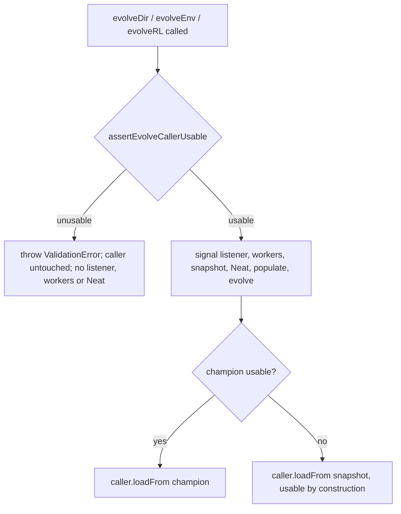

## Summary

`evolveDir()`, `evolveEnv()` and `evolveRL()` now reject an unusable caller
creature as their first statement. A caller is unusable when it has fewer than
`input + output` neurons or fails `validate()`. The rejection is a
`ValidationError` naming the entry point and the reason, and it happens before
any SIGTERM listener, worker or `Neat` population exists, so the caller's
original genome is never altered. The new helper `assertEvolveCallerUsable` in
`src/creature/EvolveTeardown.ts` reuses the existing `unusableReason()` test.
The "neither usable" throw in `restoreEvolveChampion()` stays as a backstop, and
its JSDoc, `docs/TIMEOUTS.md` and `CHANGELOG.md` now describe the entry check.
Closes #4078.

## Spec

### Intent and Rationale

- The entry snapshot is a `shallowClone()` of the caller, so it is unusable only
  when the caller was invalid on entry. Checking the caller at entry closes the
  one path where `evolveDir` rejected with the caller in whatever state the run
  left it.
- The helper calls `unusableReason()` rather than copying it, so the entry check
  and the restore check cannot drift apart.

### Essential Design Decisions

- The call must stay the first statement of each entry point, above
  `Deno.addSignalListener` and any `WorkerHandler`/`Neat` construction, so a
  throw leaks no listener or worker (see #4072).
- In `evolveEnv`/`evolveRL` it runs before the adapter input-count checks, so an
  unusable caller is always reported as unusable.

### Undiscoverable Facts

- `makeUUID` throws on a creature with too few neurons, so the tests compare
  neuron UUIDs, synapses and `input`/`output` instead (as the issue specifies).
- `./quality.sh` needs a native `rust_scorer`. None was installed on this host,
  so it was built from a shallow `stSoftwareAU/NEAT-AI-scorer` clone in `/tmp`
  and passed with `--rust-scorer-bin`. No repository file was changed for this.

## Evidence

Backend-only change; there is no UI surface.

**Docs sweep** — grep: `restoreEvolveChampion`, `snapshotEvolveCaller`, "neither
copy", "leaves the caller as it is", "Throws if neither"; section:
`docs/TIMEOUTS.md` (Issue #4061 restore paragraph in the teardown section);
siblings: none — no existing set gained a member; updated: `docs/TIMEOUTS.md`,
`CHANGELOG.md`, `src/creature/EvolveTeardown.ts` (module doc and
`restoreEvolveChampion` JSDoc); `docs/TIMEOUTS.md:181` — still true because the
backstop throw still leaves the caller as it is;
`src/creature/EvolveTeardown.ts:99` — still true because the backstop throw
still exists and the paragraph below it scopes it to a snapshot damaged after
entry.

## Reproduction

- **symptom** — an unusable caller passed to `evolveDir`/`evolveEnv`/`evolveRL`
  was not checked at entry: it ran a whole evolution and failed at teardown,
  leaving the caller in whatever state the run left it.
- **status** — `verified` — with each entry-point `assertEvolveCallerUsable`
  call removed (the base-branch behaviour), that entry point's two refusal tests
  failed (6 of 6). With the calls in place they pass.
- **regression test** —
  `test/creature/EvolveRejectsUnusableCaller_test.ts::evolveDir: a caller with too few neurons is refused untouched (Issue #4078)`

## Acceptance Criteria

<!-- vibe-spec-review inputs="diff+issue-body" -->

- **met** — `evolveDir()` called with a creature whose
  `neurons.length < input + output` rejects with a `ValidationError` that names
  the reason. — evidence:
  `test/creature/EvolveRejectsUnusableCaller_test.ts::evolveDir: a caller with too few neurons is refused untouched (Issue #4078)`
  — reviewer: met
- **met** — After that rejection, the creature's neuron UUID list, synapse list
  and `input`/`output` deep-equal a copy taken before the call. — evidence:
  `test/creature/EvolveRejectsUnusableCaller_test.ts` (`captureState` compared
  with `assertEquals` after rejection) — reviewer: met
- **met** — The same two criteria hold for a creature with enough neurons that
  fails `validate()`. — evidence:
  `test/creature/EvolveRejectsUnusableCaller_test.ts::evolveDir: a caller failing validate() is refused untouched (Issue #4078)`
  — reviewer: met
- **met** — Both cases are also covered for `evolveEnv()` and `evolveRL()`. —
  evidence: `test/creature/EvolveRejectsUnusableCaller_test.ts` (four
  `evolveEnv:`/`evolveRL:` refusal tests) — reviewer: met
- **met** — On rejection, a stub of `Neat.prototype.populatePopulation` records
  zero calls, and the test passes Deno's default op/resource sanitisers (no
  worker left running). — evidence:
  `test/creature/EvolveRejectsUnusableCaller_test.ts` (`populateCalls` asserted
  0; no sanitiser overrides; passed in `./quality.sh`) — reviewer: met
- **met** — With a valid caller, `test/creature/RestoreEvolveChampion_test.ts`,
  `test/creature/EvolveDirGenerationTwoAbandonCaller_test.ts` and
  `test/creature/EvolveRestoresCallerSnapshot_test.ts` pass unchanged. —
  evidence: those files are untouched, and a targeted run passed 27 of 27
  together with the new file — reviewer: met — reason: the reviewer said "met by
  inspection, unverified"; the tests were run here and passed
- **met** — The new tests are named `*_test.ts` and import the modules under
  test relatively, so the mutation gate exercises them. Removing the entry call
  makes them fail. — evidence:
  `test/creature/EvolveRejectsUnusableCaller_test.ts` imports `../../src/...`;
  removing each entry call turned its tests red — reviewer: met
- **met** — `./quality.sh` is green. — evidence: full gate on the final code:
  `ok | 9954 passed (5 steps) | 0 failed | 41 ignored` — reviewer: missing —
  reason: the reviewer said it "cannot be judged from a diff"; it was run here
  and passed
- **unrequested** — three direct unit tests of `assertEvolveCallerUsable` —
  reviewer: unrequested — reason: they pin the helper's accept path and error
  text, so the mutation gate catches a flipped condition
- **unrequested** — a `restoreEvolveChampion` backstop test with an undersized
  snapshot — reviewer: unrequested — reason: it pins the backstop the issue says
  to keep, including its neuron-count reason
- **unrequested** — an edit to the `EvolveTeardown.ts` module header comment —
  reviewer: unrequested — reason: the module doc described the teardown
  contract, and the entry check changes it

## Standards Review

<!-- vibe-standards-review inputs="diff+CODING-STANDARDS.md" -->

The repository has no `CODING-STANDARDS.md`. The reviewer was given `AGENTS.md`
and `docs/ENGINEERING_PRINCIPLES.md` instead.

- **clean** — Typed `ValidationError` with reason `OTHER`. Fail-fast placement
  as the first statement of all three entry points. No `console.*` or
  `@std/log`. No timing APIs or `Deno.env` mutation in tests. No TS fallback.
  Australian English. No invariant (UUID, semantic version, synapse identity)
  touched in `src/`. Docs match code. No assertion removed from an existing
  test. Review-enforced rules: none found in the standards ("by review", "review
  only" and "a reader has to" returned no matches).

## Test Plan

- Added `test/creature/EvolveRejectsUnusableCaller_test.ts`: six entry-point
  refusal tests (too few neurons and failing `validate()`, for each of
  `evolveDir`, `evolveEnv` and `evolveRL`), three `assertEvolveCallerUsable`
  unit tests, and one `restoreEvolveChampion` backstop test.
- Red check per entry call: deleting
  `assertEvolveCallerUsable(creature, "evolveDir")` → both `evolveDir:` refusal
  tests red; the same for `"evolveEnv"` → both `evolveEnv:` red; the same for
  `"evolveRL"` → both `evolveRL:` red. Restored afterwards.
- Negative assertions (`populateCalls === 0`, caller state unchanged) fail with
  the entry call removed, as shown by the red check above.
- The backstop test pins existing `restoreEvolveChampion` behaviour, so it is
  expected to pass on base too.
- Entry points checked: `evolveDir`, `evolveEnv`, `evolveRL`. Each has a test
  that goes red when only its call is reverted.
- No existing test edited; no assertion removed.
- `deno test -A` on the new file plus `RestoreEvolveChampion_test.ts`,
  `EvolveDirGenerationTwoAbandonCaller_test.ts` and
  `EvolveRestoresCallerSnapshot_test.ts`: 27 passed, 0 failed.
- `./quality.sh --rust-scorer-bin=<built rust_scorer>`: exit 0,
  `ok | 9954 passed (5 steps) | 0 failed | 41 ignored`.

<!-- vibe-branch-outcomes -->

🤖 Generated with [Claude Code](https://claude.com/claude-code)
