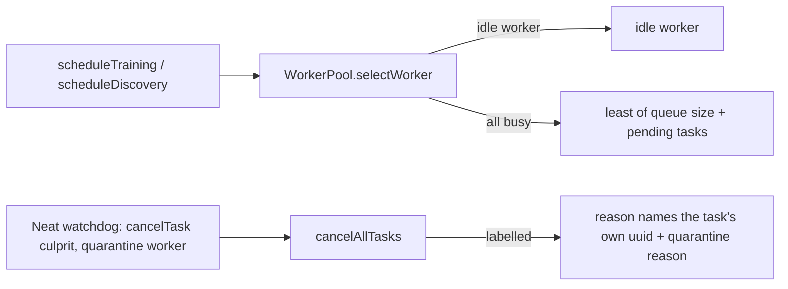

# Spread training across busy heavy workers; name each quarantined task

## Summary

When every heavy worker was busy, `WorkerPool.selectWorker` fell back to
`findLeastLoadedWorker`, which ranked workers by a queue that nothing fills
(`scheduleTraining` and `scheduleDiscovery` dispatch straight to the worker), so
every extra task landed on the first healthy worker. It now ranks by queue size
plus `getPendingTaskCount()`, ties to the first worker. A task failed by a
worker quarantine now carries its own creature uuid and says it was queued on
the quarantined worker, instead of repeating the culprit task's reason. Version
bump: `VERSION` updated for this change; the merged commit records the final
version. Closes #4095.

## Spec

### Intent and Rationale

- The log shape (tasks 2, 3, 4 on worker-13, one on worker-14) matches a
  selector that always returns the first worker when all are busy. Counting
  in-flight tasks is the smallest change that fixes training and discovery
  together, because both go through `selectWorker`.

### Essential Design Decisions

- Load is `queue.size() + getPendingTaskCount()`, not "refuse to schedule on a
  busy worker": a busy worker still accepts the task, as before, but the least
  loaded one gets it.
- Labelling is per task, via an optional `label` on `makePromise` /
  `makePromiseDeferred`. `trainTracked` and `discover` pass the creature uuid.
  `trainTracked` takes it as a required third parameter so no training caller
  can silently omit it. Other request kinds (evaluate, score, …) are unlabelled
  and keep the quarantine reason unchanged.
- The culprit keeps its own reason: `Neat.cancelTrainingWork` calls `cancelTask`
  before `quarantine`.

### Undiscoverable Facts

- Evidence is from production logs quoted in the issue comments (neat-ai
  7.0.62); the inference that queued tasks never started is the issue's, not
  verified here.
- `WorkerHandler.train()` (no production callers) now supplies
  `CreatureUtil.makeUUID(creature)` as its label so it compiles with the
  required parameter.

## Evidence

Backend-only change; no UI files touched. Tests below. `./quality.sh` could not
run in this environment (`Native rust_scorer is required … was not found`); its
`--lint-only` stage passed and `deno check src/ mod.ts` passed.

<!-- vibe-quality-gate-skipped reason="./quality.sh needs the native rust_scorer binary, which is not present on this host; --lint-only and deno check passed, targeted tests run" -->

## Reproduction

- **symptom** — with both heavy workers busy, extra training tasks all went to
  the first worker and, on quarantine, were failed with the first task's reason
- **status** — `verified` — the regression test was observed failing against the
  unfixed code and passing after the fix: the spread test and the pool test went
  red when `findLeastLoadedWorker` was restored to rank queue size only, and the
  quarantine test went red when `cancelAllTasks` ignored the label; all pass
  with the fix
- **regression test** —
  `test/NEAT/TrainingSpreadsAcrossHeavyWorkers.ts::two training tasks land on two busy heavy workers, one each (Issue #4095)`

## Mutation check

The gate's mutation run reported its source-line mutants as "no test imports
this module", which is a harness artefact: the tests below import them. Each was
re-applied by hand and the targeted suites
(`test/NEAT/TrainingSpreadsAcrossHeavyWorkers.ts`,
`test/multithreading/WorkerPool.ts`, `test/multithreading/WorkerHandler.ts`,
`test/workers/WorkerTaskCancellation.ts`) went red each time:

- `src/multithreading/WorkerPool.ts:228` negated `load < leastLoad` — 5 tests
  failed
- `src/workers/WorkerHandlerBase.ts:662` dropped `label` from the pending entry
  — 3 tests failed
- `src/workers/WorkerHandlerBase.ts:732` negated the `task.label` check — 4
  tests failed
- `src/workers/WorkerHandlerBase.ts:847` dropped the `label` argument to
  `registerPending` (the `makePromiseDeferred` path used by `trainTracked`) — 3
  tests failed. The same drop at `:817` (`makePromise`) on its own leaves the
  suites green: `src/workers/WorkerHandlerBase.ts:817` exempt (untestable): no
  production caller passes a label through `makePromise`, so no test can reach
  it (searched `makePromise(` callers under `src/`)

The remaining mutants are in test and bench code, which no test exercises:

- `bench/WorkStealingPool.ts:35` exempt (untestable): benchmark stub, not
  production code and not imported by any test
- `test/NEAT/PoolBorrowing.ts:38`,
  `test/NEAT/TrainingSpreadsAcrossHeavyWorkers.ts:37-114`,
  `test/multithreading/WorkerHandler.ts:154-230` (including the survivors at
  `:182`, `:184`, `:202`, `:209`, `:211`, `:221` and `:229`),
  `test/multithreading/WorkerPool.ts:30` and `:494-529` exempt (untestable):
  these are test helpers and the test bodies themselves; a mutant there is
  checked by the assertions it supports, which the source mutants above show are
  effective

## Acceptance Criteria

<!-- vibe-spec-review inputs="diff+issue-body" -->

- **met** — Training (and discovery: `NeatScheduling.ts:286` has the same
  pattern) selection takes in-flight load into account. Use
  `getPendingTaskCount()`, or don't schedule onto a busy heavy worker at all.
  Either way, a third task is never stacked on worker A while worker B has fewer
  tasks. — evidence: `src/multithreading/WorkerPool.ts:227`,
  `test/multithreading/WorkerPool.ts` — reviewer: met
- **met** — A task cancelled by quarantine fails with a reason that names **its
  own** creature, and says it was collateral of the quarantine. — evidence:
  `src/workers/WorkerHandlerBase.ts:733`,
  `src/multithreading/workers/WorkerHandler.ts` (`trainTracked`, `discover` pass
  the uuid) — reviewer: partial — reason: the reviewer saw `discover` unlabelled
  in the first diff; it is labelled now and
  `test/multithreading/WorkerHandler.ts` asserts it
- **met** — Regression test: a 2-worker heavy pool, both busy, scheduling 2 more
  training tasks puts one on each worker, not both on the first. That test fails
  on `v7.0.62`. — evidence: `test/NEAT/TrainingSpreadsAcrossHeavyWorkers.ts` —
  reviewer: met
- **met** — Regression test: quarantining a worker with 3 pending training tasks
  produces 3 `WorkerTaskCancelledError`s, each carrying its own task's uuid in
  `reason`. — evidence:
  `test/multithreading/WorkerHandler.ts::WorkerHandler.trainTracked: a quarantine names each training task after its own creature uuid (Issue #4095)`
  (real direct-mode handler, 3 `trainTracked` tasks quarantined, 3
  `WorkerTaskCancelledError`s each naming only its own uuid); the base-class
  mechanism is in `test/workers/WorkerTaskCancellation.ts`, and the label passed
  by `scheduleTraining` is asserted in
  `test/NEAT/TrainingSpreadsAcrossHeavyWorkers.ts` — reviewer: partial — reason:
  the earlier rounds found only echo-task and stub evidence; the real
  `trainTracked` test now covers the `label` hand-off to `makePromiseDeferred`

## Standards Review

<!-- vibe-standards-review inputs="diff+CODING-STANDARDS.md" -->

- **clean** — no violations; `CODING-STANDARDS.md` is absent, so `AGENTS.md`,
  `CONTRIBUTING.md` and `docs/ENGINEERING_PRINCIPLES.md` were used. Timing APIs,
  `Deno.env.set`, logging, Australian English, behaviour-not-implementation
  tests and stub coverage checked. Its optional items (discovery docs
  overstated, contradictory doc sentence, stale inline comment) were fixed in
  this diff.

## Test Plan

- `deno test -A --no-check test/NEAT/TrainingSpreadsAcrossHeavyWorkers.ts test/multithreading/WorkerPool.ts test/multithreading/WorkerPoolQuarantine.ts test/multithreading/WorkerHandler.ts test/NEAT/PoolBorrowing.ts test/NEAT/StuckTrainingTaskCancelled.ts test/workers/WorkerTaskCancellation.ts`:
  62 passed, 0 failed on the final head (7 files).
- Added: `test/multithreading/WorkerPool.ts` (tie/least-pending;
  queue-plus-pending), `test/NEAT/TrainingSpreadsAcrossHeavyWorkers.ts`,
  `test/workers/WorkerTaskCancellation.ts` (labelled and unlabelled quarantine),
  `test/multithreading/WorkerHandler.ts` (real handler: `discover` and three
  `trainTracked` tasks each named after their own uuid on quarantine).
- Red checks: queue-only ranking → pool tie test and spread test red;
  `cancelAllTasks` ignoring the label → labelled quarantine test red; dropping
  `uuid` at `NeatScheduling.ts` `trainTracked` call → spread test red on the
  label assertion; dropping `label` at the `makePromiseDeferred` call in
  `WorkerHandler.trainTracked` → the real-handler training test red
  (`task 0 names its own creature <uuid>`).
- Stubs given `getPendingTaskCount()` (needed for the all-busy path):
  `test/NEAT/PoolBorrowing.ts`, `test/multithreading/WorkerPoolQuarantine.ts`,
  `bench/WorkStealingPool.ts`. No assertions removed from existing tests.
- Not covered: a discovery spread test (`scheduleDiscovery` is gated by
  `isRustDiscoveryEnabled()`, which has no injection point); it shares
  `selectWorker` with training.
- Docs: `docs/TIMEOUTS.md` (GRQ #4489 list), `CHANGELOG.md`. Callers of
  `trainTracked` checked: `NeatScheduling.ts` and `WorkerHandler.train()`.
