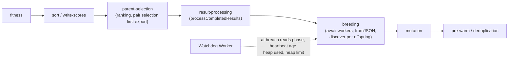

## Summary

The downstream log archive now holds two field breach lines that carry the
heartbeat age: neat-ai 7.1.14 on GRQ-19 and 7.1.17 on GRQ-21. They read
`lastHeartbeatAgeMs=1999298` and `=1982754`, both with `inFlightPhase=breeding`.
They are recorded in `docs/TIMEOUTS.md` as closing evidence. They show the main
loop was blocked, not just slow. The hosts had no swap-backed heap, and at the
kill the main thread was in the breeding window, not in fitness. For GRQ-21, a
worker log line the parent relays only when its event loop turns places the
start of the synchronous run still in progress at the kill after
`await breedingPromise`. That assumes worker breeding, which loop 2's logs do
not show.

The line could not say which main-thread step in that window blocked, or how
full the heap was, so this PR adds both:

- the breach line now ends with
  `lastHeartbeatHeapUsedMB=<MiB> heapLimitMB=<MiB>`;
- `evolve()` marks the old `breeding` window as `parent-selection`, then
  `result-processing`, then `breeding`.

The generation-11 stall on the 8 GB swap-backed host (7.0.62) itself was not
reproduced, so the root-cause criterion stays partial. Part of #4096.

## Spec

### Intent and Rationale

- The heartbeat (#4101, #4136) and its subprocess regression tests (#4140) are
  already on the base branch. What was left was the cause, and field evidence.
  This run's archive search found the evidence. The two fatal wedges blocked in
  a window that covered several separate pieces of main-thread work, and both
  came right after an out-of-memory retry halved the heap. So the next useful
  measurement is which step blocked, and whether the heap was near its limit.
- Adding diagnostics was chosen over a speculative fix: the fatal block was not
  reproduced, so no evolution behaviour changes.

### Essential Design Decisions

- The heap fields are appended after `heartbeatIntervalMS=`, so parsers that
  match the existing prefix still work. Heap used comes from
  `Deno.memoryUsage().heapUsed` at arm and on every heartbeat tick. The limit
  (`heap_size_limit`) is read once at arm. Both go into their own
  `SharedArrayBuffer`, and a value of 0 prints as `unknown`.
- The new phases are appended to `EVENT_LOOP_WATCHDOG_PHASES`, so existing
  indices keep their meaning. `setPhase` writes shared memory synchronously, so
  a breach always names the step the main thread was in, even when it is
  blocked.
- `readHeapSizeLimit` moved from `MemoryMonitor.ts` to a new
  `src/NEAT/HeapSizeLimit.ts`. The watchdog can then call it without importing
  the monitor's dependency graph, and only one copy exists.

### Undiscoverable Facts

- The two source logs (`GRQ-19-sloth.log` at archive commit `a34f9c1`,
  `GRQ-21-sloth.log` at `d78afa4`) were removed by the archive's later triage
  commits (`adb8dd6`, `54c6fac`). They are only reachable through the archive's
  git history.
- In the same runs, the non-fatal `breeding` → `deduplication` stalls match the
  same generation's `mutation=` timing to within 1–2.5 s.
- A second set of stalls runs from `fitness`/`write-scores` → `breeding`.
  `[Timing]` itemises `sort=`, `writeScores=` (with `speciation=`), and
  `resultProcessing=` and `mainThreadOverlap=` inside `breeding=`. It does not
  itemise four parts:
  - the tail of fitness;
  - the post-fitness bookkeeping before sort;
  - the unmarked span between write-scores and parent selection;
  - parent selection inside `breeding=`.

  In GRQ-21 generations 1 and 4, the stall is longer than all the itemised steps
  it could overlap: 30398 ms against 22678 ms, and 15121 ms against 9506 ms. So
  at least 7.7 s and 5.6 s of those blocks were in code `[Timing]` does not
  itemise. The generation 4 stall started in write-scores, so for it that code
  is the span between write-scores and parent selection.
- `inFlightPhase=` names where the main thread was at the kill, not where the
  block began.
  - For GRQ-21 (7.1.17), the last line is the relayed
    `[training-backend] task=7600c3d3 …`. The parent writes it only when the
    event loop turns, and `await breedingPromise` is the only yield between
    write-scores and mutation. So the run still blocking at the kill began after
    that await, in a callback during breeding. The most likely callback is the
    per-offspring `Creature.fromJSON` / memetic `discover`. The heartbeat age
    may also count time before the await, because a handler can block before the
    timer fires. The placement assumes worker breeding: the `breedSingle`
    fallback never turns the loop, and the logs do not show which path loop 2
    took.
  - For GRQ-19 (7.1.14, no relay), part of the block may lie earlier.
- Loop 1 on both hosts ended with V8's GC trace at 4,214–4,257 MB of the 4,326
  MB grant, with average mutator utilisation 0.272 and 0.350. So about 65–73 %
  of the time was going to garbage collection just before the OOM retry halved
  the heap.

## Evidence

Backend-only change. No UI file is touched.

Archive search (the downstream production log archive's `Develop` branch,
deepened to 3000 commits): `git log -S"lastHeartbeatAgeMs"` returned `a34f9c1`,
`adb8dd6`, `d78afa4` and `54c6fac`. The breach lines, quoted from
`git show a34f9c1:GRQ-19-sloth.log` and `git show d78afa4:GRQ-21-sloth.log`:

```text
[Neat] First generation wedged after 2100s (event loop blocked past the first-generation bound; watchdog killing the process) — first-generation-wedged lastHeartbeatAgeMs=1999298 inFlightPhase=breeding heartbeatIntervalMS=1000
[Neat] First generation wedged after 2100s (event loop blocked past the first-generation bound; watchdog killing the process) — first-generation-wedged lastHeartbeatAgeMs=1982754 inFlightPhase=breeding heartbeatIntervalMS=1000
```

Both hosts have 10 CPUs and 16 GB RAM, with about 13–14 GB available. Loop 1
ended `Learn.ts exited 133` (V8 heap-limit abort) at 4326 MB. Loop 2 ran at 2163
MB with `heavyWorkers 1, threads 1`.



Issue numbers cited, each looked up with `gh` in this run:

- #4096: evolveDir main loop stalls in generation 11 past the T+15 cap on 7.0.62
  (8 GB swap-backed host): SIGKILL loses 10 evolved generations, and the
  watchdog cannot say what blocked
- #4101, #4136, #4140: merged PRs for this issue, with the same title
- #4068: Document the event-loop limit of the in-process bounds and the
  caller-side per-loop hard kill
- #4086: Document the event-loop limit and the caller-side per-loop hard kill
  (#4068)
- #4146: Recurrence of #4119 on 7.1.12 + engine 0.1.50: training tasks still
  overrun the per-task deadline, return no result and get quarantined. Its fix
  relays worker log lines such as `[training-backend]` through the parent's
  worker `message` listener.

## Reproduction

- **symptom** — the main event loop of `evolveDir` stopped servicing timers in
  generation 11 on an 8 GB swap-backed host (7.0.62), and the watchdog SIGKILLed
  the run.
- **status** — `not-run` — reason: the trigger needs a paging, swap-backed 8 GB
  host and the full production corpus; this host has 16 GB and no swap. The
  field wedges on 7.1.14 and 7.1.17 are quoted instead. The new diagnostic tests
  were seen failing against the unchanged source, then passing.
- **regression test** —
  `test/creature/EvolveRunWatchdogHeartbeat_test.ts::EvolveRunWatchdogHeartbeat: a busy main thread in generation 2 is killed with a heartbeat age at least the busy duration`
  (from #4140, unchanged here)

## Acceptance Criteria

<!-- vibe-spec-review inputs="diff+issue-body" -->

- **met** — The watchdog gets a main-thread heartbeat: a `SharedArrayBuffer`
  timestamp the main loop bumps on a timer, read by `EventLoopWatchdogWorker`.
  The breach line then reports `lastHeartbeatAgeMs=` and the in-flight phase
  (`inFlightPhase`). — evidence: `src/NEAT/EventLoopWatchdog.ts`,
  `src/NEAT/EventLoopWatchdogWorker.ts` (from #4101 and #4136, extended here) —
  reviewer: met
- **partial** — Root cause of the generation-11 stall identified, or reproduced
  or excluded with quoted evidence. In particular: is it paging on a swap-backed
  heap, or main-thread work inside fitness? — evidence: `docs/TIMEOUTS.md`
  ("Field observation (2026-11-13)") — reviewer: partial — reason: the
  generation-11 case itself (7.0.62, 8 GB swap-backed host, abandoned "stalled
  in fitness") is not reproduced, identified or ruled out. The paging and
  fitness exclusions apply only to the two generation-1 wedges on 16 GB hosts
  with no swap. Their cause is still inferred (garbage collection near the 2163
  MB limit, after a loop-1 GC trace at 65–73 % GC time). The run still blocking
  at GRQ-21's kill is placed after `await breedingPromise`, assuming worker
  breeding. Only the `breeding` → `deduplication` stalls are shown to be the
  synchronous `mutator.mutate`. The fatal block's step and heap state wait on a
  field breach carrying this PR's heap fields and phases.
- **met** — Regression test: a subprocess run whose main thread busy-loops in
  generation ≥ 2 is killed with a breach line carrying `lastHeartbeatAgeMs` ≥
  the busy duration. A run that is merely slow but yielding reports a small
  heartbeat age. — evidence:
  `test/creature/EvolveRunWatchdogHeartbeat_test.ts::EvolveRunWatchdogHeartbeat: a busy main thread in generation 2 is killed with a heartbeat age at least the busy duration`,
  `test/creature/EvolveRunWatchdogHeartbeat_test.ts::EvolveRunWatchdogHeartbeat: a yielding main thread in generation 2 keeps its heartbeat age near one interval`
  (from #4140; re-run on this head) — reviewer: met
- **met** — Closing evidence: a quoted breach line from a field run that
  includes the heartbeat age, or a quoted green final loop on a swap-backed 8 GB
  host. — evidence: `docs/TIMEOUTS.md` quotes the GRQ-19 (7.1.14) and GRQ-21
  (7.1.17) breach lines with `lastHeartbeatAgeMs=1999298` and `=1982754` —
  reviewer: met
- **unrequested** — the `lastHeartbeatHeapUsedMB=` / `heapLimitMB=` breach
  fields and the `HeapSizeLimit.ts` move — reviewer: unrequested — reason: both
  fatal wedges followed a heap-limit OOM, so heap headroom at the last tick is
  what tells garbage collection near the limit from synchronous work. That is
  the remaining root-cause question.
- **unrequested** — the `parent-selection` and `result-processing` phases that
  split the old `breeding` window — reviewer: unrequested — reason: the field
  breach named `breeding`, which spanned four separate main-thread steps, so
  only splitting it can name the step that blocked.
- **unrequested** — the `docs/TIMEOUTS.md` stall and mutation analysis, and the
  CHANGELOG entry — reviewer: unrequested — reason: it is the quoted evidence
  for the root-cause criterion, and the CHANGELOG records the new breach-line
  fields.

## Standards Review

<!-- vibe-standards-review inputs="diff+AGENTS.md+docs/ENGINEERING_PRINCIPLES.md" -->

- **clean** — no violations. Checked:
  - logging through `getLogger()` only, and no `@std/log`;
  - no timing assertions or `Deno.env` mutation in tests;
  - tests assert on breach-line stderr, exit code and the public phase observer,
    never on source text;
  - typed errors unchanged;
  - DRY: `readHeapSizeLimit` was moved, not copied;
  - no fallback path, and no change to the UUID or semantic-version invariants;
  - `EventLoopWatchdogWorker.ts` still imports nothing;
  - phase indices are stable;
  - Australian English.

  Each changed expectation in an existing test still fails without its code.
  Neither standards file marks a rule as enforced by review only. Of the
  reviewer's optional notes, the `HeapSizeLimit.ts` doc comment was updated, and
  the spec reviewer's phase-order note on `docs/TIMEOUTS.md` was fixed in this
  diff.

## Test Plan

- `test/NEAT/EventLoopWatchdog_test.ts`:
  - **New tests** (red against the unchanged source, then green):
    - `EventLoopWatchdogHeap: the breach line reports heap used and the heap limit in MiB`:
      512/2048 MiB slots print `lastHeartbeatHeapUsedMB=512 heapLimitMB=2048`.
    - `EventLoopWatchdogHeap: unmeasured heap slots are reported as unknown`.
    - `EventLoopWatchdogHeap: a busy-looping main thread reports real heap readings taken at arm`:
      both values are greater than 0, and used is at most the limit.
    - `EventLoopWatchdogPhase: parent-selection is named in the breach line and result-processing is accepted`.
  - `EventLoopWatchdogPhase: every listed phase is named as itself in the breach line`
    now lists the two new phases. Nothing was removed from it.
  - Removed from `test/NEAT/EventLoopWatchdog_test.ts`:
    `const suffix = "inFlightPhase=untracked heartbeatIntervalMS=100\n";`
    - Obsolete: the breach line no longer ends at `heartbeatIntervalMS=`; the
      heap fields now follow it.
    - Still covered by:
      `test/NEAT/EventLoopWatchdog_test.ts::EventLoopWatchdogWorker: a kill that fails is reported on stderr after the breach line`.
      Its ends-with-newline and kill-failure-order checks are unchanged.
    - Replaced by:
      `const suffix = "inFlightPhase=untracked heartbeatIntervalMS=100 " + "lastHeartbeatHeapUsedMB=unknown heapLimitMB=unknown\n";`
- `test/NEAT/EvolveBreedingPhaseMarks_test.ts` (new):
  `evolve: breeding is announced as parent-selection, result-processing, breeding, then mutation (Issue #4096)`
  drives one real `evolve()` generation with a worker. Against the unchanged
  `NeatEvolution.ts` it failed because `parent-selection` was never announced.
- `test/creature/EvolveWatchdogWiring_test.ts`: `GENERATION_PHASES` gains
  `parent-selection` and `result-processing` before `breeding`. No assertion was
  removed. The exact per-generation walk for `evolveDir`, `evolveEnv` and
  `evolveRL` still fails without the new markers.
- **Ran on the head:**
  - `deno test -A test/docs/*.ts` (every doc guard, including
    `LiveDocsNoPrivateGrqReference.ts` and `ArchiveDocsNoPrivateRepoSlugs.ts`,
    which failed before the private repo name was reworded) — 318 passed, 0
    failed.
  - `NEAT_AI_BACKPROP_ENABLED=0 deno test -A --parallel` on 10 files —
    `test/NEAT/EventLoopWatchdog_test.ts`,
    `test/NEAT/EvolveBreedingPhaseMarks_test.ts`,
    `test/NEAT/NeatPhaseObserver_test.ts`,
    `test/creature/EvolveWatchdogWiring_test.ts`,
    `test/creature/EvolveRunWatchdogHeartbeat_test.ts`,
    `test/creature/EvolveRunWatchdog_test.ts`, `test/NEAT/MemoryMonitor.ts`,
    `test/NEAT/MemoryPressureCacheCorrelation.ts`,
    `test/NEAT/EvolveAbandonedTrainingResultDiscard_test.ts` and
    `test/creature/EvolveDirFirstGenerationWedged.ts` — 119 passed, 0 failed.
  - `NEAT_AI_BACKPROP_ENABLED=0 deno test -A --parallel test/NEAT/`: the first
    run gave 59 passed, 1 failed. The failing test's name was not captured.
    Three reruns each gave 60 passed, 0 failed.
- `./quality.sh --skip-tests --skip-discovery` (dependency update, format, lint,
  bash syntax, type-check, WASM sync) passed.
- <!-- vibe-quality-gate-skipped reason="full ./quality.sh exits 1 on this host before its test stage: native rust_scorer is required and not installed here; the static stages and the targeted tests above were run instead" -->
