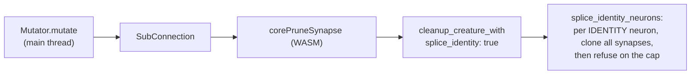

## Summary

The 2026-11-21 field breach on neat-ai 7.1.31 carries the heartbeat fields the
issue was waiting for. It reports
`lastHeartbeatAgeMs=380135
inFlightPhase=mutation`, with the heap at 16,257 of
20,396 MB, on a 64 GB host with no swap. This PR finds the main-thread work
behind a block of that kind. The `SUB_CONN` mutation hands the whole creature to
NEAT-AI-core's `prune_synapse`, and inside it `splice_identity_neurons` costs
O(hidden `IDENTITY` neurons × synapses) per cleanup pass.

- A settled creature of 9,818 neurons / 66,052 synapses takes about 16 s per
  call.
- A call that also splices takes up to 86 s.
- Both run synchronously on the main thread, with no paging involved.

`docs/TIMEOUTS.md` records the measurements,
`bench/PruneSynapseProductionScale.ts` reproduces them, and a NEAT-AI-core
branch carries the fix (marker below).

The generation-11 stall the issue reports (7.0.62, 8 GB swap-backed host) is not
explained by this. Its abandon line reads `stalled in fitness`, which only the
poll inside the fitness window prints, so that block ended inside fitness, after
generation 10's mutation. Its cause is still not identified. Part of #4096.

## Spec

### Intent and Rationale

- The heartbeat, heap fields and phase split (#4101, #4136, #4152) and the
  subprocess regression tests (#4140) are already on the base branch. The open
  criterion is the root cause, so this run measured `Mutator.mutate` on a
  production-sized creature instead of adding more diagnostics.
- One `SUB_CONN` took 85 s, against about 7 s for the other 39 mutations
  together. The cost lies entirely in the core call. Export and `loadFrom` take
  under 70 ms.
- The fix is in NEAT-AI-core, because that is where the quadratic lives. Adding
  a TypeScript workaround or skipping `SUB_CONN` on large creatures would break
  principle 7 (no fallback for core-owned operations) and change evolution.

### Essential Design Decisions

- No NEAT-AI behaviour changes. NEAT-AI picks up the fix through the ordinary
  core bump once a core release carries it. Pinning the branch commit is not
  allowed.
- The core fix returns exactly the same answers. The net-new-synapse cap now
  refuses before the synapse list is cloned, and every refusal was already
  `Ok(None)`. The squash map is built once per sweep, because a splice changes
  no surviving neuron's squash.
- The bench times the real `SUB_CONN` operator through `Mutator.mutateCreature`.
  It settles the creature with one call at registration, so the time it reports
  is the settled per-call cost.

### Undiscoverable Facts

- 7.0.62, 7.1.31 and the current `deno.json` all pin core
  `1d44889e405e4e0cfb553321b44cc39e7d771f5f`, read from the published
  `deno.json` on JSR. Core added `splice_identity_neurons` in core PR #703
  (2026-09-16). `SubConnection` has called `corePruneSynapse` since PR #3988
  (2026-09-09).
- The published 7.0.62 `src/NEAT/NeatEvolution.ts` sets the in-flight phase to
  `fitness` at line 323, polls at line 327 and clears it at line 338. That
  structure places the generation-11 block inside fitness.
- On the synthetic creature, the first prune also splices its many spliceable
  `IDENTITY` neurons. That is why first calls (11.6 s / 86 s) cost several times
  more than settled ones (2.3 s / 15.9 s).

## Evidence

Backend-only change; no UI file is touched. Timings below come from this host
(aarch64 Linux, Deno 2.9.8, idle). They are indicative only, not a gate.

| Neurons | Synapses | First call (also splices) | Settled creature |
| ------: | -------: | ------------------------- | ---------------: |
|   4,107 |   26,930 | 11,641 ms                 |         2,275 ms |
|  10,257 |   64,940 | 86,192 ms                 |        15,922 ms |

Inside core (a native release build at `1d44889`), one settled cleanup pass
takes 18.27 s at 7,764 non-input neurons / 66,056 synapses. Of that,
`splice_identity_neurons` takes over 98 %. With the core fix the same pass takes
1.86 s, and the first cleanup drops from 96 s to 14.5 s.

Issue and PR numbers cited, each looked up in this run: #4096 (this issue);
#4101, #4136, #4140 and #4152 (earlier PRs for it); #3976 / PR #3988 (synapse
removal moved to WASM); core PR #703 (`splice_identity_neurons`).

## Reproduction

- **symptom** — the main loop blocked for 380 s in `mutation`
  (`inFlightPhase=mutation`) on 7.1.31. The generation-11 stall on 7.0.62 is a
  separate block that ended inside fitness.
- **status** — `partial` — reason: the multi-second, quadratic main-thread cost
  of `SUB_CONN` is reproduced at the field creature size (the table above). The
  link from the 380 s field block to `SUB_CONN` is inferred, because the breach
  names the phase, not the operator. The generation-11 block was not reproduced.
- **regression test** — `bench/PruneSynapseProductionScale.ts` (timing belongs
  in `bench/`, not in `test/`). The core branch adds
  `neat-core/tests/prune_splice.rs` cases and an allocation test (see Test
  Plan).

## Acceptance Criteria

<!-- vibe-spec-review inputs="diff+issue-body" -->

- **met** — The watchdog gets a main-thread heartbeat: a `SharedArrayBuffer`
  timestamp the main loop bumps on a timer, read by `EventLoopWatchdogWorker`. —
  evidence: `src/NEAT/EventLoopWatchdog.ts`,
  `src/NEAT/EventLoopWatchdogWorker.ts` (earlier PRs, unchanged here) —
  reviewer: met
- **partial** — Root cause of the generation-11 stall identified, or reproduced
  or excluded with quoted evidence. — evidence: `docs/TIMEOUTS.md` ("Field
  observation (2026-11-21) and root cause") — reviewer: partial — reason: the
  root cause of the `mutation` block is identified and measured. The
  generation-11 block ended inside the fitness window, so this cause does not
  explain it, and that block's cause, including whether paging played a part, is
  still open.
- **met** — Regression test: a subprocess run whose main thread busy-loops in
  generation ≥ 2 is killed with a breach line carrying `lastHeartbeatAgeMs` ≥
  the busy duration. — evidence:
  `test/creature/EvolveRunWatchdogHeartbeat_test.ts` (earlier PR, unchanged
  here) — reviewer: met
- **met** — Closing evidence: a quoted breach line from a field run that
  includes the heartbeat age. — evidence: `docs/TIMEOUTS.md` quotes the
  2026-11-21 line `lastHeartbeatAgeMs=380135 inFlightPhase=mutation` — reviewer:
  met
- **unrequested** — the NEAT-AI-core fix branch — reviewer: unrequested —
  reason: the root cause lives in an internal `stSoftwareAU/*` dependency that
  `deno.json` declares, and the coding guidelines require fixing it there in the
  same run rather than deferring it.
- **unrequested** — `bench/PruneSynapseProductionScale.ts` and the `spliceable`
  cspell word — reviewer: unrequested — reason: the bench is the reproducing
  command for the root-cause evidence, and the word is needed by the new doc
  text.

## Standards Review

<!-- vibe-standards-review inputs="diff+AGENTS.md+docs/ENGINEERING_PRINCIPLES.md" -->

- **violation** — core TDD: the new splice tests pass on the base revision, so
  nothing pins the fix — evidence: `neat-core/tests/prune_splice.rs:1034` (core
  branch) — reason: fixed in this diff — the core branch adds an allocation test
  that fails against the base `prune_cleanup.rs` and passes with the fix (see
  Test Plan).
- **clean** — the reviewer checked these and found them compliant:
  - no timing APIs under `test/`;
  - Australian English and the NEAT vs NEAT-AI rule;
  - no logging, `Deno.env` or Temporal changes;
  - the UUID and semantic-version invariants are untouched;
  - no TypeScript fallback for a core-owned operation (principle 7);
  - the early cap check gives the same result as `plan_edge`'s count;
  - no workflow changes.

  Neither standards file marks a rule as enforced by review only. Of the
  optional notes, the bench now really times the settled call, and the
  `prune_splice.rs` arithmetic comment is corrected.

## Test Plan

- No existing test was edited or removed.
- `bench/PruneSynapseProductionScale.ts` (new): `deno fmt`, `deno lint` and
  `deno check` are clean. A run reported 6.2 s for the settled 6,157-neuron
  call.
- `timeout 300 deno test -A test/docs/*.ts` — 318 passed, 0 failed. cspell with
  `docs/cspell.json` reports 0 issues on the edited files.
- Core branch `fix/splice-identity-quadratic-neat-ai-4096`:
  `cargo test -p neat-core --release --test prune_splice` — 26 passed, 0 failed.
  The full `cargo test -p neat-core --release` showed no failures.
  `cargo clippy -p neat-core --all-targets` and `cargo fmt --check` are clean.
- `neat-core/tests/splice_identity_allocations.rs` (core branch, new) counts the
  bytes one cleanup allocates on 200 cap-refused `IDENTITY` relays in an
  8,000-synapse creature. Against the base `prune_cleanup.rs` it failed with
  `cleanup allocated 624099686 bytes, ceiling 32000000`; with the fix it passes,
  and the creature's neurons and edges are unchanged.
- `./quality.sh < /dev/null` on the head: exit 0, 10600 passed, 0 failed, 50
  ignored.

<!-- vibe-cross-repo-pr repo="stSoftwareAU/NEAT-AI-core" branch="fix/splice-identity-quadratic-neat-ai-4096" base="Develop" title="Refuse a capped IDENTITY splice before cloning the synapse list (NEAT-AI#4096)" summary="splice_identity_neurons cost O(identity neurons x synapses) per cleanup pass, about 16 s per prune_synapse call at NEAT-AI's field creature size; exact early refusal plus an allocation oracle" -->
