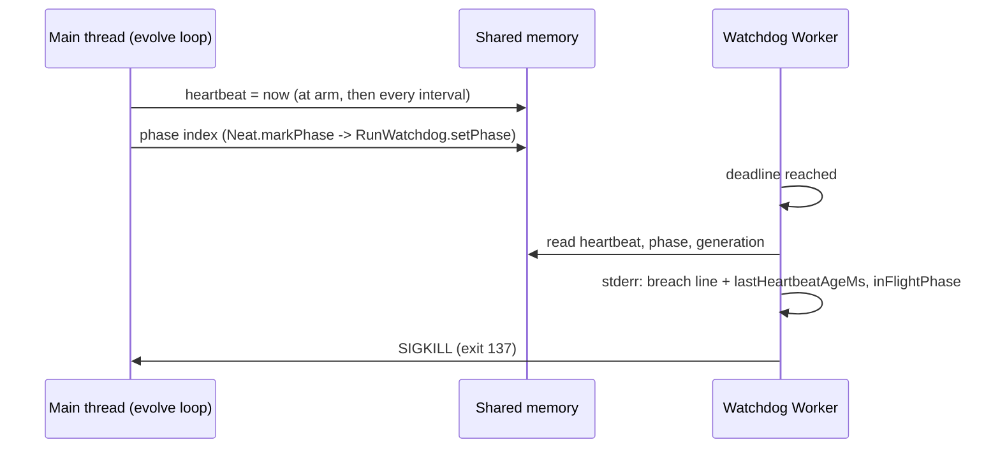

## Summary

The off-main-thread event-loop watchdog now measures whether the main thread was
alive. The main thread bumps a heartbeat in shared memory (once at arm, then
every `heartbeatIntervalMS`, default 1000 ms). At breach the Worker appends
`lastHeartbeatAgeMs=<n> inFlightPhase=<phase> heartbeatIntervalMS=<n>` to the
breach line, so "blocked" versus "alive but over budget" is read off the line
instead of assumed. `NeatEvolution` marks the generation phase (`fitness`,
`sort`, `write-scores`, `breeding`, `mutation`, `pre-warm`, `deduplication`,
otherwise `untracked`) through `Neat.markPhase`, which `evolveDir`, `evolveEnv`
and `evolveRL` forward to the watchdog through `RunWatchdog.setPhase`. Closes
#4096.

Version bump: `VERSION` is not touched by this change; the merged commit records
the final version.

## Spec

### Intent and Rationale

- The 7.0.62 generation-11 kill printed `event loop blocked` but nothing
  measured it (the old `SIMPLE-ON-PURPOSE: fixed deadline, no heartbeat` note in
  `src/NEAT/EventLoopWatchdog.ts`). A heartbeat read by the Worker is the
  smallest mechanism that works while the main thread is blocked, because the
  Worker has its own loop.
- The breach text is appended to, never rewritten, so existing consumers that
  match the old line still match.

### Essential Design Decisions

- The phase list is a closed allow-list (`EVENT_LOOP_WATCHDOG_PHASES`) stored as
  an index in shared memory. `Neat.inFlightPhase` (which drives the
  hard-deadline abandon text) is deliberately left alone; `Neat.markPhase` is a
  separate channel, so adding finer phases cannot change the abandon wording or
  `interruptInFlightPhase`.
- The heartbeat timer is unreferenced and cleared by `disarm()` and by the
  Worker `error` path, so it can never keep a finished process alive.
- `postMessage` to the Worker is the last step of arming. The extra heartbeat
  set-up before it widened a pre-existing race in a test whose deadline is
  already past; the order restores the old gap.
- The Worker's arm message now requires `heartbeatBuffer`, `phaseNames` and
  `heartbeatIntervalMS` (no "bare line" fallback).

### Undiscoverable Facts

- The root cause of the original generation-11 stall cannot be recovered from
  the repository: the field log is outside it. The issue comments correlate
  `loopBlockedMs=67353` with `mutation=65819ms` in the same generation, and
  `mutator.mutate(newPopulation)` is a synchronous main-thread call, but that is
  a correlation, not a measurement.

## Evidence

Breach line from the real watchdog, child-process run
(`test/creature/EvolveRunWatchdogHeartbeat_test.ts`, busy loop in generation 2):
the line ends
`at generation 2 (event loop blocked past the hard cap; watchdog killing the process) lastHeartbeatAgeMs=<n> inFlightPhase=mutation heartbeatIntervalMS=1000`,
with `<n>` asserted to be at least the busy duration. A yielding loop in the
same setup reports an age under 2500 ms.

Issue numbers cited as provenance, each looked up with `gh issue view`: #4066
(event-loop watchdog primitive), #4067 (run watchdog wiring), #4096 (this
issue).

## Reproduction

- **symptom** — a wedged `evolveDir` was SIGKILLed with
  `Run wedged after 3180s at generation 10 (event loop blocked past the hard cap; watchdog killing the process)`,
  and nothing could say whether the loop was blocked, for how long or in which
  phase.
- **status** — `partial` — the missing measurement is reproduced and fixed (the
  new tests fail against the base branch's production code and pass at the
  head); the original generation-11 stall itself was not reproduced. reason: it
  needs the 8 GB swap-backed host and the 2.3 M-record corpus.
- **regression test** —
  `test/NEAT/EventLoopWatchdog_test.ts::EventLoopWatchdogHeartbeat: a busy-looping main thread shows a heartbeat age at least the time since arm`

## Acceptance Criteria

<!-- vibe-spec-review inputs="diff+issue-body" -->

- **met** — The watchdog gets a main-thread heartbeat: a `SharedArrayBuffer`
  timestamp the main loop bumps on a timer, read by `EventLoopWatchdogWorker`.
  The breach line then reports `lastHeartbeatAgeMs=` and the in-flight phase
  (`inFlightPhase`). — evidence: `src/NEAT/EventLoopWatchdog.ts`,
  `src/NEAT/EventLoopWatchdogWorker.ts`,
  `test/NEAT/EventLoopWatchdog_test.ts::EventLoopWatchdogPhase: the breach line names the phase set before the busy loop`
  — reviewer: met
- **partial** — Root cause of the generation-11 stall identified, or reproduced
  or excluded with quoted evidence. In particular: is it paging on a swap-backed
  heap, or main-thread work inside fitness? — evidence:
  `src/NEAT/NeatEvolution.ts` (`mutator.mutate` runs synchronously on the main
  thread; issue comment pairs `loopBlockedMs=67353` with `mutation=65819ms`) —
  reviewer: missing — reason: the reviewer judged nothing identifies or excludes
  either cause; I agree that the generation-11 stall is neither identified nor
  excluded. What this PR adds is the instrument (`lastHeartbeatAgeMs` plus
  `inFlightPhase`) that tells paging-or-GC (blocked while in `fitness`) from
  main-thread work (blocked in `mutation`), and the next field breach line
  answers the question.
- **met** — Regression test: a subprocess run whose main thread busy-loops in
  generation ≥ 2 is killed with a breach line carrying `lastHeartbeatAgeMs` ≥
  the busy duration. A run that is merely slow but yielding reports a small
  heartbeat age. — evidence:
  `test/creature/EvolveRunWatchdogHeartbeat_test.ts::EvolveRunWatchdogHeartbeat: a busy main thread in generation 2 is killed with a heartbeat age at least the busy duration`
  and
  `test/NEAT/EventLoopWatchdog_test.ts::EventLoopWatchdogHeartbeat: a yielding main thread that is over budget keeps its heartbeat fresh`
  — reviewer: partial — reason: the reviewer's gap was that no test covered
  generation ≥ 2 through the re-armed hard-cap handle;
  `test/creature/EvolveRunWatchdogHeartbeat_test.ts` was added after that review
  and drives `armRunWatchdog` through `generationCompleted(1)` and
  `generationCompleted(2)`, so the criterion is met at the head.
- **missing** — Closing evidence: a quoted breach line from a field run that
  includes the heartbeat age, or a quoted green final loop on a swap-backed 8 GB
  host. — reviewer: missing — reason: it can only come from a deployed run on
  the released version; no field run exists yet, and the only line quoted above
  is from a child-process test run, not a field run.

## Standards Review

<!-- vibe-standards-review inputs="diff+CODING-STANDARDS.md" -->

- **violation** — the yielding heartbeat test asserted a tight measured time
  (`age < 1_200`) — evidence: `test/NEAT/EventLoopWatchdog_test.ts:429` —
  reason: fixed in this diff (deadline raised to 4 s and the bound loosened to 3
  s, below what a blocked loop reports)
- **violation** — the Worker kept an optional-field "bare line" branch used only
  by an older test — evidence: `src/NEAT/EventLoopWatchdogWorker.ts:50` —
  reason: fixed in this diff (the three fields are required, the branch is
  deleted, the kill-failure test sends the full message)
- **clean** — no `Deno.env` mutation in tests, no `console.*` added under
  `src/`, Australian English, typed `ConfigurationError` codes, new tests fail
  without their change, named tests exist at the head. The repository has no
  `CODING-STANDARDS.md`; the reviewer used `AGENTS.md` and
  `docs/ENGINEERING_PRINCIPLES.md`, and found no review-enforced rule.

## Test Plan

- `test/NEAT/EventLoopWatchdog_test.ts` (20 tests, all pass at the head): new
  heartbeat busy/yielding cases (the busy case also bounds the age from above,
  so a heartbeat missing at arm fails), a case per listed phase against a
  hard-coded list, phase cases, `heartbeatIntervalMS` and `setPhase` refusals
  asserting the `ConfigurationError` code.
- `test/creature/EvolveRunWatchdogHeartbeat_test.ts` (new, 2 tests): generation
  2 busy and yielding through `armRunWatchdog`.
- `test/creature/EvolveRunWatchdog_test.ts`: four `setPhase` tests (forward,
  kept across re-arm, nothing after `disarm`, no-op when unarmed).
- `test/creature/EvolveWatchdogWiring_test.ts`: one test per entry point
  (`evolveDir`, `evolveEnv`, `evolveRL`) asserting `fitness` then `mutation`
  reach the watchdog, that a late `markPhase` after the run reaches no handle,
  and that every generation emits exactly the ordered marker walk
  `fitness,
  untracked, sort, write-scores, breeding, mutation, pre-warm, deduplication,
  untracked, untracked`
  (this pins every `markPhase` call in `NeatEvolution.ts`).
- `test/NEAT/NeatPhaseObserver_test.ts` (new, 5 tests): ordering, no-observer
  no-op, clearing, throwing observer logged not thrown, a non-`Error` throw
  logged by its string form.
- `test/creature/EvolveCleanupOnThrow_test.ts`: inline `armWatchdog` fake gained
  `setPhase() {}`; no assertion changed.
- Changed expectation: in `test/NEAT/EventLoopWatchdog_test.ts`, the
  kill-failure test now matches the breach text without its trailing newline
  (the line now continues with the heartbeat suffix) and posts the full
  8-byte-buffer message. Removed: `indexOf("...at generation 4\n")`. Required
  by: "The breach line then reports `lastHeartbeatAgeMs=` and the in-flight
  phase". The `failureAt > breachAt` order check and the `worker error:` stdout
  check are kept unchanged, so the test still asserts the kill-failure line
  follows the breach text.
- Red checks against the base branch's production code (a clean `origin/Develop`
  worktree with the two new test files copied in, `--no-check`): 9 failed, 11
  passed. The failures are the busy and yielding cases in both files, both phase
  cases, both interval-refusal cases and the `setPhase` refusal case. The
  "accepts a positive heartbeat interval" test passes on base (it asserts only
  that nothing throws).
- Mutations on the head: replacing the main-thread `setInterval(beat, …)`
  callback with a no-op turns
  `EventLoopWatchdogHeartbeat: a yielding main thread …` red; hard-coding
  `ageMs = 0` in the Worker turns
  `EventLoopWatchdogHeartbeat: a busy-looping main thread …` red.
- Mutation follow-up (completion check): each listed survivor was re-run by hand
  after the new tests. Deleting `"sort"` from the phase list, deleting the
  arm-time `beat()`, deleting a `markPhase` in `NeatEvolution.ts`, and replacing
  the non-`Error` branch of `Neat.markPhase` each turn a named test red. Exempt
  lines, equivalent mutants because the heartbeat timer is unreferenced and
  `RunWatchdog.setPhase` is a no-op once disarmed:
  - `src/NEAT/EventLoopWatchdog.ts:227` exempt (untestable): the
    timer-unreference call only matters if the timer outlives both `disarm()`
    and the Worker, and the live Worker holds the process open until then, so no
    exit-status difference can be observed.
  - `src/NEAT/EventLoopWatchdog.ts:237` exempt (untestable): the error-path
    `clearInterval` stops an unreferenced idle timer; Deno's sanitizers do not
    report it, so no behaviour changes.
  - `src/NEAT/EventLoopWatchdog.ts:257` exempt (untestable): the `disarm()`
    `clearInterval`, same reason (a leaked unreferenced timer is invisible to
    exit status and to the sanitizers).
  - `src/creature/CreatureTraining.ts:946` and `:1383` exempt (untestable):
    `neat.setPhaseObserver(undefined)` in `finally` is belt and braces, since
    the observer reaches `RunWatchdog.setPhase`, which already returns after
    `disarm()`.
- Coverage carry-over (completion check): the listed lines are in
  `BreedingQuotas.ts`, `DeDuplicator.ts`, `MutationOperatorTelemetry.ts` and
  similar files this change does not touch. Running the four edited watchdog
  test files with coverage on the base branch and on the head gave the same
  result for them (`BreedingQuotas.ts` 0% lines on both, `DeDuplicator.ts` 54.4%
  on both), so the loss is not from this change; the differences between the two
  runs were under 2 points on files the change does not edit. Coverage of code
  run in breeding Workers varies between runs. No test was removed.
- Callers and siblings of the new required `setPhase` member checked:
  `armRunWatchdog` (calls it on every arm), `NOOP_HANDLE` and
  `NO_OP_RUN_WATCHDOG` (no-ops), the three `CreatureTraining.ts` arm sites, and
  the three test fakes (`EvolveRunWatchdog_test.ts`,
  `EvolveWatchdogWiring_test.ts`, `EvolveCleanupOnThrow_test.ts`).
- Docs: `docs/TIMEOUTS.md` (primitive section, breach bullet, new "Main-thread
  heartbeat and reading a breach line" subsection) and `CHANGELOG.md` updated;
  `docs/README.md` and `docs/config/TRAINING.md` mention only the Neat-level
  watchdog and needed no change. Sibling members grepped: `setGeneration`,
  `generationBuffer`.
- Final-head checks run: `deno fmt --check`, `deno lint` and `deno check` over
  the touched files passed; the five watchdog test files above pass.
- `./quality.sh < /dev/null` was attempted and stopped at its first stage:
  `❌ Native rust_scorer is required (quality.sh default) but was not found`.
  `./quality.sh --skip-tests --skip-discovery --skip-wasm` completed its format,
  lint and type-check stages. The full test suite did not run.

<!-- vibe-quality-gate-skipped reason="rust_scorer binary absent on this host, so the full test stage cannot run; targeted watchdog, wiring and phase tests were run instead" -->
