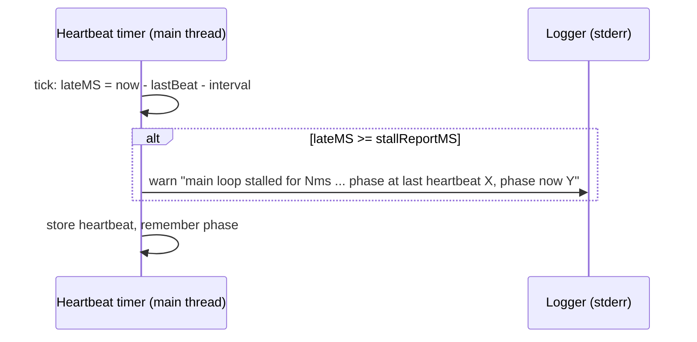

## Summary

PR #4101 (merged, released from 7.0.65) gave the off-main-thread watchdog a
heartbeat and an in-flight phase, but they surface only at a fatal breach. The
field comments on #4096 are mostly non-fatal main-loop blocks of 60 to 110 s
that never reach the deadline, so that instrument never reports them. This PR
adds a non-fatal stall line to the same heartbeat timer: when a tick is late by
`stallReportMS` (default `DEFAULT_STALL_REPORT_MS`, 10 s) the main thread logs
`[Neat] main loop stalled for <ms>ms (heartbeat every <n>ms) at generation
<n|unknown>; phase at last heartbeat: <phase>, phase now: <phase>`. It does not
kill anything. The field logs on 7.1.2 also exclude one hypothesis (see
Evidence). Part of #4096.

Version bump: `VERSION` is not touched by this change; the merged commit records
the final version.

## Not closing #4096

The generation-11 root cause is still neither identified nor excluded
(`partial`), and the closing field evidence needs a deployed run on a release
that carries this change (`missing`).

## Spec

### Intent and Rationale

- The root-cause criterion needs measurements of the blocks that actually
  happen. A fatal-only report cannot give them, so the smallest addition is a
  line from the existing heartbeat timer, with no new thread and no new timer.

### Essential Design Decisions

- The stall check is a main-thread comparison of two `Date.now()` readings, so
  it needs no Worker change and the breach line is untouched. It uses the wall
  clock, so a clock step can give a false line; that is documented.
- Both the phase at the last heartbeat and the phase now are named. A phase
  marker is cleared when its work returns, so the phase now alone can read
  `untracked` after a block that began inside `mutation`.
- The arm-time heartbeat is stored directly, not through the checking `beat`,
  so arming never reports.

### Undiscoverable Facts

- The 10 s default is above the 1 s heartbeat interval and well below the 60 to
  110 s blocks in the issue comments. The Worker's own handshake line already
  names those blocks, but only inside a worker-init failure.

## Evidence

Field logs searched: GRQ-logs `Develop` at `66af01e` (2026-11-06), history from
2026-10-29 (the day #4101 merged) with `git log -S 'lastHeartbeatAgeMs'` and
`git log -G 'Run wedged|event loop blocked'`. Neither matched a line, so no
fatal breach with a heartbeat age has been logged since the heartbeat shipped.
The same window does hold non-fatal blocks on 7.1.2, for example
`GRQ-3-rocket.log` (rocket@GRQ-3, commit `289753f`, load averages
`49.79 58.48 50.43` on 10 CPUs):

```text
[Timing] fitness=34710ms breeding=133950ms breedingWorker=133949ms mainThreadOverlap=0ms ... sort=0ms writeScores=194ms mutation=0ms deduplication=974ms speciation=18ms total=232627ms
[DiscoveryReplayRunner] Worker init failed; falling back to direct execution for this worker slot. Error: [WasmWorkerInit] Worker init: no response after 60s (worker=worker-25). Parent-observed: handshakeMs=60000 parentStallMs=5942 loopBlockedMs=64941 ...
```

In that generation `mutation=0ms` and every itemised main-thread phase is
under 1 s, while `total` exceeds `fitness + breeding` by about 63 s, matching
`loopBlockedMs=64941`. So the comment's inference that a long `mutation` phase
causes the block does not hold for this instance, and the block sits in time no
phase accounts for, on a host far over-subscribed. That excludes `mutation` for
that run only. It neither identifies the generation-11 cause nor tells paging
from CPU starvation. The new stall line is what will.



Issue numbers cited as provenance, each looked up with `gh issue view`: #4066
(event-loop watchdog primitive), #4067 (arm the watchdog in evolveDir, evolveEnv
and evolveRL), #4096 (this issue).

## Reproduction

- **symptom** — main-loop blocks of 60 to 110 s (and one fatal one) left no
  record of how long the loop was blocked or in which phase, except through the
  worker-init failure line.
- **status** — `partial` — the missing report is reproduced by a child-process
  busy loop (no stall line before this change) and fixed. reason: the original
  generation-11 stall needs the 8 GB swap-backed host and the 2.3 M-record
  corpus and was not reproduced.
- **regression test** —
  `test/NEAT/EventLoopWatchdog_test.ts::EventLoopWatchdogStall: a busy loop logs one stall line naming the generation and the phase`

## Acceptance Criteria

<!-- vibe-spec-review inputs="diff+issue-body" -->

- **met** — The watchdog gets a main-thread heartbeat: a `SharedArrayBuffer`
  timestamp the main loop bumps on a timer, read by `EventLoopWatchdogWorker`.
  The breach line then reports `lastHeartbeatAgeMs=` and the in-flight phase
  (`inFlightPhase`). — evidence: `src/NEAT/EventLoopWatchdog.ts`,
  `src/NEAT/EventLoopWatchdogWorker.ts` (merged in #4101, present at the base)
  — reviewer: met
- **partial** — Root cause of the generation-11 stall identified, or reproduced
  or excluded with quoted evidence. In particular: is it paging on a swap-backed
  heap, or main-thread work inside fitness? — evidence: the `rocket` log excerpt
  above and `src/NEAT/EventLoopWatchdog.ts` (stall line) — reviewer: partial —
  reason: not identified. `mutation` is excluded for one run only; paging versus
  starvation is open until a stall line from the field names the phase.
- **met** — Regression test: a subprocess run whose main thread busy-loops in
  generation ≥ 2 is killed with a breach line carrying `lastHeartbeatAgeMs` ≥
  the busy duration. A run that is merely slow but yielding reports a small
  heartbeat age. — evidence:
  `test/creature/EvolveRunWatchdogHeartbeat_test.ts::EvolveRunWatchdogHeartbeat: a busy main thread in generation 2 is killed with a heartbeat age at least the busy duration`
  (merged in #4101, present at the base) — reviewer: met
- **missing** — Closing evidence: a quoted breach line from a field run that
  includes the heartbeat age, or a quoted green final loop on a swap-backed 8 GB
  host. — reviewer: missing — reason: the GRQ-logs search above found no such
  line since 2026-10-29; it needs a deployed run.

## Standards Review

<!-- vibe-standards-review inputs="diff+CODING-STANDARDS.md" -->

Pending the reviewer's verdict below.

## Test Plan

- `test/NEAT/EventLoopWatchdog_test.ts`: new
  `EventLoopWatchdogStall: a busy loop logs one stall line naming the generation and the phase`
  (asserts exactly one line, `generation 3`, `phase at last heartbeat:
  mutation`), `EventLoopWatchdogStall: a yielding main thread logs no stall line`,
  and three `stallReportMS` validation tests (`NOT_FINITE`, `OUT_OF_RANGE`,
  positive accepted). No existing assertion was edited or removed.
- Red checks: the report comparison changed to never fire turns the busy-loop
  test red (`stall line missing from stderr`); changed to always fire it turns
  the yielding test red. Both restored.
- Ran on the head: `deno test -A test/NEAT/EventLoopWatchdog_test.ts
  test/creature/EvolveRunWatchdogHeartbeat_test.ts
  test/creature/EvolveRunWatchdog_test.ts
  test/creature/EvolveWatchdogWiring_test.ts`: 48 passed, 0 failed. `deno fmt
  --check`, `deno lint` and `deno check` on the touched TypeScript pass.
- Callers of `armEventLoopWatchdog`: `src/creature/EvolveRunWatchdog.ts` passes
  no `stallReportMS`, so production uses the 10 s default.
- Docs: `docs/TIMEOUTS.md` (heartbeat section) and `CHANGELOG.md`.
- <!-- vibe-quality-gate-skipped reason="the full ./quality.sh was not run: it needs the native rust_scorer and about 15 minutes; CI runs it on the PR" -->
