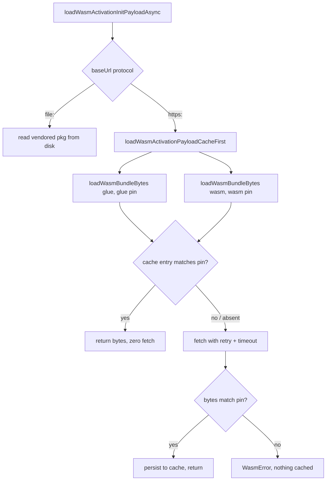

# Load the WASM activation payload cache-first (#4097)

## Summary

`loadWasmActivationInitPayloadAsync()` (and so `fetchWasmForWorkers()`) fetched
`wasm_activation.js` and `wasm_activation_bg.wasm` from jsr.io on every process
start for `https:` installs. It never consulted the SHA-pinned on-disk bundle
cache that `WasmModuleLoader` already uses, so a jsr.io outage longer than the
caller's retry window killed a run whose bytes were already on disk. The
`https:` branch now loads both files through `loadWasmBundleBytes` (cache-first,
bounded retry, per-attempt timeout). The JS glue is cached beside the binary and
is pinned by a new `EXPECTED_WASM_GLUE_SHA256`, generated by `./build.sh` next
to the existing binary pin. Closes #4097.

Version bump: the `deno.json` change in this diff is the quality gate's own
dependency bump (`@stsoftware/tags` 1.0.34 to 1.0.36); no `VERSION` is edited by
hand, and the merged commit records the final version.

## Spec

### Intent and Rationale

- The glue is cached and pinned (the issue's first option) rather than handed to
  workers as a versioned URL: the payload carries `jsSource` as text, and a
  pinned cache entry keeps the warm path fully offline.
- The glue is executed in workers, and the cache directory is environment
  controlled, so an unpinned cached glue would be a code-execution path. It is
  verified against its own pin before use and before caching.
- The old single-shot fetch (`fetchWasmActivationPayloadOverHttp`) was removed,
  not kept, so one implementation owns payload loading (ENGINEERING_PRINCIPLES
  principles 4 and 7).

### Essential Design Decisions

- `loadWasmActivationInitPayloadAsync(options?)` gained `WasmPayloadLoadOptions`
  (`LoadWasmBundleOptions` plus `expectedGlueSha256` and `baseUrl`). `baseUrl`
  is the seam that lets a test reach the `https:` branch from a `file:`
  checkout; a load with an explicit `baseUrl` neither reads nor writes the
  process memo. Options other than `baseUrl` only affect the first memoised load
  in a process (documented on the function).
- Failures are wrapped in `WasmError` (`MODULE_NOT_LOADED`) naming both URLs, so
  callers such as GRQ keep one failure mode. The cold-cache bound changes from
  one 30 s attempt to the cache loader's 60 s per attempt with bounded retries
  (#4048).
- `build.sh` `write_runtime_bundle_pin` fails loud, and writes no pin, when
  `wasm_activation.js` is missing. `src/wasm/WasmBundleSha256.ts` was updated by
  hand and diffed byte-for-byte against the function's output.

### Undiscoverable Facts

- The glue is not cached by any release before this change, so the first start
  on the new version still fetches the glue once, even when the binary is
  already cached; later starts are offline.
- The glue cache entry shares the cache directory and the `.wasm` file suffix
  with the binary entry. Keys are SHA-256 of the full URL, and each entry is
  verified against its own pin.

## Evidence

Backend-only change; no UI file is touched. Evidence is the test runs below.

Docs sweep: grep:
`fetchWasmForWorkers|WasmActivationPayload|fetched from jsr|always fetch|WASM_PAYLOAD_FETCH_TIMEOUT_MS|fetchWasmActivationPayloadOverHttp|WasmPayloadFetchOptions`
over `README.md`, `docs/` (excluding `docs/archive/`) and `src/`; section: the
JSR-install part of `docs/troubleshooting/WASM.md` (read in full after editing);
siblings: `EXPECTED_WASM_BUNDLE_SHA256` and `EXPECTED_WASM_MEMORY_MODEL` in
`src/wasm/WasmBundleSha256.ts` and `docs/CORE_DEPENDENCY_POLICY.md`; updated:
`docs/troubleshooting/WASM.md`, `CHANGELOG.md`, the header comments of
`build.sh` and `src/wasm/WasmBundleSha256.ts`; `docs/api/COMPUTE.md` says the
payload is "fetched once and cached", which is still true; `CHANGELOG.md:37`
still names the removed `fetchWasmActivationPayloadOverHttp`, as history of what
this entry removed.

Issues cited: #4097: Recurrence of GRQ#4862: fetchWasmForWorkers() /
loadWasmActivationInitPayloadAsync() always fetch the WASM payload from jsr.io
and never read the on-disk bundle cache; #4035: WASM payload fetch() has no
timeout in src/workers/WasmActivationPayload.ts; #4048: WasmBundleCache
fetchWithRetry has no timeout: a stalled jsr.io connection hangs WASM loading
forever.

## Reproduction

- **symptom** — with a warm on-disk bundle cache and a jsr.io that is down
  (`TypeError: fetch failed`), `loadWasmActivationInitPayloadAsync()` for an
  `https:` install made two `fetch` calls and threw
  `WasmError: WASM activation
  payload could not be loaded from https://jsr.io/... : fetch failed`.
- **status** — `verified` — the new tests were run against the base
  `WasmActivationPayload.ts` (`--no-check`, because the base takes no options):
  8 of 9 failed, including the warm-cache test, which got the vendored file
  rather than the cache contents. A second break kept the new seam but sent the
  `https:` branch back to the uncached fetch; the warm-cache test went red there
  too (the executor's mutation (i), `FAILED | 2 passed | 4 failed` on the then
  six-test file). All pass on the fixed code. The seam (`baseUrl`) is new, so
  the first run proves the test needs the fix, and the second proves it detects
  the symptom itself.
- **regression test** —
  `test/workers/WasmPayloadCacheFirst.ts::Issue #4097: a warm cache serves the payload with zero network calls`

## Acceptance Criteria

<!-- vibe-spec-review inputs="diff+issue-body" -->

- **met** — `loadWasmActivationInitPayloadAsync()` resolves the `.wasm` bytes
  through `loadWasmBundleBytes` (cache-first, SHA-pinned) for `https:` installs.
  The JS glue comes from a cache too: either cache `wasm_activation.js` next to
  the `.wasm`, or hand workers the versioned glue URL so Deno's module cache
  serves it, as GRQ's loader already does. — evidence:
  `src/workers/WasmActivationPayload.ts::loadWasmActivationPayloadCacheFirst`,
  `test/workers/WasmPayloadCacheFirst.ts::Issue #4097: a poisoned cached glue is rejected, re-fetched, and the genuine glue served`
  — reviewer: met
- **met** — A warm cache needs **zero** `fetch` calls: `fetchWasmForWorkers()`
  succeeds offline. — evidence:
  `test/workers/WasmPayloadCacheFirst.ts::Issue #4097: a warm cache serves the payload with zero network calls`
  — reviewer: met — reason: the reviewer notes `fetchWasmForWorkers()` takes no
  options and resolves to `file:` in a checkout, so no test calls it directly;
  it is a one-line wrapper over the tested function
- **met** — Regression test: inject a `fetchFn` that always rejects
  (`TypeError: fetch failed`), pre-populate a temp `cacheDir` with the bundle,
  call `loadWasmActivationInitPayloadAsync()` and assert it returns the payload
  with `fetchFn` called 0 times. Today's code fails this: it calls `fetch` twice
  and throws. — evidence:
  `test/workers/WasmPayloadCacheFirst.ts::Issue #4097: a warm cache serves the payload with zero network calls`
  — reviewer: met
- **met** — Cold cache + failing fetch still fails loud, naming the URLs. —
  evidence:
  `test/workers/WasmPayloadCacheFirst.ts::Issue #4097: a cold cache with a failing network rejects with WasmError naming both URLs`
  — reviewer: met
- **partial** — Release + GRQ bump. Then GRQ can drop the now-redundant parallel
  `fetchWasmForWorkers()` branch in `src/preloadWasm.ts:219-222` and fix its log
  wording. That part is GRQ-side follow-up, not this issue. — evidence:
  `CHANGELOG.md` entry for #4097 — reviewer: partial — reason: the release and
  the GRQ-side edit happen after merge and are not code in this repository —
  remaining: merge-verification-only
- **partial** — Closing evidence: a quoted log line from a GRQ run on the
  released version showing the preload succeeding on cache with no jsr.io fetch,
  e.g. a `cache=hit` line for the payload path. A sustained-outage repro on any
  host also counts. — reviewer: partial — reason: needs a released build and a
  GRQ run log; the spec reviewer could not judge it from the diff — remaining:
  merge-verification-only
- **unrequested** — `deno.json` and `deno.lock`: `@stsoftware/tags` 1.0.34 to
  1.0.36 — reviewer: unrequested — reason: written by the quality gate's own
  dependency bump; the repository bumps dependencies in the same PR
- **unrequested** — `baseUrl` option and memo bypass on
  `loadWasmActivationInitPayloadAsync` — reviewer: unrequested — reason: the
  spec reviewer traced it to the issue's regression test, which must reach the
  `https:` branch from a `file:` checkout
- **unrequested** — glue SHA pin in `build.sh` and
  `src/wasm/WasmBundleSha256.ts`, with build-script tests — reviewer:
  unrequested — reason: the spec reviewer traced it to "SHA-pinned"; the glue is
  executed in workers, so it needs a pin

## Standards Review

<!-- vibe-standards-review inputs="diff+CODING-STANDARDS.md" -->

`CODING-STANDARDS.md` does not exist in this repository, so the reviewer used
`AGENTS.md` and `docs/ENGINEERING_PRINCIPLES.md`; it was not checked against a
`CODING-STANDARDS.md`.

- **violation** — principles 4 and 7: the superseded single-shot
  `fetchWasmActivationPayloadOverHttp`, `WasmPayloadFetchOptions` and
  `WASM_PAYLOAD_FETCH_TIMEOUT_MS` were kept with no production caller —
  evidence: `src/workers/WasmActivationPayload.ts:140` — reason: fixed in this
  diff (the three symbols, `test/workers/WasmPayloadFetchTimeout.ts` and the
  stale docs were removed; the guard moved to
  `test/workers/WasmPayloadCacheFirst.ts`)
- **violation** — optional: header comments in `build.sh` and
  `src/wasm/WasmBundleSha256.ts` said the pin derives only from the binary —
  evidence: `src/wasm/WasmBundleSha256.ts:4` — reason: fixed in this diff
- **violation** — optional: the memo ignores options other than `baseUrl` —
  evidence: `src/workers/WasmActivationPayload.ts:202` — reason: fixed in this
  diff (documented on the function)
- **clean** — glue and binary each verified against their own pin before use and
  before caching; a missing or malformed pin is rejected; pin file matches
  `build.sh` output byte-for-byte; tests assert behaviour, no timing APIs, no
  `Deno.env.set`; typed `WasmError` with cause; no new `console.*`; Australian
  English; docs match code; no workflow files touched; no named test is absent.
- **clean** — existing tests changed (`test/scripts/BuildScriptContentHash.ts`,
  `test/scripts/BuildScriptMemoryModel.ts`): no assertion removed; the added
  glue fixture is required by the new missing-glue guard; the edited and added
  assertions go red without the `build.sh` change.
- Optional, not changed: the glue cache entry keeps a `.wasm` file suffix
  (harmless; key is a URL hash). Residual risk: the glue pin assumes jsr.io
  serves `wasm_activation.js` byte-for-byte as vendored; if it ever rewrites it,
  `https:` installs fail loud rather than run.

## Test Plan

Tests added in `test/workers/WasmPayloadCacheFirst.ts` (9, all named
`Issue #4097: ...`): warm cache with zero fetches; cold cache with a failing
network; non-OK HTTP 503 with nothing cached; cold fetch then offline reuse;
poisoned cached glue; network glue missing the pin; vendored glue pin; stalled
fetch; invalid timeout. `test/scripts/BuildScriptContentHash.ts` gains the
missing-glue refusal test and the glue-constant assertions;
`test/scripts/BuildScriptMemoryModel.ts` gains a glue fixture line in two tests.

Removed from `test/workers/WasmPayloadFetchTimeout.ts` (file deleted with the
function it tested; reason: principles 4 and 7, one owner):

- Removed from `test/workers/WasmPayloadFetchTimeout.ts`: a stalled payload
  fetch rejects with WasmError MODULE_NOT_LOADED
  - Moved to: `test/workers/WasmPayloadCacheFirst.ts`
- Removed from `test/workers/WasmPayloadFetchTimeout.ts`: every payload fetch
  carries an abort signal
  - Moved to: `test/wasm/WasmBundleCache.ts`
    (`Issue #4048 — every attempt passes an abort signal to fetchFn`)
- Removed from `test/workers/WasmPayloadFetchTimeout.ts`: a healthy peer returns
  the JS source and WASM bytes
  - Moved to: `test/workers/WasmPayloadCacheFirst.ts` (cold cache fetches once,
    persists, serves offline)
- Removed from `test/workers/WasmPayloadFetchTimeout.ts`: a non-OK response
  still rejects with WasmError
  - Moved to: `test/workers/WasmPayloadCacheFirst.ts` (non-OK response on a cold
    cache)
- Removed from `test/workers/WasmPayloadFetchTimeout.ts`: a network failure is
  wrapped in WasmError with its cause
  - Moved to: `test/workers/WasmPayloadCacheFirst.ts` (cold cache with a failing
    network)
- Removed from `test/workers/WasmPayloadFetchTimeout.ts`: an invalid timeout is
  refused
  - Moved to: `test/workers/WasmPayloadCacheFirst.ts` (invalid fetch timeout)
    and `test/wasm/WasmBundleCache.ts`
    (`Issue #4048 — an invalid fetchTimeoutMs is refused`)
- Removed from `test/workers/WasmPayloadFetchTimeout.ts`: the default timeout is
  a generous bound (30 000 ms)
  - Moved to: `test/wasm/WasmBundleCache.ts`
    (`Issue #4048 — the default bound is generous`, 60 000 ms); the 30 s
    constant no longer exists

Red-checks (each restored after):

- Whole fix reverted (base `WasmActivationPayload.ts`, `--no-check`): 8 of 9 new
  tests red; the vendored-pin test stays green, as it tests the pin file.
- `https:` branch back to the uncached fetch on the new seam: warm-cache test
  red (and three more).
- Glue loaded with the binary's digest instead of the glue pin: poisoned-glue
  test red (plus warm-cache and offline-reuse tests);
  `network glue that misses the glue pin` stays green because it rejects under
  either pin, so only the poisoned-glue test isolates the glue pin (reads binary
  pin instead of glue pin → red).
- `WasmError` wrapping skipped: cold-cache failing-network test red
  (`Expected error to be instance of "WasmError"`).
- `if (!response.ok)` disabled in `fetchWithRetry`: non-OK test red.
- Stalled fetch: with the signal not passed alone the test stays green, because
  `untilAborted` also bounds it; with `untilAborted` also removed it goes red.
- `build.sh` without the glue constant: pin test red; guard removed alone:
  missing-glue test red (it asserts the guard's own message); guard and digest
  validation both removed: red.

Entry points checked: `loadWasmActivationInitPayloadAsync` (called by
`src/multithreading/workers/WorkerHandler.ts`,
`src/intelligentDesign/workers/WorkerHandler.ts` and
`src/creature/EpisodeWorkerPool.ts` with no arguments, so they get the defaults
and the cache-first path) and `fetchWasmForWorkers` (wrapper, no arguments).
Their `file:` behaviour is covered by the unchanged
`test/workers/WasmActivationPayload.ts` and
`test/wasm/WasmPayloadAvailability.ts`, which pass.

Branch outcomes: `loadWasmActivationPayloadCacheFirst` success: warm-cache and
cold-fetch tests; failure wrapped: cold-cache failing-network, non-OK and
stalled tests; `expectedGlueSha256 ?? default`: glue-pin tests; `memoised`
true/false: the `baseUrl` tests (false); the default (true) path is covered by
the unchanged `test/workers/WasmActivationPayload.ts`. `build.sh`: missing glue
refused, glue digest emitted.

Results on the final code head:
`timeout 590 ./quality.sh --rust-scorer-bin=<built from the sibling scorer checkout>`
with `NEAT_AI_DISCOVERY_LIB_PATH` set to the installed discovery library:
`ok | 10006 passed (5 steps) | 0 failed | 4 ignored`, exit 0, run before the
non-OK test and this summary were added. After adding the non-OK test:
`timeout 120 deno test -A test/workers/WasmPayloadCacheFirst.ts`:
`ok | 9 passed | 0 failed`. The gate is re-run after this summary is committed;
its result is in the PR comment if it differs.

Not checked: no test calls `fetchWasmForWorkers()` itself; a real jsr.io fetch
and the GRQ-side follow-up were not exercised.
