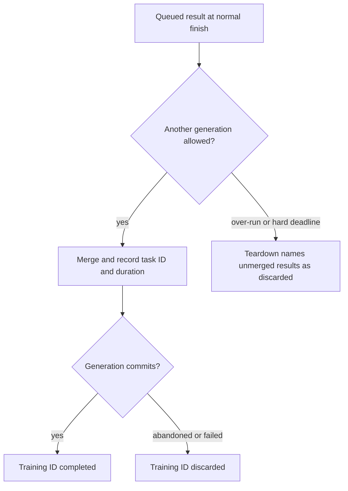

## Summary

Training completion is logged when its generation commits. A result merged into
an abandoned or failed generation receives a discard line without an earlier
completion line. The checkpointed fix is preserved; timeout documentation now
also explains why over-run and hard-deadline bounds can prevent a late merge.
Newer sampler logs still do not meet the field-evidence criterion. Part of
#4099.

## Spec

### Intent and Rationale

- Preserve the queued-result finish-up fix delivered by merged PR #4104 and the
  evidence recorded by merged PR #4137; finish the duplicate-terminal-line fix
  already checkpointed on this branch.
- Reuse the existing deterministic regressions. No additional uncovered defect
  was confirmed, so no new test or behaviour was added during this resumption.

### Essential Design Decisions

- `processCompletedResults()` records task IDs and durations in the required
  `mergedTrainIDs` map. `Neat.commitMergedTraining()` emits completion lines;
  abandonment and teardown clear the same map after logging discards.
- The over-run and hard-deadline guards retain priority over another merge and
  population-scoring pass in `evolveDir`, `evolveEnv` and `evolveRL`.
- Terminal logging covers handled commits, failures and teardown. A process
  killed outright can exit before these handlers run.

### Undiscoverable Facts

- The downstream log repository at `3f1809f96c270b2cfe577cefa39aa5fc8c46c12e`
  (2026-11-13T03:04:09Z) contains only a portfolio log. Sampler evidence below
  comes from earlier immutable snapshots, read using `gh api`.
- The inspected 7.1.15 sampler log explicitly discards two late results while
  its downstream parser reports both as `in_flight` with `reason=log-ended`.
- Independent reviewer agents were not dispatched: this executor was explicitly
  instructed not to delegate. The criteria and standards below are manual
  assessments, without independent-review provenance markers.

## Evidence

Backend-only change; no visual surface changed.

The three changed duplicate-terminal regressions fail against default-branch
production code at `e275a8278147d2f2abaa59eb8a057ec0e857959f` with the current
test file copied into an isolated worktree: 2 passed, 3 failed, each with actual
completion count 1 versus expected 0. They pass on this branch.

### Field evidence checked on 2026-11-13

These are sampled production logs, not a fleet-wide survey. Each row records the
source revision, release, task ID, completion line and parsed outcome.

| Log and revision                                                              | NEAT-AI release | Task       | Completion line                                                                                                  | Parsed terminal outcome                       |
| ----------------------------------------------------------------------------- | --------------- | ---------- | ---------------------------------------------------------------------------------------------------------------- | --------------------------------------------- |
| `GRQ-3-rocket.log` at `22d5d10cb4e96772f3738bbf83b61e4bb4883d5d` (2026-11-06) | 7.1.10          | `b8e11321` | Absent                                                                                                           | `outcome=abandoned … reason=worker-cancelled` |
| `GRQ-3-sloth.log` at `fda98f174a6ed9261bee357c8bbbecd1ccf718d1` (2026-11-10)  | 7.1.15          | `ef0834b8` | `Training ef0834b8 completed after 4m 6s 892ms`                                                                  | `outcome=completed … reason=result-returned`  |
| Same snapshot                                                                 | 7.1.15          | `804474fb` | `Training 804474fb completed after 3m 47s 882ms`                                                                 | `outcome=completed … reason=result-returned`  |
| Same snapshot                                                                 | 7.1.15          | `89130576` | Absent; `Training 89130576 discarded at teardown: it settled after the last generation's results were processed` | `outcome=in_flight … reason=log-ended`        |
| Same snapshot                                                                 | 7.1.15          | `20c163b1` | Absent; `Training 20c163b1 discarded at teardown: it settled after the last generation's results were processed` | `outcome=in_flight … reason=log-ended`        |
| `GRQ-21-sloth.log` at `d78afa4b7796109a9bd57f15257aa59f117f92b0` (2026-11-11) | 7.1.17          | `7600c3d3` | Absent; first-generation watchdog killed the process                                                             | `outcome=aborted … reason=stage-aborted`      |

The 7.1.15 completions precede generation 4 and belong to tasks scheduled before
generation 1. They are not evidence of a final-generation late merge. After
generation 5, `Waiting for 2 settled result(s)` is followed by the over-run stop
and the two discards above. The newer 7.1.17 run ends with exit 137. Neither
release contains this branch's pending commit-time logging change.

Issue/PR provenance checked with `gh issue view` or `gh pr view`: #4099: the
late-result teardown defect; #4107: a merged result discarded by an abandoned
generation; #4104: merged queued-result finish-up fix
(`819418174f183bdd8143cb08aa947d492d833521`); #4137: merged field-evidence
record (`3fb7753f819edf4d4e899034fec33ca263476f5b`).

## Reproduction

- **symptom** — a merged training result logged both completed and discarded
  when its generation was abandoned or failed before commit.
- **status** — `verified` — three edited regressions failed against unmodified
  default-branch production code, then passed with the checkpointed fix.
- **regression test** — `test/NEAT/EvolveAbandonedTrainingResultDiscard_test.ts`
  (hard-deadline abandon, teardown while breeding is pending, and failure during
  merge).
- The original v7.0.62 silent-drop reproduction was not rerun against that tag;
  its delivered late-result regression passes on this branch.

## Acceptance Criteria

Manual assessment; independent agent review was prohibited for this executor.

- **met** — Before `finishUp` can return `true`, it also checks
  `trainingComplete.length > 0` (and `discoveryComplete`). When either is
  non-empty it arms one more processing pass. Alternatively, the teardown drains
  `trainingComplete` into the population and re-scores before
  `restoreEvolveChampion`/`writeCreatures`. Whichever route: a settled result is
  either merged or explicitly logged as discarded with its id. — evidence:
  `test/NEAT/NeatFinishUp.ts` queued-training, queued-discovery and over-run
  cases; `test/creature/BoundedEvolveTeardown.ts` persist-time settlement and
  failure cases. Delivered by #4104, preserved here.
- **met** — Every scheduled training task ends with exactly one terminal line
  (`completed`, `failed`, `abandoned`, or a new `discarded at teardown`). —
  evidence: `test/NEAT/EvolveAbandonedTrainingResultDiscard_test.ts` asserts one
  discard and zero completions for abandoned/failed generations, and one
  completion with no discard for a normal commit;
  `test/creature/EvolveFailureNamesInFlightTasks_test.ts` covers failure cleanup
  through all three entry points. Scope: handled exits, as explained in Spec.
- **met** — Regression test: stub a worker whose training promise resolves
  **after** the final generation's `processCompletedResults` but before
  `finishUp`. Then assert that (a) the trained creature reaches the returned
  population or the creature store, or a `discarded` line names the task, and
  (b) `Training <id> completed` is logged. On `v7.0.62` this test fails. —
  evidence:
  `test/creature/EvolveDirLateTrainingResult.ts::evolveDir: a training result settled after the last generation is merged and persisted, not discarded (Issue #4099)`.
  The delivered test injects settlement through `recordTrainingComplete` after
  the final scheduled generation rather than a worker promise; its original red
  run was recorded by #4104, not rerun against v7.0.62 here.
- **missing** — Field evidence: a GRQ sampler log on a neat-ai release carrying
  the fix where a task scheduled in the last generation shows
  `Training <id> completed`, with no `outcome=in_flight … reason=log-ended` in
  `[training-outcomes]`. — reason: none of the inspected snapshots qualifies;
  this branch's commit-time logging change has not shipped. The sampled late
  results on 7.1.15 were discarded and still parse as `log-ended`.

## Standards Review

Manual review only; no independent review is claimed.

- **clean** — logging uses `getLogger()`; no persisted format, dependency or
  external-input boundary changed in this fix; Australian English; no new timing
  or environment mutations in tests. The required map argument reaches the
  production `evolve()` call and the existing direct test callers.
- **clean** — read the bounded-teardown and cooperative-return sections of
  `docs/TIMEOUTS.md`, the matching source comments and the historical example in
  `docs/troubleshooting/MEMORY.md`. Updated `docs/TIMEOUTS.md`, `CHANGELOG.md`
  and the stale map comment in `src/NEAT/NeatEvolution.ts`. No twinned rule was
  found for the changed completion producer.

## Test Plan

- No new tests added during resumption. Existing regression assertions remain;
  no tests were removed or skipped. Red on unmodified `Develop`: 2 passed, 3
  failed in `test/NEAT/EvolveAbandonedTrainingResultDiscard_test.ts`.
- The focused command passed 91 tests across
  `test/NEAT/EvolveAbandonedTrainingResultDiscard_test.ts`,
  `test/NEAT/NeatFinishUp.ts`,
  `test/NEAT/ProcessCompletedResultsMerged_test.ts`,
  `test/NEAT/EvolveAbandonedDiscoveryReplayDiscard_test.ts`,
  `test/NEAT/AbandonedCommitKeepsPreviousPopulation_test.ts`,
  `test/creature/EvolveDirLateTrainingResult.ts`,
  `test/creature/BoundedEvolveTeardown.ts`,
  `test/creature/EvolveDirBoundedTeardown.ts`,
  `test/creature/EvolveFailureNamesInFlightTasks_test.ts`,
  `test/creature/NeuronUuidStability.ts` and
  `test/creature/SemanticVersionStability.ts`.
- Removed from `test/NEAT/EvolveAbandonedTrainingResultDiscard_test.ts`:
  `1, "the trained task must still log its completed line",`.
  - Required by: "Every scheduled training task ends with exactly one terminal
    line (`completed`, `failed`, `abandoned`, or a new
    `discarded at teardown`)."
  - Replaced by:
    `0, "a task whose generation is abandoned must log only its discarded line, not completed (Issue #4099)"`;
    the existing exactly-one discard and retained-population assertions remain.
- Removed from `test/NEAT/EvolveAbandonedTrainingResultDiscard_test.ts`:
  `1, "the training result must have been merged before breeding is awaited",`.
  - Required by: "Every scheduled training task ends with exactly one terminal
    line (`completed`, `failed`, `abandoned`, or a new
    `discarded at teardown`)."
  - Replaced by:
    `neat.mergedUncommittedTrainIDs.has(TASK_ID), "the training result must have been merged before breeding is awaited"`
    and `0, "not logged completed before the generation commits (Issue #4099)"`;
    the discard-count assertion remains, with a final zero-completion check.
- Removed from `test/NEAT/NeatFinishUp.ts`: the completion assertion's message
  `` `the merge must log the settled task's completion; got: ${plain}` ``.
  - Required by: "Every scheduled training task ends with exactly one terminal
    line (`completed`, `failed`, `abandoned`, or a new
    `discarded at teardown`)."
  - Replaced by:
    `` `the commit must log the settled task's completion; got: ${plain}` ``.
    The same completion regex now runs after the explicit commit; the test still
    checks the trained creature and drained queue, and additionally asserts no
    completion at merge.
- `test/NEAT/ProcessCompletedResultsMerged_test.ts` passes the required map; its
  outcome assertions are unchanged.
- Callers inspected: normal finish, over-run, hard deadline and failure cleanup
  in `evolveDir`, `evolveEnv`, `evolveRL`; shared commit and abandon paths in
  `NeatEvolution.evolve`; teardown persist-success and persist-failure paths.

- `DENO_JOBS=1 ./quality.sh < /dev/null`, with the built native scorer path
  supplied through `NEAT_AI_RUST_SCORER_BINARY_PATH`: exited 0 after formatting,
  lint, shell checks, type checks, WASM verification and test execution; 10,326
  tests passed (5 steps), 0 failed, 50 ignored. The first launch pointed at the
  wrong Cargo output directory and failed the scorer preflight; after correcting
  that path, the complete gate exited 0. The scorer was built from source
  revision `742c5df30fc98ece3afe784be1aca18f925b47b3` (crate 1.1.103).
- Native discovery availability verification was skipped by the gate because its
  library was absent. GPU scoring and native backpropagation opt-in lanes were
  not run. Dependency refresh reported everything up to date and changed neither
  `deno.json` nor `deno.lock`.

- After writing the final summary,
  `deno test -A test/docs/ArchiveDocsNoPrivateRepoSlugs.ts < /dev/null` passed
  (1 test); `deno fmt` formatted the summary.

## Merge verification

CI and review remain pending. Field evidence remains missing.

Not checked: qualifying production evidence, independent agent review and the
optional native discovery, GPU and native-training lanes.
