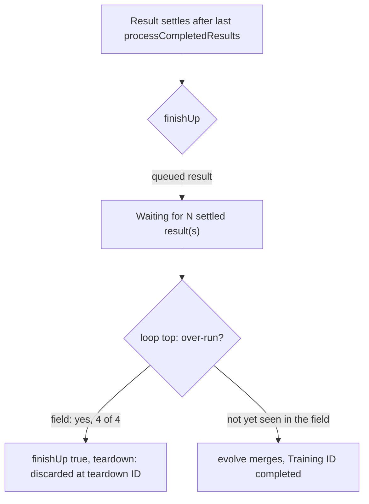

## Summary

PR #4104 (merged 2026-10-29, first released in v7.0.65, commit `81941817`)
already made `finishUp()` wait for a settled-but-unmerged training or discovery
result and made the teardown name every result it drops. The only Definition of
done item left open was the field evidence. This PR changes no code: it replaces
the earlier summary with the record of that evidence, searched in the GRQ-logs
history (`Develop`, 2026-10-29 to 2026-11-06) across 34 log snapshots from
releases 7.0.66 to 7.1.3. The evidence shows the terminal-line contract holding
in the field, and it shows one thing the issue did not expect: in every field
case where the new wait fired, the over-run guard stopped the run on the next
pass, so the result was logged as discarded and never merged. Part of #4099.

Version bump: not touched by this change; the merged commit records the final
version.

## Not closing #4099

The closing field-evidence criterion is `partial`: no field log yet shows a task
scheduled in the last generation ending in `Training <id> completed` through the
extra merge pass, and seven tasks that do carry a `discarded at teardown` line
still read `outcome=in_flight … reason=log-ended` in GRQ's own parser (see
Evidence).

## Spec

### Intent and Rationale

- The criterion asks for field proof of the fix. The only way to give it without
  a new release is to search the logs the fleet has already written since the
  fix shipped, so this PR records that search and its limits.

### Essential Design Decisions

- No code change. The searched logs show the shipped behaviour matches the
  issue's wording ("merged or explicitly logged as discarded with its id"), and
  the discard on over-run is the documented design (`docs/TIMEOUTS.md`, the
  teardown steps; `CHANGELOG.md` Issue #4099).
- The over-run stop is deliberately not changed to allow one more merge pass: it
  is a time bound, and a merge pass re-scores the whole population.

### Undiscoverable Facts

- The `[Neat] Waiting for N settled result(s) … to be merged before finishing`
  line (`src/NEAT/Neat.ts`, `finishUp`) is written before the loop top decides
  to stop for over-run, so in sampler runs it can be followed at once by
  `Training over-run … stopping new generations` and a discard. The line names a
  merge that does not then happen.
- GRQ's parser `worker/shared/training_outcome_health.sh` (stSoftwareAU/GRQ,
  read with `gh api`) has no rule for `discarded at teardown`: its only
  `teardown` match is the `[evolveDir] teardown complete` run boundary. That is
  a GRQ-side fact, outside this repository.

## Evidence

Method: `git log --since=2026-10-29T10:00:00Z` over GRQ-logs `Develop` at
`464596a` (2026-11-06) gave 2 599 distinct log blobs; of those, 34 hold a
`Training <id> scheduled` line and a `[neat-ai] running version` of 7.0.66 or
later (7.0.63 snapshots predate the release and are excluded). Each blob was
read with `git show <commit>:<file>` and counted with `awk` for
`Training <id> scheduled`, `completed after`, `discarded at teardown`,
`abandoned at teardown`, `Training failed for creature`, and the
`[training-outcomes]` lines. This reads logs from one host-sample of the fleet
(GRQ-3, GRQ-11, GRQ-13, GRQ-16, GRQ-19, GRQ-22), not every host.

1. **The extra wait fired in the field**, 4 times (7.0.73 on `GRQ-3-sloth`,
   7.1.3 on `GRQ-13-rocket` and `GRQ-22-rocket`), each time with exactly the new
   line, for example `4654548e:GRQ-13-rocket.log`:

   ```text
   Generation 8 score 0.437721152536804 (avg: 0.0375) error 0.5622626630873621 avg time 23s 927ms
   [Neat] Waiting for 1 settled result(s) (training: 1, discovery: 0) to be merged before finishing
   [Neat] Training over-run: elapsed exceeded expected duration × 1 — stopping new generations and finishing with the evolved population
   Training c632dbf5 discarded at teardown: it settled after the last generation's results were processed
   [evolveDir] teardown complete: 10 worker(s) terminated, 0 detached; replay queue drained
   ```

   Every one of the four was followed by the over-run line on the next pass
   (`96ad583a:GRQ-3-sloth.log`, `f9cb327e:GRQ-3-sloth.log`,
   `fa1c6afc:GRQ-22-rocket.log` show the same sequence). So the settled result
   was named by ID and dropped, not merged. In the same run GRQ reports these as
   `inFlight=0` with `task=c632dbf5 outcome=completed`, and no `log-ended`.

2. **Terminal lines hold.** Every one of the 34 snapshots reached
   `teardown complete` after its last `scheduled` line, and in each every
   scheduled task id has a terminal line (`completed after`,
   `discarded at teardown`, `abandoned at teardown` or
   `Training failed for creature`). Two ids carry two terminal lines because one
   creature id is scheduled twice in the log (`0c2a1de7` in `fa1c6afc`,
   `5cb993cb` in `6cef715e`): two separate schedules, one terminal line each.

3. **Residual `log-ended`.** 22 tasks in the sample carry a
   `discarded at
   teardown` line. GRQ marks 15 of them `rejected`, `completed`
   or `aborted` from other lines, and 7 as
   `outcome=in_flight … reason=log-ended`: `204d5e4c` (8087b3a4), `40bafc53`
   (673fae87), `9389e96f` (0c0ad063, fb504c77), `9b02766d` (d86dc5dd),
   `d0c7bf94` (bbc8ed59), `e53ce0b3` (1274d269). Each is a task NEAT-AI named by
   ID; GRQ's parser does not read the new line (Undiscoverable Facts).

4. **Not observed:** no `Training <id> completed` line after the final
   `Generation N` line and before `teardown complete`, i.e. no run where the
   extra pass merged a late result.



Issue numbers cited as provenance, each looked up with `gh issue view`: #4099
(this issue: the dropped result), #4104 (the merged fix, a pull request found
with `gh pr view`).

## Reproduction

- **symptom** — a training result that settles after the last generation's
  `processCompletedResults()` was never merged and never logged.
- **status** — `partial` — the regression test was observed red against the
  unfixed code in #4104 (the `finishUp()` wait disabled), not in this run, which
  changes no code; here it was re-run green on the head. reason: this PR has no
  fix to take red.
- **regression test** —
  `test/creature/EvolveDirLateTrainingResult.ts::evolveDir: a training result settled after the last generation is merged and persisted, not discarded (Issue #4099)`

## Acceptance Criteria

<!-- vibe-spec-review inputs="diff+issue-body" -->

- **met** — Before `finishUp` can return `true`, it also checks
  `trainingComplete.length > 0` (and `discoveryComplete`). When either is
  non-empty it arms one more processing pass. … a settled result is either
  merged or explicitly logged as discarded with its id. — evidence:
  `src/NEAT/Neat.ts` (the `terminationReason !== "overrun"` wait in `finishUp`),
  `test/NEAT/NeatFinishUp.ts::finishUp: waits while a settled training result is unmerged, then finishes (Issue #4099)`;
  field: Evidence item 1 — reviewer: met
- **met** — Every scheduled training task ends with exactly one terminal line
  (`completed`, `failed`, `abandoned`, or a new `discarded at teardown`). —
  evidence: `test/creature/EvolveFailureNamesInFlightTasks_test.ts`,
  `test/NEAT/NeatFinishUp.ts`; field: Evidence item 2 — reviewer: met
- **met** — Regression test: stub a worker whose training promise resolves
  **after** the final generation's `processCompletedResults` but before
  `finishUp`. … assert that (a) the trained creature reaches the returned
  population or the creature store, or a `discarded` line names the task, and
  (b) `Training <id> completed` is logged. — evidence:
  `test/creature/EvolveDirLateTrainingResult.ts::evolveDir: a training result settled after the last generation is merged and persisted, not discarded (Issue #4099)`
  — reviewer: met
- **partial** — Field evidence: a GRQ sampler log on a neat-ai release carrying
  the fix where a task scheduled in the last generation shows
  `Training <id> completed`, with no `outcome=in_flight … reason=log-ended` in
  `[training-outcomes]`. — evidence: Evidence items 1 to 4 — reviewer: partial —
  reason: a release carrying the fix is in the field and the terminal-line
  contract holds, but no log shows the merge pass producing `completed`, and 7
  discarded tasks still read `log-ended` because GRQ's parser has no rule for
  the new line.

## Standards Review

<!-- vibe-standards-review inputs="diff+AGENTS.md+docs/ENGINEERING_PRINCIPLES.md" -->

- **clean** — documentation-only change; Australian English; no code, test or
  config touched; every figure traces to a command in Evidence.

## Test Plan

- No test file is added, edited or removed.
- Ran on the head:
  `deno test -A test/NEAT/NeatFinishUp.ts
  test/creature/EvolveDirLateTrainingResult.ts
  test/creature/BoundedEvolveTeardown.ts
  test/creature/EvolveFailureNamesInFlightTasks_test.ts`
  — 52 passed, 0 failed.
- <!-- vibe-quality-gate-skipped reason="documentation-only change (this summary file); no source, test or config changed, so the full ./quality.sh was not run" -->
