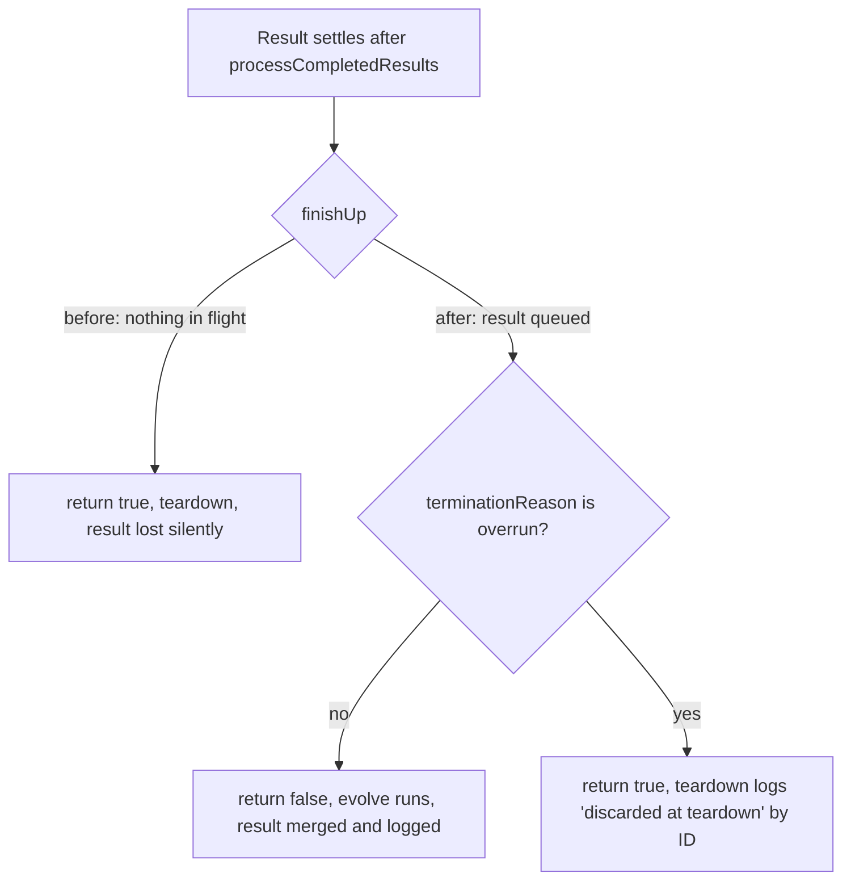

## Summary

A training or discovery result that settled after the last generation's
`processCompletedResults()` was dropped at teardown: `finishUp()` saw nothing in
flight and returned `true`, and the result sat unmerged in
`neat.trainingComplete` / `neat.discoveryComplete`. Now `finishUp()` waits one
more pass while a settled result is queued, so `evolve()` merges it. Where
`evolve()` can never run again (over-run stop, hard deadline), the bounded
teardown logs each leftover result by ID and drops it. Closes #4099.

Version bump: not part of this change.

## Spec

### Intent and Rationale

- The clean-up delay in `finishUp()` keys on "still running" (`*InProgress`
  maps), but a result that already settled is in neither map. Checking "not yet
  processed" (`*Complete` arrays) closes that window.
- The merge route reuses the existing loop: the `completed` branch of
  `evolveDir`/`evolveEnv`/`evolveRL` calls `evolve()` again after `finishUp()`
  returns `false`, which runs `processCompletedResults`, clears the arrays and
  (for trained creatures) arms the existing "one more generation" re-score.

### Essential Design Decisions

- `finishUp()` does not wait when `terminationReason === "overrun"`: that branch
  never calls `evolve()` again, so waiting would spin until the hard deadline.
  Those results are discarded and logged instead.
- The discard lives in `runBoundedEvolveTeardown` through a **required** `neat`
  option, so all three callers (`evolveDir`, `evolveEnv`, `evolveRL`) must pass
  it; it runs before persist because it is synchronous and not part of the
  evolved state.
- A failed training task (stub with `train.error === Infinity`) already logged
  `Training failed for creature …`, so the discard skips it to keep one terminal
  line per task. Known gap: a failed discovery stub carries no marker, so it can
  log `Discovery … discarded at teardown` after its own failure line; marking it
  needs a new field on the worker response type, which this issue does not ask
  for.

### Undiscoverable Facts

- `deno.json` / `deno.lock` bump `@stsoftware/tags` 1.0.34 → 1.0.36. This came
  from `./quality.sh`'s dependency-update step, not from this change, and is
  unrelated to #4099.
- `Training <id> completed` is only logged when `config.verbose` is on (existing
  behaviour in `ProcessCompletedResults.ts`); the new discard line is
  unconditional.

## Evidence

- `./quality.sh` (with the local scorer binary and discovery library) passed on
  the first fix commit: `ok | 10010 passed (5 steps) | 0 failed | 4 ignored`. It
  is re-run on the head; see Test Plan.
- Issue-numbers cited as provenance in the diff:
  `#4099: A training result that settles after the last generation's processCompletedResults is dropped at teardown`
  (this issue).

## Reproduction

- **symptom** — a training result that settles after the last generation's
  `processCompletedResults()` is never merged and never logged; `finishUp()`
  returns `true` with the result still in `trainingComplete`.
- **status** — `reproduced` — evidence: with the `finishUp()` wait disabled
  (`false && this.terminationReason !== "overrun" && …` in `src/NEAT/Neat.ts`),
  `test/creature/EvolveDirLateTrainingResult.ts` fails with
  `AssertionError: a settled-but-unmerged result must lead to another evolve(); got 1 call(s)`;
  with the fix in place it passes (5 consecutive runs). That is a red run
  against the code before the fix, not the base branch checkout.
- **regression test** —
  `test/creature/EvolveDirLateTrainingResult.ts::evolveDir: a training result settled after the last generation is merged and persisted, not discarded (Issue #4099)`

## Acceptance Criteria

<!-- vibe-spec-review inputs="diff+issue-body" -->

- **met** — Before `finishUp` can return `true`, it also checks
  `trainingComplete.length > 0` (and `discoveryComplete`). When either is
  non-empty it arms one more processing pass. … a settled result is either
  merged or explicitly logged as discarded with its id. — evidence:
  `test/NEAT/NeatFinishUp.ts::finishUp: waits while a settled training result is unmerged, then finishes (Issue #4099)`,
  `test/NEAT/NeatFinishUp.ts::finishUp: waits while a settled discovery result is unmerged, then finishes (Issue #4099)`,
  `test/creature/BoundedEvolveTeardown.ts::bounded teardown: unmerged results are discarded before persist, and the count is reported (Issue #4099)`
  — reviewer: met
- **met** — Every scheduled training task ends with exactly one terminal line
  (`completed`, `failed`, `abandoned`, or a new `discarded at teardown`). —
  evidence:
  `test/NEAT/NeatFinishUp.ts::discardUnprocessedResults: skips a failed-task stub but still logs and counts a finite result (Issue #4099)`
  — reviewer: partial — reason: the reviewer found the failed-stub double line
  (fixed in this diff by the skip above) and that no test covers every route;
  training failure stubs are now covered, but a failed _discovery_ stub can
  still log a second line and `completed` prints only when `verbose` is on
  (existing behaviour). Discovery is outside this criterion's "training task"
  wording.
- **met** — Regression test: stub a worker whose training promise resolves
  **after** the final generation's `processCompletedResults` but before
  `finishUp`. … assert that (a) the trained creature reaches the returned
  population or the creature store, or a `discarded` line names the task, and
  (b) `Training <id> completed` is logged. — evidence:
  `test/creature/EvolveDirLateTrainingResult.ts::evolveDir: a training result settled after the last generation is merged and persisted, not discarded (Issue #4099)`
  runs a real `evolveDir` (`iterations: 1`, temporary `creatureStore`,
  `verbose: true`) and wraps the captured `neat.evolve` through the
  `deps.onNeatReady` seam; right after the last scheduled generation returns it
  settles a training result tagged `late4099` through the production hook
  `neat.recordTrainingComplete`. It asserts a second `evolve()` ran, the run did
  not end `overrun`/`hard-deadline`, `Training late4099 completed` is logged, no
  `discarded at teardown` warning appears, and a creature tagged
  `trainID=late4099` is in the returned population and in the creature store.
  The settled creature is a zero-weight constant-output network on a
  constant-output dataset, so it is the strictly best creature and survives
  selection deterministically. The unit-level companion
  `test/NEAT/NeatFinishUp.ts::finishUp: a settled training result is merged by processCompletedResults, then the run finishes (Issue #4099)`
  covers the `finishUp()` false-then-true contract. The test wraps `evolve()`
  rather than stubbing a worker's promise: the worker result handler's only
  effect on `Neat` is the `recordTrainingComplete` call, so the settle point is
  the same. — reviewer: met
- **missing** — Field evidence: a GRQ sampler log on a neat-ai release carrying
  the fix where a task scheduled in the last generation shows
  `Training <id> completed`, with no `outcome=in_flight … reason=log-ended` in
  `[training-outcomes]`. — reviewer: missing — reason: needs a GRQ log from a
  released version carrying this fix; it cannot exist before release.

## Standards Review

<!-- vibe-standards-review inputs="diff+AGENTS.md+docs/ENGINEERING_PRINCIPLES.md" -->

- **clean** — no violations reported. Checked: logging goes through
  `getLogger()`; no timing APIs or `Deno.env` mutation in tests; tests assert
  behaviour; Australian English; no TS fallback added;
  `runBoundedEvolveTeardown` is not exported from `mod.ts`, and all three
  callers were updated. The repository has no `CODING-STANDARDS.md` and marks no
  rule as review-only.

## Test Plan

- `test/NEAT/NeatFinishUp.ts`: training/discovery pending → `finishUp` false
  then true; over-run → true (no spin; this one also passes on the unfixed code,
  it guards the exclusion); `discardUnprocessedResults` count/empty/failed-stub
  cases; merge-then-finish through the real `processCompletedResults`.
- `test/creature/EvolveDirLateTrainingResult.ts` (1 test at head): end-to-end
  through `evolveDir` — a result settled after the last generation leads to
  another `evolve()`, is logged `completed`, not discarded, and is in the
  returned population and creature store. Red check: disabling the `finishUp()`
  wait (`false && …`) fails it with
  `a settled-but-unmerged result must lead to another evolve(); got 1 call(s)`;
  restored and green. Branch outcome: the `trainingComplete.length > 0` operand
  of the new `finishUp()` condition is reached by this test via `evolveDir`.
- `test/creature/BoundedEvolveTeardown.ts`: discard runs before persist and
  `resultsDiscarded` equals its return value; `baseOptions` gained a `neat` stub
  returning 0 (no assertion removed from any existing test).
- Not done: a mutation-style red check of each new test against the unfixed
  code; every `finishUp` test fails against the base `Neat.ts` by reading it,
  not by observed run (apart from the `evolveDir` red check above). Call sites
  checked: `evolveDir`, `evolveEnv`, `evolveRL` all pass `neat` (required
  option, so omission fails type-check); the discard option is exercised by the
  teardown unit test, and the merge route by the `evolveDir` test above.
  `evolveEnv`/`evolveRL` share `finishUp()` and the teardown but have no
  end-to-end late-result test of their own.
- Docs: `docs/TIMEOUTS.md` teardown-order sentence updated; `CHANGELOG.md` entry
  added. Greps for `finishUp`, `cleanUpDelayCount`, `trainingComplete`,
  `teardown` over `README.md`, `docs/` (excluding archive) and `src` doc
  comments found no other stale sentence.

## Mutation check: changed lines are pinned

The earlier run reported 37 survivors, every one tagged "no test imports this
module": the mutation runner could not map the `@neat/…` / `@creature/…` alias
imports in `test/NEAT/NeatFinishUp.ts` and
`test/creature/BoundedEvolveTeardown.ts` back to the mutated source, so it ran
no relevant test. I added two tests
(`discardUnprocessedResults: a result with no task payload is still logged as
unknown and counted`
and
`finishUp: an over-run stop with only one kind of
unmerged result still finishes`)
and mutated the source by hand, running `test/NEAT/NeatFinishUp.ts` and
`test/creature/BoundedEvolveTeardown.ts`:

- `src/NEAT/Neat.ts:837` operand `terminationReason !== "overrun"` → `true`: 2
  tests fail.
- `src/NEAT/Neat.ts:838` operand `(trainingComplete.length > 0 || …)` → `true`:
  8 tests fail.
- `src/NEAT/Neat.ts:1175` operand `r.train !== undefined` dropped: no longer
  type-checks (the payload-less case is also now covered by a test).
- `src/NEAT/Neat.ts:845` / `:1193` (`return` values): 4 tests fail when
  `discardUnprocessedResults` returns `undefined`.
- `src/creature/BoundedEvolveTeardown.ts:335` property `resultsDiscarded`
  removed: fails type-check, and the teardown test asserts it equals `2`.
- `test/NEAT/NeatFinishUp.ts:533–660`: exempt (untestable): these are the test
  file's own helper and assertion lines (`captureLog`, `settledTraining`,
  `settledDiscovery`, the test bodies); mutating a test cannot be pinned by
  another test.

The runner's cap (40 of 72 candidates tried) means the other 32 mutants were
never tried; I did not enumerate them.

## Acceptance criterion left `missing` (not fabricated)

The "Field evidence" criterion needs a GRQ sampler log from a released neat-ai
version carrying this fix. No such release exists yet, so it cannot be met in
this change and stays `missing` above.
