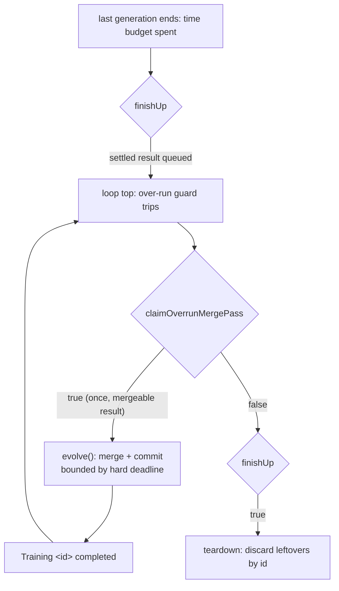

## Summary

A run that ends on its time budget no longer throws away a training result that
settled after the last generation. Up to now, the over-run guard always won on
such runs. It trips at the same instant the time budget ends the last
generation, so the "wait one more pass" fix from #4104/#4153 could never run on
a time-ended run, and every GRQ sampler loop is one. Now the over-run stop runs
**one** more `evolve()` to merge and commit a queued result, still bounded by
the hard deadline. This applies in `evolveDir`, `evolveEnv` and `evolveRL`.

The field-evidence criterion needs a release carrying this change plus a new GRQ
sampler log, so it is still open. Part of #4099.

## Spec

### Intent and Rationale

- `timedOut` (`src/creature/EvolveGenerationTail.ts:175`,
  `now > start +
  timeout`) and the over-run guard (`hasTrainingOverrun`,
  `src/NEAT/HardDeadline.ts:129-145`, `now - start > timeout × 1`) trip at the
  same moment. So when a time budget ends the last generation, the next loop
  pass always takes the over-run branch. That branch called `finishUp()`, which
  returns `true` on over-run, so the teardown discarded the result.
- Field logs show it every time: no audited sampler snapshot has yet shown a
  last-generation completion (see Evidence).
- Of the two routes the issue offers, this reuses the existing one: one more
  processing pass through the real `evolve()`. That keeps its scoring,
  population cap, commit-time `completed` line and hard-deadline abandon path.
  Draining at teardown instead would have needed a second, unscored merge path.

### Essential Design Decisions

- `Neat.claimOverrunMergePass()` grants the pass **at most once per run**
  (`overrunMergePassUsed`). It claims only when a mergeable result is queued: a
  training result with a finite `train.error`, or any discovery result. A failed
  training task, queued with `+Infinity` (`src/NEAT/NeatScheduling.ts:140-146`),
  does not claim it.
- This replaces #4153's rule that the over-run guard always beats a merge pass.
  The hard deadline still wins:
  - The cap check at the top of each loop runs first.
  - The merge generation runs under `awaitWithinHardDeadline` like any other.
  - An interrupted (SIGTERM) stop still breaks before the claim.
- `finishUp()` is unchanged. The claim is made in the over-run branch before
  `finishUp` is consulted. A result that settles after the merge pass is still
  discarded at teardown, named by its task ID.
- The merge generation schedules no new work, because `requestOverrunStop` sets
  `doNotStartMore`, which `NeatScheduling.ts:287` honours.

### Undiscoverable Facts

- `GRQ-25-rocket.log` (the downstream production log repo `Develop` @ `a9aa34f`,
  2026-11-15, neat-ai 7.1.19, `option='sampler'`) shows the defect on a release
  that already has #4104. Lines 461-465 log
  `[Neat] Waiting for 3 settled result(s) (training: 3,
  discovery: 0) to be merged before finishing`,
  then `[Neat] Training over-run:
  …`, then three
  `Training <id> discarded at teardown` lines.
- GRQ's `[training-outcomes]` parser still reports two of those discarded tasks
  as `in_flight … reason=log-ended`, because it does not recognise the
  `discarded at teardown` line. That parser lives in the GRQ repository.
- The Spec and Standards reviewer agents (`spec-reviewer`, `standards-reviewer`)
  hit `You've reached your Fable limit … (HTTP 429)`. The same briefs then ran
  as general-purpose sub-agents, and their verdicts are recorded below.

## Evidence

Backend-only change; no visual surface changed.

- **Red against the base code:** I ran the new evolveDir regression with `src/`
  unchanged from `Develop` @ `2367ed2e`, and it failed: completion count 0,
  expected 1. The captured log read
  `[Neat] Waiting for 1 settled result(s)
  …`, then
  `[Neat] Training over-run: …`, then
  `Training 022d17fc discarded at
  teardown: it settled after the last generation's results were processed`.
  It passes at head.
- **Wiring checks:** I replaced each loop's `if (!neat.claimOverrunMergePass())`
  with `if (true)` in all three loops (`evolveDir`, `evolveEnv`, `evolveRL`) and
  ran the evolveDir, evolveEnv and evolveRL files. Four tests failed: the
  evolveDir training and discovery over-run tests
  (`EvolveDirLateTrainingResult.ts:464` and `:540`), the evolveEnv test
  (`EvolveEnvHardDeadline_test.ts:360`) and the evolveRL test
  (`EvolveRLHardDeadline_test.ts:376`). The failed-training evolveDir test
  correctly still passes, because a failed result must not claim the pass.
  `src/creature/CreatureTraining.ts` was restored afterwards
  (`git diff HEAD
  --stat -- src` empty).
- **Full gate:**
  `./quality.sh --rust-scorer-bin=<locally built NEAT-AI-scorer
  rust_scorer>`
  passed at `bc2133a3`:
  `ok | 10482 passed (5 steps) | 0 failed |
  50 ignored (10m13s)`. Without that
  flag the gate stops at
  `❌ Native
  rust_scorer is required (quality.sh default) but was not found.`

### Field evidence checked on 2026-11-16

The three `Develop` commits in the downstream production log repo since the last
audit (2026-11-13T03:28Z) that carry an `option='sampler'` log:

| Log @ commit                    | Release | Observed outcome                                                                                                                                                        |
| ------------------------------- | ------- | ----------------------------------------------------------------------------------------------------------------------------------------------------------------------- |
| `GRQ-25-rocket.log` @ `7482799` | 7.1.17  | Loop 1: 27 generations, then `Set training/discovery clean up count to 2` and the over-run stop.                                                                        |
| `GRQ-25-sloth.log` @ `c2f8734`  | 7.1.19  | Loop 1: tasks still in flight at the over-run stop; `[training-outcomes]` shows both `abandoned … reason=worker-cancelled`.                                             |
| `GRQ-25-rocket.log` @ `a9aa34f` | 7.1.19  | Loop 1: three settled results waiting to merge, then the over-run stop, then three `discarded at teardown` lines (lines 461-465). This is the exact case this PR fixes. |

None shows a last-generation `Training <id> completed`. A release carrying this
change is needed before one can.

## Reproduction

- **symptom** — on a run that ends on its time budget, a training result that
  settled after the last generation's `processCompletedResults()` is never
  merged and never gets a `completed` line. It is logged `discarded at teardown`
  (GRQ-25-rocket 7.1.19), or on v7.0.62 not at all.
- **status** — `verified` — the evolveDir regression was observed failing
  against the unfixed base production code (completion count 0,
  `discarded at
  teardown` logged) and passing after the fix
- **regression test** —
  `test/creature/EvolveDirLateTrainingResult.ts::evolveDir: a training result settled when the time budget runs out is merged by one over-run pass, not discarded (Issue #4099)`

## Acceptance Criteria

<!-- vibe-spec-review inputs="diff+issue-body" -->

- **met** — Before `finishUp` can return `true`, it also checks
  `trainingComplete.length > 0` (and `discoveryComplete`). When either is
  non-empty it arms one more processing pass. Alternatively, the teardown drains
  `trainingComplete` into the population and re-scores before
  `restoreEvolveChampion`/`writeCreatures`. Whichever route: a settled result is
  either merged or explicitly logged as discarded with its id. — evidence:
  `src/NEAT/Neat.ts` (`claimOverrunMergePass`, `finishUp`),
  `src/creature/CreatureTraining.ts` (three over-run branches);
  `test/creature/EvolveDirLateTrainingResult.ts::evolveDir: a training result settled when the time budget runs out is merged by one over-run pass, not discarded (Issue #4099)`
  and
  `test/creature/EvolveDirLateTrainingResult.ts::evolveDir: a discovery result settled when the time budget runs out is merged by one over-run pass (Issue #4099)`
  — reviewer: met
- **met** — Every scheduled training task ends with exactly one terminal line
  (`completed`, `failed`, `abandoned`, or a new `discarded at teardown`). —
  evidence: the new evolveDir, evolveEnv and evolveRL over-run tests each assert
  exactly one `Training <id> completed` and no `discarded` line;
  `test/creature/EvolveDirLateTrainingResult.ts::evolveDir: a failed training task at the time budget end is reported as failed and starts no merge generation (Issue #4099)`
  — reviewer: met
- **met** — Regression test: stub a worker whose training promise resolves
  **after** the final generation's `processCompletedResults` but before
  `finishUp`. Then assert that (a) the trained creature reaches the returned
  population or the creature store, or a `discarded` line names the task, and
  (b) `Training <id> completed` is logged. On `v7.0.62` this test fails. —
  evidence:
  `test/creature/EvolveDirLateTrainingResult.ts::evolveDir: a training result settled when the time budget runs out is merged by one over-run pass, not discarded (Issue #4099)`
  (red against base `2367ed2e`), plus the existing
  `test/creature/EvolveDirLateTrainingResult.ts::evolveDir: a worker training promise settled after the last generation is merged and persisted (Issue #4099)`
  (red against v7.0.62, recorded by #4153) — reviewer: met — reason: the
  reviewer noted it could not run the test against v7.0.62. The new test was run
  red against this branch's base, and the v7.0.62 red run is the earlier test's,
  recorded by #4153.
- **missing** — Field evidence: a GRQ sampler log on a neat-ai release carrying
  the fix where a task scheduled in the last generation shows
  `Training <id> completed`, with no `outcome=in_flight … reason=log-ended` in
  `[training-outcomes]`. — reviewer: missing — reason: needs a neat-ai release
  carrying this PR and a new GRQ sampler log. Every audited snapshot predates
  this change, and none shows a last-generation completion.
- **unrequested** — `test/NEAT/OverrunEnforcement.test.ts` first test now sets
  `trainPerGen: 0` — reviewer: unrequested — reason: needed so that its existing
  "no new generation may start after the over-run threshold" assertion still
  pins the nothing-to-merge case. With training on, the new merge pass
  legitimately runs one more generation. The training-on case is now asserted by
  the new over-run tests (`result.generation === 2`).

## Standards Review

<!-- vibe-standards-review inputs="diff+CODING-STANDARDS.md" -->

- **violation** — the merge pass added to `evolveEnv` and `evolveRL` had no
  test, so deleting either branch left every test green (principle 1, enforced
  by review) — evidence: `src/creature/CreatureTraining.ts:1229` — reason: fixed
  in this diff (`test/creature/EvolveEnvHardDeadline_test.ts` and
  `test/creature/EvolveRLHardDeadline_test.ts` now each have an over-run
  merge-pass test. Each was observed failing with its loop's branch replaced by
  `if (true)`).
- **clean** — Reviewer checked `AGENTS.md` and `docs/ENGINEERING_PRINCIPLES.md`
  (this repository has no `CODING-STANDARDS.md`):
  - logging through `getLogger()` only, no `@std/log`;
  - Australian English;
  - tests assert behaviour, not implementation (principle 3);
  - no `Deno.env.set`;
  - no fallback path (principle 7);
  - neuron UUID, creature UUID and semantic-version invariants untouched;
  - the failed-training filter matches `ProcessCompletedResults.ts` and the
    teardown skip;
  - the hard deadline still bounds the merge pass;
  - CHANGELOG and `docs/TIMEOUTS.md` updated (principle 5);
  - small enough to revert on its own (principle 9).

  The reviewer marked one thing optional: `Date.now()` in the new evolveDir test
  is used only to anchor the injected clock, as
  `test/NEAT/OverrunEnforcement.test.ts` already does, and is never used to
  measure anything.

## Test Plan

Tests added. All assert through the public `evolveDir`, `evolveEnv` or
`evolveRL` entry point, with the result settled at the worker boundary (a
stubbed `WorkerHandler` training promise, or the `recordTrainingComplete` /
`recordDiscoveryComplete` recording seam the response handler uses). None
asserts an internal flag or the number of `evolve()` calls:

- `test/creature/EvolveDirLateTrainingResult.ts`, three over-run cases that
  share one fixture:
  - `evolveDir: a training result settled when the time budget runs out is merged by one over-run pass, not discarded (Issue #4099)`.
    It drives the real scheduler, worker-response handler, `evolve()`, commit
    and creature store, and asserts `terminationReason === "overrun"`,
    `generation === 2`, exactly one `completed` line, no `discarded` line, and
    the trained creature in both the population and the store;
  - `evolveDir: a failed training task at the time budget end is reported as failed and starts no merge generation (Issue #4099)`:
    the worker rejects, `generation === 1`, the task is named once as failed,
    and no creature is contributed;
  - `evolveDir: a discovery result settled when the time budget runs out is merged by one over-run pass (Issue #4099)`:
    `generation === 2`, one `discovery_complete` event, no `discarded` line.
- `test/creature/EvolveEnvHardDeadline_test.ts::evolveEnv: an over-run with a settled training result queued runs one merge generation that commits it (Issue #4099)`.
- `test/creature/EvolveRLHardDeadline_test.ts::evolveRL: an over-run with a settled training result queued runs one merge generation that commits it (Issue #4099)`.
  Both settle the result once, after the first generation, and assert the
  returned generation count and termination reason, one `completed` line, the
  merge-pass log line and no `discarded` line.

Existing tests edited (no assertion removed):

- `test/NEAT/OverrunEnforcement.test.ts`: the first test gains `trainPerGen: 0`
  and a positive control
  (`!joined.includes("running one more generation to merge")`). Its existing
  assertions are unchanged.
- `test/NEAT/NeatFinishUp.ts`: the stale comment in
  `finishUp: an over-run stop does not wait on results it will never merge (Issue #4099)`
  is reworded. Its assertions are unchanged; `finishUp()` itself is unchanged.
  This PR added no test that calls `claimOverrunMergePass()` directly: the
  empty, failed-only, discovery-only and bounded cases are covered through
  `evolveDir` as listed above.

Callers and siblings checked:

- All three loops' over-run branches carry the claim: `evolveDir`, `evolveEnv`
  and `evolveRL`.
- The `completed` branch's own `finishUp` path is unchanged. It reaches the
  claim on the next loop pass.

Guards the new path keeps:

- the hard-deadline check at the loop top (it runs before the claim);
- `interrupted` (it breaks before the claim);
- the `awaitWithinHardDeadline` generation bound;
- `doNotStartMore` (no new scheduling).

Run results on the final head:

- `deno test -A` over the five test files above plus
  `test/creature/EvolveDirStuckChildDeadline.ts`,
  `test/creature/BoundedEvolveTeardown.ts`,
  `test/creature/EvolveFailureNamesInFlightTasks_test.ts` and
  `test/NEAT/EvolveAbandonedTrainingResultDiscard_test.ts`: passed
  (`ok | 80 passed | 0 failed`). `deno fmt --check` and `deno lint` are clean.
- `./quality.sh` passed at `bc2133a3` (10,482 passed). Later commits changed
  only tests, so that full gate has not been re-run on the final head; the files
  they touch were run as above.
- Review fixes: the tests no longer assert the internal `overrunMergePassUsed`
  flag, the number of calls to the patched `neat.evolve`, or the clock keyed to
  an `evolve()` call number. The helper-level `claimOverrunMergePass` cases in
  `NeatFinishUp.ts` were replaced by the public `evolveDir` cases above. The
  tests still fail with the claim replaced by `if (true)` (see Wiring checks),
  so the wiring is pinned by behaviour.

Docs updated:

- `docs/TIMEOUTS.md`: the "Over-run" bullet and the `finishUp()` paragraph under
  the teardown section, both read in full.
- `CHANGELOG.md`: a new entry under `[Unreleased]`, in the `Fixed` section.

I grepped `docs/` (excluding `docs/archive/`) for `over-run|overrun` and read
every hit; I also grepped `src/` for `never calls evolve|over-run path`. No
other hit was made false by this change.

🤖 Generated with [Claude Code](https://claude.com/claude-code)
