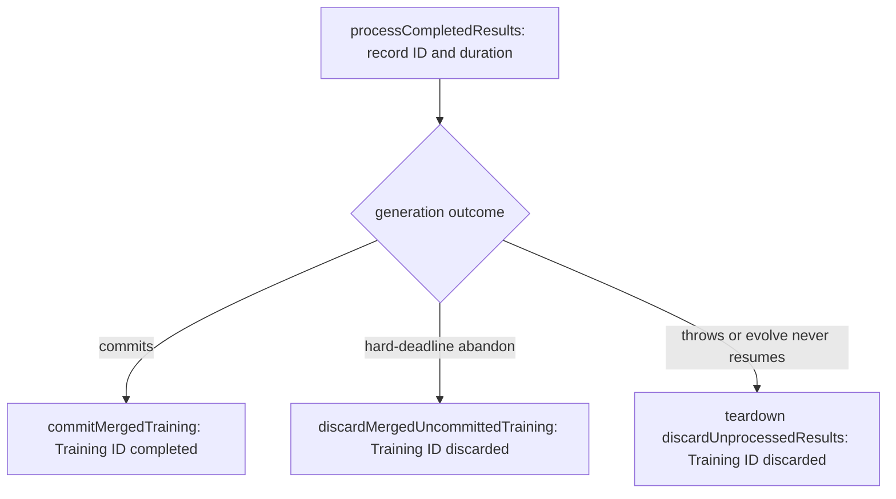

## Summary

A training task's `Training <id> completed` line is now written when its
generation commits, not when `processCompletedResults()` merges the result. A
task merged into a generation that the hard deadline abandons, or that throws
before it commits, now logs only its `Training <id> discarded: …` line. Before
this change it logged both. Every scheduled training task therefore ends with
exactly one terminal line. The other code criteria were delivered by #4104 and
are unchanged here. The field-evidence criterion needs a GRQ log from a release
carrying this change, so it stays open. Part of #4099.

## Spec

### Intent and Rationale

- After #4104 and #4107, one gap stayed open: a hard-deadline abandon of an
  uncommitted generation logged `completed` at merge and then `discarded`. #4107
  proposed two fixes ("log each discarded trained creature …" or "log the
  `completed` line only once the merge is committed"). Only the second gives one
  terminal line, so this PR takes it.

### Essential Design Decisions

- `Neat.mergedUncommittedTrainIDs` is now a `Map` from train ID to result
  duration. It used to be a `Set`. `processCompletedResults()` fills it, and
  `Neat.commitMergedTraining()`, called from the commit branch of `evolve()`,
  logs `Training <id> completed after <duration>` for each entry in the same
  wording as before, then clears it. The abandon branch and the teardown still
  go through `discardMergedUncommittedTraining()`. Whichever path runs first
  clears the map, so no task is named twice.
- The `mergedTrainIDs` parameter of `processCompletedResults()` is now required,
  so no caller can merge a result without recording it. The only production
  caller (`evolve()`) already passed it.
- Trade-off: the `completed` line now comes later in the generation, after
  breeding and pre-selection. If the process is killed outright mid-generation
  with no teardown, a merged task gets no terminal line. Every path that reaches
  the teardown or the failure cleanup still logs `discarded`.

### Undiscoverable Facts

- No field log yet shows the late-merge pass producing `completed`. Up to
  2026-11-06, the field cases where the wait fired were all stopped by the
  over-run guard, which logged the task as `discarded at teardown` (recorded in
  the previous archived summary at #4137, kept in git history).

## Evidence

Backend-only change; no UI file touched.

Issue numbers cited as provenance, each looked up with `gh issue view` or
`gh pr view` in this run: #4099 (this issue), #4104 (the merged finishUp fix),
#4107 ("A training result merged in a generation the hard deadline then abandons
is logged 'completed' but its creature is dropped, with no discard line"), #4137
(the earlier field-evidence summary PR).

## Reproduction

- **symptom** — a task merged into a generation the hard deadline then abandons
  logged both `Training <id> completed` and
  `Training <id> discarded: generation
  abandoned past the hard deadline`, two
  terminal lines for one task.
- **status** — `verified` — the three edited tests in
  `test/NEAT/EvolveAbandonedTrainingResultDiscard_test.ts` were run against the
  unchanged `src/` and failed on their new `completed`-count assertions (3
  failed, 2 passed). They pass after the fix.
- **regression test** —
  `test/NEAT/EvolveAbandonedTrainingResultDiscard_test.ts::evolve: a trained task discarded by a hard-deadline abandon is logged once as discarded (Issue #4107)`

## Acceptance Criteria

<!-- vibe-spec-review inputs="diff+issue-body" -->

- **met** — Before `finishUp` can return `true`, it also checks
  `trainingComplete.length > 0` (and `discoveryComplete`). When either is
  non-empty it arms one more processing pass. … a settled result is either
  merged or explicitly logged as discarded with its id. — evidence:
  `src/NEAT/Neat.ts` (`finishUp`, from #4104),
  `test/NEAT/NeatFinishUp.ts::finishUp: waits while a settled training result is unmerged, then finishes (Issue #4099)`
  — reviewer: met — reason: delivered at HEAD by #4104; this diff does not
  change it
- **met** — Every scheduled training task ends with exactly one terminal line
  (`completed`, `failed`, `abandoned`, or a new `discarded at teardown`). —
  evidence: `src/NEAT/Neat.ts` (`commitMergedTraining`),
  `src/NEAT/NeatEvolution.ts` (commit branch),
  `test/NEAT/EvolveAbandonedTrainingResultDiscard_test.ts` (three tests
  asserting zero `completed` lines and one `discarded` line, plus one asserting
  one `completed` line and no `discarded` line on a normal commit) — reviewer:
  met
- **met** — Regression test: stub a worker whose training promise resolves
  **after** the final generation's `processCompletedResults` but before
  `finishUp`. … assert that (a) the trained creature reaches the returned
  population or the creature store, or a `discarded` line names the task, and
  (b) `Training <id> completed` is logged. — evidence:
  `test/creature/EvolveDirLateTrainingResult.ts::evolveDir: a training result settled after the last generation is merged and persisted, not discarded (Issue #4099)`
  — reviewer: met — reason: from #4104. It settles through
  `recordTrainingComplete` rather than a stubbed worker promise, and its red run
  was recorded in #4104, not against a `v7.0.62` checkout. It still passes with
  the `completed` line moved to commit.
- **missing** — Field evidence: a GRQ sampler log on a neat-ai release carrying
  the fix where a task scheduled in the last generation shows
  `Training <id> completed`, with no `outcome=in_flight … reason=log-ended` in
  `[training-outcomes]`. — reviewer: missing — reason: needs a GRQ sampler log
  from a release that contains this change; no such release exists until this PR
  merges.

## Standards Review

<!-- vibe-standards-review inputs="diff+AGENTS.md+docs/ENGINEERING_PRINCIPLES.md" -->

- **clean** — no violations. Checked: logging via `getLogger()` only; no timing
  APIs or `Deno.env` mutation in tests; one producer for the `completed` line;
  every caller passes the newly required `processCompletedResults` argument;
  Australian English; `CHANGELOG.md` and `docs/TIMEOUTS.md` match the code;
  changed test expectations still fail with the fix reverted. Neither
  `AGENTS.md` nor `docs/ENGINEERING_PRINCIPLES.md` marks a rule as enforced by
  review only. Two stale test comments the reviewer listed as optional (the
  module header of `test/NEAT/EvolveAbandonedTrainingResultDiscard_test.ts` and
  an assertion message in `test/NEAT/NeatFinishUp.ts`) were fixed in this diff.

## Test Plan

- `test/NEAT/EvolveAbandonedTrainingResultDiscard_test.ts`:
  - Removed from `test/NEAT/EvolveAbandonedTrainingResultDiscard_test.ts`:
    `1, "the trained task must still log its completed line",` (completed count
    in the hard-deadline abandon test)
    - Required by: "Every scheduled training task ends with exactly one terminal
      line (`completed`, `failed`, `abandoned`, or a new
      `discarded at
      teardown`)."
    - Replaced by:
      `0, "a task whose generation is abandoned must log only its discarded line, not completed (Issue #4099)"`
  - Removed from `test/NEAT/EvolveAbandonedTrainingResultDiscard_test.ts`:
    `1, "the training result must have been merged before breeding is awaited",`
    (the breeding-parked teardown test)
    - Required by: "Every scheduled training task ends with exactly one terminal
      line (`completed`, `failed`, `abandoned`, or a new
      `discarded at
      teardown`)."
    - Replaced by:
      `neat.mergedUncommittedTrainIDs.has(TASK_ID), "the training result must have been merged before breeding is awaited"`
      and
      `0, "not logged completed before the generation commits (Issue #4099)"`
  - Added a zero-`completed` assertion at the end of the breeding-parked
    teardown test and in the threw-mid-merge test.
  - The normal-commit test is unchanged and still asserts exactly one
    `completed` line through a real `evolve()` commit.
- `test/NEAT/NeatFinishUp.ts`: the late-merge test passes a `Map` to
  `processCompletedResults`. It asserts the task is recorded and that no
  `completed` line is logged at merge, then calls `neat.commitMergedTraining()`
  (expects 1) before the existing `completed` regex. That assertion's message
  now reads "the commit must log …".
- `test/NEAT/ProcessCompletedResultsMerged_test.ts`: call sites pass the newly
  required `new Map()`. No assertion changed.
- Red against the unchanged `src/`: 3 failed, 2 passed in
  `test/NEAT/EvolveAbandonedTrainingResultDiscard_test.ts`, each failing on its
  new `completed` count.
- Ran on the head:
  `deno test -A test/NEAT/EvolveAbandonedTrainingResultDiscard_test.ts test/NEAT/NeatFinishUp.ts test/NEAT/ProcessCompletedResultsMerged_test.ts test/creature/EvolveDirLateTrainingResult.ts test/creature/BoundedEvolveTeardown.ts test/creature/EvolveFailureNamesInFlightTasks_test.ts`
  — 60 passed, 0 failed. `test/NEAT/NeatAwaitInFlightTasks.ts` and
  `test/creature/EvolveDirStuckChildDeadline.ts`: 11 passed, 0 failed.
  `NEAT_AI_BACKPROP_ENABLED=0 deno test -A --parallel test/NEAT/`: 55 passed, 0
  failed. After the comment-only follow-up,
  `test/NEAT/EvolveAbandonedTrainingResultDiscard_test.ts` and
  `test/NEAT/NeatFinishUp.ts` were re-run: 30 passed, 0 failed.
- `./quality.sh --skip-tests --skip-discovery` (format, lint, type-check, WASM
  sync) passed.
- <!-- vibe-quality-gate-skipped reason="full ./quality.sh exits 1 on this host before its test stage: native rust_scorer is required and not installed here; the static stages and the targeted tests above were run instead" -->
