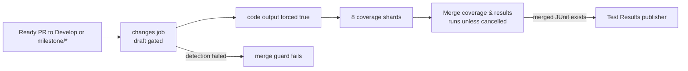

## Summary

Develop docs-only PRs now run all eight coverage shards and publish the required
`Test Results` check. The existing Develop ruleset remains unchanged. The Deno
dependency update step also advanced internal `@stsoftware/tags` from 1.0.36 to
1.0.40 in `deno.json` and `deno.lock`. Version bump: `deno.json` was updated for
this change; the merged commit records the final version. Closes #4111.

## Spec

### Intent and Rationale

- The active Develop ruleset requires `Coverage shard 0` through
  `Coverage shard 7` and `Test Results`; docs-only PRs previously skipped those
  check publishers.
- Extending the existing milestone override to Develop fixes the missing checks
  without changing branch protection.

### Essential Design Decisions

- Ready PRs targeting Develop or `milestone/*` force coverage on, including
  docs-only changes. This trades extra CI work for checks the rulesets require.
- Every ready PR this workflow accepts runs all eight shards. The retained
  include list does not gate coverage under the current Develop and milestone
  triggers; its no-code skip notice is unreachable after successful detection.
  Draft gating, cancellation handling, the matrix, parity check and failure
  reporting are unchanged.
- `Merge coverage & results` remains the aggregation job; neither the Develop
  nor the milestone ruleset requires it.

### Undiscoverable Facts

- Read-only `gh api repos/stSoftwareAU/NEAT-AI/rulesets/20827306` confirmed the
  required status contexts on the active Develop ruleset. The review fix also
  checked ruleset `21880654` for milestone branches: neither ruleset lists
  `Merge coverage & results`.
- Read-only `gh api repos/stSoftwareAU/NEAT-AI/commits/94e9cb1bea07/check-runs`
  returned `Coverage shard ${{ matrix.shard }}` as skipped
  and no `Test Results` check for the cited regression commit.

## Evidence

The coverage decision now forces the shards for Develop and milestone refs. The
merge job aggregates shard output and publishes `Test Results` when merged JUnit
exists; change-detection failures still reach its fail-loud guard.

## Test Plan

- `test/ci/CoveragePathScoping.ts` (7 tests at head): passed. Its current
  expectations against the base workflow (`origin/Develop`) give 6 passed, 1
  failed:
  `every accepted ready PR forces coverage regardless of the path
  filter`
  reports `AssertionError: Values are not equal.` Removing only the Develop
  operand also makes that test fail; removing only the milestone operand makes
  it fail too.
- `test/ci/CoverageMilestoneBranchFilter.ts` (1 test at head): passed.
- `test/ci/CoverageShardMatrix.ts` (4 tests at head): passed.
- `test/ci/CoverageMergeGate.ts` (9 tests at head): passed.
- `test/ci/CoverageFailsPrOnTestFailure.ts` (3 tests at head): passed.
- Command:
  `timeout 180 deno test -A test/ci/CoveragePathScoping.ts test/ci/CoverageMilestoneBranchFilter.ts test/ci/CoverageShardMatrix.ts test/ci/CoverageMergeGate.ts test/ci/CoverageFailsPrOnTestFailure.ts < /dev/null`.
  The glob tests check only the retained filter's matching, not whether coverage
  runs. Names, messages and the helper now make this distinction explicit.
  Expectations and coverage of the job graph remain unchanged.
- `deno lint test/ci/CoveragePathScoping.ts` and
  `deno check test/ci/CoveragePathScoping.ts test/ci/CoverageMilestoneBranchFilter.ts`:
  passed.
- `deno fmt --check .github/workflows/coverage.yaml test/ci/CoveragePathScoping.ts docs/troubleshooting/CI.md docs/archive/pr-summaries/pr-summary-4111.md`:
  passed.
- `actionlint .github/workflows/coverage.yaml` and Markdown lint on the changed
  Markdown: passed.
- Full `timeout 900 ./quality.sh < /dev/null`: failed at preflight:
  `Native rust_scorer is required (quality.sh default) but was not found.` The
  full suite did not run in this review environment.

## Review corrections

Updated the workflow comments, `test/ci/CoveragePathScoping.ts`, this summary
and `docs/troubleshooting/CI.md` (the docs-only PR section and its diagram) to
say that all accepted ready PRs run coverage, including unlisted paths. The
retained filter and skip notice do not decide coverage under the current
triggers. Removed the claim that the aggregation job is required. Searches
across the workflow, test names, README and non-archived docs found no other
live copies of those claims outside the corrected section. The workflow's
executable settings are unchanged by this review fix.

The supplied test-results comment reports no failures. Read-only check-run
`123837226956` for `f4b56f96` confirms success, 9,915 passed tests and 91
skipped; all eight coverage shards and the aggregation job also succeeded on
that commit.

Not checked: the full suite, because the native scorer is absent. The previous
commit's successful CI results do not replace a full gate on this push.
