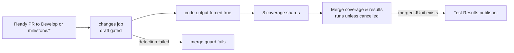

## Summary

Develop docs-only PRs now run all eight coverage shards and publish the required
`Test Results` check. The existing Develop ruleset remains unchanged. The Deno
dependency update step also advanced internal `@stsoftware/tags` from 1.0.36 to
1.0.40 in `deno.json` and `deno.lock`. Version bump: `deno.json` was updated for
this change; the merged commit records the final version. Closes #4111.

## Spec

### Intent and Rationale

- The active Develop ruleset requires `Coverage shard 0` through
  `Coverage shard 7` and `Test Results`; docs-only PRs previously skipped those
  check publishers.
- Reusing the existing milestone override fixes the missing checks without
  changing branch protection.

### Essential Design Decisions

- Ready PRs targeting Develop or `milestone/*` force coverage on, including
  docs-only changes. This trades extra CI work for checks the rulesets require.
- The include-list filter remains in place for code-change detection. Draft
  gating, cancellation handling, the eight-shard matrix, parity check and
  failure reporting are unchanged.
- `Merge coverage & results` remains the aggregation job; it is not a required
  Develop check.

### Undiscoverable Facts

- Read-only `gh api repos/stSoftwareAU/NEAT-AI/rulesets/20827306` confirmed the
  required status contexts on the active Develop ruleset.
- Read-only `gh api repos/stSoftwareAU/NEAT-AI/commits/94e9cb1bea07/check-runs`
  returned `Coverage shard ${{ matrix.shard }}` as skipped
  and no `Test Results` check for the cited regression commit.

## Evidence

The coverage decision now forces the shards for Develop and milestone refs. The
merge job aggregates shard output and publishes `Test Results` when merged JUnit
exists; change-detection failures still reach its fail-loud guard.

## Test Plan

- `test/ci/CoveragePathScoping.ts`: the updated output-expression expectation
  failed against the unfixed workflow (6 passed, 1 failed); it failed again when
  only the Develop override was removed while the milestone override remained.
- `timeout 180 deno test -A test/ci/CoveragePathScoping.ts test/ci/CoverageMilestoneBranchFilter.ts test/ci/CoverageShardMatrix.ts test/ci/CoverageMergeGate.ts test/ci/CoverageFailsPrOnTestFailure.ts < /dev/null`:
  24 passed, 0 failed. This covers the Develop/milestone override, path
  matching, branch filters, matrix parity, merge cancellation guard and failure
  reporting.
- `deno fmt --check .github/workflows/coverage.yaml test/ci/CoveragePathScoping.ts docs/troubleshooting/CI.md`:
  passed.
- `deno lint test/ci/CoveragePathScoping.ts`: passed.
- `deno check test/ci/CoveragePathScoping.ts test/ci/CoverageMilestoneBranchFilter.ts`:
  passed.
- Full `./quality.sh` with the required native scorer and Discovery library
  available: passed; 10,063 passed, 0 failed, 4 ignored (6m14s).

Removed from `test/ci/CoveragePathScoping.ts`: the expected output expression
that forced coverage only for milestone refs:


`${{ startsWith(github.base_ref, 'milestone/') && 'true' || steps.filter.outputs.code }}`


Required by: "Apply the milestone override to Develop targets as well." Replaced
by the expression that also forces coverage for Develop:


`${{ (github.base_ref == 'Develop' || startsWith(github.base_ref, 'milestone/')) && 'true' || steps.filter.outputs.code }}`


Red check: removing only the Develop clause while keeping the milestone clause
made the test fail.

Removed from `test/ci/CoveragePathScoping.ts`: the assertion message describing
`merge` as "the required check". Required by: "test/ci/CoveragePathScoping.ts
still describes merge as the required check, which it is not on Develop."
Replaced by: the assertion still requires `merge` to run and now describes its
Test Results publishing role.
