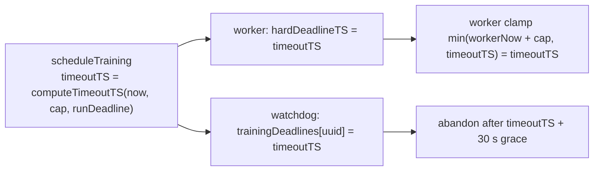

## Summary

`scheduleTraining` now fixes a training task's deadline once, at scheduling,
with the existing `computeTimeoutTS` (`min(now + task cap, run hard deadline)`).
That same absolute value is handed to the worker in the existing
`TrainOptions.hardDeadlineTS` field and recorded in `neat.trainingDeadlines` for
the stuck-task watchdog. Neither is recomputed after dispatch, so queueing or
worker setup can no longer renew the budget. Closes #4118.

Version bump: not touched here; CI records the final version on the merged
commit.

## Spec

### Intent and Rationale

- Before, the worker was handed only the run's hard deadline, so it re-anchored
  `now + trainingTimeOutMinutes` when it dequeued the task, and the watchdog
  deadline was computed a third time after dispatch. Time spent in between
  renewed the budget and the two disagreed about when the task was due.
- Reusing the existing `hardDeadlineTS` option (as the issue assumes) means the
  worker-side clamp stays untouched: `min(workerNow + cap, timeoutTS)` is always
  `timeoutTS` because `workerNow` is never earlier than scheduling time.

### Essential Design Decisions

- `trainingTimeOutMinutes` is still sent, so direct `creature.train()` callers
  and the relative-timeout / no-timeout contracts are unchanged.
- `scheduleTraining` gained an optional sixth parameter `now: () => number`
  defaulting to `Date.now`. It is the clock seam the tests use so they never
  patch the global clock; the only production caller leaves it at the default.
- For scheduled tasks `hardDeadlineTS` now holds the task's own deadline rather
  than the run deadline. `rustTrainDirSkipReason` therefore also refuses native
  training once the task cap has passed (its message still reads "hardDeadlineTS
  has already expired", which stays accurate). Discovery's deadline is
  untouched.

### Undiscoverable Facts

- None.

## Evidence

Backend-only change; no UI files touched. Behaviour is pinned by
`test/NEAT/TrainingTaskDeadlineImmutable.ts`, which drives the real
`scheduleTraining` with a controlled clock and a worker that burns 90 s during
dispatch.

## Reproduction

- **symptom** — a training task whose dispatch or worker setup took time got a
  later deadline at the worker and at the watchdog than the one fixed when it
  was scheduled (e.g. 90 s late for a 5-minute cap).
- **status** — `verified` — the new tests were run against the unfixed
  `NeatScheduling.ts` and failed (4 of 8, e.g. actual `1800000390000`, expected
  `1800000300000`), then passed after the fix. That red run used the first
  version of the test file, which patched `Date.now`; the final version injects
  the clock instead and was re-run green on the head and red under each break
  below.
- **regression test** —
  `test/NEAT/TrainingTaskDeadlineImmutable.ts::the worker and the watchdog share the deadline fixed at scheduling (Issue #4118)`

## Acceptance Criteria

<!-- vibe-spec-review inputs="diff+issue-body" -->

- **met** — A test through the actual scheduling path delays worker
  dispatch/setup and proves that time cannot renew the task budget. — evidence:
  `test/NEAT/TrainingTaskDeadlineImmutable.ts::a worker that starts late cannot renew the task budget (Issue #4118)`
  — reviewer: met — reason: the worker's setup half is simulated by calling
  `computeTimeoutTS` as `createEpochState` does, which the reviewer judged
  within the issue's "controlled clock and worker boundary".
- **met** — The worker receives exactly the deadline recorded for the watchdog;
  independently reverting dispatch forwarding or watchdog storage makes its
  assertion fail. — evidence:
  `test/NEAT/TrainingTaskDeadlineImmutable.ts::the worker and the watchdog share the deadline fixed at scheduling (Issue #4118)`
  — reviewer: met
- **met** — Tests distinguish an earlier run deadline from an earlier task cap,
  and cover disabled caps and direct callers' existing behaviour. — evidence:
  `test/NEAT/TrainingTaskDeadlineImmutable.ts::an earlier run deadline wins over the task cap (Issue #4118)`,
  `::an earlier task cap is forwarded in place of the later run deadline (Issue #4118)`,
  `::a disabled task cap leaves the run deadline in force (Issue #4118)`,
  `::no cap and no run deadline stays unbounded (Issue #4118)`,
  `::the relative timeout still travels with the task (Issue #4118)`; direct
  `creature.train()` callers are covered by the unchanged
  `test/architecture/training/TrainingOutcome.ts` `computeTimeoutTS` tests —
  reviewer: partial — reason: the reviewer found no new direct-caller test in
  the diff; no worker-side code changed, so the existing `computeTimeoutTS`
  tests are the guard for that contract.
- **met** — The watchdog still waits its existing 30-second grace and
  cancels/quarantines a genuinely unresponsive worker. The pile-up fix remains
  intact. — evidence:
  `test/NEAT/TrainingTaskDeadlineImmutable.ts::the watchdog still waits its 30 s grace past the original deadline, then cancels (Issue #4118)`
  and the unchanged `test/NEAT/StuckTrainingTaskCancelled.ts` — reviewer: met
- **partial** — Targeted tests and the repository quality gate pass. — evidence:
  targeted tests pass (see Test Plan) — reviewer: missing — reason: the full
  `./quality.sh` could not run here (it stops at
  `Native rust_scorer is
  required`); CI must run it. quality gate not yet run
  — remaining: merge-verification-only

## Standards Review

<!-- vibe-standards-review inputs="diff+CODING-STANDARDS.md" -->

- **violation** — the test overwrote the global `Date.now`, against the
  AGENTS.md testing rule — evidence:
  `test/NEAT/TrainingTaskDeadlineImmutable.ts:40` — reason: fixed in this diff
  (clock injected through a new `now` parameter on `scheduleTraining`; the file
  no longer mentions `Date.now`)
- **clean** — Australian English, no hidden or secret paths staged, tests assert
  behaviour (worker options, recorded deadline, watchdog result, cancel and
  quarantine) rather than internals, no `Deno.env` mutation, docs match code.
  The repository has no `CODING-STANDARDS.md`; the reviewer used `AGENTS.md` and
  `docs/ENGINEERING_PRINCIPLES.md`, and named the review-enforced testing rules
  it checked.

## Test Plan

- Added `test/NEAT/TrainingTaskDeadlineImmutable.ts` (8 tests):
  - the worker and the watchdog share the deadline fixed at scheduling
  - a worker that starts late cannot renew the task budget
  - an earlier run deadline wins over the task cap
  - an earlier task cap is forwarded in place of the later run deadline
  - a disabled task cap leaves the run deadline in force
  - no cap and no run deadline stays unbounded
  - the relative timeout still travels with the task
  - the watchdog still waits its 30 s grace past the original deadline, then
    cancels
- Red checks on the head (each break applied alone, then restored):
  - forwarding reverted to the run deadline
    (`hardDeadlineTS: neat.hardDeadlineTS ...`) → 3 tests red (shared deadline,
    late worker, earlier task cap).
  - watchdog storage recomputed after dispatch (`computeTimeoutTS(now(), ...)`)
    → 2 tests red (shared deadline, earlier task cap); the grace test
    deliberately does not use the injected clock.
  - The tests that stay green under the unfixed code (earlier run deadline,
    disabled cap, no cap, relative timeout) pin behaviour that must not change.
- Entry point checked: `scheduleTraining` is the only place that builds the
  worker's `hardDeadlineTS` for training and the watchdog's `trainingDeadlines`;
  its caller `Neat.scheduleTraining` leaves `now` at the default.
- Ran on the head: the new file plus `ScheduledTrainingIterations`,
  `StuckTrainingTaskCancelled`, `SchedulingRepeatGuard`,
  `ScheduledTrainingLogLine`, `TrainingGainLogWiring`, `PoolBorrowing`,
  `TrainingRegressionSkip`, `PopulationTrainingSkip` — 42 passed, 0 failed; the
  new file alone — 8 passed, 0 failed. `deno fmt`, `deno lint` and `deno check`
  clean on the touched files.
- Docs read and updated: `docs/TIMEOUTS.md` (training bullet, sub-second budget
  bullet, sequence diagram, data-flow line), `docs/config/TRAINING.md`
  (`trainingTaskTimeoutMinutes`), `CHANGELOG.md`, and the doc comments on
  `TrainOptions.hardDeadlineTS` and `computeTimeoutTS`.

<!-- vibe-quality-gate-skipped reason="full ./quality.sh not runnable here: it stops at 'Native rust_scorer is required'; deno fmt, deno lint, deno check and the covering tests were run on the touched files. CI runs the full gate." -->
