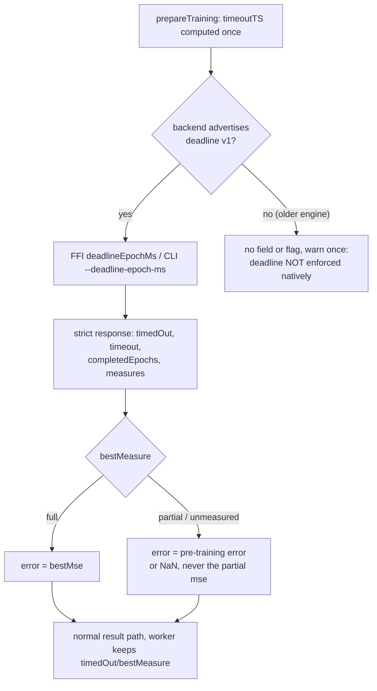

## Summary

The native `trainDir` bridge now forwards the task's single effective deadline
to `libneat_ai_backpropagation` (FFI, `deadlineEpochMs`) and
`neat_ai_backpropagation` (CLI, `--deadline-epoch-ms`) once the backend has
advertised the `deadline` capability. A cooperative timeout comes back as a
normal result, and older engines keep running exactly as before with an explicit
"not enforced natively" warning. Version bump: no `VERSION` field is edited by
this change; the merged commit records the final version.

Part of #4119. Four criteria are still `partial` (see Acceptance Criteria): CI
does not provide the native engines, adapter finalisation is only warned about
rather than bounded, a stopped run with a partial/unmeasured score carries the
incumbent's error forward, and `./quality.sh` could not run here.

## Spec

### Intent and Rationale

- Field logs (issue comments, neat-ai 7.0.66 to 7.1.2) show native training
  tasks running past their deadline until the watchdog cancelled and quarantined
  the worker. The native engine now stops cooperatively, so the adapters must
  send it the deadline and accept its answer.
- Capability is probed before any new field or flag is sent, because old engines
  reject unknown request fields. This follows the Backprop #214 compatibility
  matrix ("New caller, old engine: the NEAT-AI adapter must probe and
  diagnose").
- The stale-branch `issue-4073-...` assumed "ABI 2". The final contract keeps
  ABI 1 and uses a capability probe, so only its ideas were reused (timing
  struct, NaN handling), not its ABI gating.

### Essential Design Decisions

- One deadline: `TrainingSetupState.timeoutTS` is computed once in
  `prepareTraining` (`min(now + trainingTimeOutMinutes, hardDeadlineTS)`), used
  by the TypeScript loop (`createEpochState`) and by both native adapters, so
  backend selection cannot restart the budget. The "hardDeadlineTS already
  expired" skip to the TypeScript loop is unchanged.
- A partial or unmeasured stop never supplies a score from the trainer.
  `TrainingResult.error` carries the creature's own pre-training error (the
  `error` tag, or the `untrained-error` tag that `WorkerHandler.trainTracked`
  sends instead), else `NaN`, which `isFailedTrainWorkerResponse` already treats
  as an unusable result. Trade-off, flagged by the independent reviewers:
  `scheduleTraining` then scores the changed weights with the incumbent's error.
  That is not a new measured figure, but it is not an earned one either.
- Capable backends are strict: a missing or inconsistent field is an error
  naming the field, and there is no TypeScript/WASM fallback.
- `timedOut` and `bestMeasure` are optional on `TrainingResult` and
  `ResponseData.train` and are copied across the worker boundary only when
  defined, so legacy and TypeScript responses keep their old shape.

### Undiscoverable Facts

- The Backprop engine used for verification was built from
  stSoftwareAU/NEAT-AI-Backpropagation `947cbb5` (v0.1.50, PR 216 / issue 214)
  and the legacy producer from `f444bc4` (v0.1.49); both are outside the
  repository, in `/tmp` of this run. Their provenance is in
  `test/fixtures/native-backprop/README.md`.
- `WorkerHandler.trainTracked` deletes the creature tags and sends the
  pre-training error only as `untrained-error`; the first worker run returned
  NaN until the bridge read that tag too.
- One full-file integration run under heavy host load (about 7.6) had the FFI
  productive case reach its 120 s hang guard; 15 standalone and 8 repeated
  full-file runs afterwards passed, and the cause is unidentified.

## Evidence

Real engines, final head,
`NEAT_AI_BACKPROP_DEADLINE_NEW=<new-engine-dir> NEAT_AI_BACKPROP_DEADLINE_LEGACY=<legacy-engine-dir>`:

| Scenario                               | adapter     | timedOut           | bestMeasure | weights changed / valid | settled after deadline        |
| -------------------------------------- | ----------- | ------------------ | ----------- | ----------------------- | ----------------------------- |
| productive, 1 s deadline               | FFI         | true               | partial     | true / true             | 30 to 42 ms                   |
| productive, 1 s deadline               | CLI         | true               | partial     | true / true             | 37 ms                         |
| already out of time                    | FFI and CLI | true               | unmeasured  | false / true            | 17 ms                         |
| through a real worker (`trainTracked`) | FFI         | true (on the wire) | partial     | true / true             | 53 ms, healthy, not cancelled |
| legacy engine, deadline set            | FFI and CLI | absent             | absent      | true / true             | warned, not stopped natively  |

Tool behaviour relied on (observed): the new engine's `capabilities` prints
`{"abiVersion":1,"capabilities":{"deadline":{"version":1,...}},"version":"0.1.50"}`;
the legacy CLI answers `error: unrecognized subcommand 'capabilities'` with exit
2; the legacy library lacks the `neat_backprop_capabilities` symbol (Deno 2.9
`dlopen` with `optional: true` returns `null`). Fixtures in
`test/fixtures/native-backprop/` come from those real binaries.

Issue numbers cited as provenance: #4118: Give the training worker and watchdog
one immutable task deadline; #4073: Rust trainDir (FFI/CLI) ignores the per-task
timeoutTS (closed; its branch was reviewed, not reopened);
NEAT-AI-Backpropagation#214: Expose cooperative deadlines through Backprop FFI
and CLI; #4126: Process never exits after evolveDir returns following a worker
quarantine (existing doc page linked, not changed in behaviour).

## Reproduction

- **symptom** — a native `trainDir` (FFI or CLI) was never given the task
  deadline: a long first epoch ran on until the stuck-task watchdog cancelled
  the task and quarantined its worker
  (`training task ... passed its per-task deadline without returning a result`).
- **status** — `partial` — reason: the regression was observed red by removing
  only the forwarding from the fixed bridge (the FFI spread and the CLI flag),
  which reproduces the base behaviour (the productive cases hit the 120 s guard,
  4 min 2 s and 2 min 4 s runs), rather than by checking out the base branch.
- **regression test** —
  `test/architecture/training/NativeDeadlineIntegration.ts::native deadline: FFI productive run stops at the deadline and keeps its learning`

## Acceptance Criteria

<!-- vibe-spec-review inputs="diff+issue-body" -->

- **partial** — Real `trainDir` calls forced independently through the actual
  FFI library and CLI return `timedOut: true` and changed, valid weights on a
  productive long-first-epoch fixture with a short deadline. — evidence:
  `test/architecture/training/NativeDeadlineIntegration.ts::native deadline: FFI productive run stops at the deadline and keeps its learning`
  and
  `::native deadline: CLI productive run stops at the deadline and keeps its learning`
  — reviewer: partial — reason: both pass against the real engines on this head,
  but they run only where an engine resolves (CI provides none, so they are
  ignored there and fail only under `NEAT_AI_BACKPROP_REQUIRE_FFI=1`).
- **partial** — The scheduled-worker integration path settles by its original
  deadline plus 30 seconds, including adapter finalisation; returned weights
  reach existing result evaluation without timeout-driven
  cancellation/quarantine. — evidence:
  `test/architecture/training/NativeDeadlineIntegration.ts::native deadline: a productive run through a real worker settles at the deadline on a healthy worker`,
  `test/workers/TrainTimeoutFieldsCrossWorkerBoundary.ts` — reviewer: partial —
  reason: the real worker settles within the grace and the result passes
  `isFailedTrainWorkerResponse`, but the scheduler's evaluation is not run and
  finalisation is only warned about (`RustTrainDirBridge.ts`
  `packageTrainingResult`), not bounded.
- **partial** — An already-expired/no-progress request and a timeout before any
  full epoch have explicit supported outcomes, without fabricated scores or
  unconditional parsing of an absent epoch journal. — evidence:
  `test/architecture/training/RustTrainDirDeadline.ts::Rust trainDir deadline: a partial measure never supplies the error`,
  `NativeDeadlineIntegration.ts::native deadline: FFI run already out of time stops unmeasured with the weights unchanged`
  — reviewer: partial — reason: no journal is read on the capable path and the
  outcomes are explicit, but a partial/unmeasured result carries the incumbent's
  error forward (see Essential Design Decisions), so the scheduler scores
  changed weights with a figure the trainer did not measure.
- **partial** — Supported legacy FFI and CLI contracts receive no unsupported
  deadline fields/flags, retain prior execution behaviour and emit the required
  diagnostic. Fixtures are produced or verified by the actual legacy producer,
  not guessed. — evidence:
  `test/architecture/training/RustTrainDirDeadline.ts::Rust trainDir deadline: a legacy library never receives the deadline and is warned once`,
  `NativeDeadlineIntegration.ts::native deadline: a legacy CLI engine is warned and not stopped natively`,
  the CLI probe cases in `RustTrainDirDeadline.ts` — reviewer: partial — reason:
  the legacy CLI probe is covered by shell-script fakes copied byte for byte
  from the real legacy CLI, and the full legacy CLI run only by the engine-gated
  integration case; no legacy CLI train fixture was captured.
- **met** — A backend advertising deadline support must supply its required
  result metadata; malformed responses and genuine native errors fail
  explicitly. No silent TypeScript/WASM fallback is added. — evidence:
  `test/architecture/training/NativeBackpropCapabilities.ts`,
  `test/architecture/training/RustTrainDirDeadline.ts::Rust trainDir deadline: a capable library's legacy-shaped response is refused`
  — reviewer: met
- **partial** — Tests retain cancellation/quarantine for a genuinely wedged
  call, and native integration checks and the repository quality gate pass. —
  evidence: `test/NEAT/TrainingTaskDeadlineImmutable.ts`,
  `test/creature/ProcessExitsAfterWedgedWorker.ts` (unchanged and passing) —
  reviewer: partial — reason: `./quality.sh` could not run here (native
  `rust_scorer` is missing); the equivalent targeted checks passed instead (see
  Test Plan).
- **unrequested** — a `worker-productive` scenario, `WorkerTrainResponse.ts` and
  an info log in `NeatScheduling.ts` — reviewer: unrequested — reason: needed so
  `timedOut`/`bestMeasure` survive the worker boundary the scheduler reads from;
  the log only reports, it adds no branch.
- **unrequested** — strict `deadlineEpochMs` validation in `nativeBackpropTrain`
  and the `__install...`/`__reset...ForTests` seams — reviewer: unrequested —
  reason: refuses an invalid deadline before a native call; the seams are how
  the doubles-based tests reach the real code.

## Standards Review

<!-- vibe-standards-review inputs="diff+CODING-STANDARDS.md" -->

- **violation** — stale doc: `trainingTimeOutMinutes` listed as ignored by the
  Rust path — evidence: `src/config/TrainOptions.ts:43` — reason: fixed in this
  diff
- **violation** — docs said `hardDeadlineTS` is forwarded unchanged, but the
  effective `timeoutTS` is — evidence: `docs/TIMEOUTS.md:379`,
  `CHANGELOG.md:528` — reason: fixed in this diff
- **violation** — an elapsed-time threshold asserted in a test file — evidence:
  `test/architecture/training/NativeDeadlineIntegration.ts:289` — reason: fixed
  in this diff (the driver reports `settledWithinGrace` against
  `TRAINING_TASK_WATCHDOG_GRACE_MS`; the test asserts the boolean)
- **violation** — legacy CLI branch had no test in any gate — evidence:
  `src/architecture/training/RustTrainDirBridge.ts:755` — reason: fixed in this
  diff (four shell-fake probe tests in
  `test/architecture/training/RustTrainDirDeadline.ts`; the full legacy CLI run
  stays engine-gated)
- **clean** — Australian English; no `console.*` in `src/`; no `Deno.env.set` in
  tests; no source-text-grep tests; fail loud on malformed capability and
  response; no WASM fallback; named tests exist at the head. The reviewer's
  `optional` notes (unearned score; `cliDeadlineCapable` keyed to clap's message
  text) are recorded under Essential Design Decisions and Undiscoverable Facts.

## Test Plan

Final-head results (no `rust_scorer`, so `./quality.sh` itself did not run; it
stops at its rust_scorer check, exit before any step):

- `deno fmt --check` clean after formatting
  `test/fixtures/native-backprop/README.md`; `deno lint` clean (2320 files);
  `deno check` clean on `mod.ts`, `scripts/*.ts`,
  `test/architecture/training/*.ts`, `test/workers/*.ts`.
- `NEAT_AI_BACKPROP_ENABLED=0 deno test -A --preload test/_preload.ts --config ./deno.json --parallel`
  over `test/architecture/training`, `test/workers`, `test/config`,
  `test/scripts`, `test/docs`, `test/multithreading`, `test/NEAT`:
  `ok | 2756 passed | 0 failed | 8 ignored` (the ignored cases are the
  engine-gated native ones).
- With real engines (`NEAT_AI_BACKPROP_DEADLINE_NEW=<new-engine-dir>`,
  `..._LEGACY=<legacy-engine-dir>`,
  `NEAT_AI_BACKPROP_LIB_PATH=<new-engine-dir>`): `NativeDeadlineIntegration.ts`,
  `NativeBackpropCapabilities.ts`, `RustTrainDirDeadline.ts`:
  `ok | 42 passed | 0 failed`; `NativeDeadlineIntegration.ts` alone re-run after
  the last edit: `ok | 7 passed | 0 failed`. The 18 cases of
  `RustTrainDirDeadline.ts` re-ran green after the CLI-probe tests.

Added tests: `test/architecture/training/NativeBackpropCapabilities.ts` (parse,
refuse, doubles-based `nativeBackpropTrain`),
`test/architecture/training/RustTrainDirDeadline.ts` (forwarding, carry rules,
legacy warning once, `prepareTraining` `timeoutTS`, CLI probe fakes),
`test/architecture/training/NativeDeadlineIntegration.ts` (real FFI, CLI,
legacy, worker in child processes),
`test/workers/TrainTimeoutFieldsCrossWorkerBoundary.ts`. No assertion was
removed from an existing test;
`test/architecture/training/TrainingTaskWatchdog.ts` has a comment-only edit.

Red-checks (each restored and `cmp`-verified): forwarding spread removed (FFI
productive and worker cases hit the guard, expired case `timedOut` false); CLI
`--deadline-epoch-ms` removed (CLI productive hits the guard); `timedOut: false`
forced (4 integration cases red); `loadFrom(bestJson)` dropped (weights-changed
cases red); legacy guard changed to send the field
(`a legacy library never receives the deadline` red); partial mse used as the
error (`a partial measure never supplies the error` red); `untrained-error`
ignored (its carry case red); worker pass-through copy removed (2 of 3 cases
red); CLI probe `return false` and non-JSON-accepted breaks (cases 3 and 4 red).
The `error`-wins and `"undefined"` carry cases cannot catch the "ignore
`untrained-error`" mutation, which the dedicated case does.

Callers checked for `setup.timeoutTS`: `createEpochState` (TypeScript loop),
`tryFfiTrainDir`, `tryCliTrainDir`; every existing setup is built by
`prepareTraining`, so no existing test needed a change. Existing related-rule
check: `rustTrainDirSkipReason` (expired `hardDeadlineTS`) still precedes the
native call and keeps its test. Persisted data: none; the worker message only
gains optional keys. Docs sweep: `docs/TIMEOUTS.md` (new section and Training
bullet), `docs/config/TRAINING.md`,
`docs/troubleshooting/PROCESS_DOES_NOT_EXIT.md`, `src/config/TrainOptions.ts`,
`CHANGELOG.md`; siblings grepped: `trainingTimeOutMinutes`, `log`,
`targetError`. Stale-but-unchanged: `src/NEAT/Neat.ts:119` "Enforcement lands in
follow-up sub-issues" concerns the Neat-level field. No `deno.lock` change.

Not done: CI does not provide the native engines or run these cases; adapter
finalisation is warned about, not bounded; the scheduler's own evaluation is not
run in the worker integration case; `./quality.sh` did not run here.

<!-- vibe-quality-gate-skipped reason="./quality.sh stops at its native rust_scorer prerequisite, which is not installed in this run; targeted fmt, lint, check and tests were run instead; CI runs the gate" -->
