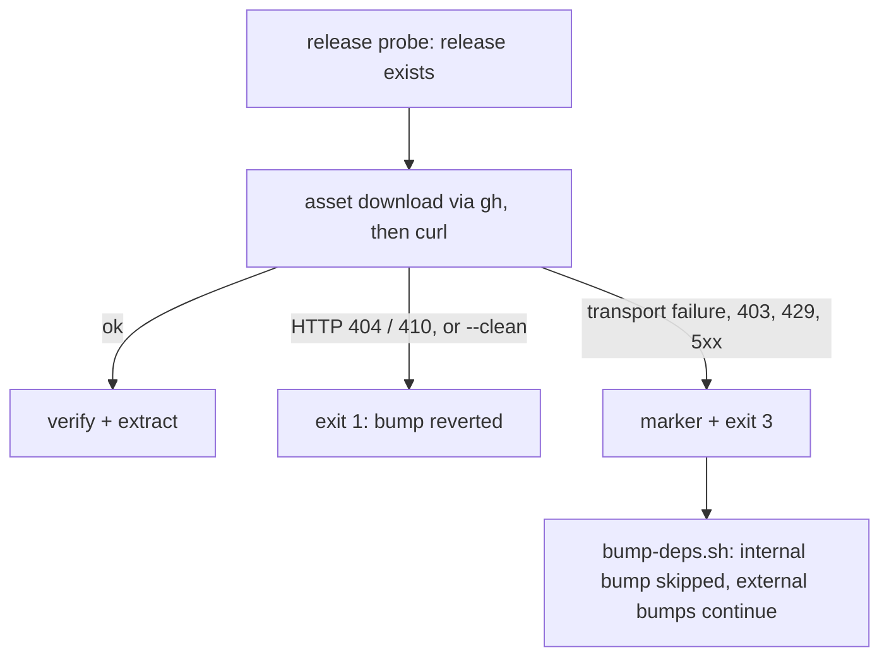

## Summary

`bump-deps.sh` failed on every run in the unattended worker because `build.sh`
exited `1` when the release asset could not be downloaded. The release probe
succeeds (via `api.github.com`), but the signed asset host
`release-assets.githubusercontent.com` is refused by the egress proxy
(`curl: (56) CONNECT tunnel failed, response 403`, or `(22)` with HTTP 403). The
bump was reverted each time.

`build.sh` now treats an asset download that fails for any reason other than the
asset being absent as "upstream could not be reached", the condition Issue #3990
already handles for the revision lookup: it prints
`BUILD_STATUS=upstream-unresolved` and exits `3`. `bump-deps.sh` already
degrades that pair (marker and status) to a skipped internal bump, so it now
exits `0` and continues with the external bumps. Closes #4120.

Version bump: not touched here; CI records the final version on the merged
commit.

## Spec

### Intent and Rationale

- The failure is an egress block on the asset host, not something the script can
  repair, so the fix is to classify it as an outage rather than a broken build.
  This reuses the exit-3 contract from #3990 instead of adding a second one.

### Essential Design Decisions

- Only a 404 or 410 on the asset stays a hard failure. Every other failure is
  treated as unreachable, including a 403 that could in principle be a bad
  credential on a private repo; #3990 already counts "no credential" as
  unreachable. The skip is loud (ERROR lines, curl's own stderr, the marker, and
  `bump-deps.sh`'s WARNING and summary line), never silent.
- Under `--clean`, `wasm_activation/pkg` has already been deleted before the
  download, so a failed download keeps exiting `1`: "nothing was changed" would
  be false.
- `bump-deps.sh`'s skip reason is reworded to "upstream could not be reached
  (revision lookup or bundle download)"; only a comment and that string changed,
  and the logic still requires both marker and status.

### Undiscoverable Facts

- The block is in the sandbox proxy, observed here with `gh release download`
  and `curl` against the failing release (`wasm-bundle-e86c342e…`):
  `CONNECT tunnel failed, response 403` on
  `release-assets.githubusercontent.com`, while `api.github.com` answers.

## Evidence

Run in this sandbox against the real, blocked asset host, on the head:

- `./build.sh` (no fakes) exits `3`, prints
  `Release asset host unreachable: curl
  exit code 22, HTTP status 000` and
  `BUILD_STATUS=upstream-unresolved`; `deno.json` and `wasm_activation/` are
  unchanged.
- `./bump-deps.sh --no-external --skip-smoke` exits `0` and prints
  `WARNING: internal bump skipped — upstream could not be reached (revision lookup or bundle download).`

## Reproduction

- **symptom** — `bump-deps.sh` exited 1
  ("`./build.sh failed (exit 1); internal
  bump aborted`") on every run because
  the release asset download was refused.
- **status** — `verified` — the new refusal tests failed on the unfixed
  `build.sh` (exit `1` where `3` was expected) and pass after the fix; the real
  script was also reproduced against the blocked host.
- **regression test** —
  `test/scripts/BuildScriptRetry.ts::build.sh signals a refused asset tunnel (curl 56 / 000) with exit 3 and the marker (Issue #4120)`

## Test Plan

- Added to `test/scripts/BuildScriptRetry.ts` (fake `gh` and `curl` shims; the
  fake `curl` now optionally answers the asset URL with a configured exit code
  and HTTP status, mirroring curl's `-fsSL -w '%{http_code}'` behaviour):
  - `build.sh signals a refused asset tunnel (curl 56 / 000) with exit 3 and the marker (Issue #4120)`
  - `build.sh signals a 403 on the release asset with exit 3 and the marker (Issue #4120)`
  - `build.sh keeps a genuinely missing release asset (curl 22 / 404) a hard failure, exit 1 with no marker (Issue #4120)`
  - `build.sh keeps a gone release asset (curl 22 / 410) a hard failure, exit 1 with no marker (Issue #4120)`
  - `build.sh keeps an asset refusal a hard failure under --clean, exit 1 with no marker (Issue #4120)`
  - The two exit-3 tests also assert `deno.json` `neatCore.rev` is unchanged and
    `wasm_activation/pkg` stays empty.
- Red checks: the two exit-3 tests failed on the unfixed `build.sh` (`-1 +3`).
  The three exit-1 tests pin behaviour that must not change, so they pass on the
  unfixed script. Each operand of the new condition was removed alone and a test
  went red: `$CLEAN == true` → the `--clean` test; `== "404"` → the 404 test;
  `== "410"` → the 410 test.
- Existing callers: `bump-deps.sh` is the only consumer of exit 3
  (`test/scripts/BumpDepsScript.ts`, 16 passed, covers marker-and-status, and
  the bare-status case); `quality.sh` only runs `./build.sh --verify-only`,
  which never reaches the download.
- Ran on the head:
  `deno test -A --no-check test/scripts/Build*.ts
  test/scripts/BumpDeps*.ts test/scripts/CoreDependencyPolicy.ts
  test/scripts/ContributingCorePin.ts test/scripts/BashScriptSyntax.ts`
  (104 passed, 0 failed, before the 410 test; `BuildScriptRetry.ts` alone 12
  passed after it); `deno fmt --check`, `deno lint`, `deno check`, `bash -n` and
  `shellcheck` clean on touched files.
- Docs updated: `AGENTS.md` (Unattended upstream lookup),
  `docs/CORE_DEPENDENCY_POLICY.md` (internal-bump bullet), `CHANGELOG.md`, and
  the exit-code help and header comments in `build.sh` and `bump-deps.sh`.

<!-- vibe-quality-gate-skipped reason="full ./quality.sh not runnable here: it stops at 'Native rust_scorer is required'; formatter, linter, type check, shellcheck and the covering tests were run on the touched files. CI runs the full gate." -->
