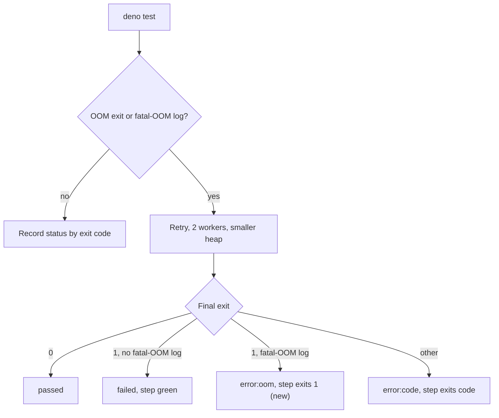

## Summary

A coverage shard whose V8 fatal-OOM (`Fatal JavaScript out of memory` /
`Ineffective mark-compacts`, exit 1) survives the capped-worker retry is now
recorded as `error:oom` and fails the required `Coverage shard <n>` check.
Before, it was recorded as `failed` and the step exited 0, so the shard stayed
green. Closes #4124.

No version file is touched by this change.

## Spec

### Intent and Rationale

- `is_oom_failure` already recognised the fatal-OOM log signature for the retry
  decision, but the final status was classified by exit code alone. The same
  predicate is reused on the final run rather than adding a second grep.

### Essential Design Decisions

- The new `elif` is placed before the plain exit-1 branch and requires exit 1,
  so signal exits (133/134/137/143) keep their `error:<code>` marker and exit
  code. The step exits 1 with marker `error:oom`.
- `test-errors.log` is overwritten by the retry run, so the check reflects the
  final run only; an ordinary exit-1 test failure after a retry stays `failed`.
- The merge job needs no change: its gate counts any status other than `passed`
  or `failed` as a crashed shard.

### Undiscoverable Facts

- None.

## Evidence

Backend/CI-only change; no UI. Evidence is the harness run, which executes the
committed "Run test shard" shell block with a fake `deno`:

```text
deno test -A --no-check test/ci/CoverageFailsPrOnTestFailure.ts test/ci/CoverageOomRetryParallel.ts < /dev/null
ok | 17 passed | 0 failed
```



## Test Plan

- `test/ci/CoverageFailsPrOnTestFailure.ts` (new tests; `runShard` gained an
  optional `oomRuns` parameter and returns `runs`):
  - both runs exit 1 and emit the signature → `error:oom`, exit 1, artifacts
    retained.
  - first run exit 1 with signature, retry exit 1 without it → `failed`, exit 0,
    `runs` equal to 2 (proves the retry engaged).
  - first run exit 1 with signature, retry exit 0 → `passed`.
- Result on the final head: 17 passed, 0 failed (the file above plus
  `test/ci/CoverageOomRetryParallel.ts`). `deno fmt --check` and `deno lint`
  clean on touched files.
- Red checks (each break done alone, then restored):
  - remove the new `elif` → new both-runs test red (`failed` vs `error:oom`).
  - remove the `-eq 1` operand → existing `an exhausted OOM retry…` test red
    (`error:oom` vs `error:137`).
  - remove the `is_oom_failure` operand → retry-without-signature test red
    (`error:oom` vs `failed`).
- No existing assertions were removed or edited.
- Twinned copies checked: `docs/troubleshooting/CI.md` (paragraph, mermaid,
  exit-code table) updated; `CHANGELOG.md` bullet added; no other doc describes
  the shard status values.
- The full `./quality.sh` gate was not run in this checkout (it stops at
  `Native rust_scorer is required` in this environment); CI runs it.

<!-- vibe-quality-gate-skipped reason="./quality.sh requires the native rust_scorer, unavailable in this sandbox; targeted fmt, lint and the two CI test files were run instead" -->
