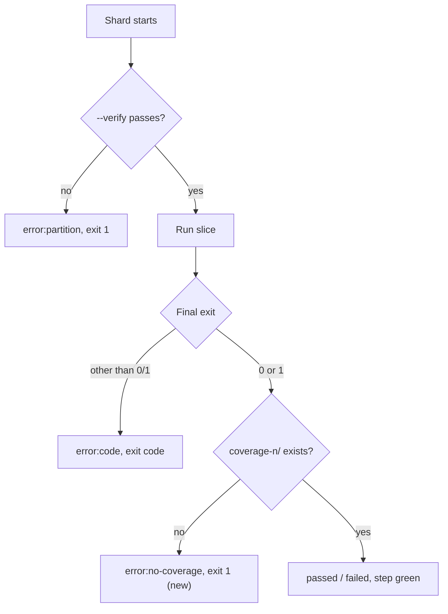

## Summary

The shard partition parity gate (`shard_test_files.ts --verify`) and the
lost-coverage check ran only in `Merge coverage & results`, which neither the
`Develop` nor the milestone ruleset requires. Both now also run inside each
required `Coverage shard <n>` job, so a failure turns a required check red. The
merge-job copies stay as defence in depth. Closes #4125.

No version file is touched by this change.

## Spec

### Intent and Rationale

- Moving the checks into the already-required shard job needs no ruleset change
  (a repository setting this PR cannot make) and keeps the fix reviewable in the
  workflow file.

### Essential Design Decisions

- A shard runs `--verify --total="${SHARD_TOTAL}"` before listing its slice. On
  failure it writes `error:partition` and exits 1 before any test runs.
  `--verify` only lists files and plans, so eight repeats are cheap.
- After the status chain, a shard whose `coverage-<shard>/` is absent writes
  `error:no-coverage` and exits 1. The crash branch already exits earlier, so
  this covers `passed` and `failed` (exit 1 test failures).
- The merge gate counts any status other than `passed`/`failed` as errored, so
  the new markers need no merge-job change.

### Undiscoverable Facts

- The per-shard directory check cannot see a directory the artifact upload then
  drops (the #3550 case). That stays covered by the merge gate and by
  `test/ci/CoverageShardArtifactPaths.ts`.

## Evidence

Backend/CI-only change; no UI. The tests execute the committed "Run test shard"
shell block with a fake `deno`.

```text
deno test -A --no-check test/ci/CoverageFailsPrOnTestFailure.ts test/ci/CoverageOomRetryParallel.ts test/ci/CoverageShardMatrix.ts test/ci/CoverageMergeGate.ts test/ci/CoverageShardArtifactPaths.ts test/ci/ActionlintWorkflow.ts test/ci/WorkflowVersionCheckStrictMode.ts < /dev/null
ok | 42 passed | 0 failed
```



## Test Plan

- `test/ci/CoverageFailsPrOnTestFailure.ts` (harness `runShard` gained
  `{ verifyExit, skipCoverage }`; no existing assertion removed or edited):
  - a failed partition check → `error:partition`, exit 1, `runs` 0; positive
    control with `verifyExit: 0` → `passed`, `runs` 1.
  - passing run that loses its coverage dir → `error:no-coverage`, exit 1.
  - ordinary exit-1 failure that loses its coverage dir → `error:no-coverage`,
    exit 1 (the dir check precedes the green `failed` outcome).
- Red checks (each break alone, then restored; `cmp` confirmed identical):
  - remove the `--verify` block → partition test red (`passed` vs
    `error:partition`).
  - remove the coverage-dir block → both lost-coverage tests red.
- Fake mirrors the real callee: real `--verify` throws (non-zero exit) with the
  cause on stderr and prints OK otherwise (`scripts/shard_test_files.ts`
  `main`).
- Twinned copies: merge-job `Verify shard partition parity` and
  `coverage_merge_gate.ts` are retained; comments note the per-shard copy.
  `docs/troubleshooting/CI.md` and `CHANGELOG.md` updated.
- The full `./quality.sh` gate was not run (it needs the native `rust_scorer`,
  unavailable in this sandbox); CI runs it.

<!-- vibe-quality-gate-skipped reason="./quality.sh requires the native rust_scorer, unavailable in this sandbox; targeted fmt, lint and the CI test files were run instead" -->
