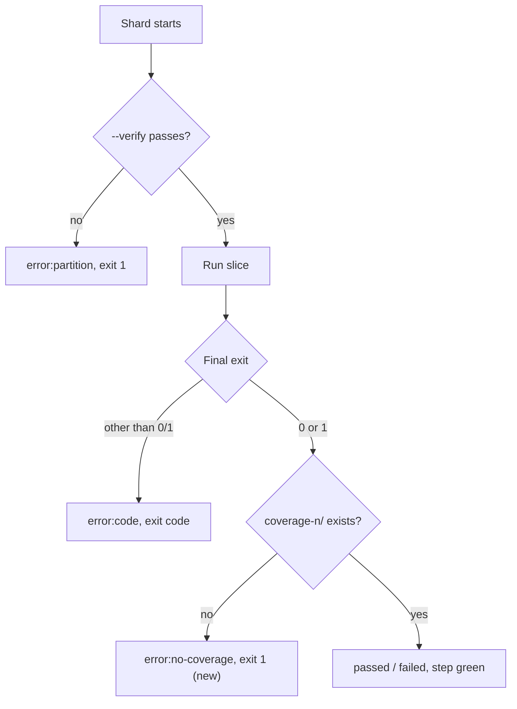

## Summary

The shard partition parity gate (`shard_test_files.ts --verify`) and the
lost-coverage check ran only in `Merge coverage & results`, which neither the
`Develop` nor the milestone ruleset requires. Both now also run inside each
required `Coverage shard <n>` job, so a failure turns a required check red. The
merge-job copies stay as defence in depth. Closes #4125.

Version bump: `deno.json` version updated for this change; the merged commit
records the final version.

## Spec

### Intent and Rationale

- Moving the checks into the already-required shard job needs no ruleset change
  (a repository setting this PR cannot make) and keeps the fix reviewable in the
  workflow file.

### Essential Design Decisions

- A shard runs `--verify --total="${SHARD_TOTAL}"` before listing its slice. On
  failure it writes `error:partition` and exits 1 before any test runs.
  `--verify` only lists files and plans, so eight repeats are cheap.
- After the status chain, a shard whose `coverage-<shard>/` is absent writes
  `error:no-coverage` and exits 1. The crash branch already exits earlier, so
  this covers `passed` and `failed` (exit 1 test failures).
- The merge gate counts any status other than `passed`/`failed` as errored, so
  the new markers need no merge-job change.

### Undiscoverable Facts

- The per-shard directory check cannot see a directory the artifact upload then
  drops (the #3550 case). That stays covered by the merge gate and by
  `test/ci/CoverageShardArtifactPaths.ts`.

## Evidence

Backend/CI-only change; no UI. The tests execute the committed "Run test shard"
shell block with a fake `deno`.

```text
deno test -A test/ci/CoverageRegressionSensitivity.ts < /dev/null
ok | 66 passed | 0 failed
```

`test/ci/CoverageRegressionSensitivity.ts` (66 tests at head, including imported
shard tests) passed. The suite imports `test/ci/CoverageFailsPrOnTestFailure.ts`
and exercises its assertions against fault-injected workflow copies.



## Test Plan

- `test/ci/CoverageFailsPrOnTestFailure.ts` (harness `runShard` gained a
  trailing `{ verifyExit, skipCoverage }` options argument after the base
  branch's `oomRuns` (Issue #4124); no existing assertion removed or edited):
  - a failed partition check → `error:partition`, exit 1, `runs` 0; positive
    control with `verifyExit: 0` → `passed`, `runs` 1.
  - passing run that loses its coverage dir → `error:no-coverage`, exit 1.
  - ordinary exit-1 failure that loses its coverage dir → `error:no-coverage`,
    exit 1 (the dir check precedes the green `failed` outcome).
- `test/ci/CoverageRegressionSensitivity.ts` registers the three new shard cases
  for exit, status and coverage faults. Missing-directory cases inject
  `mkdir -p coverage-0`; exit faults inject `exit 0`. Partition faults also
  exercise the run count and the passing control separately, so a later
  assertion cannot hide removal of an earlier one.
- Fake mirrors the real callee: real `--verify` throws (non-zero exit) with the
  cause on stderr and prints OK otherwise (`scripts/shard_test_files.ts`
  `main`).
- Twinned copies: merge-job `Verify shard partition parity` and
  `coverage_merge_gate.ts` are retained; comments note the per-shard copy.
  `docs/troubleshooting/CI.md` and `CHANGELOG.md` updated.
- `timeout 1200 ./quality.sh < /dev/null` failed immediately:
  `Native rust_scorer is required (quality.sh default) but was not found.` The
  full suite did not run; targeted checks are recorded below.

- Targeted `deno fmt --check`, `deno lint` and `deno check` passed for the
  changed test; formatting also passed for this summary. Markdown lint passed
  with `deno run --no-config --no-lock -A npm:markdownlint-cli2@0.23.2`.

## Mutation check

`test/ci/CoverageRegressionSensitivity.ts` imports the shard regression suite;
its workflow faults make the new assertions mutation-sensitive. Each assertion
below was deleted individually, the matching sensitivity test was run, and the
original file was restored. Every run exited 1 with
`AssertionError: Values are not equal` because the child test incorrectly passed
against a broken workflow.

- `test/ci/CoverageFailsPrOnTestFailure.ts:284` status, `:285` exit, `:286` run
  count and `:287` absent coverage: killed by partition faults.
- `test/ci/CoverageFailsPrOnTestFailure.ts:291` exit, `:292` status, `:293` run
  count and `:294` coverage: killed by faults scoped to the passing control.
- `test/ci/CoverageFailsPrOnTestFailure.ts:299` status, `:300` exit and `:301`
  absent coverage: killed by passing-run lost-coverage faults.
- `test/ci/CoverageFailsPrOnTestFailure.ts:306` status, `:307` exit and `:308`
  absent coverage: killed by ordinary-failure lost-coverage faults.

All 14 assertion-deletion mutants were killed. The earlier assertion exemptions
and obsolete harness line references have been removed.

Branch outcomes: existing present-directory/JUnit fault cases remain covered;
the new absent-directory cases select directory-creation faults and omit JUnit
faults. Only the partition scenario selects the run-count and passing-control
faults. The complete sensitivity suite exercises both choices for each added
condition. No workflow, public API or persisted format changes in this review
fix. The per-shard and merge-job gate copies remain unchanged.

### Sensitivity-suite mutation review (PR #4129)

The reported “no test imports this module” is a discovery limitation:
`test/ci/CoverageRegressionSensitivity.ts` is itself a `deno test` entry point.
Each of the 11 reported mutations was applied individually and checked with
`deno test -A --no-check test/ci/CoverageRegressionSensitivity.ts`, then
restored. No production code or tests were changed for this review.

Existing tests kill these four mutations; the reported survivors are incorrect:

- `test/ci/CoverageRegressionSensitivity.ts:127`, deleting `filter`: rejection
  cases fail because the child cannot run the intended test.
- `test/ci/CoverageRegressionSensitivity.ts:130`, changing `absentCoverage` to
  false or deleting it: the added JUnit faults incorrectly leave the child
  green, so the parent rejection tests fail.
- `test/ci/CoverageRegressionSensitivity.ts:138`, negating the absent-coverage
  ternary: lost-coverage JUnit rejection cases fail.

The remaining seven mutations cannot be killed by supported behavioural tests:

- `test/ci/CoverageRegressionSensitivity.ts:123` exempt (untestable): deleting
  this test-data element removes eight partition sensitivity tests, without
  changing any executed assertion or workflow behaviour. Testing its presence
  would pin test registration, which the repository's behaviour-test policy
  excludes.
- `test/ci/CoverageRegressionSensitivity.ts:124` exempt (untestable): deleting
  this element removes three passing-run lost-coverage sensitivity tests;
  remaining behaviour is unchanged. A test-registration assertion would be
  required to detect the deletion.
- `test/ci/CoverageRegressionSensitivity.ts:125` exempt (untestable): deleting
  this element removes three ordinary-failure lost-coverage sensitivity tests;
  remaining behaviour is unchanged. A test-registration assertion would be
  required to detect the deletion.
- `test/ci/CoverageRegressionSensitivity.ts:128` exempt (untestable): deleting
  `code: 1` is equivalent here. Both `1 === 0` and `undefined === 0` are false,
  so the exit fault remains `exit 0`; no other code reads this field.
- `test/ci/CoverageRegressionSensitivity.ts:129` exempt (untestable): changing
  `complete: false` to true is equivalent for these three scenarios because
  `absentCoverage: true` omits all JUnit faults before `complete` is read.
- `test/ci/CoverageRegressionSensitivity.ts:129` exempt (untestable): deleting
  `complete` is equivalent for the same reason: no generated fault reads it
  while `absentCoverage` is true.
- `test/ci/CoverageRegressionSensitivity.ts:142` exempt (untestable): negating
  this condition removes two crash empty-JUnit sensitivity tests and adds three
  complete-result empty-JUnit sensitivity tests, all of which still reject their
  broken workflows. The mutated suite passes 67 tests. Distinguishing these test
  inventories would require a test-registration assertion.

Harness search: the coverage/sensitivity files under `test/ci/` include the
entry point above and `test/ci/CoverageFailsPrOnTestFailure.ts`, which exercises
the real workflow shell. Neither observes registration of other tests; adding
such an observer would test implementation rather than workflow outcomes. No new
behavioural test can distinguish the equivalent mutations. The original scenario
definitions remain intact.

Mutation results: the six exemptions at lines 123–130 passed with respectively
58, 63, 63, 66, 66 and 66 tests; line 142 passed with 67. The four mutations at
lines 127, 130 (two variants) and 138 exited 1. Each run used the actual entry
point rather than an import-based mutation-test selector.

Restored-head validation: all 66 tests passed with type checking enabled;
`deno fmt --check` passed for this summary. Skipped: full quality suite for this
documentation-only review. Residual risk: test-case deletion is not guarded by
behavioural assertions, as explained in the exemptions above.
