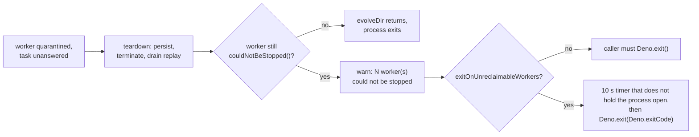

## Summary

A worker quarantined with an unanswered task can be blocked inside synchronous
native (FFI) code. `Worker.terminate()` cannot interrupt such a thread, and Deno
keeps the process alive for it, so a script whose last `evolveDir` has returned
never exits. This PR makes the teardown report those workers and adds an opt-in
exit guard. Part of #4126.

The report is on by default: `evolveDir`, `evolveEnv` and `evolveRL` teardown
logs one `teardown: N worker(s) could not be stopped` warning. The guard is off
by default: `exitOnUnreclaimableWorkers: true` makes a library call
`Deno.exit()` (preserving `Deno.exitCode`) 10 s after teardown, but only when
such a worker is left. Version bump: none in this change.

## Spec

### Intent and Rationale

- The incident's process hung after the last statement; the leading suspect (a
  quarantined worker stuck in native code) cannot be reclaimed by any JavaScript
  call, so the library can only report it and, if asked, exit.
- The issue's definition of done allows either fixing the pin or reporting it so
  callers can exit explicitly; both are delivered, with the exit behind an
  option because a library must not exit its host unasked.

### Essential Design Decisions

- `exitOnUnreclaimableWorkers` defaults to `false`: a deliberate deviation from
  "can't pin the process" by default. A silent `Deno.exit()` from a library
  could cut off a caller's later work (save, check-in).
- The guard runs last in teardown (after persist and replay drain) and is armed
  with a timer that does not hold the process open, so a healthy process still
  exits naturally before it fires.
- A worker counts as unstoppable only when a task it had cancelled is still
  unanswered at quarantine; a late reply clears the task id. An error event on
  an idle worker, or a cancelled task answered later, does not count.
- The option is wired into `evolveEnv` and `evolveRL` teardown too, but has no
  effect there today: `evolveEnv` has no worker pool and `EpisodeWorkerPool`
  does not report `couldNotBeStopped()`.

### Undiscoverable Facts

- The cause is inferred from the issue, not observed in the fleet: no log shows
  a ref'd timer or the watchdog pinning the process. The new child-process test
  reproduces the native-block mechanism with a real worker calling the C library
  `sleep`.
- The issue's closing evidence needs a fleet log with a quarantine followed by a
  phase `END`; that can only come after release and an opt-in in GRQ.

## Evidence

Backend/CLI change; no UI. Tests that verify it:

- `test/creature/ProcessExitsAfterWedgedWorker.ts` runs the real teardown in a
  child process with a worker blocked in synchronous FFI: the child exits by
  itself with the option on, keeps running without it (control), and preserves
  the caller's exit code.
- `test/creature/BoundedEvolveTeardown.ts`,
  `test/workers/UnreclaimableWorkerExit.ts`,
  `test/workers/WorkerTaskCancellation.ts`,
  `test/config/ExitOnUnreclaimableWorkersOption.ts` cover the report, the
  counts, the arming, the handler flag and the config default.
- Red check: replacing the `armUnreclaimableWorkerExit(...)` call in
  `src/creature/BoundedEvolveTeardown.ts` with a no-op made 4 tests fail (the
  process-exit tests and the "failed persist still arms the guard" test);
  restored afterwards.

## Reproduction

- **symptom** — the process stayed alive for 2 h after `evolveDir` returned
  following `[worker-11] quarantined`, until the stale-window watchdog killed it
- **status** — `partial` — reason: reproduced the mechanism (a worker blocked in
  synchronous FFI that `Worker.terminate()` cannot stop) in a child process
  around the real `runBoundedEvolveTeardown`, not through a full `evolveDir`
  with the native trainer; the observed hang with default options is pinned as
  the control
- **regression test** —
  `test/creature/ProcessExitsAfterWedgedWorker.ts::process exits on its own after a wedged worker is quarantined when exitOnUnreclaimableWorkers is true`

## Acceptance Criteria

<!-- vibe-spec-review inputs="diff+issue-body" -->

- **partial** — Reproduce: a test where one scheduled training task blocks
  synchronously, past its deadline, gets quarantined, and `evolveDir` then
  returns. Assert that the hosting deno process exits within a bounded time —
  evidence: `test/creature/ProcessExitsAfterWedgedWorker.ts` — reviewer: partial
  — reason: the child calls `runBoundedEvolveTeardown` directly rather than
  `evolveDir`, and the process only exits with
  `exitOnUnreclaimableWorkers: true`; the one-line wiring in
  `src/creature/CreatureTraining.ts` has no `evolveDir`-level test
- **partial** — Fix in neat-ai so a quarantined/terminated worker or watchdog
  can't pin the process. If a thread genuinely can't be reclaimed, `evolveDir`
  should report it (e.g.
  `[evolveDir] teardown: N worker(s) could not be stopped`) so callers can exit
  explicitly — evidence: `src/creature/BoundedEvolveTeardown.ts`,
  `src/workers/UnreclaimableWorkerExit.ts`,
  `test/creature/BoundedEvolveTeardown.ts` — reviewer: partial — reason: the
  report branch is met and opt-in exit is provided, but by default a wedged
  thread still pins the process, and no ref'd timer or watchdog leak was found
  or tested
- **missing** — In GRQ, separately: the `EvolveApp`s can end with an explicit
  `Deno.exit(0)` after cleanup — reviewer: missing — reason: lives in the GRQ
  repository, out of scope here; documented as Option 2 in
  `docs/troubleshooting/PROCESS_DOES_NOT_EXIT.md`
- **missing** — Closing evidence: a quoted fleet log showing a quarantine
  followed by the unit's `[phase] ✔ END industry-evolve` within a minute of
  `Cleaned up .tmp/train` — reviewer: missing — reason: needs a release and a
  fleet run
- **unrequested** — `exitOnUnreclaimableWorkers` passed into `evolveEnv` and
  `evolveRL` teardown and registered in `scripts/lib/optionAuditRollup.ts` —
  reviewer: unrequested — reason: the option is a config field read by all three
  teardown callers; it is documented as having no effect outside `evolveDir`

## Standards Review

<!-- vibe-standards-review inputs="diff+AGENTS.md+docs/ENGINEERING_PRINCIPLES.md+docs/DOC_STYLE.md" -->

- **violation** — `couldNotBeStopped()` counted every task ever cancelled, so a
  cancelled task answered later made a later unrelated quarantine report an
  unstoppable worker, contradicting its doc comment — evidence:
  `src/workers/WorkerHandlerBase.ts:330` — reason: fixed in this diff
  (cancelled-and-unanswered task ids are tracked and a late reply clears the id)
- **clean** — Australian English; no timing APIs read in unit tests (the
  child-process test only uses a kill watchdog and binary assertions); logging
  goes through `getLogger()`; typed `ValidationError`; no `@std/log`; no
  named-but-absent tests; every added field has a production reader apart from
  the test seams `exitGuard` and `workersUnreclaimable`, which no written rule
  forbids

## Test Plan

- Added `test/creature/ProcessExitsAfterWedgedWorker.ts`,
  `test/workers/UnreclaimableWorkerExit.ts`,
  `test/config/ExitOnUnreclaimableWorkersOption.ts`; extended
  `test/creature/BoundedEvolveTeardown.ts` and
  `test/workers/WorkerTaskCancellation.ts` (including a cancel, late reply, then
  quarantine case for the violation above).
- No assertion removed from an existing test. One expected value changed: the
  pinned top-level option count in `test/scripts/AuditOptionUsage.ts` went from
  119 to 120 for the new `exitOnUnreclaimableWorkers` key. That test still fails
  if the key set drifts again.
- Related docs updated: `docs/config/WORKERS.md`,
  `docs/troubleshooting/PROCESS_DOES_NOT_EXIT.md`, `docs/TROUBLESHOOTING.md`,
  `docs/README.md`, `CHANGELOG.md`. Twinned rule: the option audit list
  `scripts/lib/optionAuditRollup.ts` lists the new option; no other copy was
  found.
- Red check for the late-reply fix: with the late-reply clear removed from
  `handleCallback`,
  `couldNotBeStopped is false when a cancelled task was
  answered late and a later quarantine is unrelated (Issue #4126)`
  fails; restored afterwards.
- `./quality.sh --skip-discovery --rust-scorer-bin=<built rust_scorer>` on the
  final head: `ok | 10134 passed (5 steps) | 0 failed | 41 ignored`. The
  discovery library step was skipped because it could not be installed in this
  container (`Discovery library file not found`); this change does not touch
  discovery.
