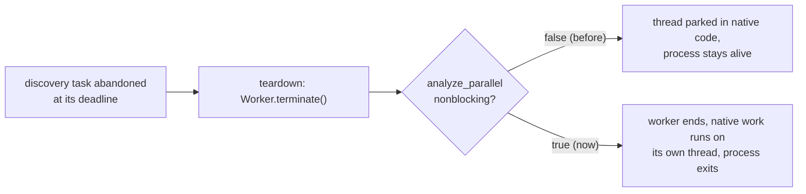

## Summary

The 7.1.3 recurrence of this issue was not a training task. In `GRQ-3-sloth.log`
(the downstream fleet logs at `9af82cc`, 2026-11-05) the worker that could not
be stopped held a **discovery** task inside the Rust GPU `analyze_parallel` FFI
call, which was declared `nonblocking: false`. A thread parked in a synchronous
native call cannot be stopped by `Worker.terminate()`, and Deno keeps the
process alive for it. This PR declares `analyze_parallel` `nonblocking: true`
and awaits it up the analysis chain, so an abandoned discovery analysis no
longer pins the process. The synchronous native trainer (`neat_backprop_train`)
is unchanged, so a training task on a legacy engine can still pin the process.
Part of #4126.

Version bump: no `VERSION` field is edited by this change; the merged commit
records the final version.

## Not closing #4126

The Definition of done is not met in full: the training path on a legacy engine
is unchanged, the GRQ-side `Deno.exit()` lives in another repository, and the
closing fleet-log evidence needs a release and a run (see Acceptance Criteria).

## Spec

### Intent and Rationale

- The comment on 7.1.3 asked why a task is blocked in native code past its
  deadline after #4134. The log answers it: the task was a discovery analysis,
  so the native trainer deadline of #4119 never applied to it.
- Non-blocking FFI removes the pin itself, instead of reporting it (the earlier
  teardown warning and opt-in `exitOnUnreclaimableWorkers`, which GRQ does not
  enable).

### Essential Design Decisions

- Only `analyze_parallel` is made non-blocking: it is the call the log shows,
  and it is the long-running one. The other discovery symbols are short or
  memory probes and stay blocking.
- `DiscoverStructureDeps.analyzeParallel` accepts a sync or promise result so
  the existing synchronous test doubles stay valid; production has one path, the
  awaited FFI call.
- `DiscoverStructure.ensureRustCombinedAnalysis` queues its native analyses
  (`combinedAnalysisTail`): with a non-blocking FFI call the three-way fan-out
  in `runParallelAnalysis` (neuron-only, synapse-only, removal) would otherwise
  start three native analyses together, where the blocking call used to run them
  one after another and let the removal analysis hit the synapse analysis's
  cache. The queue restores that order. A failed analysis does not poison the
  queue. A native analysis that never settles holds the queue, as the blocking
  call held the thread before; the Rust-side analysis deadline remains the
  bound.
- Accepted risk: when a worker is terminated while its native analysis runs,
  that call's result pointer is never read or freed (one leaked result, in a
  process that is exiting), and the input buffer is only kept alive while the
  worker awaits it. Not exercised against the real library (see Test Plan).
- The public synchronous `trainDir` was not converted: it is called from tests,
  benches and scripts, so making the native trainer non-blocking is a separate,
  larger change. On a deadline-capable engine (crate 0.1.50 or later) the
  trainer already stops by itself (#4119).

### Undiscoverable Facts

- Log evidence, `GRQ-3-sloth.log` at `9af82cc`: native engine
  `neat_ai_backpropagation 0.1.50`, then
  `[Neat] Discovery timeout reached after wall-clock deadline expired. Clearing stuck discoveries: d93116c6`,
  `[worker-11] terminated with 1 task(s) still in flight (2)` and
  `[evolveDir] teardown: 1 worker(s) could not be stopped`. Discovery
  `56c37f26-…93116c6` had logged
  `rust combined analysis chunk 1/3 … [synapse=gpu neuron=gpu]`.
- Observed with Deno 2.9.8 on Linux: a worker blocked in a synchronous C-library
  `sleep(60)` keeps the process alive after `terminate()` (killed by `timeout`
  at 25 s); the same call declared `nonblocking: true` exits at once.

## Evidence

Backend change; no UI. Commands run on the head:

- The archived summary describes downstream references at concept level so it
  remains accessible to public readers; the archive privacy test covers it.
- `timeout 600 deno test -A test/ErrorGuidedStructuralEvolution/AnalyzeParallelNonBlocking.ts`
  — 5 passed, 0 failed.
- `timeout 600 deno test -A test/ErrorGuidedStructuralEvolution/AnalyzeParallelSerialised.ts`
  — 5 passed, 0 failed.
- `deno test -A test/ErrorGuidedStructuralEvolution/*.ts test/discovery/*.ts` —
  940 passed, 0 failed, 35 ignored. The ignored cases need the Rust library and
  a GPU, which this runner lacks.
- `./quality.sh --skip-tests --skip-discovery --skip-wasm` (format, lint,
  type-check): completed without an error report.

Docs read and updated: `docs/troubleshooting/PROCESS_DOES_NOT_EXIT.md` (Cause,
Option 1 scope), `docs/DISCOVERY_ARCHITECTURE.md` (the "blocking FFI call"
passages), `docs/OPTION_AUDIT_SLICE_E.md`, `docs/GPU_ACCELERATION.md` (the
`analyzeParallel` snippet), `CHANGELOG.md`. Left as true: `docs/TIMEOUTS.md`,
`docs/config/WORKERS.md`, `docs/troubleshooting/MEMORY.md` (they describe the
native trainer or the generic quarantine). Issue numbers cited, each looked up
with `gh issue view`: #4126 (this issue), #4119 (native trainer deadline, open),
#4134 (its pull request).

## Reproduction

- **symptom** — `evolveDir` returned and the script ended, but the process
  stayed alive until a stale-window watchdog killed it; the log showed
  `teardown: 1 worker(s) could not be stopped` for a stuck discovery analysis.
- **status** — `partial` — reason: the process-exit mechanism is reproduced in a
  child process with a worker blocked in a C-library `sleep` declared with the
  production flag; the real `analyze_parallel` and a full `evolveDir` with a
  quarantined worker are not run, because the Rust library is not available here
  and a full `evolveDir` child hung before teardown in the earlier attempt on
  #4130.
- **regression test** —
  `test/ErrorGuidedStructuralEvolution/AnalyzeParallelNonBlocking.ts::a worker blocked in the analyze_parallel FFI declaration does not keep the process alive after terminate (Issue #4126)`

## Acceptance Criteria

<!-- vibe-spec-review inputs="diff+issue-body" -->

- **partial** — Reproduce: a test where one scheduled training task blocks
  synchronously, past its deadline, gets quarantined, and `evolveDir` then
  returns. Assert that the hosting deno process exits within a bounded time —
  evidence:
  `test/ErrorGuidedStructuralEvolution/AnalyzeParallelNonBlocking.ts::a worker blocked in the analyze_parallel FFI declaration does not keep the process alive after terminate (Issue #4126)`,
  `test/creature/ProcessExitsAfterWedgedWorker.ts` — reviewer: partial — reason:
  the independent review counted the earlier PR's
  `ProcessExitsAfterWedgedWorker.ts` as meeting it on Develop, and this PR adds
  no `evolveDir`-level reproduction; the new test is a child-process check of
  the `analyze_parallel` declaration with a C-library stand-in, not a scheduled
  task through `evolveDir`; a full `evolveDir` with a wedged worker hung before
  teardown when tried earlier.
- **partial** — Fix in neat-ai so a quarantined/terminated worker or watchdog
  can't pin the process. If a thread genuinely can't be reclaimed, `evolveDir`
  should report it … so callers can exit explicitly — evidence:
  `src/architecture/ErrorGuidedStructuralEvolution/RustDiscoveryLibrary.ts`
  (`RUST_DISCOVERY_SYMBOLS`), `RustDiscoveryOperations.ts`,
  `RustAnalysisCache.ts` — reviewer: partial — reason: the discovery pin seen on
  7.1.3 is removed and its native analyses are queued so the non-blocking call
  does not overlap them; the synchronous native trainer on a legacy engine can
  still pin the process, and the report plus opt-in exit from the earlier PR
  remain its only guard. The reviewer said no log shows a discovery task was
  involved; `GRQ-3-sloth.log` at `9af82cc` does
  (`Clearing stuck discoveries: d93116c6` directly before
  `1 worker(s) could not be stopped`).
- **missing** — In the downstream production application, the `EvolveApp`s can
  end with an explicit `Deno.exit(0)` after cleanup — reviewer: missing —
  reason: lives outside this repository.
- **missing** — Closing evidence: a quoted fleet log showing a quarantine
  followed by the unit's `[phase] ✔ END industry-evolve` within a minute of
  `Cleaned up .tmp/train` — reviewer: missing — reason: needs a release carrying
  this change and a fleet run.
- **unrequested** — the exported `RUST_DISCOVERY_SYMBOLS` constant and the
  `await` added in about 12 existing tests — reviewer: unrequested — reason: the
  constant is read by `loadRustLibrary` and by the new test; the test edits only
  add `async`/`await` because `analyzeParallel` now returns a promise.

- **unrequested** — this file replaces the archived summary of the earlier #4126
  pull request (#4130, merged) at the same path — reviewer: unrequested —
  reason: `pr-summary-4126.md` is the path this run must write; the earlier
  record stays in git history, and its report and opt-in exit are unchanged.

## Standards Review

<!-- vibe-standards-review inputs="diff+AGENTS.md+docs/ENGINEERING_PRINCIPLES.md+docs/DOC_STYLE.md" -->

- **violation** — the C-library `sleep` stand-in is more lenient than the real
  `analyze_parallel` and no contract source was named — evidence:
  `test/ErrorGuidedStructuralEvolution/AnalyzeParallelNonBlocking.ts:1` —
  reason: fixed in this diff (the header names the Deno FFI `nonblocking`
  contract and says the real library is not available in CI)
- **violation** — the `analyzeParallel` snippet stayed synchronous — evidence:
  `docs/GPU_ACCELERATION.md:169` — reason: fixed in this diff (now awaited)
- **violation** — the docs disagreed on whether the analysis can be cancelled —
  evidence: `CHANGELOG.md:31` and
  `docs/troubleshooting/PROCESS_DOES_NOT_EXIT.md:34` — reason: fixed in this
  diff (both now name the Rust deadline and `cancel_analysis_memory_pressure()`)
- **clean** — Australian English; logging only through `getLogger()`; no timing
  API read by an assertion (the kill watchdog bounds a hang); no
  named-but-absent tests; no `@std/log`; no existing expected value changed.

## Test Plan

- Added `test/ErrorGuidedStructuralEvolution/AnalyzeParallelNonBlocking.ts` (4
  tests): the process-exit test, a control with a blocking declaration (the
  child is still running after its last statement), and two
  `ensureRustCombinedAnalysis` cases with an asynchronous `analyzeParallel`
  double (a success, and a failure whose reason `boom` must be logged).
- Red checks: `analyze_parallel` set to `nonblocking: false` in the type and in
  `RUST_DISCOVERY_SYMBOLS` → the process-exit test failed
  (`child did not exit within 30000 ms`), the control and the two analysis tests
  stayed green; restored. The `await` before `deps.analyzeParallel(` removed → a
  type error under `deno test`, and with `--no-check` both analysis tests failed
  (`analysis did not return a result` instead of `boom`); restored.
- Added `test/ErrorGuidedStructuralEvolution/AnalyzeParallelSerialised.ts` (5
  tests, all through `DiscoverStructure` with an asynchronous `analyzeParallel`
  double): each of `analyzeSelectedNeurons`, `analyzeMissingNeurons` and
  `analyzeSelectedNeuronsForRemoval` returns the candidate of the awaited
  analysis (the three `await this.ensureRustCombinedAnalysis` mutants, which
  leave the cache empty and the result `undefined`); a `Promise.all` fan-out of
  the three reaches the double at most once at a time and the removal analysis
  is served from the cache (the verifier's overlap finding); a failed analysis
  does not stop the queued one. Red check: the queue replaced by an immediately
  resolved promise → the fan-out test failed and the failure-isolation test
  errored; restored.
- Added to `AnalyzeParallelNonBlocking.ts` a case that pins the whole
  `RUST_DISCOVERY_SYMBOLS` table (parameters, result and `nonblocking` per
  symbol). It is the FFI declaration `Deno.dlopen` receives and the real library
  is not available to exercise it; it covers the `RustDiscoveryLibrary.ts`
  property mutants.
- Edited existing tests (`test/ErrorGuidedStructuralEvolution/`
  AnalysisCacheRelease, AnalysisFocusNeuronErrorShares,
  AnalysisMemoryBudgetWiring, AnalyzeParallelGpuGuard, AnalyzeParallelWireShape,
  DeprecatedFocusNeuronErrorShares, DiscoveryTaskDescriptor,
  NeuronDiscoveryIntegration, RustAnalysisCacheGpuGuard; `test/discovery/`
  CpuOnlyDiscoveryIntegration, CrossPlatformGpuSupport;
  `test/docs/GpuAccelerationDoc.ts`) only gained `async`/`await`. No assertion
  was removed or changed.
- Callers checked for the new async result: `ensureRustCombinedAnalysis` and
  `collectRustAnalysisCandidates` (methods) are awaited in
  `analyzeSelectedNeurons`, `analyzeMissingNeurons`,
  `analyzeSelectedNeuronsForRemoval` and `runAnalysisLoop`; the pure
  `collectRustAnalysisCandidates` in `DiscoverAnalysis.ts` stays synchronous.
- Not run: the real `analyze_parallel` against NEAT-AI-Discovery (library and
  GPU not present), the full `./quality.sh` test stage (over this runner's
  10-minute command limit) and the mutation tool itself. The listed survivors
  were each given a test that goes red for them (see above).
- <!-- vibe-quality-gate-skipped reason="the full ./quality.sh takes about 15 minutes, longer than this runner's 10-minute foreground command limit; format, lint and type-check ran via ./quality.sh --skip-tests, and the affected test directories were run directly; CI runs the full gate" -->
