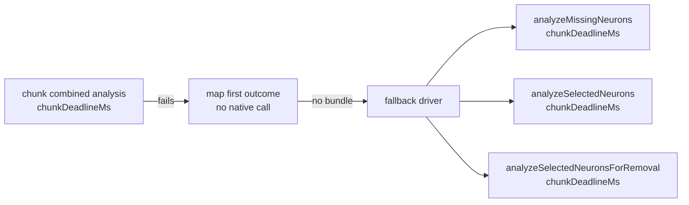

## Summary

A discovery chunk whose combined analysis failed was re-run by the analysis loop
without the per-chunk deadline (Issue #2501). The loop now reuses the first
call's outcome instead of asking for a second native analysis, and the fallback
analyses it runs for a failed chunk receive the chunk deadline. Closes #4141.

Version bump: not edited here; the merge workflow bumps the patch version.

## Spec

### Intent and Rationale

- `runAnalysisLoop` ran `ensureRustCombinedAnalysis(chunk, …, chunkDeadlineMs)`,
  then `collectRustAnalysisCandidates(chunk)`, which called
  `ensureRustCombinedAnalysis` again with no deadline. After a failure the cache
  is empty, so that second call issued a fresh `analyze_parallel` bounded only
  by the overall analysis window; the fallback driver then issued three more.
- Fix follows the issue's suggestion: map the first call's result
  (`mapRustAnalysisCandidates`, never a native call) and forward
  `chunkDeadlineMs` to the fallback analyses.

### Essential Design Decisions

- The fallback driver makes four native calls for a failed chunk, not the two
  the issue names: `analyzeMissingNeurons`, `analyzeSelectedNeurons` **and**
  `analyzeSelectedNeuronsForRemoval` (which also calls
  `ensureRustCombinedAnalysis`). All three now take an optional trailing
  `chunkDeadlineMs`.
- `ParallelAnalysisFn` gains a **required** sixth parameter
  `chunkDeadlineMs: number | undefined`, so a driver cannot silently drop it.
  Only `runParallelAnalysis` and the test doubles implement the type.
- `collectRustAnalysisCandidates(focusList)` is unchanged in behaviour; it now
  delegates to the new mapper. Its only remaining caller is
  `test/ErrorGuidedStructuralEvolution/NeuronDiscoveryIntegration.ts`.
- The fallback still runs after a failed combined analysis (the issue asks to
  bound it, not remove it); each call is now bounded by the chunk deadline.

### Undiscoverable Facts

- None.

## Evidence

Per chunk, the real fallback path makes four native `analyzeParallel` calls
(combined, missing-neuron, helpful-synapse, harmful-synapse). Before the fix the
first carried the chunk deadline and four more did not (five calls); now all
four carry it.

## Reproduction

- **symptom** — a chunk whose combined analysis returns a failure is re-run up
  to four more times, none with the per-chunk deadline.
- **status** — `verified` — the new test fails against the base-branch `src`
  (run with `--no-check`, because the test's six-parameter driver double does
  not type-check against the five-parameter base type):
  `every analyzeParallel
  call must carry the per-chunk deadline 6500, got [6500, 1793966547733, …]`;
  it passes with the fix.
- **regression test** —
  `test/ErrorGuidedStructuralEvolution/DiscoverAnalysisPerChunkTimeout.ts::runAnalysisLoop never re-runs a failed chunk's native analysis without the per-chunk deadline (Issue #4141)`

## Test Plan

- Added
  `runAnalysisLoop never re-runs a failed chunk's native analysis without
  the per-chunk deadline (Issue #4141)`
  in `test/ErrorGuidedStructuralEvolution/DiscoverAnalysisPerChunkTimeout.ts`: a
  failing `analyzeParallel` double, a fixed clock, the real fallback driver. It
  asserts every recorded `analysisDeadlineMs` equals the chunk deadline (6500)
  and that there are exactly four calls per chunk. Red on base `src` (above),
  green at head.
- Edited the helper `runAnalysisLoopWithStub` in the same file: the driver
  double forwards the sixth argument, `runParallelAnalysis` is optional (so the
  real driver can run) and `analyzeParallel` is injectable. No assertion of the
  three existing tests changed; they pass.
- Callers of `ParallelAnalysisFn` / the changed analysis methods checked:
  `runAnalysisLoop` (both `analysisFn` call sites pass `chunkDeadlineMs`),
  `runParallelAnalysis` (forwards to all three), `analyze()` and
  `analyzeSynapsesForRemoval()` (no per-chunk budget, optional param left
  unset).
- Ran on the head: `deno test -A test/ErrorGuidedStructuralEvolution/*.ts` — 324
  passed, 0 failed, 31 ignored; `deno fmt --check src test CHANGELOG.md`,
  `deno lint src test`,
  `deno check mod.ts test/ErrorGuidedStructuralEvolution/*.ts` clean.
- Docs: `CHANGELOG.md` Unreleased/Fixed entry added; the doc comment on
  `releaseCombinedRustAnalysisCache` and the comment in the loop that named
  `collectRustAnalysisCandidates` now name `mapRustAnalysisCandidates`. No
  `README.md`/`docs/` page names these methods.

<!-- vibe-quality-gate-skipped reason="./quality.sh takes about 15 minutes and a single foreground command is capped at 10 minutes in this run; the targeted fmt, lint, type-check and the ErrorGuidedStructuralEvolution suite were run instead. CI runs the full gate." -->

Not done: the full `./quality.sh` gate, and the independent Spec/Standards
reviewers (the issue states no acceptance-criteria list).
