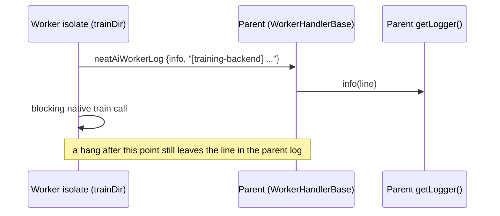

## Summary

Adds the observability the issue asks for first: every training task now writes
one
`[training-backend] task=<ID> backend=<ffi|cli|wasm> deadlineSent=<yes|no> capability=<version|none>`
line **before** the blocking native call, and that line reaches the **parent's**
logger from inside a worker. The root cause (engine deadline check granularity,
capability probe, or a hang outside `trainDir`) is not pinned or fixed here — it
needs the captured creature on sloth@GRQ-3 and an engine change in
NEAT-AI-Backpropagation. Part of #4146.

Version bump: not touched by this change.

## Spec

### Intent and Rationale

- Worker `getLogger()` output goes to the worker isolate's console, so the
  bridge's backend and legacy-deadline lines never reached the parent log. A
  hung task therefore left no record of the backend or whether a deadline was
  sent.
- The line is written before the native call because a hung task never returns a
  response; a response field would be lost exactly when it is needed.

### Essential Design Decisions

- A new `neatAiWorkerLog` worker message (modelled on the #3771 heartbeat)
  carries info/warn lines to the parent, which writes them via `getLogger()` and
  never routes them to the task-callback map. Only `info` and `warn` are
  accepted.
- The bridge reports through a reporter hook (`TrainDirBackendReport.ts`); the
  default reporter calls `getLogger()`, so in-process/MockWorker runs log
  directly. Only the pooled worker entry installs the relaying reporter.
- The once-per-backend `[NEAT-AI] trainDir using …` lines and the
  legacy-deadline warning go through the same reporter (text unchanged), so they
  now reach the parent too.
- `capability` is the deadline capability version (`1`) or `none`;
  `cliDeadlineCapability` was added and `cliDeadlineCapable` now wraps it
  (unchanged signature).

### Undiscoverable Facts

- The predictive-coding branch of `trainDir` never uses a native trainer; it
  writes `backend=wasm deadlineSent=no capability=none` from
  `trainDirPredictiveCoding`, so every task writes one line.
- `./quality.sh` cannot run its test stage on this host (no native
  `rust_scorer`); see Test Plan.

## Evidence

Tests: `test/workers/TrainDirBackendRelayWiring.ts` (the production worker
entry), `test/workers/TrainDirBackendRelay.ts`,
`test/architecture/training/RustTrainDirBackendReport.ts`,
`test/architecture/training/NativeBackpropCargoLibLayout.ts`.

## Reproduction

- **symptom** — training tasks overran the per-task deadline, returned no result
  and were quarantined; the run log showed neither the backend nor whether a
  deadline was sent
- **status** — `not-run` — reason: the hang needs the captured creature
  (`~/logs/training-hangs/*.json` on sloth@GRQ-3) and a deadline-capable engine;
  neither is reachable from this run. Only the observability gap was addressed,
  and its tests were observed red with the change removed.
- **regression test** —
  `test/workers/TrainDirBackendRelayWiring.ts::the real pooled worker relays its training backend line to the parent logger`
  (red with the `installTrainDirRelay` line in `worker.ts` commented out)

## Acceptance Criteria

<!-- vibe-spec-review inputs="diff+issue-body" -->

- **partial** — The worker logs, into the parent run log, which `trainDir`
  backend ran and whether a deadline was forwarded (one line per task:
  `backend=ffi|cli|wasm deadlineSent=yes|no capability=<version|none>`). A
  regression test asserts the line reaches the parent's logger from inside a
  worker. — evidence: `test/workers/TrainDirBackendRelayWiring.ts` (real
  `deno/worker.ts` isolate through a real `WorkerHandler`, `backend=wasm`),
  `test/workers/TrainDirBackendRelay.ts`,
  `test/architecture/training/RustTrainDirBackendReport.ts` (ffi and cli,
  capable, capable with no timeout, and legacy) — reviewer: partial — reason:
  the real-worker test runs the TypeScript loop (`NEAT_AI_BACKPROP_ENABLED=0` on
  the child, as this host has no native library), so ffi and cli are proven
  through the reporter hook but not through a real worker
- **missing** — Root cause pinned to one of the three branches above with a
  reproduction on the captured creature or an equivalently large fixture. —
  reviewer: missing — reason: needs the captured creature on sloth@GRQ-3; the
  new line is what lets the next field run tell the three branches apart
- **missing** — If branch 1: the engine checks the deadline inside an epoch (or
  at a bounded batch interval) — coordinate with NEAT-AI-Backpropagation#214.
  Regression: a fixture where one epoch is longer than the deadline returns
  `timedOut: true` with changed weights within deadline + 30 s through both FFI
  and CLI. — reviewer: missing — reason: conditional on branch 1, which is
  unconfirmed; the engine change lives in NEAT-AI-Backpropagation and no
  deadline-capable engine is available in this run
- **partial** — If branch 2: capability probe failure is loud and the regression
  covers the `$CARGO_HOME/lib` install layout GRQ uses. — evidence:
  `test/architecture/training/NativeBackpropCargoLibLayout.ts` (the
  `~/.cargo/lib` layout is found, wins over a cwd build, and an absent install
  resolves to no library),
  `test/architecture/training/RustTrainDirBackendReport.ts` — reviewer: partial
  — reason: no change to the probe itself; the layout test covers `~/.cargo/lib`
  only, and a `CARGO_HOME` that is not `~/.cargo` is not searched (not changed:
  nothing shows GRQ uses one)
- **missing** — Closing requires a quoted
  `[training-outcomes] … timedOut=N≥1 abandoned=0` line from a sampler or learn
  run on sloth@GRQ-3 (or another 16 GB host) on the fixed release, not
  inspection. — reviewer: missing — reason: needs a host run on a released build

## Standards Review

<!-- vibe-standards-review inputs="diff+CODING-STANDARDS.md" -->

- **clean** — Standards reviewer found no violations against `AGENTS.md`,
  `docs/ENGINEERING_PRINCIPLES.md` and `CONTRIBUTING.md` (this repository has no
  `CODING-STANDARDS.md`); checked Australian English, no timing APIs or
  `Deno.env.set` in tests, Logger policy, no `console.*` in `src/`, no existing
  test edited.

## Test Plan

- `NEAT_AI_BACKPROP_ENABLED=0 deno test -A test/workers/TrainDirBackendRelay.ts test/architecture/training/RustTrainDirBackendReport.ts test/architecture/training/RustTrainDirDeadline.ts test/architecture/training/RustTrainDirBridge.ts test/architecture/training/TrainingLoop.ts test/workers/WorkerStartHeartbeat.ts test/workers/WorkerHandlerBaseInitTimeout.ts`
  — 68 passed, 0 failed.
- Red checks: removing the `reportTrainDirBackend` call from
  `trainDirPredictiveCoding` →
  `the predictive-coding trainer reports
  backend=wasm …` failed ("one backend
  line per task"); removing the FFI `reportTrainDirBackend` call → the 3 FFI tests in
  `RustTrainDirBackendReport.ts` failed; commenting out `routeWorkerLogMessage`
  in `WorkerHandlerBase` → the handler test in `TrainDirBackendRelay.ts` failed.
- PR #4149 review: `deadlineSent` is now separated from `capability` by an FFI
  and a CLI case pairing a deadline-capable trainer with no timeout (neither
  `hardDeadlineTS` nor `trainingTimeOutMinutes`), asserting
  `backend=<ffi|cli> deadlineSent=no capability=1`. Red checks:
  `deadlineSent:
  deadlineCapable` at the FFI report site failed the FFI
  no-timeout test; `let deadlineSent = deadlineCapable` in `tryCliTrainDir`
  failed the CLI no-timeout test.
- Entry points checked: FFI (`tryFfiTrainDir`, capable, capable with no timeout
  and legacy), CLI (`tryCliTrainDir`, capable, capable with no timeout and
  legacy, in a child process), TypeScript loop (`runTypeScriptLoop`),
  predictive-coding trainer (`trainDirPredictiveCoding`), worker relay
  (`worker.ts` → `installTrainDirRelay`, driven end to end by
  `TrainDirBackendRelayWiring.ts`), parent routing (`WorkerHandlerBase`).
- `./quality.sh --skip-tests --skip-discovery` — passed (format, lint, type
  check, WASM sync). The full `./quality.sh` stops before tests: "Native
  rust_scorer is required … was not found" on this host; the worker re-runs the
  gate.
- Without `NEAT_AI_BACKPROP_ENABLED=0`,
  `TrainingLoop - trainDir returns a well-formed result for a tiny dataset`
  fails here because no native library exists on this host (pre-existing,
  unrelated).
- Existing tests edited: none.
- Docs updated: `docs/TIMEOUTS.md` (new section on the line),
  `docs/troubleshooting/PROCESS_DOES_NOT_EXIT.md`, `CHANGELOG.md`.

- Also run: `test/architecture/training/NativeBackpropCargoLibLayout.ts` and
  `test/workers/TrainDirBackendRelayWiring.ts` — 4 passed. Red check: with the
  `installTrainDirRelay` line in `worker.ts` commented out, the wiring test
  failed (no `[training-backend]` line reached the parent logger).
- Mutation check could not judge mutants: its baseline fails on this host
  because no native library exists (the listed files need one unless
  `NEAT_AI_BACKPROP_ENABLED=0`), which is environmental and not something this
  change can fix.

Not done / not checked: root-cause pin, in-epoch deadline regression and engine
change, a `$CARGO_HOME` that is not `~/.cargo` (only `~/.cargo/lib` has a layout
test), and the field `[training-outcomes] timedOut≥1` confirmation. The full
test suite was not run on this host.
