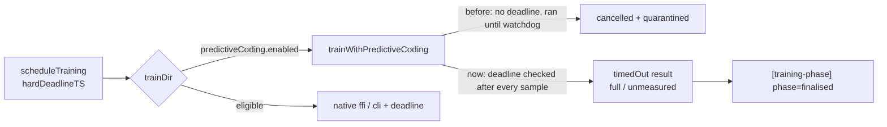

## Summary

The `[training-backend]` lines added by #4149 have now reached a field log, and
they show what was holding the workers. On sloth@GRQ-25 (2026-11-15, neat-ai
7.1.19, sampler loop 1), both hung tasks ran on `backend=wasm`. The run was in
predictive-coding learn mode. The predictive-coding trainer
(`trainWithPredictiveCoding`) never read the per-task deadline, and every
iteration reads every record of every file. On a large creature it ran minutes
past the deadline, until the watchdog cancelled the task and quarantined the
worker.

This PR makes the predictive-coding trainer stop at the task's single deadline,
which it checks after every sample. It discards the partial iteration and
returns a `timedOut` result. That result carries best measure `full` when at
least one iteration completed, and `unmeasured` otherwise, with the creature's
carried error. The trainer also writes a `[training-phase] phase=finalised` line
to the parent log, and `docs/TIMEOUTS.md` now says which `[training-phase]`
lines a predictive-coding task writes and how to read their absence.

Part of #4146. The native-engine branches stay unconfirmed, and closing needs a
field run.

## Spec

### Intent and Rationale

- The field log answers the issue's open question. The task reached `trainDir`
  but took the predictive-coding path, which none of the issue's three branches
  covers. That path is the one with no deadline, so the fix goes there and not
  into the native engine.
- The check runs after every sample, as the standard TypeScript loop does
  (`TrainingEpoch.ts`). Even a single iteration over the full corpus can outlast
  the task budget.

### Essential Design Decisions

- A partial iteration is discarded: no best-error update and no Hebbian update.
  Its error covers only some of the records, so scoring from it would give the
  creature a score it did not earn. This follows the native path's rule
  (`packageTrainingResult`: never score a partial measure).
- When no iteration completed, the result is `bestMeasure: "unmeasured"` with
  `error` set to the `error` or `untrained-error` tag, or `NaN`. The scheduler's
  existing `isUnmeasuredTimeout` then skips scoring. `preTrainingErrorTag` is
  exported from `RustTrainDirBridge.ts` and reused, not copied.
- The deadline is computed once with `computeTimeoutTS` from
  `trainingTimeOutMinutes` and `hardDeadlineTS`, which is the same value the
  other trainers use.
- A run that does not time out returns the old result shape, with no `timedOut`
  or `bestMeasure` key. The `[training-backend]` line is unchanged
  (`deadlineSent` still means a native request carried a deadline).

### Undiscoverable Facts

- The evidence is in GRQ-logs history at commit `c2f87347` (file
  `GRQ-25-sloth.log`; the 2026-11-17 triage deleted it), quoted under Evidence.
- The diff alone cannot show that this is the predictive-coding trainer and not
  the standard TypeScript loop, because both print `backend=wasm`. The log shows
  it: `Sampler learn mode: predictiveCoding`, `costName: MSE`, and only
  forward-only creatures, so none of the other skip-Rust reasons applies. With
  Rust enabled, the standard loop throws instead of running, unless a skip
  reason sends it there (`runTrainingLoop`).
- The earlier reports (7.1.12 to 7.1.17) were all sampler runs. They predate the
  backend line, so their trainer cannot be confirmed from their logs.

## Evidence

Fetched with
`gh api 'repos/stSoftwareAU/GRQ-logs/contents/GRQ-25-sloth.log?ref=c2f8734767aa9129b30ca155462f959234b4a24f'`:

```text
69:  Sampler learn mode: predictiveCoding
394: [neat-ai] running version 7.1.19
456: [training-backend] task=b679fd6f backend=wasm deadlineSent=no capability=none
457: [training-backend] task=3b5090f5 backend=wasm deadlineSent=no capability=none
546: [Neat] Stuck-task watchdog abandoning 2 training task(s) past per-task deadline: b679fd6f, 3b5090f5
547: Worker task 2 on worker-13 was cancelled after 346431ms without a response: training task b679fd6f passed its per-task deadline without returning a result (GRQ #4489)
793: [training-outcomes] tasks=2 scheduled=2 completed=0 timedOut=0 abandoned=2 ...
```

The log has no `[training-phase]` line, which matches the code on the base
branch: only the native path wrote one.



## Reproduction

- **symptom** — scheduled training tasks overran the per-task deadline, returned
  no result and were cancelled and quarantined (`timedOut=0 abandoned=2`)
- **status** — `reproduced` on an equivalently large fixture.
  `bench/PredictiveCodingDeadlineLarge.ts` builds a creature with 76,500
  synapses (the captured hang creature has 63,317) and 200 records, and calls
  `trainDir` in predictive-coding mode with a deadline 2 s away. With the base
  versions of the five changed production files restored (`--no-check`), the run
  was still going at 900 s and was killed by `timeout` (exit 124). At the head
  it returns in about 3.4 s: `timedOut=true bestMeasure=unmeasured`, about 1.4 s
  past the deadline, which is one sample on this creature. The unit regression
  tests also failed on base (0 passed, 3 failed with `AssertionError`). The
  captured creature itself is only on sloth@GRQ-3.
- **regression test** —
  `test/architecture/training/PredictiveCodingDeadline.ts::predictive-coding trainDir past its deadline is an unmeasured timeout`

## Acceptance Criteria

<!-- vibe-spec-review inputs="diff+issue-body" -->

- **met** — The worker logs, into the parent run log, which `trainDir` backend
  ran and whether a deadline was forwarded — evidence:
  `test/workers/TrainDirBackendRelay.ts`,
  `test/workers/TrainDirBackendRelayWiring.ts` (both from the merged #4149; this
  diff adds the `finalised` phase line for predictive-coding tasks in
  `test/architecture/training/PredictiveCodingDeadline.ts`) — reviewer: met —
  reason: delivered by the merged #4149 on the base branch; this diff adds only
  the predictive-coding `finalised` phase line
- **met** — Root cause pinned to one of the three branches above with a
  reproduction on the captured creature or an equivalently large fixture —
  evidence: the field log lines under Evidence,
  `bench/PredictiveCodingDeadlineLarge.ts` (76,500 synapses: base still running
  at 900 s against a 2 s deadline, head returns in about 3.4 s),
  `test/architecture/training/PredictiveCodingDeadline.ts` — reviewer: met —
  reason: the field log (GRQ-25, 7.1.19, not the GRQ-3 7.1.12 incident) pins the
  cause to the predictive-coding trainer, which reached `trainDir` but matches
  none of the three branches as written; the reviewer ran the head half of the
  bench (`timedOut=true` in 5.3 s), not the 900 s base half
- **missing** — If branch 1: the engine checks the deadline inside an epoch (or
  at a bounded batch interval) — reviewer: missing — reason: the field log shows
  that branch 1 did not occur (no native call ran). Earlier offline measurements
  had the engine stopping 0.1 to 0.3 s past the deadline.
- **missing** — If branch 2: capability probe failure is loud and the regression
  covers the `$CARGO_HOME/lib` install layout GRQ uses — reviewer: missing —
  reason: branch 2 is not the cause. The layout test
  (`test/architecture/training/NativeBackpropCargoLibLayout.ts`) came with an
  earlier PR. Not applicable: the `deadlineSent=no` lines came from
  `backend=wasm`, not a failed probe.
- **missing** — Closing requires a quoted
  `[training-outcomes] … timedOut=N≥1
  abandoned=0` line from a sampler or
  learn run on sloth@GRQ-3 (or another 16 GB host) on the fixed release —
  reviewer: missing — reason: needs a field run on a release carrying this PR
- **unrequested** — the predictive-coding trainer honours the task deadline
  (`src/predictiveCoding/PredictiveCodingTrainer.ts`,
  `src/architecture/training/TrainingPredictiveCoding.ts`) — reviewer:
  unrequested — reason: this is the fix for the cause the field log pinned; the
  issue's own branches did not foresee it
- **unrequested** — a `[training-phase] phase=finalised` line and an info line
  for predictive-coding tasks — reviewer: unrequested — reason: the next field
  log can then show whether a predictive-coding task settled, and how far from
  its deadline
- **unrequested** — `msFromDeadline` extracted into `TrainDirBackendReport.ts`
  and `preTrainingErrorTag` exported — reviewer: unrequested — reason: reuse in
  place of copies; the native path's behaviour is unchanged
- **unrequested** — docs in `docs/PREDICTIVE_CODING.md`, `docs/TIMEOUTS.md`,
  `src/config/TrainOptions.ts`, `src/architecture/training/TrainingTypes.ts` and
  `CHANGELOG.md` — reviewer: unrequested — reason: each describes the changed
  deadline behaviour
- **unrequested** — the two new test files and the
  `__setPredictiveCodingNowForTests` clock seam — reviewer: unrequested —
  reason: they are the regression tests for the fix, and the seam lets a test
  reach the timed-out `full` result deterministically

## Standards Review

<!-- vibe-standards-review inputs="diff+CODING-STANDARDS.md" -->

- **clean** — no violations. The repository has no `CODING-STANDARDS.md`, so the
  reviewer used `AGENTS.md` and `docs/ENGINEERING_PRINCIPLES.md`. It checked:
  logging only through `getLogger()`; `Date.now()` used only for the relative
  deadline; no timing APIs and no `Deno.env.set` in the tests; behaviour-level
  assertions; creature UUID provenance (the discarded iteration makes no edit,
  and the `loadFrom` restore is a safe harbour); DRY reuse of
  `computeTimeoutTS`, `preTrainingErrorTag` and `msFromDeadline`; no fallback
  path and no new dependency; Australian English. Neither standards file names a
  rule as enforced by review only.

## Test Plan

- Added `test/predictiveCoding/PredictiveCodingDeadline.ts`, 3 tests at the
  trainer level:
  - A deadline that has already passed stops the trainer with no completed
    iteration, and the creature's export is unchanged.
  - With a counter clock, exactly one iteration completes before the second
    times out.
  - With no deadline, every iteration completes.
- Added `test/architecture/training/PredictiveCodingDeadline.ts`, 3 tests
  through the real `trainDir` entry point:
  - An expired `hardDeadlineTS` gives `timedOut: true`,
    `bestMeasure:
    "unmeasured"`, the `untrained-error` value, and one
    `phase=finalised
    timedOut=yes` line.
  - The same case with no tag gives `NaN`.
  - With no deadline, the result has no `timedOut` key and the phase line reads
    `timedOut=no msFromDeadline=none`.
  - With a counter clock through the new `__setPredictiveCodingNowForTests`
    seam, the deadline passes after exactly one full iteration. The result is
    `timedOut: true`, `bestMeasure: "full"`, `iteration: 1`, and a finite
    `error` that is not the carried `untrained-error` tag. The phase line is
    `phase=finalised timedOut=yes msFromDeadline=2`. Red check: with the
    packaging mutated so a timed-out result is always `unmeasured`, this test
    fails and the other three pass.
- Added `bench/PredictiveCodingDeadlineLarge.ts`, the large-fixture reproduction
  under Reproduction.
- Red on base: the three `trainDir` tests failed against the base production
  files (0 passed, 3 failed). The trainer-level tests failed type-checking on
  base, because their options and fields do not exist there.
- Head: those 7 tests plus
  `test/architecture/training/PredictiveCodingBackendReport.ts` passed (8
  passed, 0 failed). That existing test, which pins the `[training-backend]`
  line, is unedited and still passes.
- `./quality.sh --rust-scorer-bin=<locally built rust_scorer>` on commit
  `f9659387`: passed, 10,484 passed, 0 failed, 50 ignored. The scorer was built
  from NEAT-AI-scorer `742c5df`.
- No existing test assertion was removed or edited.
- Callers checked: `trainDir` and `trainDirAsync` both reach
  `trainDirPredictiveCoding` through `runPredictiveCoding`. `scheduleTraining`
  passes `hardDeadlineTS` and `predictiveCoding` to the worker
  (`src/NEAT/NeatScheduling.ts`). The native `msFromDeadlineNow` now delegates
  to `msFromDeadline` with the same clock seam.

Not done or not checked: the captured hang creatures and the production corpus
are only on the field hosts. A run that ends with `iteration: 1` but no
completed iteration is reported as one iteration, the same convention as the
native path. The predictive-coding trainer still ignores `trainingSampleRate`,
which is why one iteration is so long; that is outside this issue.
