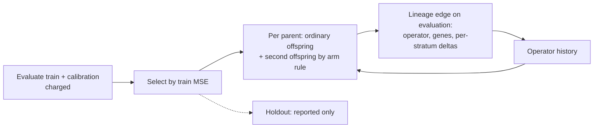

# Experiment: lineage-informed targeted offspring vs ordinary mutation (Issue #4155)

## Summary

Adds an opt-in research harness, `deno task lineage-targeting-study`, which
compares lineage-informed and stratum-targeted offspring with ordinary mutation
at an equal record budget. It records the 30-seed result, which is a **negative
finding**. No arm beats ordinary mutation on held-out MSE: every bootstrap 95%
CI spans zero, and win rates are 10–19 of 30. Every non-control arm loses some
behavioural diversity (×0.85–0.88 against the control). No production code
changed: nothing under `src/` is touched, and nothing calls the harness. Closes
#4155.

## Spec

### Intent and Rationale

- The issue asks for a controlled comparison, not a feature. The harness follows
  the pattern of the existing study harnesses (`scripts/lib/preSelectionAB.ts`,
  `scripts/pre_selection_ab.ts`), with a library, a CLI, a `deno task` and an
  evidence page plus a JSON artefact. It reuses the real `Mutator`
  (`selectMutationMethod`, `mutateCreature`, `repairAfterMutation`), `Genus`,
  `seedPopulation`, `meanGeneticDistance`, `median` and the `cliArgs` readers.
- The design is a 2×2 factorial (history on/off × stratum targeting on/off). The
  ordinary/ordinary cell is the "equally many ordinary offspring" control, so
  history and targeting are ablated separately and together.

### Essential Design Decisions

- There are three disjoint splits: **train** drives selection; **calibration**
  supplies the lineage deltas, the worst stratum and the targeted screen; and
  **holdout** is reporting only. The test "holdout never guides any decision"
  proves that holdout cannot change any trajectory.
- Cost is counted in records scored: train plus calibration for each evaluation,
  plus every calibration record the targeted screen scores. All arms stop at the
  same record limit. Holdout and the 64-record diversity probe are counted
  separately and are never charged.
- Offspring are mutation-only, with one operator each and no crossover. Every
  lineage edge therefore has one parent and a solely attributed operator.
  Parents are cloned through export/import and are never modified. The harness
  keeps its own `LineageEdge` rather than the evaluation archive's `parents`
  link (`src/archive/CreatureLineage.ts`), because the archive record has no
  per-stratum error fields. The issue also says not to make shared
  infrastructure a prerequisite for a local pilot.
- Assumption: "targeted at the worst stratum" means the best of R=3 ordinary
  candidates, scored on the parent's worst calibration stratum, with the
  screen's cost charged. "History" means picking the operator with the lowest
  historical mean delta among K=4 ordinarily proposed operators, with ε=0.25
  exploration. The diversity criterion is behavioural, not UUID genetic
  distance: under mutation-only offspring, descendants share neuron UUIDs, so
  genetic distance collapses to 0.

### Undiscoverable Facts

- arXiv 2610.30042 could not be fetched in this run either (the proxy refused
  the connection), so no method detail or number from the paper is used. The
  harness implements this repository's own reading of the issue text.
- Two criteria changed before the reported 30-seed run, and the evidence page
  says so. First, a one-seed timing run showed genetic distance collapsing, so
  the diversity metric moved to behavioural diversity. Second, after review,
  generation 1 was dropped from the diversity average. An earlier 30-seed run of
  the previous harness version gave identical holdout results and verdicts,
  because diversity is measurement-only.

## Evidence

Purely a script/CLI change; no UI files. The full record is in
`docs/evidence/lineage-targeting-4155.md`, and the machine-readable artefact is
`docs/evidence/lineage-targeting-4155.json`. The artefact holds the manifest
(code commit, NEAT-AI 7.1.17, NEAT-AI-core rev, Deno version, corpus id, seeds,
settings, criteria and policies), per-seed paired diffs, CIs, failures, coverage
of 30/30 seeds per arm, per-operator per-stratum lineage deltas and sampled full
edges. To reproduce:

```bash
deno task lineage-targeting-study --code-version=$(git rev-parse HEAD) \
  --json=docs/evidence/lineage-targeting-4155.json
```

The paired final held-out MSE is the arm minus the versus arm, so negative is
better. Seeds 4155–4184, budget 320,000 charged records per arm:

| Arm                | Versus     | Mean      | CI95                   | Wins  | Diversity | Verdict      |
| ------------------ | ---------- | --------- | ---------------------- | ----- | --------- | ------------ |
| `history`          | `ordinary` | +5.924e-3 | [−5.444e-4, +1.395e-2] | 10/30 | ×0.854    | `no-benefit` |
| `targeted`         | `ordinary` | −6.938e-4 | [−4.838e-3, +4.050e-3] | 16/30 | ×0.882    | `no-benefit` |
| `history-targeted` | `ordinary` | +1.776e-3 | [−5.384e-3, +1.268e-2] | 17/30 | ×0.868    | `no-benefit` |
| `history-targeted` | `targeted` | +2.470e-3 | [−6.074e-3, +1.324e-2] | 15/30 | ×0.977    | `no-benefit` |
| `history-targeted` | `history`  | −4.148e-3 | [−1.596e-2, +8.750e-3] | 19/30 | ×0.959    | `no-benefit` |



Independent review ran before this summary was written. The issue has no
Acceptance Criteria heading, so the two verdicts are recorded here rather than
as a closure block.

- **Spec reviewer** rated most items met. It found four gaps: affected gene keys
  were dropped from edges and the artefact; pre-declaration was weaker than the
  doc said; generation 1 inflated the diversity average; and the median helper
  was duplicated. All four were fixed in this diff (gene keys kept on edges, a
  per-operator per-stratum summary and `--edges` JSONL; `PREDECLARED_SEEDS`,
  `validateSettings` and an honest deviation note; generation 1 excluded;
  `median` reused from `scripts/lib/rankFidelity.ts`). Its one remaining partial
  is that the archive lineage mechanism is not reused; the reason is under
  Essential Design Decisions above.

## Standards Review

<!-- vibe-standards-review inputs="diff+AGENTS.md+docs/ENGINEERING_PRINCIPLES.md" -->

- **clean** — no violations. Rules checked: no timing APIs in test files, no
  `Deno.env.set` in tests, "what" not "how" tests, Australian English, logging
  policy (`console.*` only under `scripts/`), Neuron UUID and creature UUID
  provenance rules, semantic version untouched, no WASM fallback, nothing new on
  the public surface, and no existing test expectation changed. The optional
  items it raised were fixed: duplicated `median`/`mean`, settings validated
  late, and an unseeded generator in one test.

## Test Plan

- Added `test/scripts/LineageTargetingStudy.ts` (16 tests): the corpus is
  deterministic, disjoint and stratified; onlyStratum scores just that stratum;
  affectedGenes diffs by UUID identity; OperatorHistory averages deltas from
  edges only; breeding never modifies the parent; holdout never guides any
  decision (holdout targets shifted, trajectories identical, holdout reading
  differs as the positive control); runArm restores the caller's generator;
  budgets and arm accounting; a run is deterministic; pairedComparison and
  verdict (benefit, harm, no-benefit, low diversity is not benefit, mismatched
  seeds throw); behaviouralDiversity measures output differences; edges carry
  the affected gene keys; mean behavioural diversity excludes generation 1;
  validateSettings names the offending setting.
- `scripts/lib/preSelectionAB.ts`: `seedPopulation` is exported and its
  parameter narrowed. No assertion was removed from any existing test.
- On the final head,
  `deno test --allow-all test/scripts/LineageTargetingStudy.ts test/scripts/PreSelectionAB.ts`
  passed: 21 passed, 0 failed. `deno fmt --check`, `deno lint` and `deno check`
  passed on the changed files, and cspell passed on the changed docs and
  scripts.
- The full `./quality.sh --rust-scorer-bin=<built rust_scorer>` ran in the
  foreground on head `534b8fa3` and exited 0: 10,340 passed, 0 failed, 50
  ignored. Later commits removed unused and useless initialisers from
  `scripts/lib/lineageTargetingStudy.ts` (`b4411dc1` and `dd57381b`, dead code
  only); the review follow-ups change only
  `test/scripts/LineageTargetingStudy.ts`. The Discovery library is absent on
  this host, so the gate skipped its verification and discovery tests ran in
  their skip mode.

## Not done / risks

- The study uses a synthetic two-input regression with small creatures. It says
  nothing about GRQ-scale creatures or private corpora, and no representative
  production run was made.
- Discovery tests ran only in their skip mode, because the Discovery library is
  absent on this host.
- The JSON artefact is about 0.9 MB. Full lineage edges are sampled, with the
  first 40 edges of the first seed per arm; `--edges=<path>` regenerates the
  complete record.

🤖 Generated with [Claude Code](https://claude.com/claude-code)

## Review follow-up

Two deterministic tests exercise history selection through `breedPair` (overall
versus stratum-specific deltas, with an ordinary-arm control), and best-of-R
screening against the first candidate with exact record charging. Both pass.
Each relevant regression was observed failing: reversed history selection,
ignored stratum, worst-candidate screening, and first-candidate-only screening.

The history test's fixture is now stratum-specific: the operator that wins
overall and in every stratum except the parent's worst one differs from the
operator that wins in the worst stratum, so a lookup that reads any other
stratum picks the wrong operator. The test asserts the parent's worst stratum is
not stratum 0, so a lookup fixed at stratum 0 fails too. Observed failing with
the history lookup fixed at stratum 0 (15 passed, 1 failed); the test passes
with the real implementation (16 passed, 0 failed in that file).
