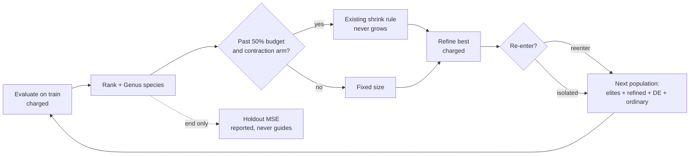

# Experiment: differential-weight offspring and delayed population contraction (Issue #4156)

## Summary

Adds an opt-in research harness, `deno task differential-weight-study`. It
compares differential-evolution (DE) weight-only offspring, which fill about 20%
of the offspring slots within a species, against delayed population contraction,
as a 2×2 at an equal charged-record budget. The 2×2 is crossed with whether
local-refinement descendants re-enter the population. The harness also records
the 30-seed result, which is a **negative finding**. No arm meets the
predeclared benefit criterion, none is harm, and every held-out MSE CI95 spans
zero. No production code changed: nothing under `src/` is touched, and nothing
imports the harness. Closes #4156.

## Spec

### Intent and Rationale

- The issue asks for a controlled comparison, not a feature. The harness follows
  the existing study pattern (`scripts/lib/preSelectionAB.ts`,
  `scripts/pre_selection_ab.ts`): a library, a CLI, a `deno task`, an evidence
  page and a JSON artefact.
- It reuses the real `Mutator`, `Offspring.breed` (through `breedOffspring`),
  `Genus`, `computeAdaptivePopulationSize`, `detectPlateau`, `seedPopulation`,
  `buildCorpus`, `scoreCreature`, `median` and the `cliArgs` readers.
- The runner already has a contraction rule, the plateau-driven shrink in
  `src/NEAT/AdaptivePopulationSizer.ts`, which is off by default. The
  "contraction" arms therefore reuse that rule and do not introduce a new one.

### Essential Design Decisions

- **DE** is DE/rand/1/bin, weight-only, with F=0.5 and CR=0.9. It works over
  genes that the target and three donors from the same `Genus` species all
  carry: biases keyed by neuron uuid and weights keyed by the synapse
  `(fromUUID, toUUID, type)`. Topology, squashes and uuids are the target's,
  which preserves alignment and activation semantics. Parents are cloned through
  `exportJSON` and never modified. When a species has fewer than three donors,
  the slot falls back to an ordinary offspring, which is counted.
- **Contraction** is delayed until 50% of the record budget and can only shrink,
  with a floor of 0.5× the base size. Assumption: the rule runs with
  `highDiversityThreshold` 0 and `lowDiversityThreshold` 0 rather than the
  production defaults of 0.8 and 0.3. In a 3-seed pilot the population held 1.3
  to 2.3 species per 24 creatures, so under the defaults the grow branch always
  fired and the shrink branch never did, and the arm would have been identical
  to the control. The manifest records this as `contractionPolicy`.
- **Local refinement** stands in for production backprop: each generation, 4
  Gaussian weight perturbations of the best creature are tried, and they are
  charged in every arm. In `@reenter` arms an improved descendant joins the
  population, as trained creatures do in production. In `@isolated` arms it
  never breeds but can still ship.
- **Budget.** Every arm stops at 240,000 charged train records. Ordinary
  offspring are topped up with retries, and slots still empty are reported per
  arm. The holdout (read once, at the end) and the 64-record diversity probe are
  never charged and never guide anything. Deviation: the issue says "Hold
  evaluation and wall-clock budgets equal". Wall-clock is measured and reported
  as median ratios, but it is not capped. A wall-clock cap on this shared
  container would make the runs non-deterministic, and the guidelines'
  Performance Task Workflow treats container timings as indicative only. The
  deterministic records budget therefore stands in for equal compute.

### Undiscoverable Facts

- arXiv 2610.26202 could not be fetched: `curl` returned
  `CONNECT tunnel failed, response 403`. No method detail or number from the
  paper is used, and the method is pinned in the JSON manifest as this
  repository's reading of the issue.
- The first full run showed that ordinary breeding leaves many slots empty,
  because `Offspring.breed` declines clones. As a result the control ran about
  100 generations while DE arms ran about 33, which mixed a population-fill
  effect into the DE contrast. The top-up retry fixed that before the reported
  run, and that earlier run is not reported.

## Evidence

This is a script/CLI change; no UI files are touched. The full record is in
`docs/evidence/differential-weight-4156.md`, and the machine-readable artefact
is `docs/evidence/differential-weight-4156.json`.

The artefact contains:

- the manifest: code commit, NEAT-AI 7.1.17, NEAT-AI-core rev, Deno 2.9.8,
  corpus id and seed, seeds, settings, criteria, contrasts and policies;
- per-run results;
- coverage of 30/30 seeds for every arm, with no failures;
- the paired comparisons.

Calibration on the disjoint seeds 94156–94160 set the time-to-target threshold
at train MSE 0.01406 and cost 1,200,000 records, which are reported separately.
Validation used seeds 4156–4185. The diff is the arm's held-out MSE minus the
control's, so a negative diff is better:

| Contrast                                        | Mean diff | CI95                 | Wins  | Diversity | Verdict      |
| ----------------------------------------------- | --------- | -------------------- | ----- | --------- | ------------ |
| `de@reenter` vs `control@reenter`               | +3.92e-3  | [−3.36e-3, +1.39e-2] | 16/30 | ×1.07     | `no-benefit` |
| `contraction@reenter` vs `control@reenter`      | −1.02e-3  | [−3.15e-3, +2.17e-4] | 9/30  | ×0.899    | `no-benefit` |
| `de+contraction@reenter` vs `control@reenter`   | +5.24e-3  | [−1.63e-3, +1.50e-2] | 14/30 | ×1.04     | `no-benefit` |
| `de@isolated` vs `control@isolated`             | +4.01e-3  | [−4.29e-3, +1.45e-2] | 14/30 | ×1.11     | `no-benefit` |
| `contraction@isolated` vs `control@isolated`    | +4.17e-5  | [−4.92e-5, +1.43e-4] | 5/30  | ×0.958    | `no-benefit` |
| `de+contraction@isolated` vs `control@isolated` | −9.53e-4  | [−5.76e-3, +3.61e-3] | 16/30 | ×1.07     | `no-benefit` |
| `control@isolated` vs `control@reenter`         | +3.43e-3  | [−2.90e-4, +7.59e-3] | 8/30  | ×0.946    | `no-benefit` |

The evidence page also covers variance (SD ratio with CI), time-to-target,
species ratio, wall-clock ratio, generations, evaluations per generation and
unfilled slots.



To reproduce:

```bash
deno task differential-weight-study --code-version=$(git rev-parse HEAD) \
  --json=docs/evidence/differential-weight-4156.json
```

No independent reviewers were dispatched. The issue has no Acceptance Criteria
heading, so the prompt requires none.

## Test Plan

- Added `test/scripts/DifferentialWeightStudy.ts`, with 12 tests:
  - `deWeightOffspring` with CR=1 sets every homologous gene to a + F(b − c) and
    leaves the parents unchanged;
  - with CR=0 it changes exactly one gene;
  - it leaves a target-only synapse alone and shares only the genes all four
    carry;
  - `contractedSize` waits for the delay, then shrinks only on a diverse
    plateau;
  - `runArm` is deterministic per seed and restores the caller's generator;
  - every arm spends its budget without exceeding it and reports its own
    mechanisms;
  - `contraction@reenter` really contracts after the delay, and the control
    never does;
  - breeding tops the population up to its target size;
  - the holdout never guides a run: shifted holdout targets give an identical
    trajectory and a different holdout reading, which is the positive control;
  - `pairedComparison` and `verdict` follow the predeclared criteria (benefit,
    harm, no-benefit, low diversity is not benefit, mismatched lengths throw);
  - `validateSettings` names the offending field;
  - `calibrateTarget` is the median final training MSE and refuses an empty set.
- `scripts/lib/preSelectionAB.ts`: `seedPopulation` and `breedOffspring` are now
  exported, and `seedPopulation`'s parameter is narrowed. There is no behaviour
  change, and its 5 existing tests pass. No assertion was removed from any
  existing test.
- The full
  `./quality.sh --rust-scorer-bin=<rust_scorer built from
  NEAT-AI-scorer Develop>`
  ran on head 96f6e1ea, which holds the same tree as the summary commit apart
  from this file. It exited 0 with
  `ok | 10338 passed (5 steps) | 0 failed | 50 ignored (9m12s)`, including all
  12 new tests and the 5 `PreSelectionAB.ts` tests. The NEAT-AI-Discovery
  library is absent on this host, so the discovery tests ran in their skip mode.
- cspell with `docs/cspell.json` reported 0 issues on the changed scripts, test
  and docs. Five words were added to the dictionary: `reenter`, `reenters`,
  `reentered`, `carryover` and `scorings`.

## Not done / risks

- The objective is a synthetic two-input regression with small creatures. The
  result says nothing about GRQ-scale creatures or private corpora, and no
  representative production run was made.
- The paper was not read (see above).
- Wall-clock was measured, not held equal (see Essential Design Decisions).
- The contraction arms use non-default diversity thresholds. Under the
  production defaults the rule never contracted in this setting.
- Local refinement is a perturbation stand-in, not the production backprop
  trainer.

🤖 Generated with [Claude Code](https://claude.com/claude-code)
