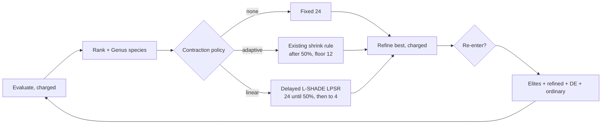

# Experiment: differential-weight offspring and delayed population contraction (Issue #4156) — the paper's mechanism

## Summary

PR #4165 merged the opt-in harness and a negative result, but it never read the
paper. This follow-up pins the paper's method as far as the container can reach
it. It then tests the paper's own contraction mechanism and re-runs the whole
study on fresh validation seeds:

- **Paper partly pinned.** arXiv 2610.26202 (Ambrosini, v1 2026-10-19) still
  cannot be fetched (`CONNECT tunnel failed, response 403`). Web search did
  return the abstract and excerpts of the PDF text. The manifest's `paper`
  object now records the title, author and version, plus what is pinned and what
  is not (`methodRead: "partial"`).
- **New arms for the paper's contraction.** The paper's "delayed contraction" is
  a budget-aware delay of L-SHADE's linear population-size reduction (LPSR). The
  harness only had NEAT-AI's adaptive shrink rule, so `delayedLinearSize` and
  four arms (`lpsr`, `de+lpsr` × `@reenter`/`@isolated`) are added beside the
  existing ones: 12 arms and 11 predeclared contrasts.
- **Fresh validation seeds.** The 8-arm results on 14156–14185 were seen before
  the LPSR arms were designed. That range is now refused like 4156–4185, and all
  12 arms ran on the fresh range 24156–24185.
- **Equal wall-clock phase.** `runArm` takes an optional `WallClockBudget`
  (`ms`, injected `now`). The CLI now runs a second phase in which every arm
  gets the same 600 ms per run on fresh seeds 44156–44185. In that phase the
  record budget is raised tenfold so the clock is what stops each run, and the
  contraction schedules read progress from elapsed time. All 360 runs stopped on
  the clock, with per-arm median wall-clock between 601 and 603 ms.
- **Review fixes (round 3).** The clock is now checked before every refinement
  candidate, not only before the whole batch, and no breeding starts once it is
  spent. A run that ends with no scored creature is recorded as censored, not as
  a completed sample, and a contrast with no paired seed is `insufficient-data`.
  The preparation ledger now holds the two superseded runs on 24156–24185. The
  wall-clock phase moved to fresh seeds 44156–44185, because the first version's
  seeds 34156–34185 were seen before the fix.

The result is negative at equal records. No contrast is benefit or harm, and
every held-out MSE CI95 spans zero. At equal wall-clock it is **mixed**:
`contraction@reenter` is **harm** by the predeclared criteria (+0.0003255, CI95
[+0.00004435, +0.0006819]), and `lpsr@reenter` leans better (−0.002561, CI95
[−0.006084, −0.00008183], 18 of 30 wins) but fails the diversity floor (0.729
against 0.8), so its verdict is `no-benefit`. The other nine contrasts are
`no-benefit`, and none is established at this sample size. The paper's delayed
LPSR is not better at equal records (+0.001361 with re-entry, +0.002685
isolated), and it cuts behavioural diversity to 0.72 and 0.65 of the control,
below the 0.8 floor. Nothing under `src/` changes.

The full text is still unread, so the delay cap, F/CR and the injection fraction
are not pinned. Part of #4156.

## Spec

### Intent and Rationale

- The open criterion was "Read and pin the full method before reproducing it".
  Search excerpts showed that the paper's contraction is delayed L-SHADE LPSR
  (section 3.3, figure 2), not a diversity-driven shrink. The merged harness
  therefore never tested the paper's mechanism, and this PR adds that arm.
- The existing adaptive arms stay, as the issue's "reuse existing mechanisms"
  asks, and the LPSR arms sit beside them rather than replacing them.

### Essential Design Decisions

- `delayedLinearSize` holds the base size (24) until `contractionDelayFraction`
  (50%) of the record budget. It then runs `round((24 − 4)·(1 − progress)) + 4`
  down to `lpsrMinPopulationSize` = 4 at budget exhaustion. It is wrapped in
  `Math.min(size, …)`, so the population never grows.
  - N_min = 4 is L-SHADE's value (Tanabe & Fukunaga 2014).
  - The 50% delay is this study's choice, because the paper's delay cap was not
    obtained. Both values were fixed before the 24156 run, and nothing was
    changed after seeing it.
- `StudyArm.delayedContraction: boolean` became
  `contraction: "none" | "adaptive" | "linear"`. The original eight arms' code
  path and RNG use are unchanged. The ccf3d612 re-run on 14156–14185 reproduced
  PR #4165's eight contrasts exactly, which is the evidence for this.
- `USED_SEED_RANGES` now also holds `[14156, 14185]` and `[34156, 34185]`;
  `VALIDATION_BASE_SEED` is 24156 and `WALL_CLOCK_BASE_SEED` is 44156. The
  superseded runs are counted in `PREPARATION_RUNS`.
- `refineWeights` takes an optional `shouldStop` that it asks before each
  candidate, and reports the candidates it really scored. The run passes the
  wall-clock check, so an expired deadline stops the batch and keeps what was
  scored (a re-entering descendant joins the population so it can ship). Without
  a wall-clock the callback is always false, so the record-budget phase is
  unchanged.
- Result collection and the contrast comparison moved from the CLI into
  `scripts/lib/differentialWeightContrasts.ts`, so they can be tested. A run
  with no finite training and holdout MSE goes to a `censored` list with its
  reason and costs and never enters `compareContrasts`.
- The `paper` manifest field changed shape (`methodRead` went from a boolean to
  `"partial"`, and fields were added). The artefact is regenerated whole and no
  code reads it, so no old-shape reader is needed.

### Undiscoverable Facts

- Direct fetches of arxiv.org (abs and pdf, via `curl` and WebFetch) were
  refused by the proxy. Semantic Scholar, alphaXiv and a reader proxy were also
  unreachable, and only github.com answered. The paper's method was pinned from
  WebSearch excerpts retrieved on 2026-11-16.
- Pinned from those excerpts:
  - MERLIN is CMA-ES with DE trial vectors added as extra offspring.
  - RAPTOR is PSO with success-history adaptation, DE injection and local
    refinement.
  - L-SHADE-SW is L-SHADE with Solis–Wets local search, whose result replaces
    the worst member.
  - The delayed LPSR improves three adaptive DE variants in 40 of 51
    comparisons.
  - The budget is a hard cap of 1,200 evaluations, all counted.
  - Local search pays off only when its result re-enters the population.
- The harness spends about 600 evaluations per run (240,000 records at 400 per
  evaluation), the same order as the paper's 1,200.

## Evidence

This is a script/CLI change; no UI files are touched. The full record is in
`docs/evidence/differential-weight-4156.md`, and the machine-readable artefact
is `docs/evidence/differential-weight-4156.json`.

- **Run.** `codeVersion`
  `d85139e6919353cd3ccdfd107e2296cd8a5397f6+uncommitted-review-fix`, NEAT-AI
  7.1.23, Deno 2.9.8. The run was made on head `d85139e6` plus this review fix,
  which was uncommitted at the time because the worker cannot commit; it is
  committed straight after. `git diff d85139e6 HEAD -- scripts test` on the
  pushed head is the code the run used. The record-budget results equal the run
  at `b224f0df` field for field apart from `wallMs`, and its contrasts equal
  that run's apart from `wallClockMedianRatio` and the new `attempted` field.
- **Equal wall-clock (new run, seeds 44156–44185).** 360/360 runs stopped by the
  600 ms clock, with no failures and none censored. Median records per arm
  ranged from 222,000 to 252,600. Nine contrasts are `no-benefit` with a CI95
  spanning zero, and two are not:
  - `contraction@reenter` is **harm**: +0.0003255, CI95 [+0.00004435,
    +0.0006819], 7/30 wins. It is tiny and one of 11 contrasts.
  - `lpsr@reenter` is −0.002561, CI95 [−0.006084, −0.00008183], 18/30 wins,
    diversity 0.729. The diversity floor makes it `no-benefit`.
  - The DE lean under isolation on the first wall-clock seeds did not replicate
    (13, 14 and 13 wins of 30). The full table is in the evidence page's "Equal
    wall-clock" section.
- **Overshoot.** Two runs ran more than 50 ms past the cap, which look like
  machine stalls: `de+contraction@reenter` at seed 44168 took 1,620 ms, and
  `lpsr@isolated` at seed 44174 took 771 ms with only 118,400 records. Both are
  kept.
- **Coverage.** 30/30 seeds for each of the 12 arms in both phases, with no
  failures and no censored runs.
- **Records.** 86,345,600 validation records charged against a budget of
  86,400,000, and 84,250,800 in the wall-clock phase. Calibration is unchanged:
  seeds 94156–94160, threshold 0.01406, 1,200,000 records.
- **Preparation ledger.** The recorded superseded runs charged 461,712,800
  records (58,794,400 + 58,796,400 + 87,537,200 + 87,545,600 + 169,039,200), on
  top of two bounded runs. The `23bd8e8f` run (87,545,600) and the `b224f0df`
  run (169,039,200, including its wall-clock phase) are the two this review
  found missing.

Record-budget contrasts (24156–24185, unchanged by the fix):

| Contrast (arm vs control)               | Mean diff  | CI95                   | Wins  | Diversity | Verdict    |
| --------------------------------------- | ---------- | ---------------------- | ----- | --------- | ---------- |
| `de@reenter`                            | +0.001649  | [−0.004733, +0.007948] | 17/30 | 1.07      | no-benefit |
| `contraction@reenter`                   | −0.0002824 | [−0.0007422, +2.5e-05] | 9/30  | 0.972     | no-benefit |
| `lpsr@reenter`                          | +0.001361  | [−0.001069, +0.005618] | 16/30 | 0.723     | no-benefit |
| `de+lpsr@reenter`                       | +0.002630  | [−0.004513, +0.009868] | 16/30 | 0.846     | no-benefit |
| `lpsr@isolated`                         | +0.002685  | [−0.000246, +0.006183] | 11/30 | 0.650     | no-benefit |
| `control@isolated` vs `control@reenter` | +0.002116  | [−0.004805, +0.008168] | 16/30 | 1.01      | no-benefit |

The evidence page has all 11 contrasts, with SD ratios, time to target, species,
wall-clock and coverage. The previous range's "about twice the spread for DE
under isolation" did not replicate (SD ratio 1.106, CI [0.87, 1.28]). Isolation
reaches the time-to-target threshold on fewer seeds than re-entry (13 against
18). That is the paper's direction, but it is not established at this sample
size.



To reproduce:

```bash
deno task differential-weight-study --code-version=$(git rev-parse HEAD) \
  --json=docs/evidence/differential-weight-4156.json
```

## Acceptance Criteria

<!-- vibe-spec-review inputs="diff+issue-body" -->

- **partial** — Read and pin the full method before reproducing it — evidence:
  the `paper` object in `scripts/differential_weight_study.ts`; the "Paper
  (partly pinned)" section of `docs/evidence/differential-weight-4156.md` —
  reviewer: partial — reason: arxiv.org was still unreachable when retried on
  2026-11-16 (as were export.arxiv.org, Semantic Scholar, Hugging Face, the
  Wayback Machine and the reader proxies). The only additions are a third
  party's notes on sections 4.5, 5.5 and 7.5 and table 6. Section 3's delay
  formula and cap, the DE variant, F/CR, the injection fraction and the
  Solis–Wets parameters are still not pinned.
- **met** — inject approximately 20% differential-evolution weight-only
  offspring across homologous genes — evidence:
  `test/scripts/DifferentialWeightStudy.ts` (DE tests from PR #4165, still
  passing) — reviewer: met
- **met** — Compare current behaviour, DE only, delayed contraction only and
  both — evidence: `STUDY_ARMS` in `scripts/lib/differentialWeightStudy.ts`;
  `test/scripts/DifferentialWeightStudy.ts::the study has 12 distinct arms and 11 contrasts that name real arms`
  — reviewer: met
- **met** — explicitly include whether local-refinement descendants re-enter the
  population — evidence: `@reenter`/`@isolated` on every arm, and the
  `control@isolated` vs `control@reenter` contrast — reviewer: met
- **met** — Preserve genome alignment and activation semantics — evidence: the
  DE operator is unchanged and nothing under `src/` is touched — reviewer: met
- **met** — Hold evaluation and wall-clock budgets equal — evidence:
  - the primary phase holds charged records equal;
  - `wallClockPhase` in `docs/evidence/differential-weight-4156.json`: every arm
    gets 600 ms per run on seeds 44156–44185, and 360/360 runs stopped on the
    clock, with per-arm medians of 601–603 ms;
  - `runArm`'s `wallClock` parameter and `refineWeights`' `shouldStop` in
    `scripts/lib/differentialWeightStudy.ts`: the clock is asked before every
    creature scored and every refinement candidate, and no breeding starts once
    it is spent. One evaluation in flight at the deadline can still finish after
    it, and so can the uncharged speciation and holdout work;
  - `test/scripts/DifferentialWeightStudy.ts::a deadline that expires during refinement scores no further candidate and keeps the one scored`:
    with a clock spent after the first candidate, exactly one candidate is
    charged (8 population + 1 evaluations, not 8 + 4), it ships, and no breeding
    starts. The same test checks the non-expired control (8 + 4) and a clock
    spent before refinement (8). It fails when the clock is not passed to
    refinement;
  - `::refineWeights stops before the next candidate once told to, keeping what it scored`
    and
    `::an equal wall-clock budget stops every arm on the clock, before its record budget`.

  reviewer: partial — reason: the previous head checked the clock only before
  the whole refinement batch, so up to three further candidates were scored
  after the deadline. Fixed in this push and the phase re-run on fresh seeds.
- **met** — measure time-to-target, held-out score, variance and diversity —
  evidence: `comparisons` in `docs/evidence/differential-weight-4156.json` —
  reviewer: met
- **met** — Do not introduce contraction if the existing runner has none merely
  to manufacture a control — evidence: the adaptive arms reuse
  `computeAdaptivePopulationSize`, and LPSR is a treatment arm, not a control —
  reviewer: met
- **met** — Opt-in experiment only; preserve ordinary behaviour, interfaces,
  immutable parents and full authoritative acceptance. No automatic deployment
  or default change — evidence: the diff touches only `scripts/`,
  `test/scripts/`, `docs/` and `CHANGELOG.md` — reviewer: met
- **met** — Predeclare controls, seeds, sample size, compute limits and
  success/failure criteria — evidence: the manifest's `settings`, `criteria`,
  `validationSeeds` and `contrasts`;
  `test/scripts/DifferentialWeightStudy.ts::the default validation seeds are 24156..24185 and overlap neither used range`
  — reviewer: met
- **met** — Identify code/model/data versions — evidence: the manifest's
  `codeVersion`, `neatAiVersion`, `neatCoreRev`, `deno` and `corpus`. The
  `codeVersion` is `d85139e6…+uncommitted-review-fix`: the run used head
  `d85139e6` plus this review fix, which the worker could not commit before the
  run. `git diff d85139e6 HEAD -- scripts test` on the pushed head is exactly
  that code. — reviewer: met
- **partial** — separate calibration from untouched validation and count all
  preparation/search costs — evidence: `preparation` in the manifest and the
  "Preparation and search cost" table. The superseded runs are now recorded
  exactly, including the two this review found missing (`23bd8e8f`, 87,545,600
  records, and `b224f0df`, 169,039,200 including its wall-clock phase). The
  recorded superseded runs total 461,712,800 records. Calibration is on the
  disjoint 94156–94160, and the validation 24156–24185 and wall-clock
  44156–44185 ranges are untouched by any earlier run — reviewer: partial —
  reason: the pilot's and the first full run's seeds and records were never
  written down, so their costs stay bounds (at most 5,760,000 + 1,200,000, and
  at most 58,800,000), not measurements. They cannot be recovered.
- **met** — Provide deterministic positive/negative correctness tests for new
  behaviour and pass the repository's normal quality checks — evidence:
  `test/scripts/DifferentialWeightStudy.ts::delayedLinearSize holds the base until the delay, then falls linearly to the minimum`,
  `::validateSettings refuses a bad lpsrMinPopulationSize`,
  `::lpsr@reenter holds its size until the delay, then only shrinks`,
  `::a deadline that expires during refinement scores no further candidate and keeps the one scored`,
  `::a run with no scored candidate is censored, kept out of every paired statistic, and not called no-benefit`
  and `::a completed run is collected, not censored`; the targeted tests and the
  repository's formatter, linter and type-check pass (see Test Plan) — reviewer:
  partial — reason: the full `./quality.sh` gate is not re-run in this fix (see
  Test Plan), so CI on the pushed head is the evidence for it.
- **met** — Deliver a reproducible command/manifest and machine-readable results
  with paired distributions, uncertainty, failures and actual coverage —
  evidence: `docs/evidence/differential-weight-4156.json` (`failures: []`,
  `censored: []` in both phases, 12-arm coverage with `completed`, `attempted`
  and `censored` per arm, `attempted` per contrast, paired CIs). A run with no
  scored candidate is censored with its reason and costs, left out of every
  paired statistic, and a contrast with no paired seed is `insufficient-data`,
  not `no-benefit`; the test above covers that path — reviewer: partial —
  reason: the previous head counted a run with no scored candidate as completed,
  so a small `--wall-clock-ms` produced non-finite statistics written as `null`.
  Fixed in this push.
- **met** — Record negative findings and remove optional code that does not earn
  its maintenance cost. Do not claim success before representative runs —
  evidence: the evidence page records the mixed equal-wall-clock result:
  `contraction@reenter` is harm, `lpsr@reenter` leans better but fails the
  diversity floor, and the other nine contrasts are `no-benefit` — reviewer:
  partial — reason: the reviewer would remove the LPSR code because its result
  is negative. It is kept because the harness is the reproducible command the
  issue requires, and deleting the arms would make the recorded negative result
  unreproducible. No production code is added.
- **met** — Keep public implementation and fixtures application-agnostic —
  evidence: the corpus is synthetic (`synthetic-tanh-quadratic-v1`) — reviewer:
  met
- **unrequested** — the delayed L-SHADE LPSR contraction policy and its four
  arms — reviewer: unrequested — reason: this is the paper's own "delayed
  contraction" mechanism, which the "read and pin the method before reproducing
  it" criterion asks to test. The adaptive arms alone tested a different
  mechanism.
- **unrequested** — moving validation to 24156–24185 and refusing 14156–14185 —
  reviewer: unrequested — reason: needed to keep validation untouched, as the
  issue asks, once the 14156 results had been seen before the LPSR design.

## Standards Review

<!-- vibe-standards-review inputs="diff+CODING-STANDARDS.md" -->

The repository has no `CODING-STANDARDS.md`. The reviewer used `AGENTS.md` and
`docs/ENGINEERING_PRINCIPLES.md`.

- **clean** — It found no violations, and no rule in these documents is marked
  as enforced by review only. Areas checked:
  - testing rules: no timing APIs, no `Deno.env.set`, and tests assert outcomes;
  - TDD, single owner and no dual path;
  - logging and dependency policy, Australian English, NEAT-AI terminology;
  - the UUID, semantic-version and synapse-identity invariants;
  - the correctness of `delayedLinearSize`;
  - doc and artefact consistency.

  On edited tests, the reviewer found that the `delayedContraction` →
  `contraction === "none"` guard still fails without the code, and that the
  added `lpsrMinPopulationSize: 2` only keeps an existing input valid. Its
  optional note was that the lpsr arm test did not pin the schedule; that was
  fixed in this diff by asserting each trace size against `delayedLinearSize`.

## Test Plan

- **Tests added** in `test/scripts/DifferentialWeightStudy.ts`:
  - `delayedLinearSize holds the base until the delay, then falls linearly to the minimum`:
    literal sizes 24, 24, 14, 4 and 4 (before the delay, at the delay, at 75%,
    at the budget and past it), and 24 for a delay of 1.
  - `validateSettings refuses a bad lpsrMinPopulationSize`: equal to elitism,
    above the population and non-integer each throw, and each error names the
    field. The default settings pass, which is the allowed control.
  - `lpsr@reenter holds its size until the delay, then only shrinks`: the size
    stays at the base before the delay, never grows and ends below the base, and
    every trace size equals `min(previous, delayedLinearSize(…))`.
    `control@reenter` on the same seed never changes size.
  - `the study has 12 distinct arms and 11 contrasts that name real arms`.
  - `the default validation seeds are 24156..24185 and overlap neither used range`.
- **Tests added for the review fixes:**
  - `refineWeights stops before the next candidate once told to, keeping what it scored`:
    with scores 5, 9, 7 and 8, an unstopped batch scores 4 and keeps 9; a stop
    asked from the second candidate scores 1 and keeps 5; a stop before the
    first scores 0 and keeps nothing. The parent is not modified.
  - `a deadline that expires during refinement scores no further candidate and keeps the one scored`:
    for `control@reenter` and `control@isolated`, a clock that never runs out
    charges 8 + 4 evaluations; one spent before refinement charges 8; one spent
    after the first candidate charges exactly 8 + 1 (`recordsCharged` 540 for 60
    records each), accepts that candidate, ships a lower training MSE than the
    8-evaluation run, and starts no breeding. It fails when the clock is not
    passed to refinement (4 candidates scored).
  - `a run with no scored candidate is censored, kept out of every paired statistic, and not called no-benefit`:
    through `collectRun` and `compareContrasts`, three zero-evaluation runs are
    censored with `evaluations` 0, `recordsCharged` 0 and the reason "no
    creature was scored before the wall-clock budget ended". A contrast then
    pairs 1 of 2 seeds with finite statistics, and a contrast with no paired
    seed has `seeds` 0 and the verdict `insufficient-data`.
  - `a completed run is collected, not censored`.
- **Tests added for the equal wall-clock budget:**
  - `an equal wall-clock budget stops every arm on the clock, before its record budget`:
    with a ticking fake clock, all 12 arms report `stoppedBy: "wall-clock"`,
    charge below the record budget, and stop only once the clock reaches `ms`.
  - `a wall-clock budget that never runs out changes nothing; one spent at once evaluates nothing`:
    a frozen clock gives a result equal to the no-budget run. A clock that is
    spent at once charges 0 records over 0 generations.
  - `under a wall-clock budget lpsr contracts on the elapsed share, not the records share`.
  - `runArm refuses a wall-clock budget that is not a positive finite number`
    (0, −5, ∞, NaN).
  - `the equal-wall-clock phase uses fresh seeds 44156..44185, 600 ms, and a tenfold record budget`
    (it replaces the earlier `…34156..34185 and a record budget the clock binds`
    test, which only asserted `> 0` and that validation did not throw). It now
    asserts the exact seeds, 600 ms and 10 × the primary budget.
- **Tests edited.** `runArm refuses a wall-clock budget…` now uses
  `assertRejects` with the exact message for each of 0, −5, ∞ and NaN, instead
  of `includes("wallClock.ms")`.
  `the default validation seeds are 24156..24185…` now asserts the three used
  ranges exactly instead of their count.
  `a validation range inside or touching a used range is reported` gains
  `usedSeedOverlap([14185, 14186])` → `[14185]`. The existing no-contraction
  test's guard changed from `!arm.delayedContraction` to
  `arm.contraction === "none"`, with the same assertions. The DE-fallback test
  sets `lpsrMinPopulationSize: 2` so its 3-creature settings still validate.
  - Removed from `test/scripts/DifferentialWeightStudy.ts`:
    `if (!arm.delayedContraction) {`
    - Replaced by: `if (arm.contraction === "none") {`, the same guard over the
      renamed field. The assertions under it are unchanged.
- **Targeted tests.**
  `deno test -A test/scripts/DifferentialWeightStudy.ts < /dev/null` on the
  final code: 35 passed, 0 failed. `deno fmt --check` and `deno lint` on
  `scripts` and `test/scripts` and `deno check` on the changed files are clean.
- **Full gate.** `./quality.sh` was not re-run in this fix. It last passed at
  head 15115d92 (`ok | 10483 passed (5 steps) | 0 failed | 50 ignored`), before
  the wall-clock commits; CI runs it on the pushed head. `rust_scorer` was built
  from a fresh clone of NEAT-AI-scorer in that run, because the checkout has
  none beside it.
- **Spelling.** cspell is clean on the changed files after adding `lpsr`,
  `Tanabe`, `Fukunaga` and `Ambrosini` to `docs/cspell.json`. markdownlint
  reports 0 issues on the edited docs.

## Not done / risks

- The paper's full text is still unread, so the delay cap, the DE variant, F/CR,
  the injection fraction and the Solis–Wets parameters are not pinned, and the
  issue stays open.
- The harness is NEAT-AI's GA-style breeding, not CMA-ES, PSO or L-SHADE. The
  objective is synthetic and the creatures are small, so the result says nothing
  about GRQ-scale runs.
- Wall-clock is held equal only in the second phase, at 600 ms on a shared
  container. That phase is not bit-reproducible, and 600 ms is far from the
  paper's 15 minutes.
- **The cap can overshoot.** The clock is checked between evaluations, so one
  evaluation in flight at the deadline finishes after it, and so does the
  uncharged speciation and holdout work. Two of 360 runs were more than 50 ms
  over, which look like machine stalls (1,620 ms and 771 ms); both are kept.
- **The wall-clock result is mixed and one contrast is harm.** A harm verdict
  for `contraction@reenter` (+0.0003255) is one of 11 contrasts on a very small
  effect. No third range was run, and the result is not replicated.
- **The wall-clock seeds were spent once.** 34156–34185 was seen before the fix
  and is now refused, so the reported wall-clock phase is on 44156–44185.
- In the wall-clock phase, time to target is still counted in records.
- The pilot's and the first full run's costs remain bounded, not measured.
- Not checked: whether the 14156-range DE spread finding was noise. The fresh
  range did not replicate it, and no third range was run.

🤖 Generated with [Claude Code](https://claude.com/claude-code)
