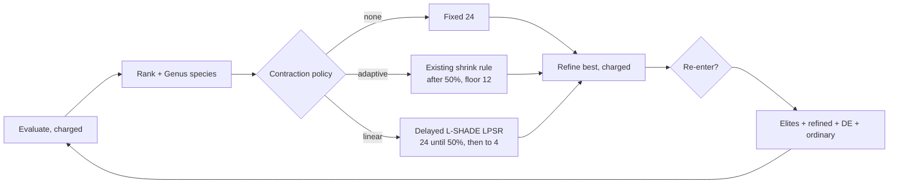

# Experiment: differential-weight offspring and delayed population contraction (Issue #4156) — the paper's mechanism

## Summary

PR #4165 merged the opt-in harness and a negative result, but it never read the
paper. This follow-up pins the paper's method as far as the container can reach
it. It then tests the paper's own contraction mechanism and re-runs the whole
study on fresh validation seeds:

- **Paper partly pinned.** arXiv 2610.26202 (Ambrosini, v1 2026-10-19) still
  cannot be fetched (`CONNECT tunnel failed, response 403`). Web search did
  return the abstract and excerpts of the PDF text. The manifest's `paper`
  object now records the title, author and version, plus what is pinned and what
  is not (`methodRead: "partial"`).
- **New arms for the paper's contraction.** The paper's "delayed contraction" is
  a budget-aware delay of L-SHADE's linear population-size reduction (LPSR). The
  harness only had NEAT-AI's adaptive shrink rule, so `delayedLinearSize` and
  four arms (`lpsr`, `de+lpsr` × `@reenter`/`@isolated`) are added beside the
  existing ones: 12 arms and 11 predeclared contrasts.
- **Fresh validation seeds.** The 8-arm results on 14156–14185 were seen before
  the LPSR arms were designed. That range is now refused like 4156–4185, and all
  12 arms ran on the fresh range 24156–24185.

The result is negative again. No contrast is benefit or harm, and every held-out
MSE CI95 spans zero. The paper's delayed LPSR is not better here (+0.001361 with
re-entry, +0.002685 isolated). It also cuts behavioural diversity to 0.72 and
0.65 of the control, below the 0.8 floor. Nothing under `src/` changes.

The full text is still unread, so the delay cap, F/CR and the injection fraction
are not pinned. Part of #4156.

## Spec

### Intent and Rationale

- The open criterion was "Read and pin the full method before reproducing it".
  Search excerpts showed that the paper's contraction is delayed L-SHADE LPSR
  (section 3.3, figure 2), not a diversity-driven shrink. The merged harness
  therefore never tested the paper's mechanism, and this PR adds that arm.
- The existing adaptive arms stay, as the issue's "reuse existing mechanisms"
  asks, and the LPSR arms sit beside them rather than replacing them.

### Essential Design Decisions

- `delayedLinearSize` holds the base size (24) until `contractionDelayFraction`
  (50%) of the record budget. It then runs `round((24 − 4)·(1 − progress)) + 4`
  down to `lpsrMinPopulationSize` = 4 at budget exhaustion. It is wrapped in
  `Math.min(size, …)`, so the population never grows.
  - N_min = 4 is L-SHADE's value (Tanabe & Fukunaga 2014).
  - The 50% delay is this study's choice, because the paper's delay cap was not
    obtained. Both values were fixed before the 24156 run, and nothing was
    changed after seeing it.
- `StudyArm.delayedContraction: boolean` became
  `contraction: "none" | "adaptive" | "linear"`. The original eight arms' code
  path and RNG use are unchanged. The ccf3d612 re-run on 14156–14185 reproduced
  PR #4165's eight contrasts exactly, which is the evidence for this.
- `USED_SEED_RANGES` now also holds `[14156, 14185]`, and `VALIDATION_BASE_SEED`
  is 24156. The superseded runs are counted in `PREPARATION_RUNS`.
- The `paper` manifest field changed shape (`methodRead` went from a boolean to
  `"partial"`, and fields were added). The artefact is regenerated whole and no
  code reads it, so no old-shape reader is needed.

### Undiscoverable Facts

- Direct fetches of arxiv.org (abs and pdf, via `curl` and WebFetch) were
  refused by the proxy. Semantic Scholar, alphaXiv and a reader proxy were also
  unreachable, and only github.com answered. The paper's method was pinned from
  WebSearch excerpts retrieved on 2026-11-16.
- Pinned from those excerpts:
  - MERLIN is CMA-ES with DE trial vectors added as extra offspring.
  - RAPTOR is PSO with success-history adaptation, DE injection and local
    refinement.
  - L-SHADE-SW is L-SHADE with Solis–Wets local search, whose result replaces
    the worst member.
  - The delayed LPSR improves three adaptive DE variants in 40 of 51
    comparisons.
  - The budget is a hard cap of 1,200 evaluations, all counted.
  - Local search pays off only when its result re-enters the population.
- The harness spends about 600 evaluations per run (240,000 records at 400 per
  evaluation), the same order as the paper's 1,200.

## Evidence

This is a script/CLI change; no UI files are touched. The full record is in
`docs/evidence/differential-weight-4156.md`, and the machine-readable artefact
is `docs/evidence/differential-weight-4156.json`.

- **Run.** `codeVersion` `23bd8e8f`, NEAT-AI 7.1.22, Deno 2.9.8.
- **Coverage.** 30/30 seeds for each of the 12 arms, with no failures.
- **Records.** 86,345,600 validation records charged against a budget of
  86,400,000. Calibration is unchanged: seeds 94156–94160, threshold 0.01406,
  1,200,000 records.
- **No uncommitted code in the run.** `git diff 23bd8e8f HEAD -- scripts test`
  is empty apart from the later test-only commit that pins the lpsr trace.

| Contrast (arm vs control)               | Mean diff  | CI95                   | Wins  | Diversity | Verdict    |
| --------------------------------------- | ---------- | ---------------------- | ----- | --------- | ---------- |
| `de@reenter`                            | +0.001649  | [−0.004733, +0.007948] | 17/30 | 1.07      | no-benefit |
| `contraction@reenter`                   | −0.0002824 | [−0.0007422, +2.5e-05] | 9/30  | 0.972     | no-benefit |
| `lpsr@reenter`                          | +0.001361  | [−0.001069, +0.005618] | 16/30 | 0.723     | no-benefit |
| `de+lpsr@reenter`                       | +0.002630  | [−0.004513, +0.009868] | 16/30 | 0.846     | no-benefit |
| `lpsr@isolated`                         | +0.002685  | [−0.000246, +0.006183] | 11/30 | 0.650     | no-benefit |
| `control@isolated` vs `control@reenter` | +0.002116  | [−0.004805, +0.008168] | 16/30 | 1.01      | no-benefit |

The evidence page has all 11 contrasts, with SD ratios, time to target, species,
wall-clock and coverage. The previous range's "about twice the spread for DE
under isolation" did not replicate (SD ratio 1.106, CI [0.87, 1.28]). Isolation
reaches the time-to-target threshold on fewer seeds than re-entry (13 against
18). That is the paper's direction, but it is not established at this sample
size.



To reproduce:

```bash
deno task differential-weight-study --code-version=$(git rev-parse HEAD) \
  --json=docs/evidence/differential-weight-4156.json
```

## Acceptance Criteria

<!-- vibe-spec-review inputs="diff+issue-body" -->

- **partial** — Read and pin the full method before reproducing it — evidence:
  the `paper` object in `scripts/differential_weight_study.ts`; the "Paper
  (partly pinned)" section of `docs/evidence/differential-weight-4156.md` —
  reviewer: partial — reason: only search excerpts could be read, because the
  proxy refuses arxiv.org. The delay formula and cap, the DE variant, F/CR, the
  injection fraction and the Solis–Wets parameters are not pinned.
- **met** — inject approximately 20% differential-evolution weight-only
  offspring across homologous genes — evidence:
  `test/scripts/DifferentialWeightStudy.ts` (DE tests from PR #4165, still
  passing) — reviewer: met
- **met** — Compare current behaviour, DE only, delayed contraction only and
  both — evidence: `STUDY_ARMS` in `scripts/lib/differentialWeightStudy.ts`;
  `test/scripts/DifferentialWeightStudy.ts::the study has 12 distinct arms and 11 contrasts that name real arms`
  — reviewer: met
- **met** — explicitly include whether local-refinement descendants re-enter the
  population — evidence: `@reenter`/`@isolated` on every arm, and the
  `control@isolated` vs `control@reenter` contrast — reviewer: met
- **met** — Preserve genome alignment and activation semantics — evidence: the
  DE operator is unchanged and nothing under `src/` is touched — reviewer: met
- **partial** — Hold evaluation and wall-clock budgets equal — evidence:
  `budgetPolicy` in the manifest — reviewer: partial — reason: the charged
  records are equal, but wall-clock is measured and not capped, because a cap on
  a shared container would make runs non-deterministic.
- **met** — measure time-to-target, held-out score, variance and diversity —
  evidence: `comparisons` in `docs/evidence/differential-weight-4156.json` —
  reviewer: met
- **met** — Do not introduce contraction if the existing runner has none merely
  to manufacture a control — evidence: the adaptive arms reuse
  `computeAdaptivePopulationSize`, and LPSR is a treatment arm, not a control —
  reviewer: met
- **met** — Opt-in experiment only; preserve ordinary behaviour, interfaces,
  immutable parents and full authoritative acceptance. No automatic deployment
  or default change — evidence: the diff touches only `scripts/`,
  `test/scripts/`, `docs/` and `CHANGELOG.md` — reviewer: met
- **met** — Predeclare controls, seeds, sample size, compute limits and
  success/failure criteria — evidence: the manifest's `settings`, `criteria`,
  `validationSeeds` and `contrasts`;
  `test/scripts/DifferentialWeightStudy.ts::the default validation seeds are 24156..24185 and overlap neither used range`
  — reviewer: met
- **met** — Identify code/model/data versions — evidence: the manifest's
  `codeVersion` `23bd8e8f`, `neatAiVersion`, `neatCoreRev`, `deno` and `corpus`
  — reviewer: partial — reason: the reviewer could not run `git` to check
  whether the run used uncommitted code. It did not:
  `git diff 23bd8e8f HEAD -- scripts test` shows only the later test-only
  commit, and the run started after `23bd8e8f` was committed.
- **met** — separate calibration from untouched validation and count all
  preparation/search costs — evidence: `preparation` in the manifest (the
  superseded 14156 runs are recorded exactly; the pilot and the first full run
  stay bounded, as in PR #4165) — reviewer: met
- **met** — Provide deterministic positive/negative correctness tests for new
  behaviour and pass the repository's normal quality checks — evidence:
  `test/scripts/DifferentialWeightStudy.ts::delayedLinearSize holds the base until the delay, then falls linearly to the minimum`,
  `::validateSettings refuses a bad lpsrMinPopulationSize`, and
  `::lpsr@reenter holds its size until the delay, then only shrinks`;
  `./quality.sh` passed — reviewer: partial — reason: the reviewer saw only the
  diff. The full gate was run here and passed (see Test Plan).
- **met** — Deliver a reproducible command/manifest and machine-readable results
  with paired distributions, uncertainty, failures and actual coverage —
  evidence: `docs/evidence/differential-weight-4156.json` (`failures: []`,
  12-arm coverage, paired CIs) — reviewer: met
- **met** — Record negative findings and remove optional code that does not earn
  its maintenance cost. Do not claim success before representative runs —
  evidence: the evidence page records `no-benefit` for every contrast —
  reviewer: partial — reason: the reviewer would remove the LPSR code because
  its result is negative. It is kept because the harness is the reproducible
  command the issue requires, and deleting the arms would make the recorded
  negative result unreproducible. No production code is added.
- **met** — Keep public implementation and fixtures application-agnostic —
  evidence: the corpus is synthetic (`synthetic-tanh-quadratic-v1`) — reviewer:
  met
- **unrequested** — the delayed L-SHADE LPSR contraction policy and its four
  arms — reviewer: unrequested — reason: this is the paper's own "delayed
  contraction" mechanism, which the "read and pin the method before reproducing
  it" criterion asks to test. The adaptive arms alone tested a different
  mechanism.
- **unrequested** — moving validation to 24156–24185 and refusing 14156–14185 —
  reviewer: unrequested — reason: needed to keep validation untouched, as the
  issue asks, once the 14156 results had been seen before the LPSR design.

## Standards Review

<!-- vibe-standards-review inputs="diff+CODING-STANDARDS.md" -->

The repository has no `CODING-STANDARDS.md`. The reviewer used `AGENTS.md` and
`docs/ENGINEERING_PRINCIPLES.md`.

- **clean** — It found no violations, and no rule in these documents is marked
  as enforced by review only. Areas checked:
  - testing rules: no timing APIs, no `Deno.env.set`, and tests assert outcomes;
  - TDD, single owner and no dual path;
  - logging and dependency policy, Australian English, NEAT-AI terminology;
  - the UUID, semantic-version and synapse-identity invariants;
  - the correctness of `delayedLinearSize`;
  - doc and artefact consistency.

  On edited tests, the reviewer found that the `delayedContraction` →
  `contraction === "none"` guard still fails without the code, and that the
  added `lpsrMinPopulationSize: 2` only keeps an existing input valid. Its
  optional note was that the lpsr arm test did not pin the schedule; that was
  fixed in this diff by asserting each trace size against `delayedLinearSize`.

## Test Plan

- **Tests added** in `test/scripts/DifferentialWeightStudy.ts`:
  - `delayedLinearSize holds the base until the delay, then falls linearly to the minimum`:
    literal sizes 24, 24, 14, 4 and 4 (before the delay, at the delay, at 75%,
    at the budget and past it), and 24 for a delay of 1.
  - `validateSettings refuses a bad lpsrMinPopulationSize`: equal to elitism,
    above the population and non-integer each throw, and each error names the
    field. The default settings pass, which is the allowed control.
  - `lpsr@reenter holds its size until the delay, then only shrinks`: the size
    stays at the base before the delay, never grows and ends below the base, and
    every trace size equals `min(previous, delayedLinearSize(…))`.
    `control@reenter` on the same seed never changes size.
  - `the study has 12 distinct arms and 11 contrasts that name real arms`.
  - `the default validation seeds are 24156..24185 and overlap neither used range`.
- **Tests edited.**
  `a validation range inside or touching a used range is reported` gains
  `usedSeedOverlap([14185, 14186])` → `[14185]`. The existing no-contraction
  test's guard changed from `!arm.delayedContraction` to
  `arm.contraction === "none"`, with the same assertions. The DE-fallback test
  sets `lpsrMinPopulationSize: 2` so its 3-creature settings still validate.
  - Removed from `test/scripts/DifferentialWeightStudy.ts`:
    `if (!arm.delayedContraction) {`
    - Replaced by: `if (arm.contraction === "none") {`, the same guard over the
      renamed field. The assertions under it are unchanged.
- **Targeted tests.**
  `deno test -A test/scripts/DifferentialWeightStudy.ts test/scripts/PreSelectionAB.ts`
  on the final code: 31 passed, 0 failed.
- **Full gate.** `./quality.sh --rust-scorer-bin=<built rust_scorer>` passed at
  head 15115d92 with
  `ok | 10483 passed (5 steps) | 0 failed | 50 ignored (16m9s)`. `rust_scorer`
  was built from a fresh clone of NEAT-AI-scorer, because the checkout has none
  beside it.
- **Spelling.** cspell is clean on the changed files after adding `lpsr`,
  `Tanabe`, `Fukunaga` and `Ambrosini` to `docs/cspell.json`. markdownlint
  reports 0 issues on the edited docs.

## Not done / risks

- The paper's full text is still unread, so the delay cap, the DE variant, F/CR,
  the injection fraction and the Solis–Wets parameters are not pinned, and the
  issue stays open.
- The harness is NEAT-AI's GA-style breeding, not CMA-ES, PSO or L-SHADE. The
  objective is synthetic and the creatures are small, so the result says nothing
  about GRQ-scale runs.
- Wall-clock is measured, not held equal.
- The pilot's and the first full run's costs remain bounded, not measured.
- Not checked: whether the 14156-range DE spread finding was noise. The fresh
  range did not replicate it, and no third range was run.

🤖 Generated with [Claude Code](https://claude.com/claude-code)
