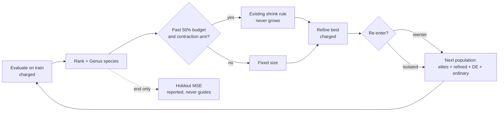

# Experiment: differential-weight offspring and delayed population contraction (Issue #4156)

## Summary

Adds an opt-in research harness, `deno task differential-weight-study`. It
compares differential-evolution (DE) weight-only offspring, which fill about 20%
of the offspring slots within a species, against delayed population contraction,
as a 2×2 at an equal charged-record budget. The 2×2 is crossed with whether
local-refinement descendants re-enter the population. The harness also records
the 30-seed result, which is a **negative finding**. No arm meets the
predeclared benefit criterion, none is harm, and every held-out MSE CI95 spans
zero. No production code changed: nothing under `src/` is touched, and nothing
imports the harness. Part of #4156, which stays open: the paper's method was not
read, so the result tests this repository's reading of the issue and not the
paper's method.

## Spec

### Intent and Rationale

- The issue asks for a controlled comparison, not a feature. The harness follows
  the existing study pattern (`scripts/lib/preSelectionAB.ts`,
  `scripts/pre_selection_ab.ts`): a library, a CLI, a `deno task`, an evidence
  page and a JSON artefact.
- It reuses the real `Mutator`, `Offspring.breed` (through `breedOffspring`),
  `Genus`, `computeAdaptivePopulationSize`, `detectPlateau`, `seedPopulation`,
  `buildCorpus`, `scoreCreature`, `median` and the `cliArgs` readers.
- The runner already has a contraction rule, the plateau-driven shrink in
  `src/NEAT/AdaptivePopulationSizer.ts`, which is off by default. The
  "contraction" arms therefore reuse that rule and do not introduce a new one.

### Essential Design Decisions

- **DE** is DE/rand/1/bin, weight-only, with F=0.5 and CR=0.9. It works over
  genes that the target and three donors from the same `Genus` species all
  carry: biases keyed by neuron uuid and weights keyed by the synapse
  `(fromUUID, toUUID, type)`. Topology, squashes and uuids are the target's,
  which preserves alignment and activation semantics. Parents are cloned through
  `exportJSON` and never modified. When a species has fewer than three donors,
  the slot falls back to an ordinary offspring, which is counted.
- **Contraction** is delayed until 50% of the record budget and can only shrink,
  with a floor of 0.5× the base size. Assumption: the rule runs with
  `highDiversityThreshold` 0 and `lowDiversityThreshold` 0 rather than the
  production defaults of 0.8 and 0.3. In a 3-seed pilot the population held 1.3
  to 2.3 species per 24 creatures, so under the defaults the grow branch always
  fired and the shrink branch never did, and the arm would have been identical
  to the control. The manifest records this as `contractionPolicy`.
- **Local refinement** stands in for production backprop: each generation, 4
  Gaussian weight perturbations of the best creature are tried, and they are
  charged in every arm. In `@reenter` arms an improved descendant joins the
  population, as trained creatures do in production. In `@isolated` arms it
  never breeds but can still ship.
- **Budget.** Every arm stops at 240,000 charged train records. Ordinary
  offspring are topped up with retries, and slots still empty are reported per
  arm. The holdout (read once, at the end) and the 64-record diversity probe are
  never charged and never guide anything. Deviation: the issue says "Hold
  evaluation and wall-clock budgets equal". Wall-clock is measured and reported
  as median ratios, but it is not capped. A wall-clock cap on this shared
  container would make the runs non-deterministic, and the guidelines'
  Performance Task Workflow treats container timings as indicative only. The
  deterministic records budget therefore stands in for equal compute.

### Undiscoverable Facts

- arXiv 2610.26202 could not be fetched: `curl` returned
  `CONNECT tunnel failed, response 403`. No method detail or number from the
  paper is used. The method is this repository's reading of the issue, and the
  manifest pins that as `paper.methodRead: false`. The issue asks to read and
  pin the paper's method before reproducing it, so this PR does **not** close
  the issue: the prerequisite stays open for the owner, who can paste or supply
  the method. Until then the negative result says nothing about the paper's
  method.
- The first full run showed that ordinary breeding leaves many slots empty,
  because `Offspring.breed` declines clones. As a result the control ran about
  100 generations while DE arms ran about 33, which mixed a population-fill
  effect into the DE contrast. The top-up retry fixed that, and that run is not
  reported.
- Preparation and search cost. Three runs besides calibration shaped the design,
  and none of them is in the reported arms: a 3-seed pilot (set the contraction
  thresholds), the first full run (found the empty slots), and a second full run
  on 4156–4185 (reported earlier, then discarded because time-to-target ignored
  shippable creatures that were not the population's best). The seeds and
  records charged of the pilot and the first full run were not recorded and
  cannot be recovered; the bound is 240,000 records per run, so at most
  5,760,000 and 57,600,000 records. The first full run probably used the CLI
  default, which was 4156–4185, so those seeds were not untouched. The reported
  validation was therefore re-run on a fresh range, **14156–14185**, that no
  earlier run used. The manifest (`preparation`) and the evidence page record
  all of this.

## Evidence

This is a script/CLI change; no UI files are touched. The full record is in
`docs/evidence/differential-weight-4156.md`, and the machine-readable artefact
is `docs/evidence/differential-weight-4156.json`.

The artefact contains:

- the manifest: code version, NEAT-AI 7.1.18, NEAT-AI-core rev, Deno 2.9.8,
  corpus id and seed, seeds, settings, criteria, contrasts, policies, the
  preparation and search cost, and the paper note;
- per-run results;
- coverage of 30/30 seeds for every arm, with no failures;
- the paired comparisons.

Calibration on the disjoint seeds 94156–94160 set the time-to-target threshold
at train MSE 0.01406 and cost 1,200,000 records, which are reported separately.
Validation used the fresh seeds 14156–14185. Time to target is read the moment
any scored creature (population member or refined descendant, re-entering or
isolated) reaches the threshold; in every arm the number of seeds with a time
equals the number of seeds whose shipped `finalTrainMse` is at or below it. The
diff is the arm's held-out MSE minus the control's, so a negative diff is
better:

| Contrast                                        | Mean diff | CI95                 | Wins  | Diversity | Verdict      |
| ----------------------------------------------- | --------- | -------------------- | ----- | --------- | ------------ |
| `de@reenter` vs `control@reenter`               | +1.01e-3  | [−3.86e-3, +6.06e-3] | 13/30 | ×0.956    | `no-benefit` |
| `contraction@reenter` vs `control@reenter`      | −4.41e-4  | [−1.05e-3, +2.33e-5] | 12/30 | ×0.911    | `no-benefit` |
| `de+contraction@reenter` vs `control@reenter`   | +9.07e-4  | [−3.98e-3, +6.00e-3] | 15/30 | ×0.924    | `no-benefit` |
| `de@isolated` vs `control@isolated`             | +9.09e-3  | [−1.48e-3, +2.13e-2] | 13/30 | ×0.993    | `no-benefit` |
| `contraction@isolated` vs `control@isolated`    | −3.74e-4  | [−1.04e-3, +7.31e-5] | 8/30  | ×0.980    | `no-benefit` |
| `de+contraction@isolated` vs `control@isolated` | +9.77e-3  | [−6.34e-4, +2.19e-2] | 12/30 | ×0.970    | `no-benefit` |
| `control@isolated` vs `control@reenter`         | −2.86e-3  | [−1.14e-2, +3.64e-3] | 12/30 | ×0.914    | `no-benefit` |

Under isolation, DE has about twice the seed-to-seed spread (SD ratio 1.97, CI95
[1.02, 3.07] for `de@isolated`). DE also reaches the time-to-target threshold on
fewer seeds (13 against 18 under re-entry, 10 against 16 isolated).

The evidence page also covers variance (SD ratio with CI), time-to-target,
species ratio, wall-clock ratio, generations, evaluations per generation and
unfilled slots.



To reproduce:

```bash
deno task differential-weight-study --code-version=$(git rev-parse HEAD) \
  --json=docs/evidence/differential-weight-4156.json
```

The reported run used `--code-version` of `eccc6792` plus the uncommitted
working-tree changes that answer the review; the manifest's `codeVersion` says
so.

No independent reviewers were dispatched. The issue has no Acceptance Criteria
heading, so the prompt requires none.

## Test Plan

- Added `test/scripts/DifferentialWeightStudy.ts`, with 19 tests (12 from the
  first push, 7 added for the review):
  - `deWeightOffspring` with CR=1 sets every homologous gene to a + F(b − c) and
    leaves the parents unchanged;
  - with CR=0 it changes exactly one gene;
  - it leaves a target-only synapse alone and shares only the genes all four
    carry;
  - `contractedSize` waits for the delay, then shrinks only on a diverse
    plateau;
  - `runArm` is deterministic per seed and restores the caller's generator;
  - every arm spends its budget without exceeding it and reports its own
    mechanisms;
  - `contraction@reenter` really contracts after the delay, and the control
    never does;
  - breeding tops the population up to its target size;
  - the holdout never guides a run: shifted holdout targets give an identical
    trajectory and a different holdout reading, which is the positive control;
  - `pairedComparison` and `verdict` follow the predeclared criteria (benefit,
    harm, no-benefit, low diversity is not benefit, mismatched lengths throw);
  - `validateSettings` names the offending field;
  - `calibrateTarget` is the median final training MSE and refuses an empty set;
  - **new:** time to target, through `runArm` for every arm: a generous target
    is met at the first scoring (the first 60 charged records), an unreachable
    target gives `null`, and a target at the run's own `finalTrainMse` is always
    reached;
  - **new:** an `@isolated` fixture where the shipped creature is better than
    every population best ever seen (so only the refined descendant reaches the
    target) still reports a time;
  - **new:** `sdRatio` gives 2 for an arm at twice the control's spread (and 0.5
    at half), an interval that brackets a noisy ratio, and the length-mismatch
    and empty errors;
  - **new:** `behaviouralDiversity` is 0 for identical creatures, the
    hand-computed mean pairwise RMS for known outputs, leaves out a creature
    with a non-finite output, and is 0 for fewer than two creatures or an empty
    probe;
  - **new:** a DE arm on a 24-creature population requests about `deFraction` of
    its slots as DE (`deSlotsRequested`), `deOffspring + deFallbacks` equals the
    request, and `deOffspring > 0`; the non-DE control requests none;
  - **new:** with a population of 3 (no species can hold four) every DE slot
    falls back and is counted, and `deOffspring` is 0;
  - **new:** `buildDeChild` (now exported) takes donors only from the parent's
    own species: with a second species of huge weights in the population the
    child's genes stay within the five same-species values, and a species of
    three gives no DE child despite plenty of creatures elsewhere.
- `scripts/lib/preSelectionAB.ts`: `seedPopulation` and `breedOffspring` are now
  exported, and `seedPopulation`'s parameter is narrowed. There is no behaviour
  change, and its 5 existing tests pass. No assertion was removed from any
  existing test, and no existing test was removed or replaced.
- Gates run on this fix, all passing: `deno fmt --check`, `deno lint` on
  `scripts` and `test/scripts`, `deno check`, cspell and markdownlint on the
  changed files, and `deno test` on `DifferentialWeightStudy.ts` and
  `PreSelectionAB.ts` (24 passed, 0 failed), plus `test/docs/` (55 passed). The
  full `./quality.sh` ran on the first push (head 96f6e1ea) with
  `ok | 10338 passed (5 steps) | 0 failed | 50 ignored (9m12s)`; it was not
  re-run in full for the review fix.
- cspell with `docs/cspell.json` reported 0 issues on the changed scripts, test
  and docs at the first push. Five words were added to the dictionary:
  `reenter`, `reenters`, `reentered`, `carryover` and `scorings`.

## Not done / risks

- The objective is a synthetic two-input regression with small creatures. The
  result says nothing about GRQ-scale creatures or private corpora, and no
  representative production run was made.
- The paper was not read (see above), so the issue stays open and the result is
  untested against the paper's method.
- The pilot's and the first full run's seeds and records were not recorded; the
  validation was re-run on a fresh range to compensate, and their cost is
  bounded, not measured.
- Wall-clock was measured, not held equal (see Essential Design Decisions).
- The contraction arms use non-default diversity thresholds. Under the
  production defaults the rule never contracted in this setting.
- Local refinement is a perturbation stand-in, not the production backprop
  trainer.

🤖 Generated with [Claude Code](https://claude.com/claude-code)
