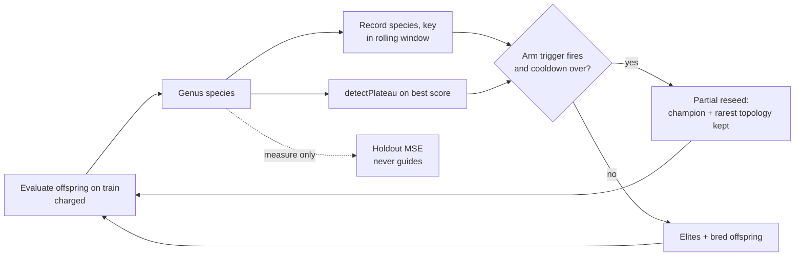

# Experiment: offspring-census restarts against stagnation restarts (Issue #4157)

## Summary

Adds an opt-in research harness, `deno task census-restart-study`, that compares
three arms at an equal charged-record budget: no restart, a conventional
stagnation restart, and a census-triggered partial reseeding. The census hashes
the canonical topology plus quantised weights in a rolling species window. The
harness also records the 30-seed result, which is a **negative finding**: no arm
meets the predeclared benefit criterion, none is harm, and every held-out MSE
CI95 spans zero. No production code changed: nothing under `src/` is touched,
and nothing imports the harness. Closes #4157.

## Spec

### Intent and Rationale

- The issue asks for a controlled comparison, not a feature. The harness follows
  the existing study pattern (`scripts/lib/preSelectionAB.ts`,
  `scripts/pre_selection_ab.ts`): a library, a CLI, a `deno task`, an evidence
  page and a JSON artefact.
- It reuses the real `Mutator`, `Offspring.breed` (through `breedOffspring`),
  `Genus`, `detectPlateau`, `CreatureUtil.getTopologyHash`, `seedPopulation`,
  `median` and the `cliArgs` readers rather than re-implementing them.
- Both restart arms apply the **identical** partial reseed, and only the trigger
  differs. The census-vs-stagnation contrast therefore measures the trigger
  alone.

### Essential Design Decisions

- **Census key**: `getTopologyHash` plus every bias (by neuron uuid) and weight
  (by synapse `(fromUUID, toUUID, type)`), each rounded to step `q`. Identity is
  the pair (Genus species, key) over the last `W` generations. The trigger is
  the Good–Turing unseen estimate (singletons ÷ offspring) dropping below 0.5,
  with a 5-generation cooldown.
- **Stagnation trigger**: the existing `detectPlateau` over the best training
  score (window 5, minimum improvement 0.01). The same signal is measured in
  every arm, so the restart delay can be reported.
- **Reseed**: keep the champion and the creature with the rarest topology, keep
  further top-ranked creatures up to half the population, and fill the rest from
  `seedPopulation`. Kept creatures are never modified.
- Assumption: calibration (seeds 94157–94161) sweeps `q ∈ {0.01, 0.05, 0.2}` ×
  `W ∈ {3, 6}` and picks the lowest median **training** MSE, so the holdout
  never selects a setting. It chose `q=0.2, W=3`. Wall-clock is measured but not
  capped, because a time cap on this shared container would make runs
  non-deterministic. Equal charged records stand in for equal compute.

### Undiscoverable Facts

- arXiv 2610.22211 could not be fetched from this container (the proxy answered
  403). No method detail or number from the paper is used. The manifest records
  the method as this repository's reading of the issue.
- With `q ≤ 0.05` the census never fired on the calibration seeds (collision
  rate 0.07–0.12), so the trigger is sensitive to the quantisation step.
- `Offspring.breed` declines clones, and those declined pairings are never
  recorded by the census. A fully stalled population can therefore leave the
  census silent while the stagnation trigger fires.

## Evidence

This is a script/CLI change; no UI files are touched. The full record is in
`docs/evidence/census-restart-4157.md`. The machine-readable artefact is
`docs/evidence/census-restart-4157.json`: the manifest (code commit 08c5747f,
NEAT-AI 7.1.17, NEAT-AI-core rev, Deno 2.9.8, corpus id and seed, seeds,
settings, criteria, the collision-sensitivity table, the chosen setting and the
calibration cost), per-run results with per-generation traces, coverage (30/30
seeds for every arm, no failures) and the paired comparisons.

Calibration cost 8,400,000 records, reported separately, and set the held-out
target at MSE 0.01478. All 90 validation runs spent exactly 240,000 records. The
diff is the arm's held-out MSE minus the baseline's, so a negative diff is
better:

| Contrast             | Mean diff | CI95                 | Wins  | Diversity | Verdict      |
| -------------------- | --------- | -------------------- | ----- | --------- | ------------ |
| stagnation vs none   | −2.77e-3  | [−7.66e-3, +3.49e-4] | 8/30  | ×1.17     | `no-benefit` |
| census vs none       | −3.06e-3  | [−8.36e-3, +1.03e-3] | 12/30 | ×9.74     | `no-benefit` |
| census vs stagnation | −2.94e-4  | [−4.07e-3, +3.40e-3] | 12/30 | ×8.30     | `no-benefit` |

- The census fired a median 22,400 records **before** the stagnation signal, but
  was not better than the stagnation restart.
- Each arm reached the held-out target on 15 of 30 seeds.
- Mean collision rate was 0.29 for none, 0.25 for stagnation and 0.23 for
  census.
- The census diversity ratio reflects freshly reseeded random creatures with a
  wide output spread. It is not evidence of useful diversity.



To reproduce:

```bash
deno task census-restart-study --code-version=$(git rev-parse HEAD) \
  --json=docs/evidence/census-restart-4157.json
```

No independent reviewers were dispatched, because the issue has no Acceptance
Criteria heading.

## Test Plan

- Added `test/scripts/CensusRestartStudy.ts`, with 15 tests:
  - `censusKey` merges weight differences below half a step and nothing else: a
    different topology or a finer step separates them;
  - `censusKey` leaves the creature unchanged;
  - `CensusWindow` reports exact counts;
  - `CensusWindow` drops entries older than its window and starts at unseen 1;
  - `partialReseed` keeps the champion and the rarest topology, never modifies
    the creatures it keeps, and picks a novel creature that is not the champion;
  - `runArm` is deterministic per seed and restores the caller's generator;
  - no arm exceeds the budget;
  - the none arm never restarts but still measures the stagnation signal;
  - the stagnation arm restarts only after the plateau signal and respects the
    cooldown;
  - the census trigger restarts at a threshold near 1 and never at a tiny one,
    which gives a positive and a negative control;
  - the holdout never guides a run;
  - `pairedComparison` and `verdict` follow the predeclared criteria;
  - `validateSettings` names the offending field;
  - `chooseCensusSetting` picks the lowest median training MSE, with ties going
    to the first setting.
- `scripts/lib/preSelectionAB.ts`: `seedPopulation` and `breedOffspring` are now
  exported, and `seedPopulation`'s parameter is narrowed. There is no behaviour
  change, and its 5 existing tests pass. No existing test was edited.
- The full
  `./quality.sh --rust-scorer-bin=<rust_scorer built from
  NEAT-AI-scorer Develop>`
  ran on head ac6b06da, the same tree as this commit apart from this file. It
  exited 0 with `ok | 10341 passed (5 steps) | 0 failed | 50 ignored (9m2s)`,
  including all 15 new tests and the 5 `PreSelectionAB.ts` tests.
- cspell was not run locally, because it runs only in the `spellcheck.yaml`
  workflow. `reseed`, `reseeded`, `reseeding`, `reseeds` and `Turing` were added
  to `docs/cspell.json`.

## Not done / risks

- The objective is a synthetic two-input regression with small creatures. The
  result says nothing about production-scale creatures or private corpora, and
  no representative production run was made.
- The paper was not read (see above). Offspring probabilities are non-stationary
  and unequal, so the census estimate is a trigger heuristic, not an accurate
  estimate of unseen genomes.
- Neuron uuids are part of the topology hash, so only clone families share a
  topology.
- In converged runs a restart arm may idle for a bounded number of generations
  waiting for a restart, and the none arm stops at its first generation with
  nothing to evaluate. Every validation run nevertheless spent the full budget.
- The harness duplicates the paired-bootstrap and verdict helpers of the
  unmerged #4156 study, because that code is not on this branch.

🤖 Generated with [Claude Code](https://claude.com/claude-code)
