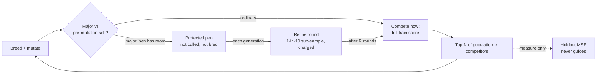

# Experiment: short protected refinement for major topology mutations (Issue #4158)

## Summary

Adds an opt-in research harness, `deno task protected-refinement-study`. It
compares letting major-mutation descendants compete at once with holding them in
a small protected pen for short refinement rounds first. It also runs matched
and ablation controls, all at an equal budget of charged records. It records the
20-seed result, which is a **negative finding**: protected refinement does not
beat immediate competition, and spending the same refinement on ordinary
descendants beats it (`harm` verdict). Nothing under `src/` changed, and nothing
imports the harness. Closes #4158.

## Spec

### Intent and Rationale

- The issue asks for a controlled comparison, not a feature. The harness follows
  the existing study pattern (`scripts/lib/preSelectionAB.ts`,
  `scripts/pre_selection_ab.ts`): a library, a CLI, a `deno task`, an evidence
  page and a JSON artefact.
- It reuses the real `Mutator`, `Offspring.breed` (through the new
  `breedChildren`), `Genus`, `seedPopulation`, `buildCorpus`, `scoreCreature`,
  `meanGeneticDistance`, `median` and the `cliArgs` readers.
- Five arms: `immediate` (control), `protect-refine` (the treatment),
  `protect-only` (no refinement), `refine-only` (no protection) and
  `matched-ordinary` (the same refinement compute spent on ordinary
  descendants).

### Essential Design Decisions

- **Major descendant**: compared with its own pre-mutation snapshot, it has a
  new hidden neuron, a changed `(from, to, type)` synapse set, or a changed
  squash on a surviving neuron. A change to weights or biases alone is ordinary.
- **Pen**: up to 4 major descendants, which are never culled, never bred from
  and never fully scored while penned. In `protect-refine` each gets one
  Gaussian weight-and-bias perturbation round per generation on a 1-in-10 train
  sub-sample, keeping the better. After R rounds a descendant is scored on the
  full train set and must out-rank the population to survive ((μ+λ) truncation),
  which is the full-score rule.
- Assumption: calibration (seeds 94158–94161) picks R ∈ {2, 3, 4} by median
  **training** MSE, so the holdout never selects. It chose R=2. Wall-clock is
  measured but not capped, and equal charged records stand in for equal compute.
- Assumption: refinement is a perturbation hill-climb, not backprop. It is
  application-agnostic and charges records exactly as full scoring does.

### Undiscoverable Facts

- arXiv 2610.35647 could not be fetched from this container
  (`curl: (56) CONNECT tunnel failed, response 403`). No method detail or number
  from it is used, and the manifest records the method as this repository's
  reading of the issue.
- `createNeatConfig` without a `seed` installs a fresh unseeded global generator
  (`src/config/NeatConfig.ts`, `createNeatConfig`). The study therefore passes
  the seed, and temporarily swaps `crypto.randomUUID` for a seeded stream
  (restored in `finally`) so that new neuron uuids are reproducible. The
  existing `preSelectionAB.runArm` calls `createNeatConfig` without a seed, so
  its runs are not reproducible per seed. This PR does not change that.
- `Offspring.breed` declines clones. A converged population can produce no
  offspring, so 6 of the 100 validation runs reached `maxGenerations` (2,000)
  before spending the full budget. They are flagged `stalled` and kept in the
  pairs.

## Evidence

This is a script/CLI change; no UI files are touched. The full record is in
`docs/evidence/protected-refinement-4158.md`. The machine-readable artefact is
`docs/evidence/protected-refinement-4158.json`. It holds the manifest (code
commit 6e9f8619 plus the review change below, NEAT-AI version, Deno version,
corpus seed, seeds, settings, criteria and arms), the calibration table, the
chosen R, the calibration cost, the per-run results, coverage (20/20 for every
arm, no failures) and the paired comparisons. Each run also records how many
major and how many ordinary descendants received refinement rounds
(`refinedMajor`, `refinedOrdinary`). Rerunning the study after adding those two
counters reproduced every earlier number, apart from `wallMs` and the NEAT-AI
version.

Calibration cost 1,362,090 records, reported separately. The diff is the arm's
held-out MSE minus the baseline's, so a negative diff is better:

| Contrast                           | Mean diff | CI95                 | W/L  | Species ratio | Verdict      |
| ---------------------------------- | --------- | -------------------- | ---- | ------------- | ------------ |
| protect-refine vs immediate        | −2.36e-3  | [−2.12e-2, +1.59e-2] | 9/11 | 0.82          | `no-benefit` |
| protect-refine vs matched-ordinary | +1.07e-2  | [+2.11e-3, +2.21e-2] | 9/11 | 0.97          | `harm`       |
| protect-refine vs refine-only      | +8.05e-3  | [−1.66e-3, +1.98e-2] | 8/12 | 0.68          | `no-benefit` |
| protect-refine vs protect-only     | +3.18e-4  | [−9.22e-3, +8.03e-3] | 7/13 | 1.10          | `no-benefit` |

- Useful structural mutations retained: 25.8% of major descendants survived
  their first full-score competition under `protect-refine`, against 35.4% for
  `immediate` and 39.3% for `refine-only`. Protection lowered retention.
- Who was refined, summed over 20 runs per arm: `protect-refine` 603 major and 0
  ordinary; `refine-only` 689 major and 0 ordinary; `matched-ordinary` 0 major
  and 626 ordinary; `immediate` and `protect-only` none.
- Diversity: the median final species count is 1–2 and the median mean genetic
  distance is 0.000 in every arm. The toy population converges to near-clones,
  so diversity cannot separate the arms.



To reproduce:

```bash
deno task protected-refinement-study --code-version=$(git rev-parse --short=8 HEAD) \
  --json=docs/evidence/protected-refinement-4158.json
```

No independent reviewers were dispatched, because the issue has no Acceptance
Criteria heading.

## Test Plan

- Added `test/scripts/ProtectedRefinementStudy.ts`, with 22 tests:
  - `classifyMutation` flags a new hidden neuron, a changed squash and an added
    or removed synapse, and does not flag a change to weights and biases alone;
  - `refineRound` keeps the structure, never worsens the sub-sample score,
    charges records and leaves its input unchanged; it adopts an improving
    perturbation as a new creature whose score equals the returned creature's
    sub-sample score and charges both evaluations; and it returns the original
    when nothing improves it;
  - `runArm` is deterministic per seed and restores the caller's generator;
  - every arm stays within the budget and accounts its phases;
  - each arm spends refinement and pen capacity as designed: `immediate` and
    `protect-only` spend no refinement records, the other three do, and
    `immediate` and `refine-only` never use the pen while `protect-only` does;
  - refinement goes to the descendants each arm names: `refine-only` and
    `protect-refine` refine majors only, `matched-ordinary` refines ordinary
    descendants only and no more than the majors produced, and `immediate` and
    `protect-only` refine none; no arm refines more than `penCapacity`
    descendants per generation;
  - the holdout never guides a run;
  - `pairedComparison` pairs by seed, skipping a seed either arm lacks and
    ignoring order;
  - `runStudy` completes every arm for every planned seed with four paired
    comparisons, chooses the calibration row with the lowest median train MSE,
    sums the calibration cost from the table, is unmoved in calibration and the
    chosen R when the holdout changes, and, when a validation seed throws (a
    seed `createNeatConfig` refuses), lists it in `failures` by arm, seed and
    message, shows coverage below plan and pairs only the surviving seed;
  - `verdict` returns benefit, harm and no-benefit, including a CI benefit with
    a species ratio under 0.8;
  - `validateSettings` accepts the defaults and names the offending field;
  - `chooseRefineRounds` picks the lowest median training MSE, with ties going
    to the first setting.
- `scripts/lib/preSelectionAB.ts`: `seedPopulation` is now exported with a
  narrowed parameter, and the crossover loop is split out as `breedChildren`,
  with the same generator draw order. No existing test was edited, and the 5
  `test/scripts/PreSelectionAB.ts` tests pass.
- `./quality.sh --rust-scorer-bin=<rust_scorer built from NEAT-AI-scorer>` ran
  on head 3f019550 and exited 0 with
  `ok | 10341 passed (5 steps) | 0 failed | 50 ignored (10m27s)`. That run
  predates the review change; it covered the first 15 tests only. After the
  review change, `deno fmt --check`, `deno lint`, `deno check` and
  `deno test -A test/scripts/ProtectedRefinementStudy.ts test/scripts/PreSelectionAB.ts`
  were run on the changed files and passed; the full gate was not rerun.
- Checked that the new test catches a regression: swapping `!c.major` for
  `c.major` in the `matched-ordinary` branch fails the refinement-allocation
  test.

## Not done / risks

- The objective is a synthetic two-input regression with small creatures. The
  result says nothing about production-scale creatures or private corpora, and
  no representative production run was made.
- The paper was not read (see above).
- Six stalled runs spent less than the full budget, so their arms had less
  compute. The page lists them by arm.
- The fixed pen capacity of 4 and the sub-sample stride of 10 were not
  calibrated; only R was.
