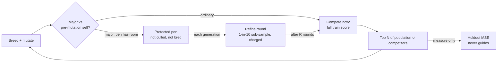

# Experiment: short protected refinement for major topology mutations (Issue #4158)

## Summary

Adds an opt-in research harness, `deno task protected-refinement-study`. It
compares letting major-mutation descendants compete at once with holding them in
a small protected pen for short refinement rounds first. It also runs matched
and ablation controls, all at an equal budget of charged records. It records the
20-seed result, which is a **negative finding**: protected refinement does not
beat immediate competition, and it does no better or worse than spending the
same refinement records on ordinary descendants (`no-benefit` on every
contrast). The matched-compute contrast covers the 16 seeds where the control
spent the treatment's allocation; four uncompletable seeds are listed and
excluded, with an all-seeds sensitivity row. Nothing under `src/` changed, and
nothing imports the harness. Closes #4158.

## Spec

### Intent and Rationale

- The issue asks for a controlled comparison, not a feature. The harness follows
  the existing study pattern (`scripts/lib/preSelectionAB.ts`,
  `scripts/pre_selection_ab.ts`): a library, a CLI, a `deno task`, an evidence
  page and a JSON artefact.
- It reuses the real `Mutator`, `Offspring.breed` (through the new
  `breedChildren`), `Genus`, `seedPopulation`, `buildCorpus`, `scoreCreature`,
  `meanGeneticDistance`, `median` and the `cliArgs` readers.
- Five arms: `immediate` (control), `protect-refine` (the treatment),
  `protect-only` (no refinement), `refine-only` (no protection) and
  `matched-ordinary` (the same refinement records, reserved from the same seed's
  `protect-refine` run, spent on ordinary descendants).

### Essential Design Decisions

- **Major descendant**: compared with its own pre-mutation snapshot, it has a
  new hidden neuron, a changed `(from, to, type)` synapse set, or a changed
  squash on a surviving neuron. A change to weights or biases alone is ordinary.
- **Pen**: up to 4 major descendants, which are never culled, never bred from
  and never fully scored while penned. In `protect-refine` each gets one
  Gaussian weight-and-bias perturbation round per generation on a 1-in-10 train
  sub-sample, keeping the better. After R rounds a descendant is scored on the
  full train set and must out-rank the population to survive ((μ+λ) truncation),
  which is the full-score rule.
- Assumption: calibration (seeds 94158–94161) picks R ∈ {2, 3, 4} by median
  **training** MSE, so the holdout never selects. It chose R=2. Wall-clock is
  measured but not capped, and equal charged records stand in for equal compute.
- **Matched control**: `matched-ordinary` is handed the seed's `protect-refine`
  `refinementSchedule` (refinement records per generation, with the evaluation
  records already charged at that point). It sets the unspent quota aside out of
  the shared 120,000-record budget, so its full evaluations cannot take it, and
  it pays the quota out against evaluation progress rather than generation
  number: it may spend what the treatment had spent when the treatment's
  evaluation reached the control's current count, and the whole remainder in the
  last generation that can still be scored. Unspent records carry forward, so
  the allocation is the treatment's whatever the control's mutation counts, pen
  occupancy or ordinary supply. Both arms then stop on the budget with the same
  evaluation records. A pair is **matched** when the control's shortfall is
  under one first refinement round (60 records: a descendant's first round also
  scores the descendant). Otherwise it is **uncompletable**: the unspent quota
  is reported per run (`refinementQuota`, `refinementShortfall`) and per seed
  (`matchedAllocation`, with `fullyMatched`), only matched seeds feed the
  matched-compute contrast, and a seed whose `protect-refine` run failed leaves
  the control as a listed failure rather than running unmatched. Two earlier
  versions did not hold the spend equal. The first sized the control from its
  own generation's major count (seed 4159: 3,060 records against 2,370; seed
  4164: 2,610 against 1,980). The second replayed the schedule by generation but
  let its full evaluations spend the budget first, so it fell short on 17 seeds
  and the arms ended with different evaluation counts (seed 4175: 1,530
  refinement and 118,200 evaluation records against 2,790 and 117,000).
- Assumption: refinement is a perturbation hill-climb, not backprop. It is
  application-agnostic and charges records exactly as full scoring does.

### Undiscoverable Facts

- arXiv 2610.35647 could not be fetched from this container
  (`curl: (56) CONNECT tunnel failed, response 403`). No method detail or number
  from it is used, and the manifest records the method as this repository's
  reading of the issue.
- `createNeatConfig` without a `seed` installs a fresh unseeded global generator
  (`src/config/NeatConfig.ts`, `createNeatConfig`). The study therefore passes
  the seed, and temporarily swaps `crypto.randomUUID` for a seeded stream
  (restored in `finally`) so that new neuron uuids are reproducible. The
  existing `preSelectionAB.runArm` calls `createNeatConfig` without a seed, so
  its runs are not reproducible per seed. This PR does not change that.
- `Offspring.breed` declines clones. A converged population can produce no
  offspring, so 9 of the 100 validation runs reached `maxGenerations` (2,000)
  before spending the full budget (`protect-refine` 1, `protect-only` 2,
  `refine-only` 1, `matched-ordinary` 5). They are flagged `stalled` and kept in
  the pairs.

## Evidence

This is a script/CLI change; no UI files are touched. The full record is in
`docs/evidence/protected-refinement-4158.md`. The machine-readable artefact is
`docs/evidence/protected-refinement-4158.json`. It holds the manifest (code
commit a2e62c0f plus the review change below, NEAT-AI version, Deno version,
corpus seed, seeds, settings, criteria and arms), the calibration table, the
chosen R, the calibration cost, the per-run results, coverage (20/20 for every
arm, no failures), the paired comparisons and the per-seed matched allocation.
Each run also records how many major and how many ordinary descendants received
refinement rounds (`refinedMajor`, `refinedOrdinary`) and its refinement
schedule (`refinementSchedule`). The review change altered only
`matched-ordinary`: every other arm, the calibration and the chosen R reproduced
their earlier numbers, apart from `wallMs` and the NEAT-AI version.

Calibration cost 1,362,090 records, reported separately. The diff is the arm's
held-out MSE minus the baseline's, so a negative diff is better:

| Contrast                                           | n  | Mean diff | CI95                 | W/L  | Species ratio | Verdict      |
| -------------------------------------------------- | -- | --------- | -------------------- | ---- | ------------- | ------------ |
| protect-refine vs immediate                        | 20 | −2.36e-3  | [−2.12e-2, +1.59e-2] | 9/11 | 0.82          | `no-benefit` |
| protect-refine vs matched-ordinary (matched seeds) | 16 | −3.86e-4  | [−1.75e-2, +1.58e-2] | 7/9  | 0.82          | `no-benefit` |
| protect-refine vs matched-ordinary (all seeds)     | 20 | +5.11e-4  | [−1.36e-2, +1.35e-2] | 9/11 | 1.00          | `no-benefit` |
| protect-refine vs refine-only                      | 20 | +8.05e-3  | [−1.66e-3, +1.98e-2] | 8/12 | 0.68          | `no-benefit` |
| protect-refine vs protect-only                     | 20 | +3.18e-4  | [−9.22e-3, +8.03e-3] | 7/13 | 1.10          | `no-benefit` |

- Useful structural mutations retained: 25.8% of major descendants survived
  their first full-score competition under `protect-refine`, against 35.4% for
  `immediate` and 39.3% for `refine-only`. Protection lowered retention.
- Who was refined, summed over 20 runs per arm: `protect-refine` 603 major and 0
  ordinary; `refine-only` 689 major and 0 ordinary; `matched-ordinary` 0 major
  and 609 ordinary; `immediate` and `protect-only` none.
- Matched allocation: 16 seeds are matched (three spent the quota exactly and
  thirteen were one 30-record sub-sample evaluation short, which cannot pay for
  a first round). On them `matched-ordinary` spent 42,420 of 42,810 refinement
  records (99.1%), and for 14 of the 16 both arms charged identical evaluation
  records (seed 4171's treatment and seed 4172's control stalled). Four seeds
  are uncompletable (4161, 4165, 4173, 4176): the control's population converged
  to clones, stalled at `maxGenerations` with no offspring left to refine, and
  spent 7,770 of those seeds' 11,220 records. They are in the JSON with
  `fullyMatched: false` and excluded from the matched contrast, and the
  all-seeds row shows they do not change the verdict. Overall the control spent
  50,190 of 54,030 records (92.9%). The contrast is at 99.1% of the matched
  spend, not an exact match.
- Diversity: the median final species count is 1–2 and the median mean genetic
  distance is 0.000 in every arm. The toy population converges to near-clones,
  so diversity cannot separate the arms.



To reproduce:

```bash
deno task protected-refinement-study --code-version=$(git rev-parse --short=8 HEAD) \
  --json=docs/evidence/protected-refinement-4158.json
```

No independent reviewers were dispatched, because the issue has no Acceptance
Criteria heading.

## Test Plan

- Added `test/scripts/ProtectedRefinementStudy.ts`, with 32 tests:
  - `classifyMutation` flags a new hidden neuron, a changed squash and an added
    or removed synapse, and does not flag a change to weights and biases alone;
  - `refineRound` keeps the structure, never worsens the sub-sample score,
    charges records and leaves its input unchanged; it adopts an improving
    perturbation as a new creature whose score equals the returned creature's
    sub-sample score and charges both evaluations; and it returns the original
    when nothing improves it;
  - `runArm` is deterministic per seed and restores the caller's generator;
  - every arm stays within the budget and accounts its phases;
  - each arm spends refinement and pen capacity as designed: `immediate` and
    `protect-only` spend no refinement records, the other three do, and
    `immediate` and `refine-only` never use the pen while `protect-only` does;
  - refinement goes to the descendants each arm names: `refine-only` and
    `protect-refine` refine majors only, `matched-ordinary` refines ordinary
    descendants only and no more than the majors produced, and `immediate` and
    `protect-only` refine none; no other arm refines more than `penCapacity`
    descendants per generation;
  - `matched-ordinary` spends the refinement records the same seed's
    `protect-refine` run spent, on four seeds where the pen is occupied and the
    two arms draw different numbers of major mutations: spend plus the reported
    shortfall equals the quota, the shortfall is under one first round, at least
    one pair spends exactly the same records, and both arms charge identical
    evaluation records; the quota is out of reach of full evaluations (a quota
    due only at the very end is still reserved, so evaluations never use its
    records); given a hand-written schedule it spends exactly that quota once
    evaluation reaches the scheduled point, whatever mutations it draws, and
    never refines a major descendant; a stalled control reports its shortfall as
    quota minus spend; `matchedAllocations` marks a seed matched only when the
    shortfall is under one first round; and it is refused without a schedule;
  - the holdout never guides a run;
  - `pairedComparison` pairs by seed, skipping a seed either arm lacks and
    ignoring order; it reports the arm's and the baseline's retained fraction
    separately (1 of 4 against 3 of 6 majors) and reports both as null when no
    paired run competed a major;
  - `runStudy` completes every arm for every planned seed with five paired
    comparisons (the matched one over the matched seeds only), chooses the
    calibration row with the lowest median train MSE, sums the calibration cost
    from the table, is unmoved in calibration and the chosen R when the holdout
    changes, validates with the calibrated depth rather than a supplied default
    outside the calibration grid (every validation result equals a direct
    `runArm` at the chosen depth, excluding wall-clock time), and, when a
    validation seed throws (a seed `createNeatConfig` refuses), lists it in
    `failures` by arm, seed and the exact message `createNeatConfig` throws (for
    `matched-ordinary`, that its `protect-refine` schedule is missing), shows
    coverage below plan and pairs only the surviving seed; with no calibration
    seeds it reports no chosen depth, no results or comparisons, zero coverage
    and one failure naming the missing finite calibration MSE;
  - `verdict` returns benefit, harm and no-benefit, including a CI benefit with
    a species ratio under 0.8;
  - `validateSettings` accepts the defaults and names the offending field;
  - `chooseRefineRounds` picks the lowest median training MSE, with ties going
    to the first setting.
- `scripts/lib/preSelectionAB.ts`: `seedPopulation` and `breedOffspring` are
  exported on the base already; the crossover loop is split out of
  `breedOffspring` as the exported `breedChildren`, with the same generator draw
  order. No existing test was edited, and the 5 `test/scripts/PreSelectionAB.ts`
  tests pass.
- `./quality.sh --rust-scorer-bin=<rust_scorer built from NEAT-AI-scorer>` ran
  on head 3f019550 and exited 0 with
  `ok | 10341 passed (5 steps) | 0 failed | 50 ignored (10m27s)`. That run
  predates the review changes; it covered the first 15 tests only. After the
  latest review change, `deno fmt --check`, `deno lint`, `deno check` and
  `deno test -A test/scripts/ProtectedRefinementStudy.ts test/scripts/PreSelectionAB.ts`
  were run and passed (37 tests); the full gate was not rerun.
- Checked that the new tests catch a regression: swapping `!c.major` for
  `c.major` in the `matched-ordinary` branch fails the matched-allocation,
  schedule-replay, stalled-shortfall and refinement-allocation tests, and
  removing the quota reservation fails the test that evaluations never use the
  reserved records.

## Not done / risks

- The objective is a synthetic two-input regression with small creatures. The
  result says nothing about production-scale creatures or private corpora, and
  no representative production run was made.
- The paper was not read (see above).
- Nine stalled runs spent less than the full budget, so their arms had less
  compute (`matched-ordinary` 5, `protect-only` 2, `protect-refine` 1,
  `refine-only` 1). The page lists them by arm. Four of the five stalled
  controls leave their seeds uncompletable (4161, 4165, 4173, 4176): they are
  listed and excluded from the matched contrast, and the all-seeds row shows the
  verdict does not depend on them.
- The matched contrast is at 99.1% of the treatment's refinement records, not an
  exact match: thirteen of the 16 matched seeds are one 30-record sub-sample
  evaluation short, which cannot pay for another first round. The arms charge
  identical evaluation records on 14 of those 16 seeds.
- The fixed pen capacity of 4 and the sub-sample stride of 10 were not
  calibrated; only R was.
