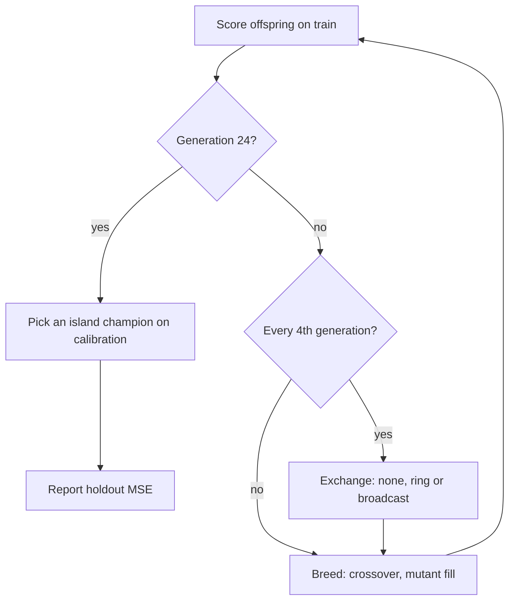

## Summary

Adds an opt-in, controlled study comparing three island-exchange policies under
an identical evaluation budget: no exchange, a six-island neighbour-only ring
that sends topology-diverse Pareto members, and the existing global champion
broadcast (the control). It includes the reproducible command
`deno task island-exchange-study`, the 20-seed machine-readable results and an
evidence page.

**The result is negative.** Under the pre-declared rules neither the ring nor no
exchange can be called better than the broadcast on paired held-out MSE: both
are **no benefit**. The ring keeps islands far more diverse (final inter-island
distance 0.42 against 0.004; collapse rate 0.10 against 0.95) at 0.89 of the
broadcast's bytes, and its mean held-out error is lower (1.10e-2 against
1.30e-2), but its 95% interval spans zero and it wins 11 of 20 seeds. Nothing
under `src/` changes and no default changes. Closes #4159.

## Spec

### Intent and Rationale

- The issue asks for a controlled comparison, not a feature. NEAT-AI has no
  in-process island model, and the existing exchange is the fleet pushing its
  fittest creature to a shared repository for others to pull. The harness
  therefore models islands in a script, in the same way as the sibling studies
  (`scripts/lib/preSelectionAB.ts`, Issue #3932).
- It reuses the real creatures, crossover (`Offspring.breed`, via
  `breedOffspring`), `Mutator` and `geneticCompatibility`, plus
  `preSelectionAB`'s corpus and scoring. `seedPopulation` and `breedOffspring`
  were exported for this rather than copied.
- Transport is the creature JSON export/import round-trip (the wire format the
  fleet's file exchange moves), measured in bytes. The transport format itself
  is #3910's scope (still open) and is not changed.

### Essential Design Decisions

- **Communication budget calibration.** The broadcast sends champions × (islands
  − 1) = 5 transfers per round. `ringAllocation` gives the ring exactly the same
  5 per round by rotating the one empty edge, so every edge sends 5 over a
  six-round cycle. A migrant the receiver already holds is not sent in either
  arm, and only applied transfers are counted.
- **Equal evaluation budget.** Each island scores exactly
  `islandPopulation − elitism` new offspring per generation, and migrants keep
  their train score. When crossover refuses a pair (clone pairs on a collapsed
  island), the slot is filled with a mutation-only copy, counted as
  `mutationFills`. Every arm charges exactly 350,100 records per seed.
- **Fills are real mutants.** A fill copies a parent and mutates it at rate 1,
  redrawing until its content uuid differs from the parent's and from every
  content uuid its island has already scored or is about to score
  (`makeMutantFill`); it throws rather than hand back a clone. An earlier run
  used the 0.5 mutation rate, so about half the fills were exact copies of a
  parent, scored again for nothing. That run called both comparisons `worse`;
  with real mutants both are `no-benefit`, so the earlier verdict is superseded.
  `fillRedraws` in the artefact counts the redraws (2.3, 0.85 and 1.8 per seed
  for `none`, `ring` and `broadcast`).
- **Re-scored evaluations are measured, not assumed.** At the scoring site each
  run counts train evaluations whose content uuid the island had already scored
  (`rescoredEvaluations`) and, separately, those that were fills
  (`rescoredFills`). The fill figure is 0 in all 60 runs, and the starting
  islands hold no duplicates. The rest is crossover children equal to content
  the island already held: 119.2, 80.8 and 96.7 of 1,164 train evaluations per
  seed (10.2%, 6.9% and 8.3%) for `none`, `ring` and `broadcast`. Crossover is
  not redrawn, so the arms are charged the same records but not given exactly
  the same new information; the evidence page says so.
- **Three disjoint splits.** Train drives selection and migrant ranking.
  Calibration picks which island champion is reported. Holdout is only reported:
  it is never charged and never read by a decision. The pre-declared rules
  (`PREDECLARED`, `comparisonVerdict`) are a 95% paired-bootstrap interval below
  zero, a collapse rate no higher than the control's, and at most 1.25× the
  control's bytes for `better`. A test reruns an arm and seed against materially
  different holdout targets and asserts that every decision-driven output is
  identical while only the holdout error moves.
- **Kept rather than removed.** The harness is the reproducible command the
  issue asks for and has no production caller. Nothing optional was added under
  `src/`, so there is no product code to remove after the negative result.

### Undiscoverable Facts

- The cited paper (arXiv 2610.35373) could not be fetched in this run (WebFetch
  returned `proxy refused the connection`), so the design follows the issue
  text.
- Neuron UUIDs come from `crypto.randomUUID`, and `createNeatConfig` installs an
  unseeded global generator unless it is given `rng`. Both made same-seed runs
  differ. The harness seeds both (`withSeededUuids`, and `rng` passed to
  `createNeatConfig`). `preSelectionAB.runArm` has the same `createNeatConfig`
  gap; this change leaves that harness's behaviour untouched.
- Wall-clock figures (per evaluation-hour, transport ms) were taken on a shared,
  parallel host and are indicative only. The records-based figures are the
  deterministic ones.

## Evidence

Backend and CLI research harness only; no UI. Full write-up:
`docs/evidence/island-exchange-4159.md`. Artefact:
`docs/evidence/island-exchange-4159.json`. NEAT-AI 7.1.18. The artefact records
`commit` `7eabf57c` with `dirty: false` and `sourceSha256`
`ebb9cf08cbea8456877560496d6a5cbe285e923ad82c8ff940ede9b002e5e3a5`: the 20 seeds
were run from a clean `scripts/` and `src/`, so that commit reproduces the
artefact apart from the wall-clock fields. The command refuses a dirty
`scripts/` or `src/` unless `--allow-dirty` is passed, and records `dirty` and
`sourceSha256` either way. 20 seeds (4159–4178), 6 islands × 10 creatures, 24
generations, exchange every 4 generations (five rounds, at generations 4 to 20),
coverage 60/60 runs, 0 failures.

| Arm         | Held-out MSE | Inter-island distance | Collapse rate | Transfers | Bytes  | Records |
| ----------- | ------------ | --------------------- | ------------- | --------- | ------ | ------- |
| `none`      | 1.198e-2     | 0.907                 | 0.00          | 0         | 0      | 350,100 |
| `ring`      | 1.104e-2     | 0.418                 | 0.10          | 25        | 28,537 | 350,100 |
| `broadcast` | 1.301e-2     | 0.004                 | 0.95          | 24.75     | 32,120 | 350,100 |

- `ring` vs `broadcast`: **no benefit**. Mean paired difference −1.97e-3, 95% CI
  [−5.42e-3, 1.16e-4], ring wins 11/20 seeds, bytes ratio 0.888.
- `none` vs `broadcast`: **no benefit**. Mean −1.04e-3, 95% CI [−4.81e-3,
  1.33e-3], wins 9/20.
- Reproducibility: the final code was run twice. The results were identical
  apart from wall-clock fields, and the test
  `island study — one arm and seed reproduce exactly` pins it.

Issue numbers cited: #4159 (Experiment: Compare neighbour-only island exchange
with global champion broadcast); #3910 (Island exchange ships 5.7 MB creatures
where a patch (or a seed) would do — ES-style transport); #3932 (the
pre-selection harness, already cited in its own module).

## Test Plan

- Added `test/scripts/IslandExchangeStudy.ts` (19 tests):
  - split sizes, disjointness and determinism
  - ring allocation, which spends exactly the budget, is fair over a cycle and
    refuses bad input
  - settings validation names the offending field, with a positive control on
    the defaults
  - the Pareto front drops dominated and unscored creatures
  - migrants exclude what the receiver already holds, and the result is empty
    when everything is a duplicate
  - the ring's diverse pick, on fixtures where the answers differ: a
    lower-scoring but topologically further front member is picked first, the
    front is taken before a dominated member that is further away, the remainder
    follows in score order, and a second pick is chosen for distance from the
    first pick
  - transport copies faithfully and never touches the source
  - each exchange arm moves what it promises
  - every arm charges exactly the same records, and changing the holdout targets
    leaves the reported island, calibration error, records, transfers, bytes and
    per-generation traces unchanged for `ring` and `broadcast`
  - a fill is always a new creature, a mutator that cannot change the parent is
    refused, and a start of clone-only islands is refilled with mutants while
    charging the same records; the run-level test also asserts that no fill is
    scored twice (`rescoredFills` is 0 for every arm), that the duplicated start
    is counted (a positive control), and that a distinct start re-scores no
    fill. Reverting the fill rule to copy-and-mutate at 0.5 makes it fail
  - the paired bootstrap
  - every verdict rule, including a `better` interval refused for bytes and for
    collapse
  - a small study completes every planned run
  - same-seed reproduction
  - `withSeededUuids` restores `crypto.randomUUID`, including when `fn` throws
- Edited `scripts/lib/preSelectionAB.ts`: `export` added to `seedPopulation` and
  `breedOffspring` only. No existing test was edited or removed.
  `test/scripts/PreSelectionAB.ts` still passes.
- `deno test --allow-all test/scripts/IslandExchangeStudy.ts test/scripts/PreSelectionAB.ts`
  passed (24 passed, 0 failed).
- All non-helper files in `test/docs/` passed (318 passed, 0 failed).
- `deno fmt`, `deno lint` and `deno check` on `scripts/` and `test/scripts/`
  passed on the final code. The full `./quality.sh` was not re-run on this head:
  it needs a built `rust_scorer` binary and a dependency update that this host
  does not run unattended. The earlier full run (head `99a5f6d5`, 10,339 passed)
  predates the mutant-fill change.
- Not checked: macOS and Windows; discovery tests ran in skip mode (no Discovery
  library on this host). No representative production run was made, so the
  finding covers tiny creatures on a smooth synthetic target only.
