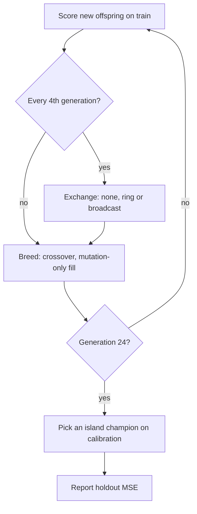

## Summary

Adds an opt-in, controlled study comparing three island-exchange policies under
an identical evaluation budget: no exchange, a six-island neighbour-only ring
that sends topology-diverse Pareto members, and the existing global champion
broadcast (the control). It includes the reproducible command
`deno task island-exchange-study`, the 20-seed machine-readable results and an
evidence page.

**The result is negative.** Under the pre-declared rules both the ring and no
exchange are **worse** than the broadcast on paired held-out MSE. The ring keeps
islands far more diverse (final inter-island distance 0.44 against 0.002;
collapse rate 0.10 against 1.00) at about the same transport cost (bytes ratio
0.92), but its held-out deficit is small and its interval only just clears zero.
Nothing under `src/` changes and no default changes. Closes #4159.

## Spec

### Intent and Rationale

- The issue asks for a controlled comparison, not a feature. NEAT-AI has no
  in-process island model, and the existing exchange is the fleet pushing its
  fittest creature to a shared repository for others to pull. The harness
  therefore models islands in a script, in the same way as the sibling studies
  (`scripts/lib/preSelectionAB.ts`, Issue #3932).
- It reuses the real creatures, crossover (`Offspring.breed`, via
  `breedOffspring`), `Mutator` and `geneticCompatibility`, plus
  `preSelectionAB`'s corpus and scoring. `seedPopulation` and `breedOffspring`
  were exported for this rather than copied.
- Transport is the creature JSON export/import round-trip (the wire format the
  fleet's file exchange moves), measured in bytes. The transport format itself
  is #3910's scope (still open) and is not changed.

### Essential Design Decisions

- **Communication budget calibration.** The broadcast sends champions × (islands
  − 1) = 5 transfers per round. `ringAllocation` gives the ring exactly the same
  5 per round by rotating the one empty edge, so every edge sends 5 over a
  six-round cycle. A migrant the receiver already holds is not sent in either
  arm, and only applied transfers are counted.
- **Equal evaluation budget.** Each island scores exactly
  `islandPopulation − elitism` new offspring per generation, and migrants keep
  their train score. When crossover refuses a pair (clone pairs on a collapsed
  island), the slot is filled with a mutation-only copy, counted as
  `mutationFills`. Every arm charges exactly 350,100 records per seed.
- **Three disjoint splits.** Train drives selection and migrant ranking.
  Calibration picks which island champion is reported. Holdout is only reported:
  it is never charged and never read by a decision. The pre-declared rules
  (`PREDECLARED`, `comparisonVerdict`) are a 95% paired-bootstrap interval below
  zero, a collapse rate no higher than the control's, and at most 1.25× the
  control's bytes for `better`.
- **Kept rather than removed.** The harness is the reproducible command the
  issue asks for and has no production caller. Nothing optional was added under
  `src/`, so there is no product code to remove after the negative result.

### Undiscoverable Facts

- The cited paper (arXiv 2610.35373) could not be fetched in this run (WebFetch
  returned `proxy refused the connection`), so the design follows the issue
  text.
- Neuron UUIDs come from `crypto.randomUUID`, and `createNeatConfig` installs an
  unseeded global generator unless it is given `rng`. Both made same-seed runs
  differ. The harness seeds both (`withSeededUuids`, and `rng` passed to
  `createNeatConfig`). `preSelectionAB.runArm` has the same `createNeatConfig`
  gap; this change leaves that harness's behaviour untouched.
- Wall-clock figures (per evaluation-hour, transport ms) were taken on a shared,
  parallel host and are indicative only. The records-based figures are the
  deterministic ones.

## Evidence

Backend and CLI research harness only; no UI. Full write-up:
`docs/evidence/island-exchange-4159.md`. Artefact:
`docs/evidence/island-exchange-4159.json`. Code commit `80ce8ff2`, NEAT-AI
7.1.17, 20 seeds (4159–4178), 6 islands × 10 creatures, 24 generations, exchange
every 4 generations, coverage 60/60 runs, 0 failures.

| Arm         | Held-out MSE | Inter-island distance | Collapse rate | Transfers | Bytes  | Records |
| ----------- | ------------ | --------------------- | ------------- | --------- | ------ | ------- |
| `none`      | 1.678e-2     | 0.950                 | 0.00          | 0         | 0      | 350,100 |
| `ring`      | 1.205e-2     | 0.443                 | 0.10          | 25        | 29,491 | 350,100 |
| `broadcast` | 1.115e-2     | 0.002                 | 1.00          | 25        | 32,201 | 350,100 |

- `ring` vs `broadcast`: **worse**. Mean paired difference +8.96e-4, 95% CI
  [4.22e-5, 1.82e-3], ring wins 8/20 seeds.
- `none` vs `broadcast`: **worse**. Mean +5.63e-3, 95% CI [1.61e-3, 1.26e-2],
  wins 3/20.
- Reproducibility: the study was run twice at the same code. The results were
  identical apart from wall-clock fields, and the test
  `island study — one arm and seed reproduce exactly` pins it.

Issue numbers cited: #4159 (Experiment: Compare neighbour-only island exchange
with global champion broadcast); #3910 (Island exchange ships 5.7 MB creatures
where a patch (or a seed) would do — ES-style transport); #3932 (the
pre-selection harness, already cited in its own module).

## Test Plan

- Added `test/scripts/IslandExchangeStudy.ts` (13 tests):
  - split sizes, disjointness and determinism
  - ring allocation, which spends exactly the budget, is fair over a cycle and
    refuses bad input
  - settings validation names the offending field, with a positive control on
    the defaults
  - the Pareto front drops dominated and unscored creatures
  - migrants exclude what the receiver already holds, and the result is empty
    when everything is a duplicate
  - transport copies faithfully and never touches the source
  - each exchange arm moves what it promises
  - every arm charges exactly the same records, and holdout is read only after
    the last decision
  - the paired bootstrap
  - every verdict rule, including a `better` interval refused for bytes and for
    collapse
  - a small study completes every planned run
  - same-seed reproduction
  - `withSeededUuids` restores `crypto.randomUUID`, including when `fn` throws
- Edited `scripts/lib/preSelectionAB.ts`: `export` added to `seedPopulation` and
  `breedOffspring` only. No existing test was edited or removed.
  `test/scripts/PreSelectionAB.ts` still passes.
- `deno test --allow-all test/scripts/IslandExchangeStudy.ts test/scripts/PreSelectionAB.ts`
  passed (18 passed, 0 failed).
- All non-helper files in `test/docs/` passed (318 passed, 0 failed).
- `./quality.sh --rust-scorer-bin=<built rust_scorer>` ran on head `99a5f6d5`
  and passed: exit 0, 10,339 passed, 0 failed, 50 ignored. The `rust_scorer`
  binary was built from a temporary NEAT-AI-scorer clone, which was then
  deleted.
- Not checked: macOS and Windows; discovery tests ran in skip mode (no Discovery
  library on this host). No representative production run was made, so the
  finding covers tiny creatures on a smooth synthetic target only.
